# SegreteriaAmbulatorio

_La segreteria del tuo centro medico, sempre disponibile._

**Manifest:** valid (schema + runtime contract) · **Functional test:** passed (22 checks passed)

## Description given to the app builder (Italian)

Ci serve SegreteriaAmbulatorio, un assistente che risponde ai pazienti di un centro medico al posto della segreteria. L'admin del centro carica medici, specialità, orari e prestazioni con durata e prezzo. Il paziente scrive o parla in chat sul sito: l'agente risponde su prestazioni, preparazione agli esami e orari, propone gli slot liberi e prenota la visita, che finisce nell'agenda del centro. Il giorno prima il paziente riceve un'email di promemoria con il link per disdire. Le richieste cliniche o urgenti non vengono gestite dall'agente: passano a un operatore umano che risponde dalla sua coda. Dati sanitari trattati con consenso esplicito. Ogni centro vede solo i propri pazienti. Abbonamento mensile per centro più costo per prenotazione.

## Functional test: what did not pass

- **saved record shown where its collection is read** (view my_appointments): a record was saved in appointments (by user) but the page does not show it (as user) _(warning)_

## Features not expressible today (spec.extensions)

- **per_booking_fee**: Costo per prenotazione a carico del centro (oltre all'abbonamento mensile): oggi i crediti si addebitano all'utente dell'evento (il paziente), non al centro; serve un addebito per evento sul proprietario dell'app.
- **voice_input**: Il paziente che parla (voce/telefono) richiede un canale phone o speech-to-text, non disponibile in questa versione: per ora solo chat scritta.
- **free_slots_for_agent**: L'agente non può leggere gli appuntamenti degli altri pazienti: gli slot realmente liberi sono garantiti dalla pagina di prenotazione /v/book; nella chat l'agente propone gli orari del medico e rimanda a /v/book per la conferma.
- **one_tenant_per_center**: Ogni centro è un'app/tenant distinta: l'isolamento dei pazienti tra centri deriva dal deploy separato; all'interno del centro i dati dei pazienti sono visibili solo a staff e admin.

## Screenshots (interpretive runtime, no data)

### home-anon
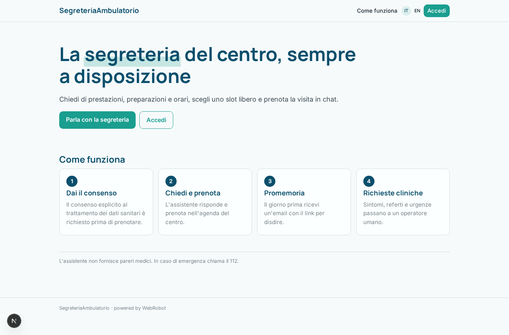

### home-mobile
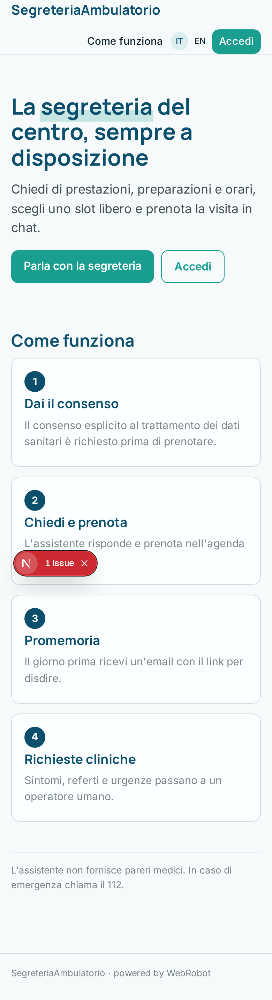

### home
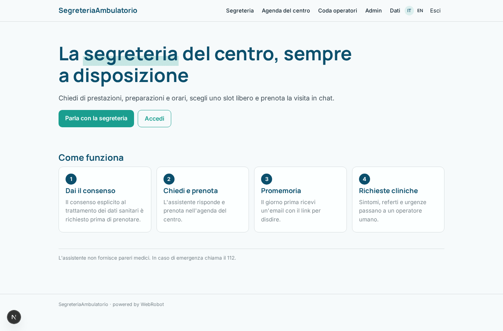

### assistant
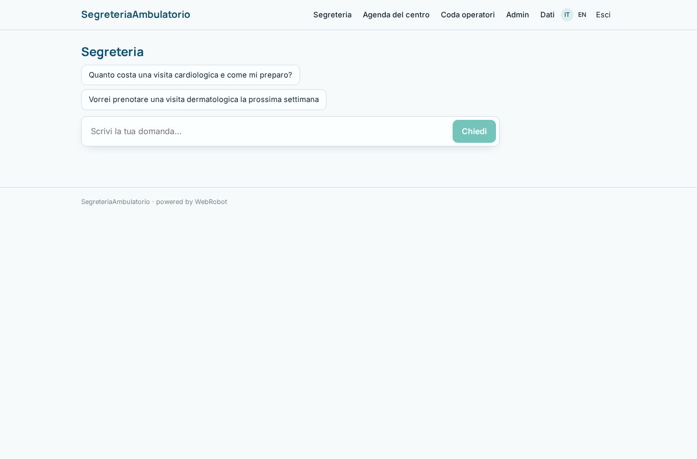

### consent
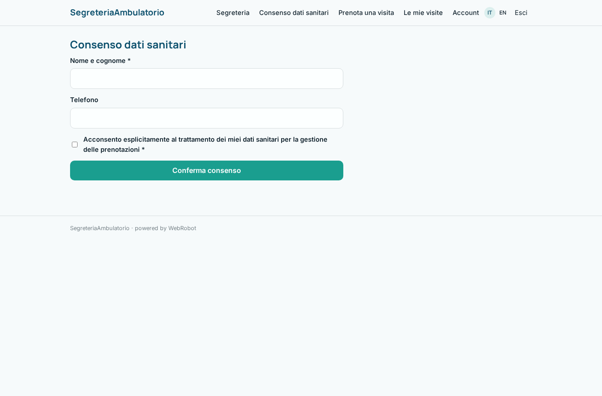

### book
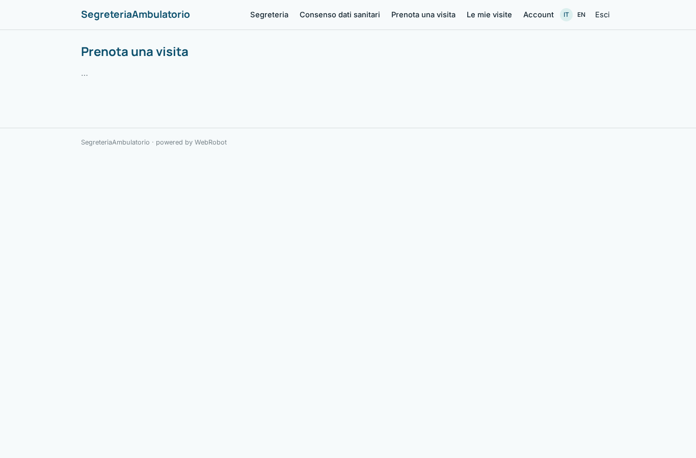

### my_appointments
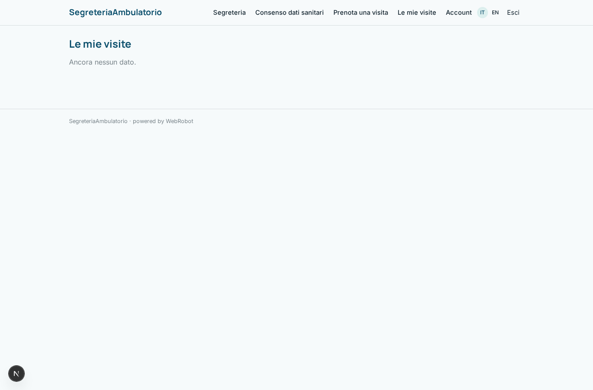

### manage
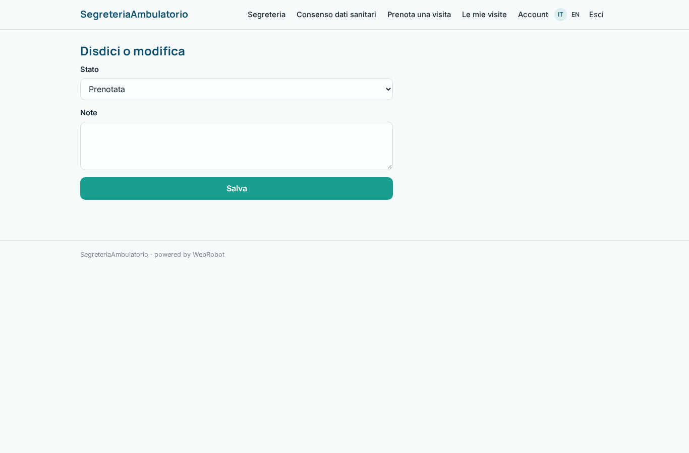

### agenda
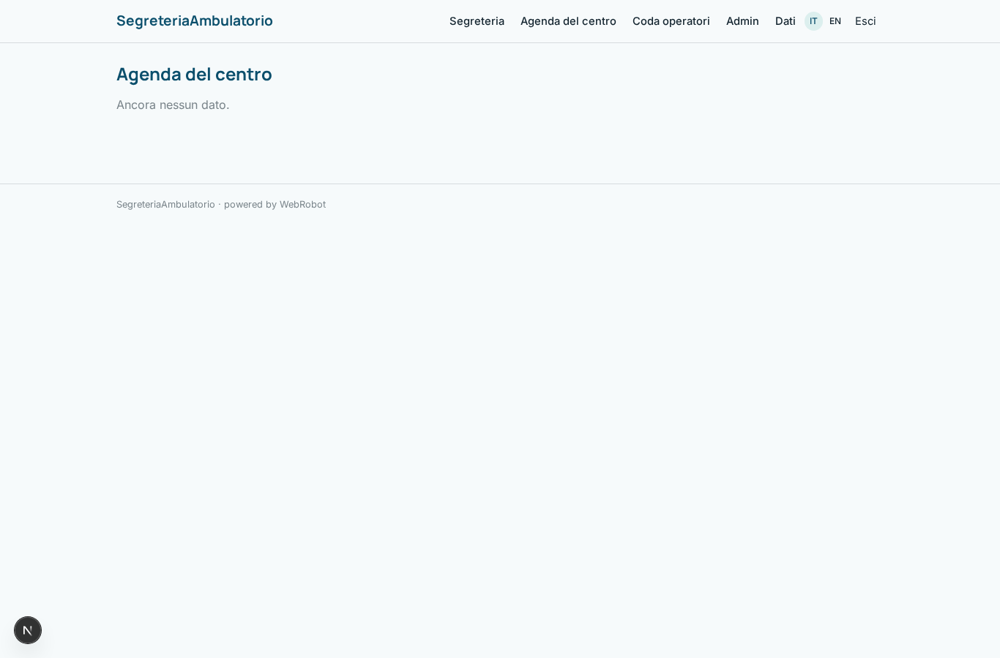

### queue
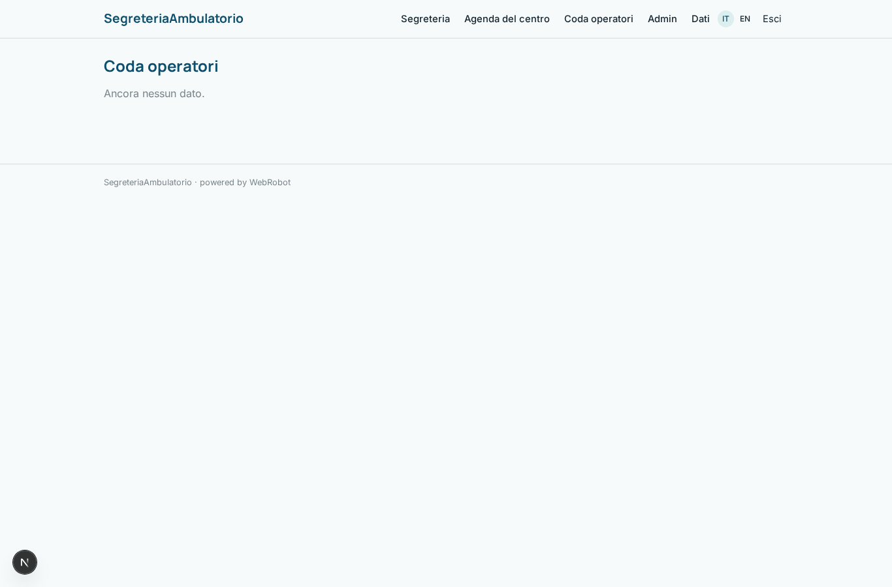

### reply
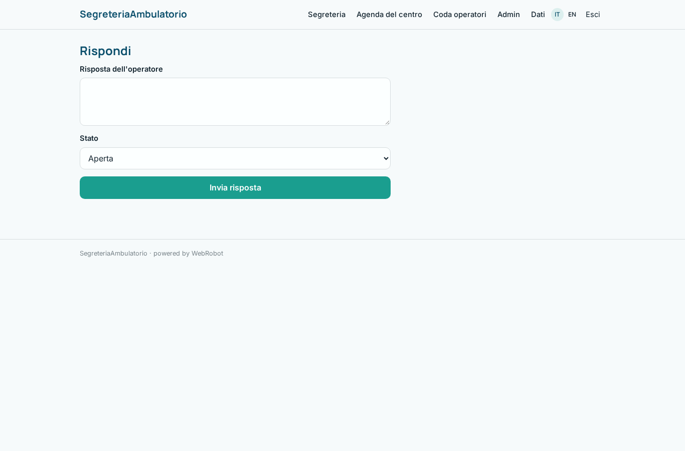

### admin
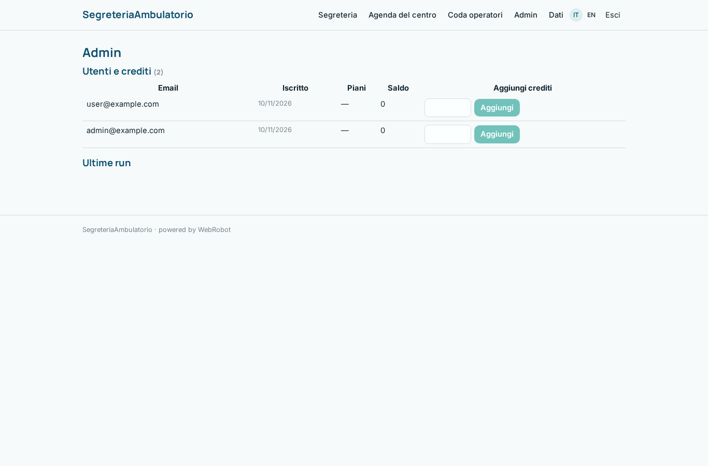

### account
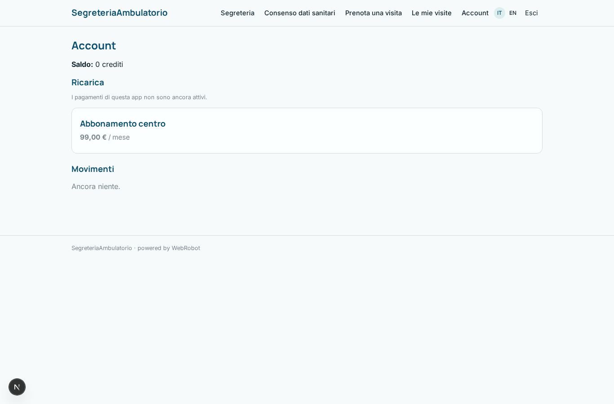
