# SelezioneChat

_Selezione del personale in chat, dal link al colloquio fissato._

**Manifest:** valid (schema + runtime contract) · **Functional test:** passed (15 checks passed)

## Description given to the app builder (Italian)

SelezioneChat automatizza la selezione del personale via WhatsApp per aziende che assumono molto, come retail, logistica e ristorazione. Il recruiter crea una posizione aperta con requisiti, sede, turni, stipendio e domande di screening. I candidati arrivano da un link o un QR code e parlano con un agente su WhatsApp: l'agente presenta l'offerta, fa le domande di screening, raccoglie disponibilità e chiede il CV come foto o documento. Ogni candidato viene salvato in un archivio con le sue risposte e un punteggio di aderenza ai requisiti. Quando un candidato supera la soglia, l'agente propone automaticamente gli slot liberi del calendario del responsabile e fissa il colloquio, mandando promemoria il giorno prima. Il recruiter vede una pipeline per posizione con stato di ogni candidato e può intervenire nella conversazione. I candidati scartati ricevono un messaggio di cortesia. I dati dei candidati li vede solo l'azienda titolare e vengono cancellati dopo dodici mesi. Abbonamento mensile per posizioni attive. Italiano, inglese, rumeno e spagnolo.

## Features not expressible today (spec.extensions)

- **whatsapp_channel**: WhatsApp is not available yet: candidates chat on the web (link or QR, magic-link sign-in). WhatsApp conversations, CV by WhatsApp and WhatsApp reminders need that channel; reminders go by email for now.
- **manager_calendar_sync**: Syncing the manager's Google/Microsoft calendar needs OAuth, not available yet. Interviewers (managers) are entered by the app admins on the data page; free slots come from the in-app booking view.
- **recruiter_takeover**: Recruiters read the candidate's record and CV summary in the pipeline; live takeover inside the conversation is not available yet.
- **per_position_kanban**: The pipeline is a table with a status column, filterable per position; a drag-and-drop board is not available.

## Screenshots (interpretive runtime, no data)

### home-anon
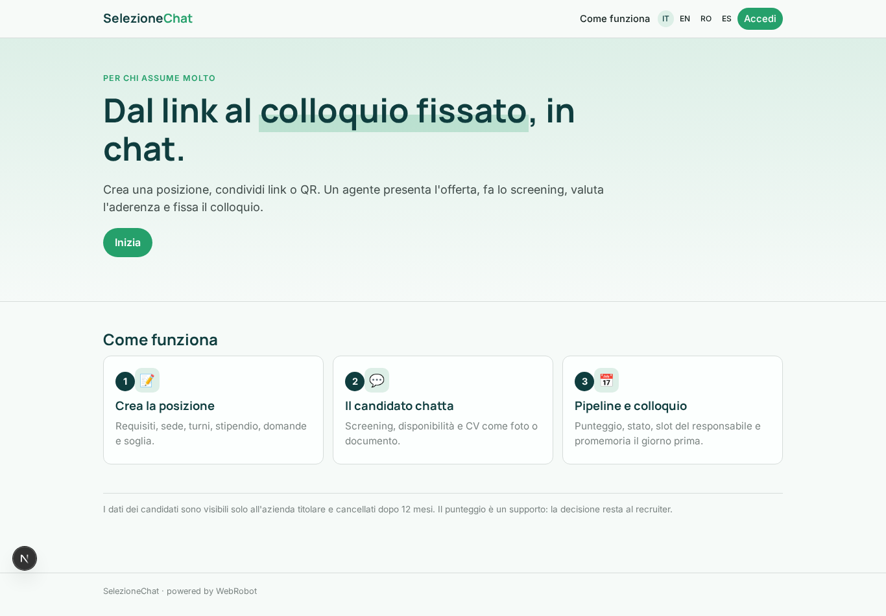

### home-mobile
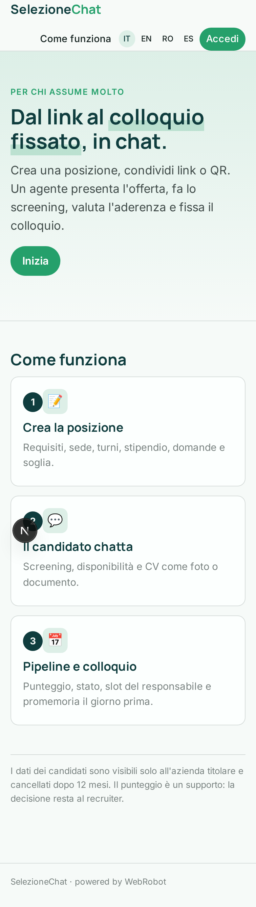

### home
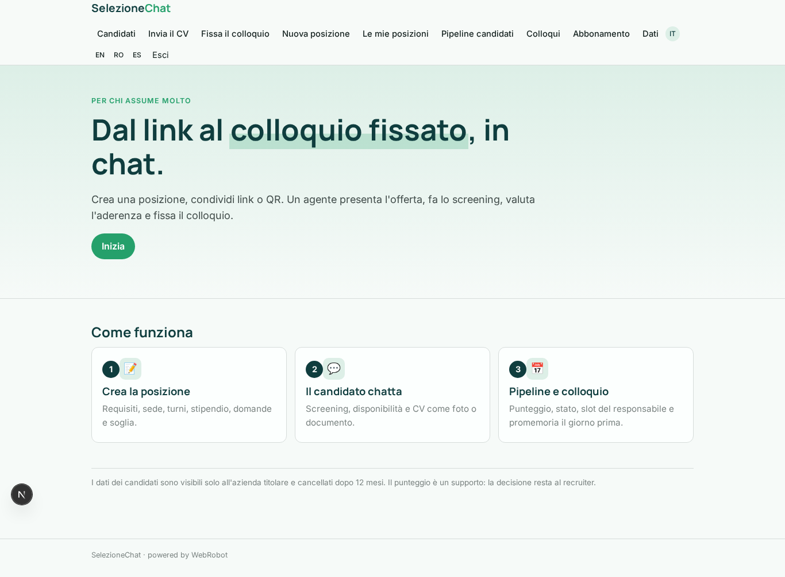

### chat
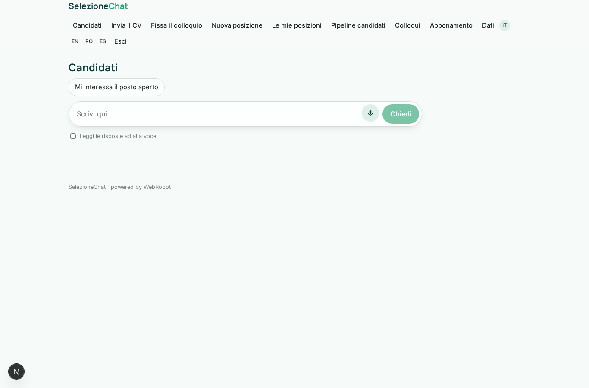

### send_cv
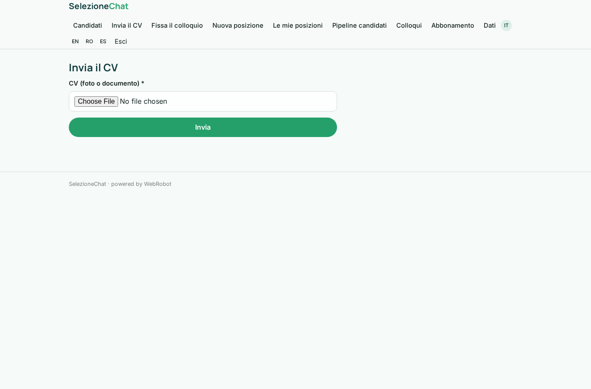

### book
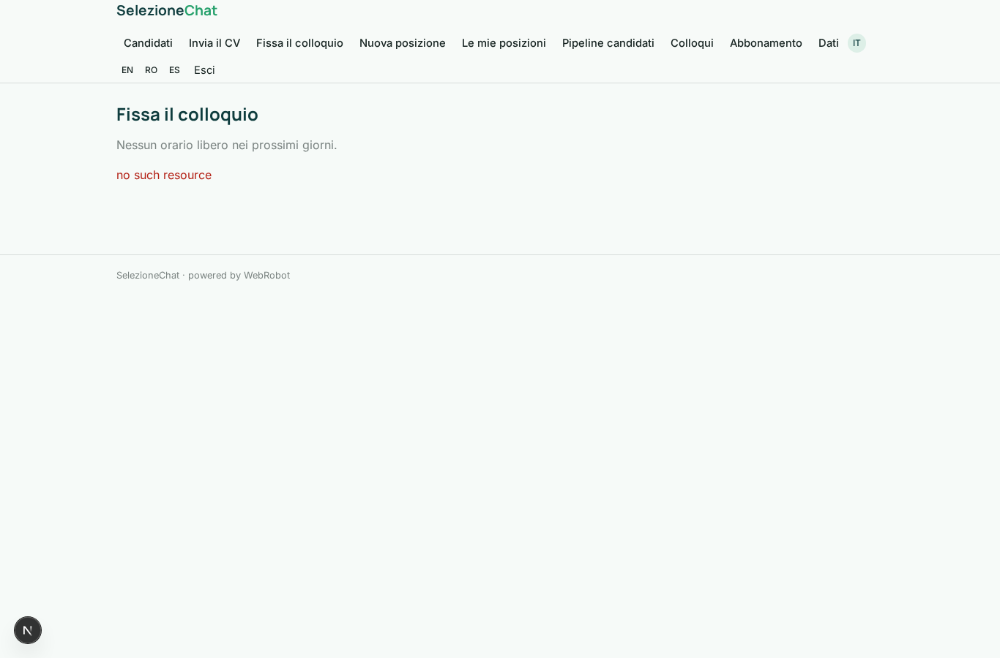

### new_position
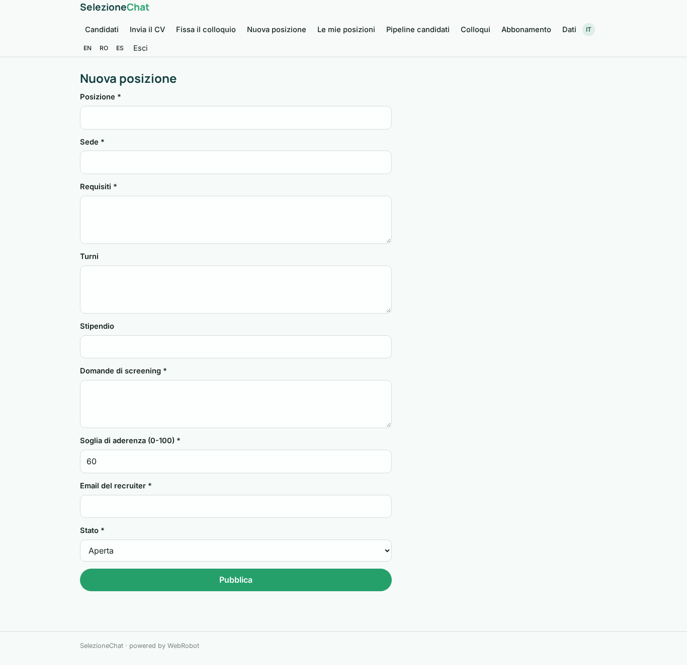

### positions
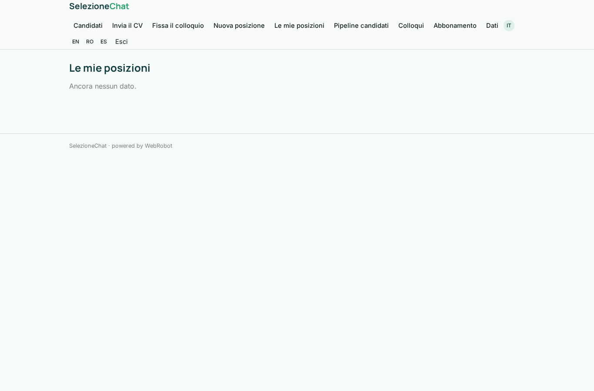

### pipeline
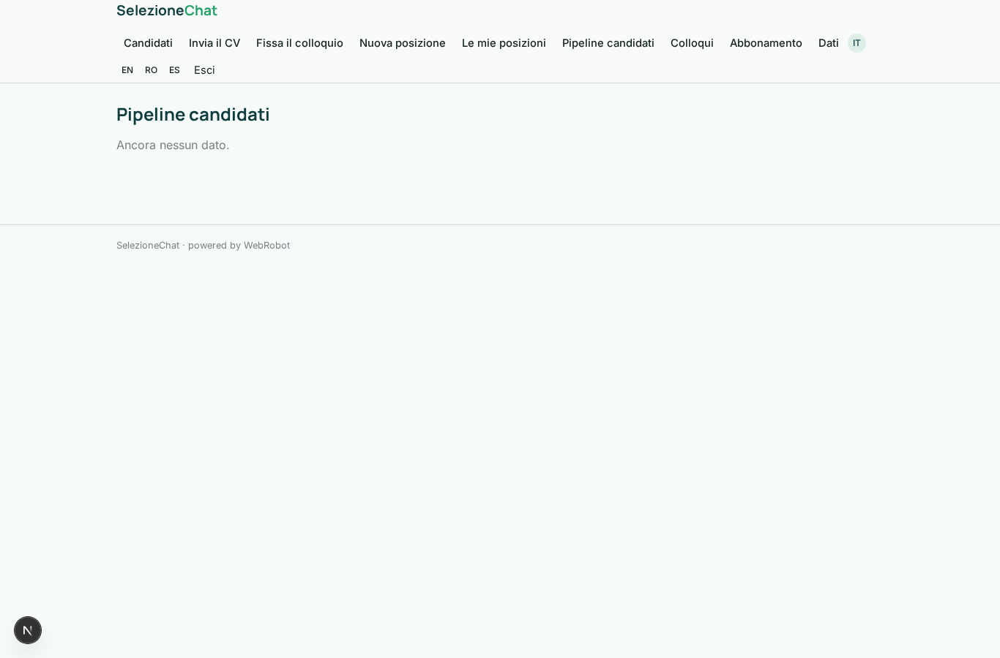

### interviews_list
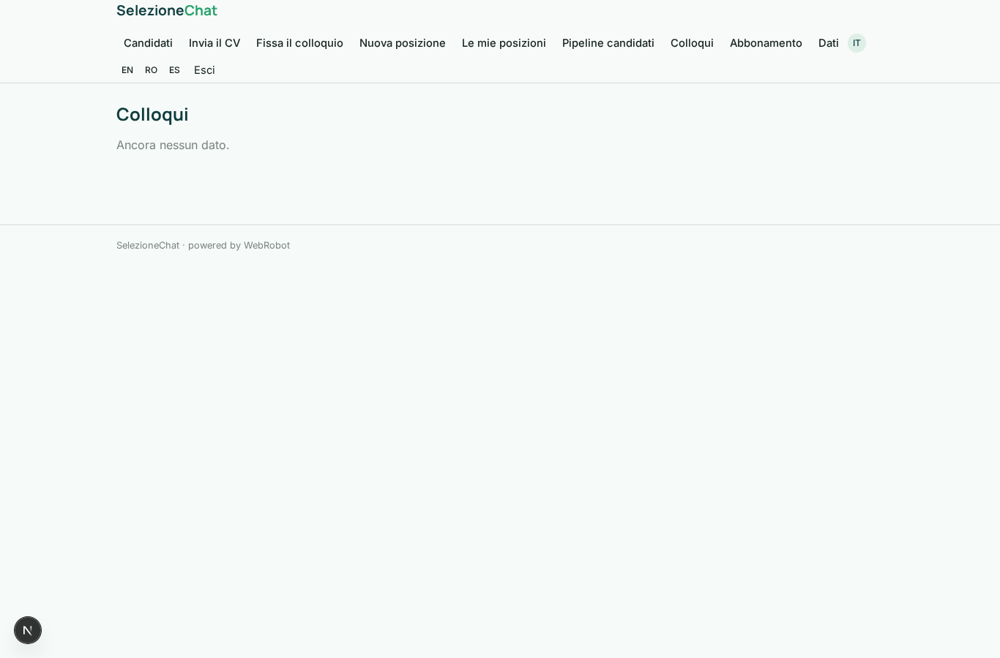

### account
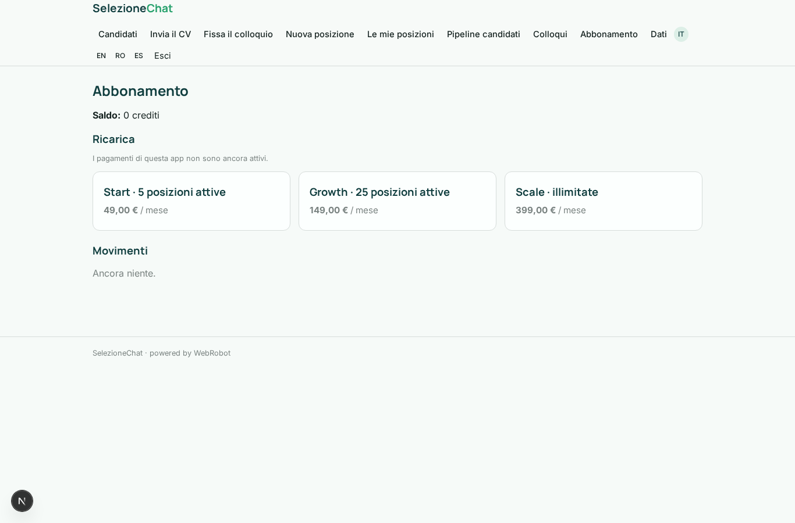
