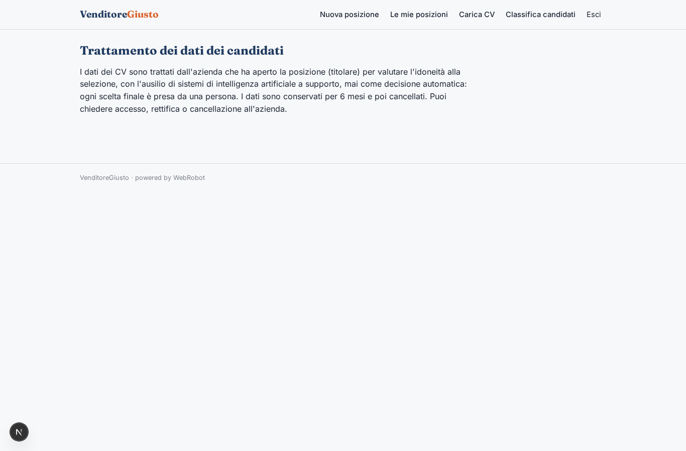
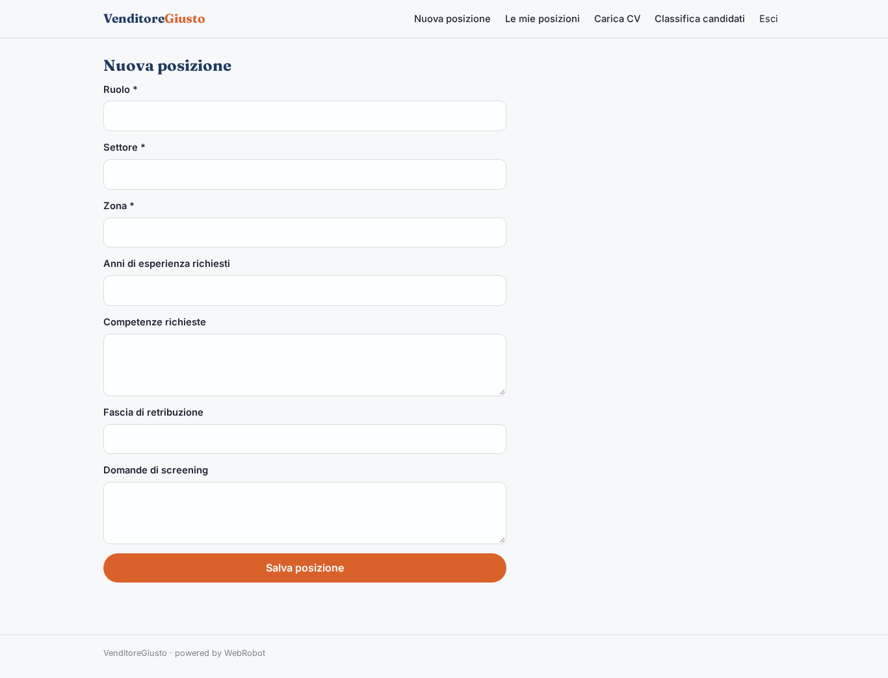
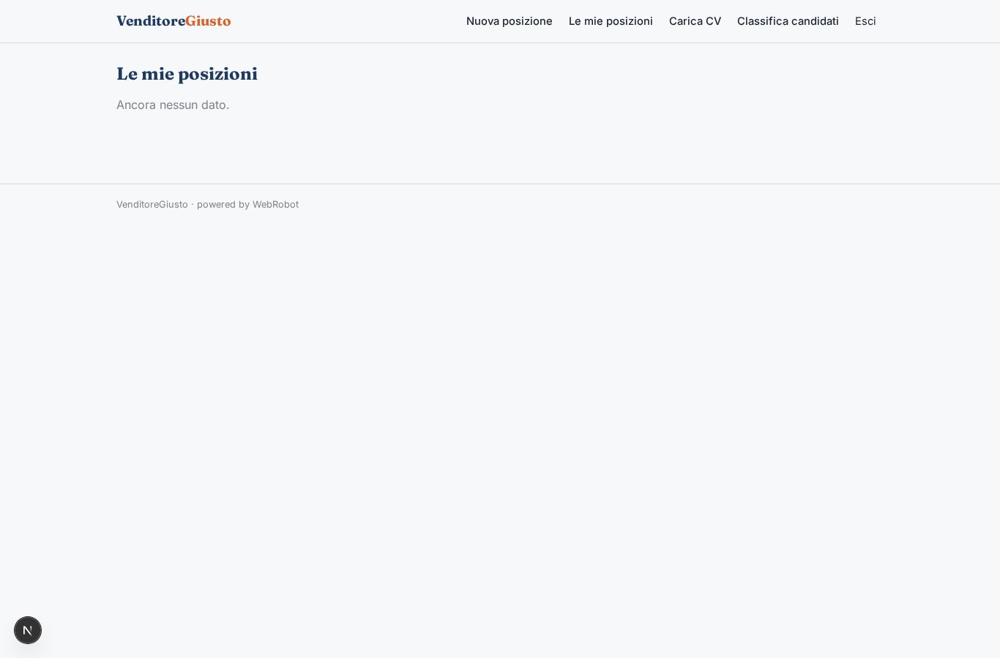
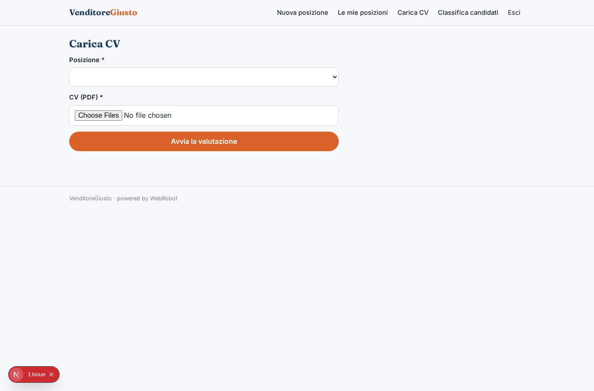
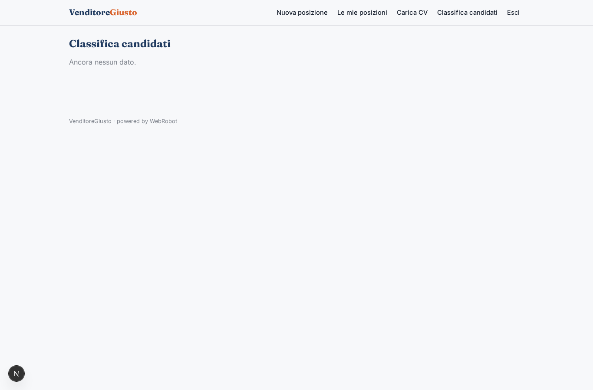
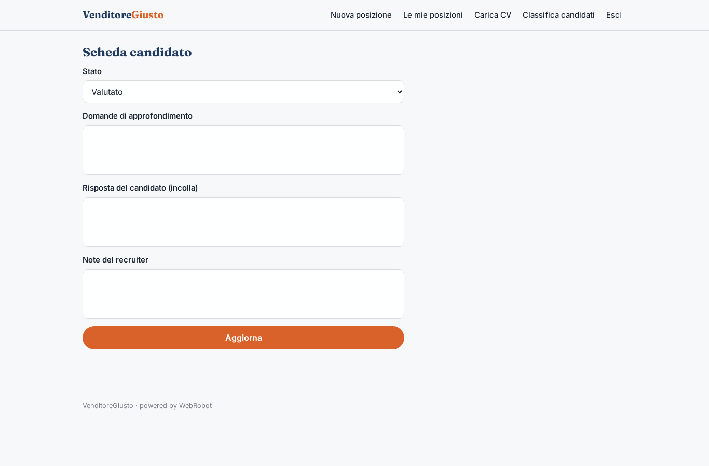
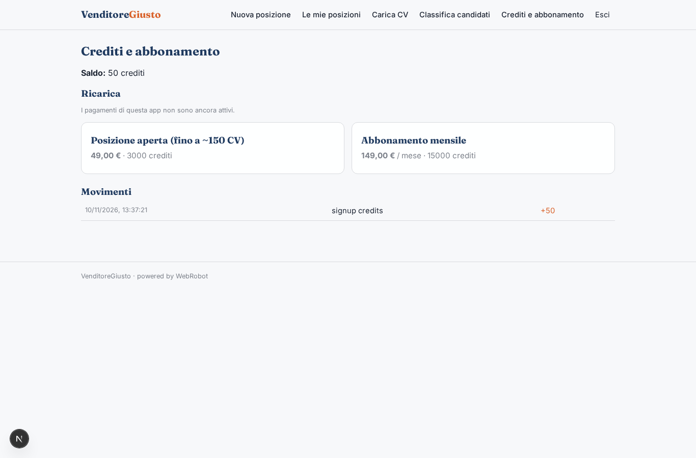

# VenditoreGiusto

_Trova il commerciale giusto, con punteggi motivati e decisione sempre tua._

**Manifest:** valid (schema + runtime contract) · **Functional test:** passed (15 checks passed)

## Description given to the app builder (Italian)

Mi serve VenditoreGiusto per le aziende che assumono commerciali. Il recruiter crea una posizione con ruolo, settore, zona, esperienza richiesta, competenze, fascia di retribuzione e domande di screening. I candidati arrivano in due modi: si candidano da una pagina pubblica caricando il CV in PDF e rispondendo alle domande, oppure il recruiter carica in blocco i CV che ha già ricevuto. Un team di agenti legge ogni CV, estrae esperienze e risultati di vendita, assegna un punteggio di aderenza motivato, poi scrive ai candidati migliori un'email con domande di approfondimento e legge le risposte, aggiornando il punteggio. Il recruiter vede una classifica con il riassunto di ogni candidato e decide chi invitare al colloquio; l'app non scarta mai nessuno in automatico senza conferma umana e informa i candidati sul trattamento dei dati. I dati sono cancellati dopo sei mesi. Ogni azienda vede solo i suoi candidati. Pagamento a posizione aperta oppure abbonamento mensile. Italiano.

## Functional test: what did not pass

- **trigger has its effect** (trigger privacy_notice): email to record.email: no such recipient in the test (role nobody holds or empty field) _(warning)_

## Features not expressible today (spec.extensions)

- **public_apply_page**: Pagina pubblica di candidatura (CV PDF + domande di screening) che salva il candidato direttamente nei dati dell'azienda che ha aperto la posizione: oggi un visitatore anonimo può scrivere solo in una casella dell'owner dell'app, non nei dati di una singola azienda. Per ora i CV ricevuti si caricano in blocco dal recruiter.
- **inbound_email_replies**: Lettura automatica delle risposte email dei candidati: per ora il recruiter incolla la risposta nella scheda candidato e l'agente aggiorna il punteggio.

## Screenshots (interpretive runtime, no data)

### home-anon

### home-mobile

### home

### privacy

### new_position

### positions_list

### upload_cv

### ranking

### candidate

### account

