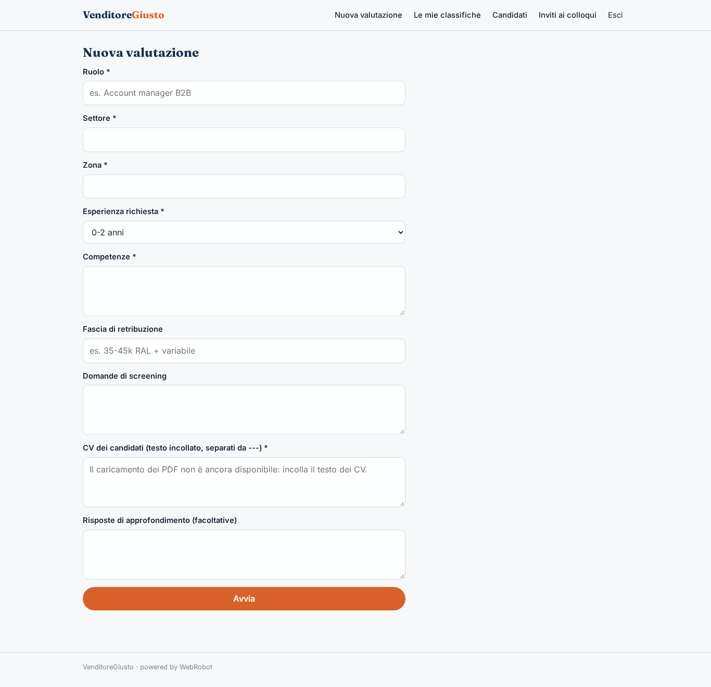
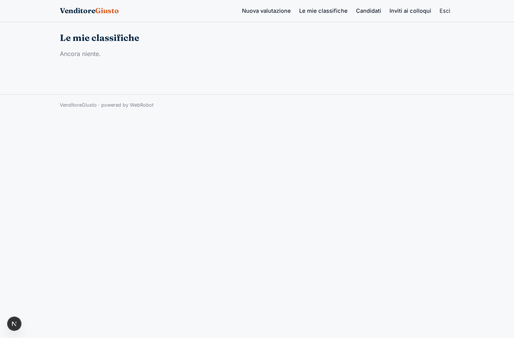
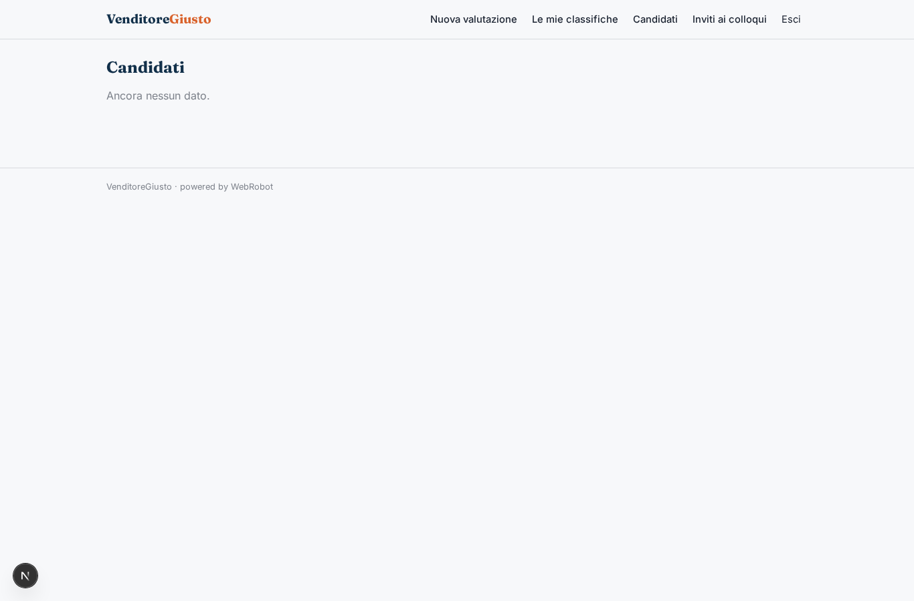
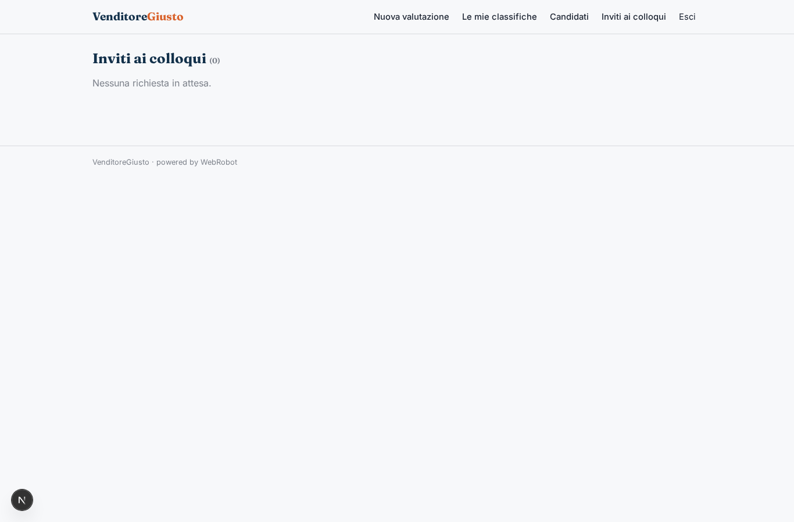
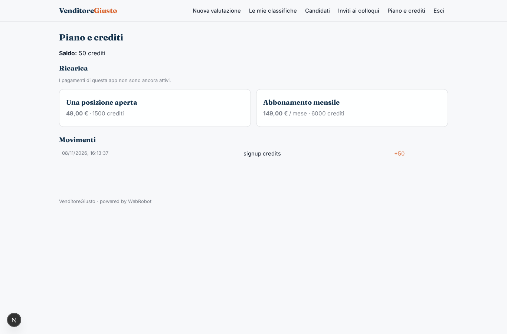

# VenditoreGiusto

_Trova il commerciale giusto, con punteggi motivati e decisione sempre tua._

**Stato manifest:** valido (validatore Python + contratto runtime)

## Descrizione data all'app builder

Mi serve VenditoreGiusto per le aziende che assumono commerciali. Il recruiter crea una posizione con ruolo, settore, zona, esperienza richiesta, competenze, fascia di retribuzione e domande di screening. I candidati arrivano in due modi: si candidano da una pagina pubblica caricando il CV in PDF e rispondendo alle domande, oppure il recruiter carica in blocco i CV che ha già ricevuto. Un team di agenti legge ogni CV, estrae esperienze e risultati di vendita, assegna un punteggio di aderenza motivato, poi scrive ai candidati migliori un'email con domande di approfondimento e legge le risposte, aggiornando il punteggio. Il recruiter vede una classifica con il riassunto di ogni candidato e decide chi invitare al colloquio; l'app non scarta mai nessuno in automatico senza conferma umana e informa i candidati sul trattamento dei dati. I dati sono cancellati dopo sei mesi. Ogni azienda vede solo i suoi candidati. Pagamento a posizione aperta oppure abbonamento mensile. Italiano.

## Funzioni non esprimibili oggi (spec.extensions)

- **public_application**: Pagina pubblica di candidatura con caricamento del CV in PDF e risposte allo screening: non disponibile (niente file, e i visitatori anonimi non possono scrivere nei dati di un'azienda). Per ora il recruiter incolla il testo dei CV.
- **candidate_emails**: Invio automatico delle email di approfondimento e lettura delle risposte: non disponibile. L'agente prepara la bozza con le domande; il recruiter la invia e incolla le risposte per aggiornare il punteggio.
- **retention_6_months**: Cancellazione automatica dei dati dei candidati dopo sei mesi: da configurare come regola di conservazione sulla collezione candidates.
- **position_entity**: Le posizioni sono parametri della valutazione; una collezione dedicata con candidature per posizione è un'evoluzione successiva.

## Screenshot (runtime interpretativo)

### home-anon

### home-mobile

### home

### new

### runs

### cands

### invites

### account

