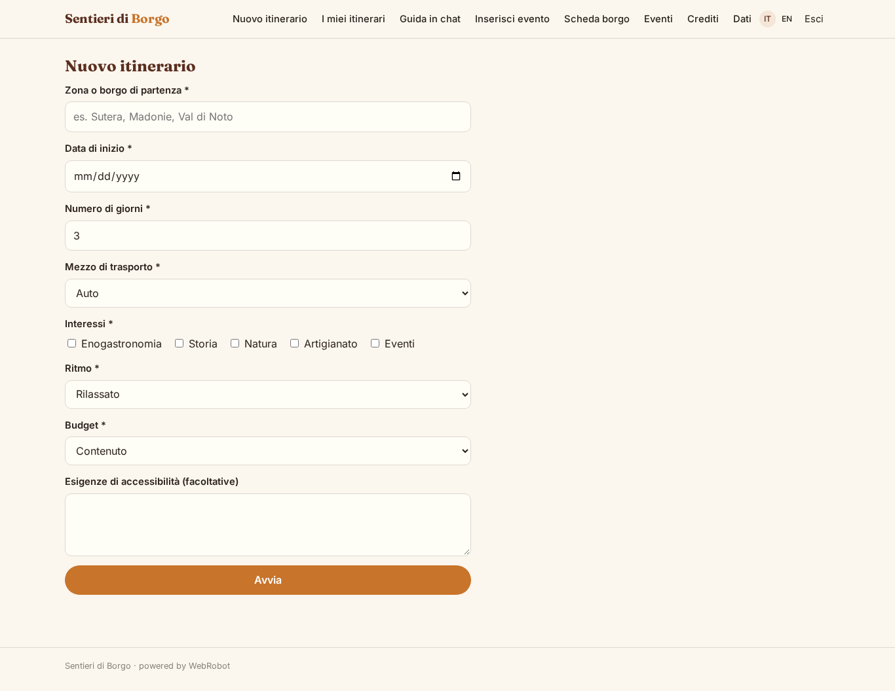
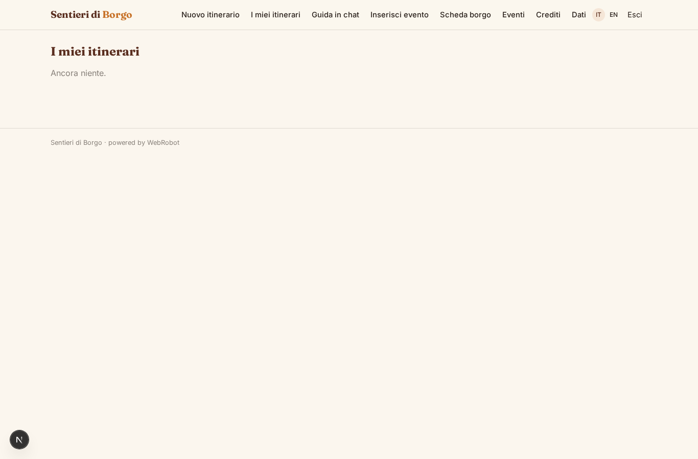
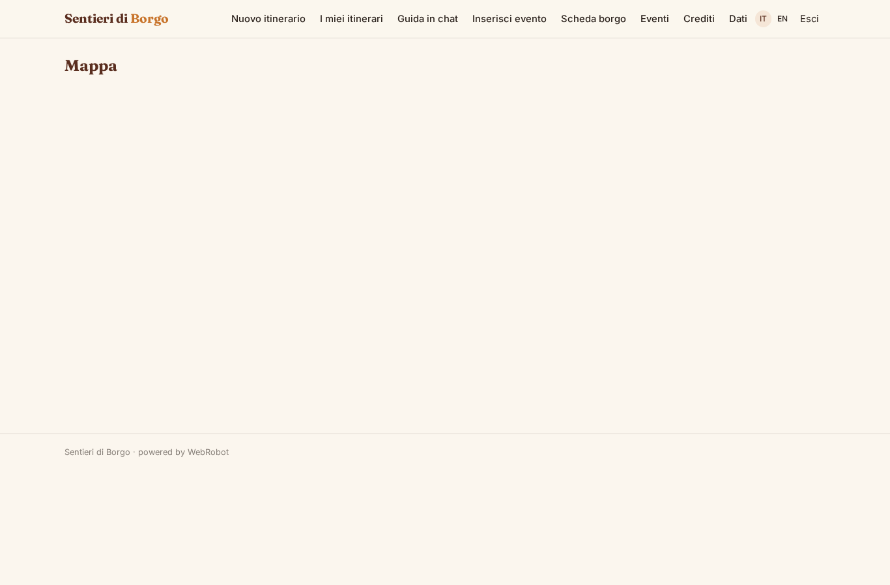
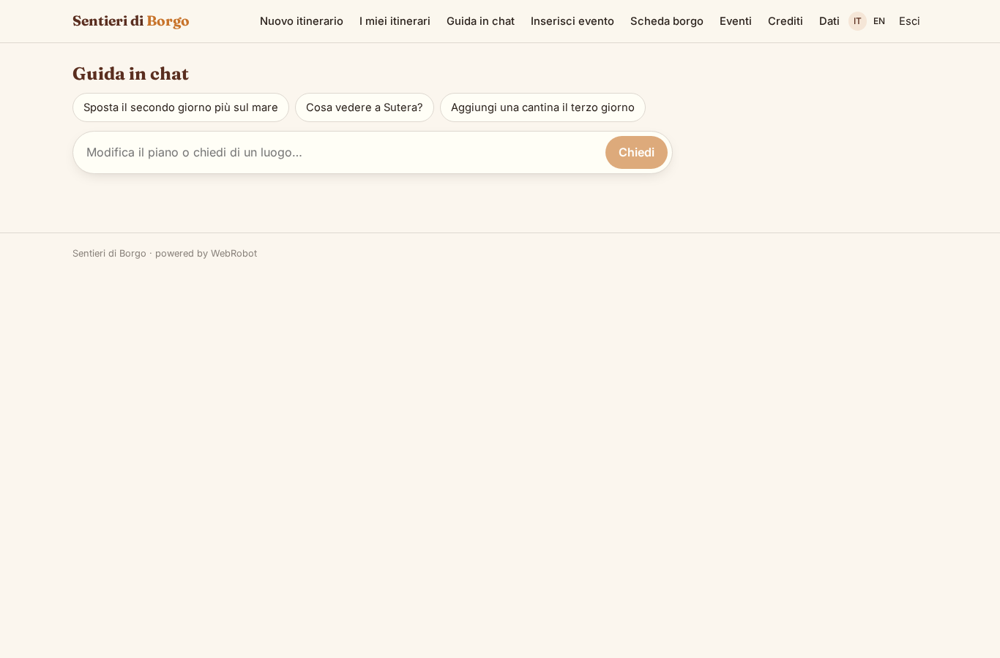
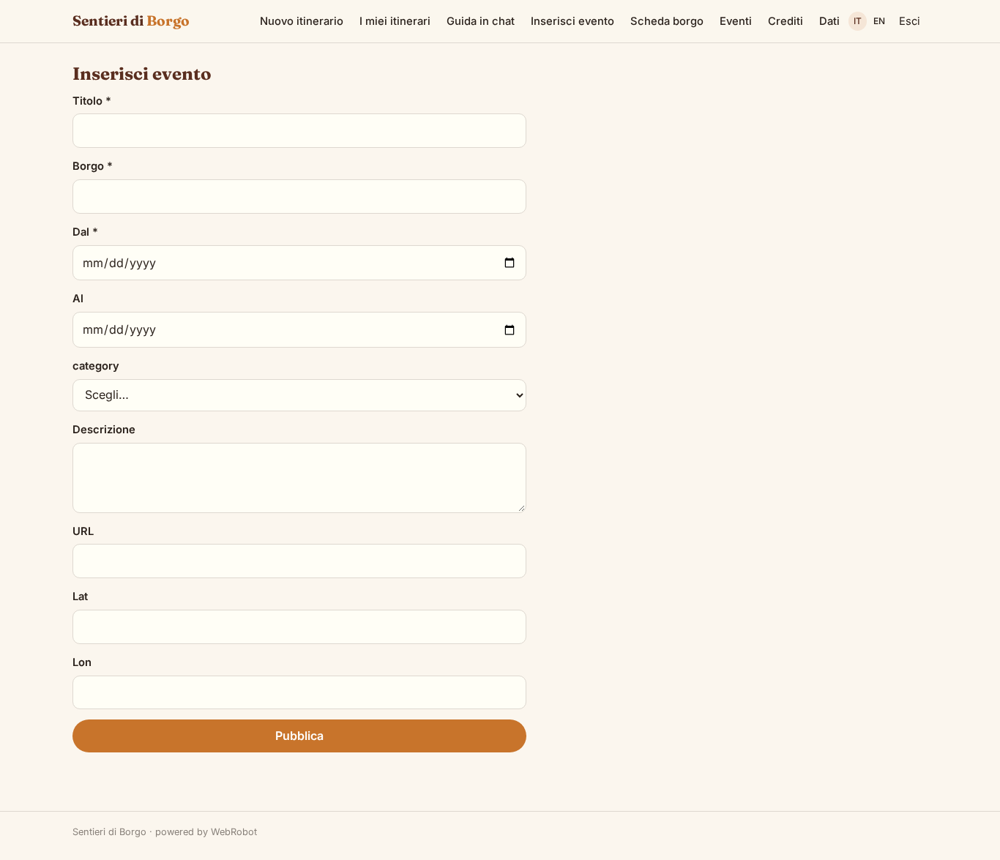
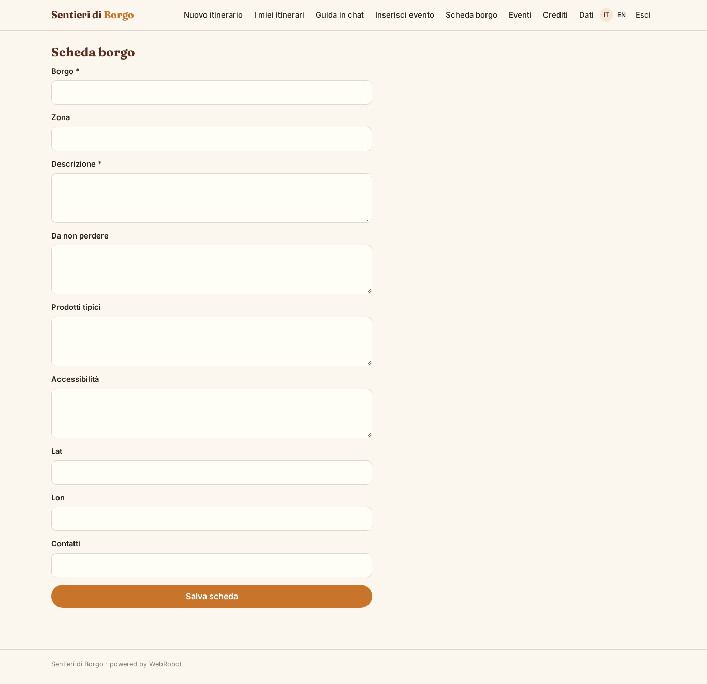
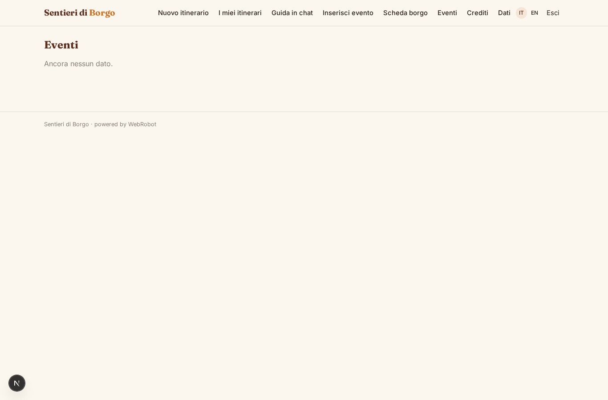
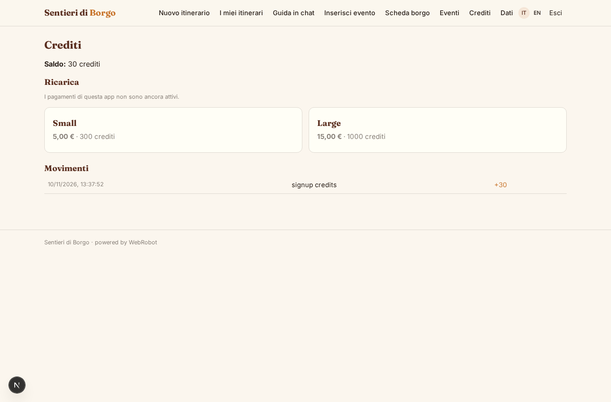

# Sentieri di Borgo

_Itinerari su misura nei borghi e nelle campagne di Sicilia._

**Manifest:** valid (schema + runtime contract) · **Functional test:** passed (17 checks passed)

## Description given to the app builder (Italian)

Vorrei un'app turistica chiamata Sentieri di Borgo, che crea itinerari personalizzati nei piccoli borghi e nelle aree rurali, partendo dalla Sicilia. Il visitatore, anche senza account, compila un modulo: zona o borgo di partenza, date, numero di giorni, mezzo di trasporto, interessi (enogastronomia, storia, natura, artigianato, eventi), ritmo e budget, eventuali esigenze di accessibilità. Un agente cerca i punti di interesse in OpenStreetMap e negli open data turistici e culturali della Regione, controlla gli eventi pubblicati nelle date scelte, e compone un itinerario giorno per giorno con orari, distanze e tempi di spostamento, alternative in caso di pioggia e consigli su prodotti tipici. Il risultato è un report consultabile online e scaricabile, con l'itinerario anche su una mappa interattiva con i percorsi tracciati. Poi il visitatore può continuare in chat per modificare il piano o chiedere informazioni su un luogo, e l'agente risponde usando la base di conoscenza delle schede dei borghi. I comuni e le pro loco partner hanno un ruolo admin per inserire eventi e schede. Il primo itinerario è gratuito, poi crediti a consumo; app in italiano e inglese.

## Features not expressible today (spec.extensions)

- **route_lines**: Map shows the stops as markers; drawing the traced route polylines between stops is not available yet (distances and times are in the report).
- **anonymous_credits**: The free first itinerary for visitors without an account is limited by the per-IP run limit; credit charging applies to signed-in users.

## Screenshots (interpretive runtime, no data)

### home-anon

### home-mobile

### home

### new_trip

### my_trips

### trip_map

### guide_chat

### event_form

### scheda_form

### events_list

### account

