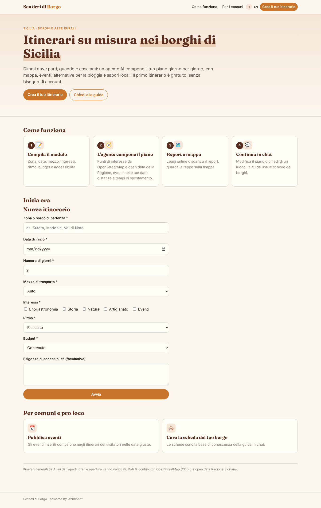
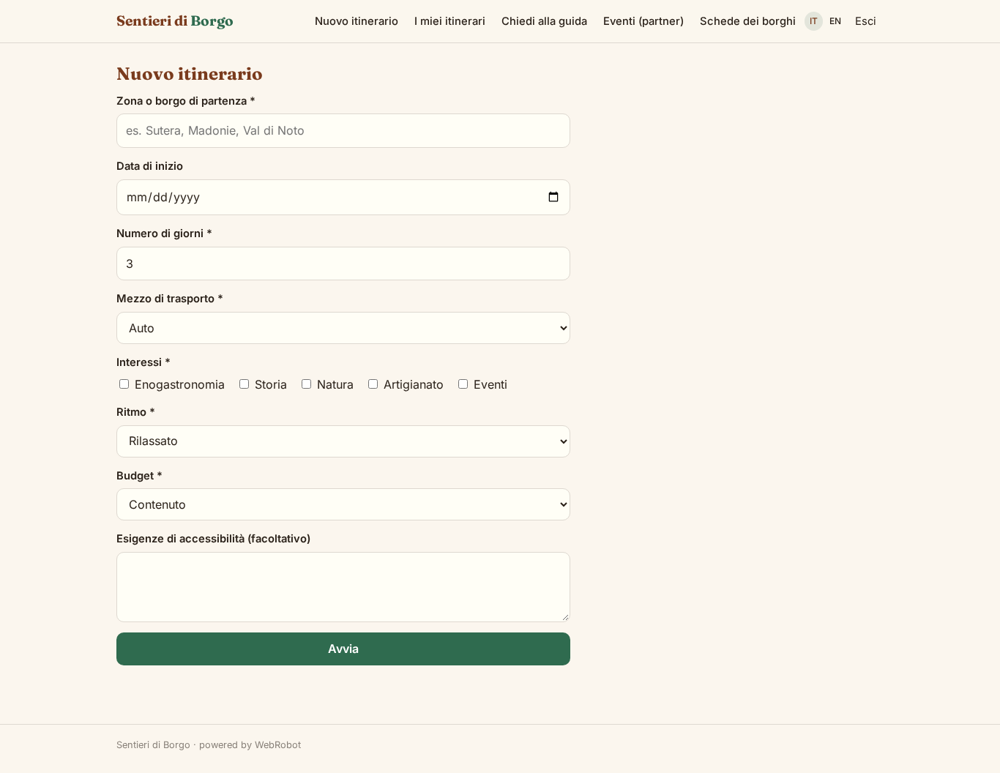
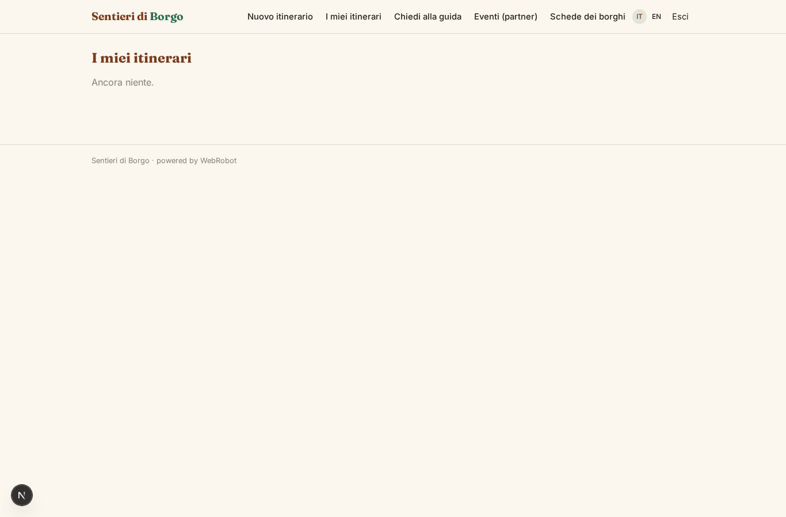
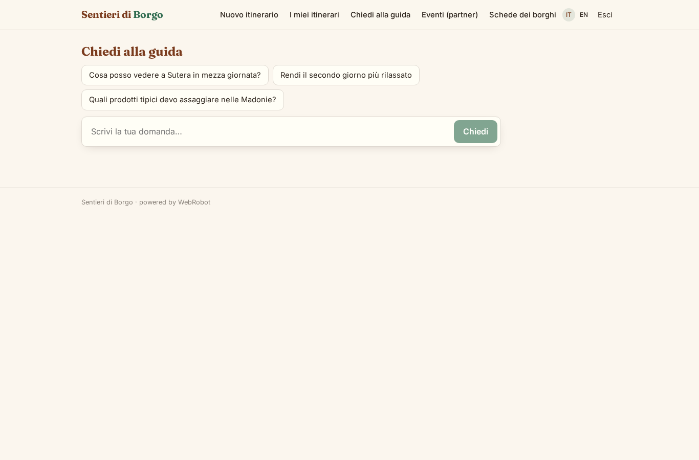
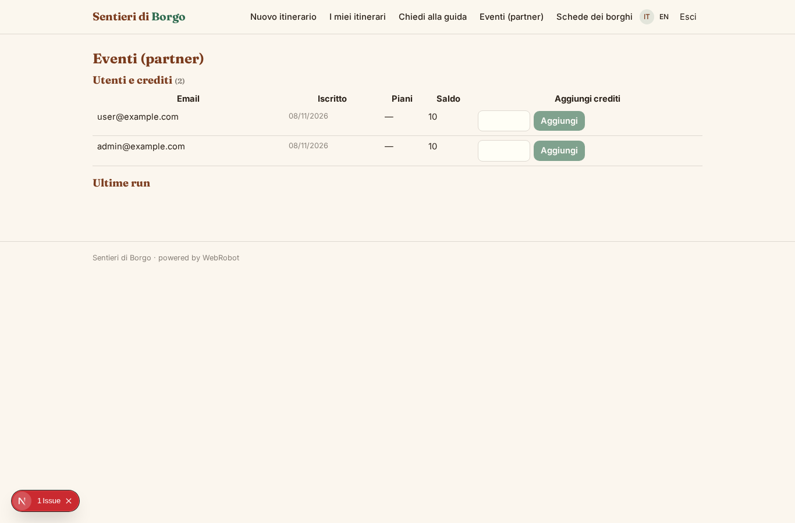
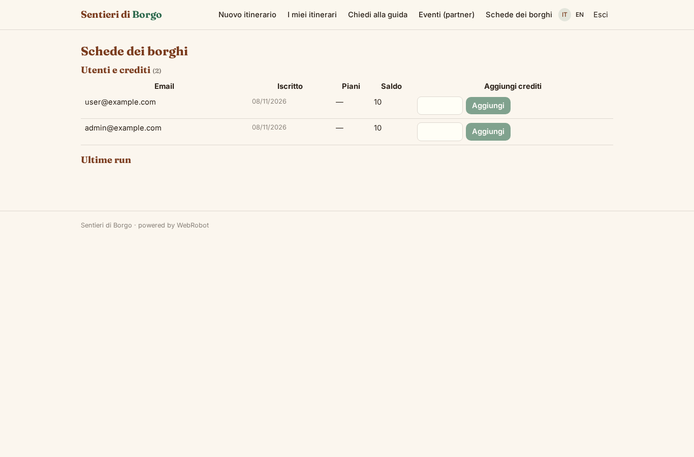
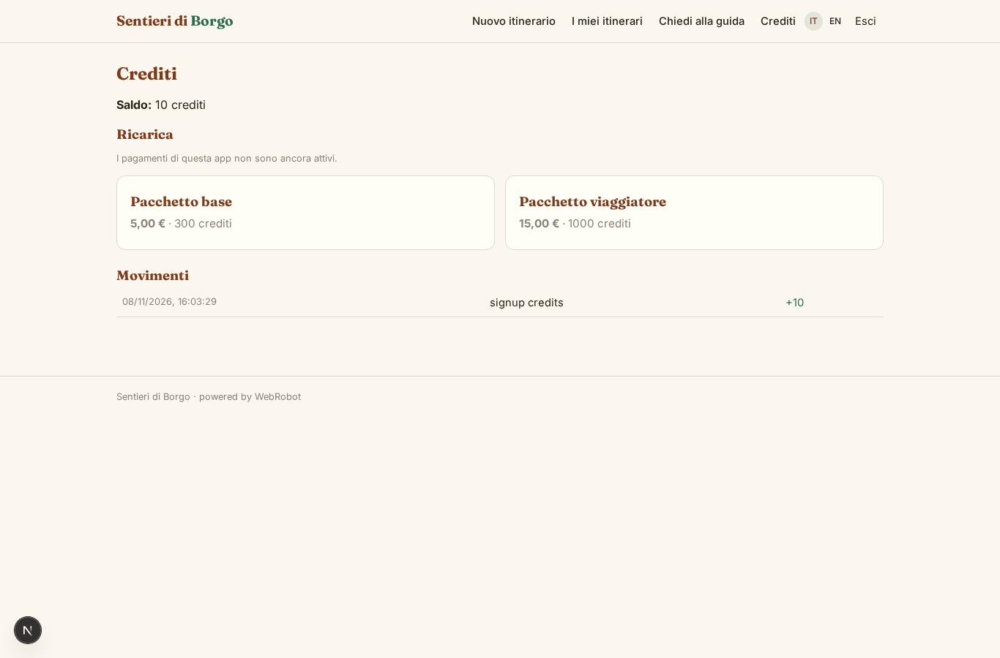

# Sentieri di Borgo

_Itinerari su misura nei borghi e nelle campagne di Sicilia._

**Manifest status:** valid (schema validator + runtime contract)

## Description given to the app builder (Italian)

Vorrei un'app turistica chiamata Sentieri di Borgo, che crea itinerari personalizzati nei piccoli borghi e nelle aree rurali, partendo dalla Sicilia. Il visitatore, anche senza account, compila un modulo: zona o borgo di partenza, date, numero di giorni, mezzo di trasporto, interessi (enogastronomia, storia, natura, artigianato, eventi), ritmo e budget, eventuali esigenze di accessibilità. Un agente cerca i punti di interesse in OpenStreetMap e negli open data turistici e culturali della Regione, controlla gli eventi pubblicati nelle date scelte, e compone un itinerario giorno per giorno con orari, distanze e tempi di spostamento, alternative in caso di pioggia e consigli su prodotti tipici. Il risultato è un report consultabile online e scaricabile, con l'itinerario anche su una mappa interattiva con i percorsi tracciati. Poi il visitatore può continuare in chat per modificare il piano o chiedere informazioni su un luogo, e l'agente risponde usando la base di conoscenza delle schede dei borghi. I comuni e le pro loco partner hanno un ruolo admin per inserire eventi e schede. Il primo itinerario è gratuito, poi crediti a consumo; app in italiano e inglese.

## Features not expressible today (spec.extensions)

- **interactive_map**: Interactive map with traced routes is not available yet: the report includes a GeoJSON block and OpenStreetMap directions links per day; a map component rendering it is missing.
- **report_download**: Download is the printable report (save as PDF from the browser); no server-side PDF file.
- **anonymous_free_trial**: Credits are tied to accounts: visitors without an account are limited by IP rate limits; the 'first itinerary free' applies via signup credits once they register.
- **plan_chat_link**: The chat agent has no automatic access to the generated report; the visitor pastes the part to change.

## Screenshots (interpretive runtime)

### home-anon

### home-mobile

### home

### new

### history

### chat

### admin_events

### admin_cards

### account

