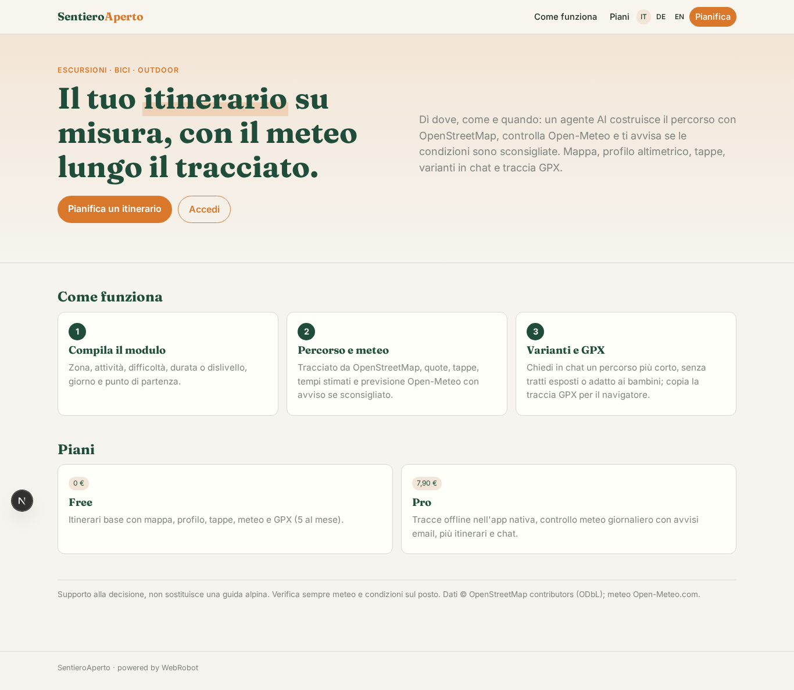
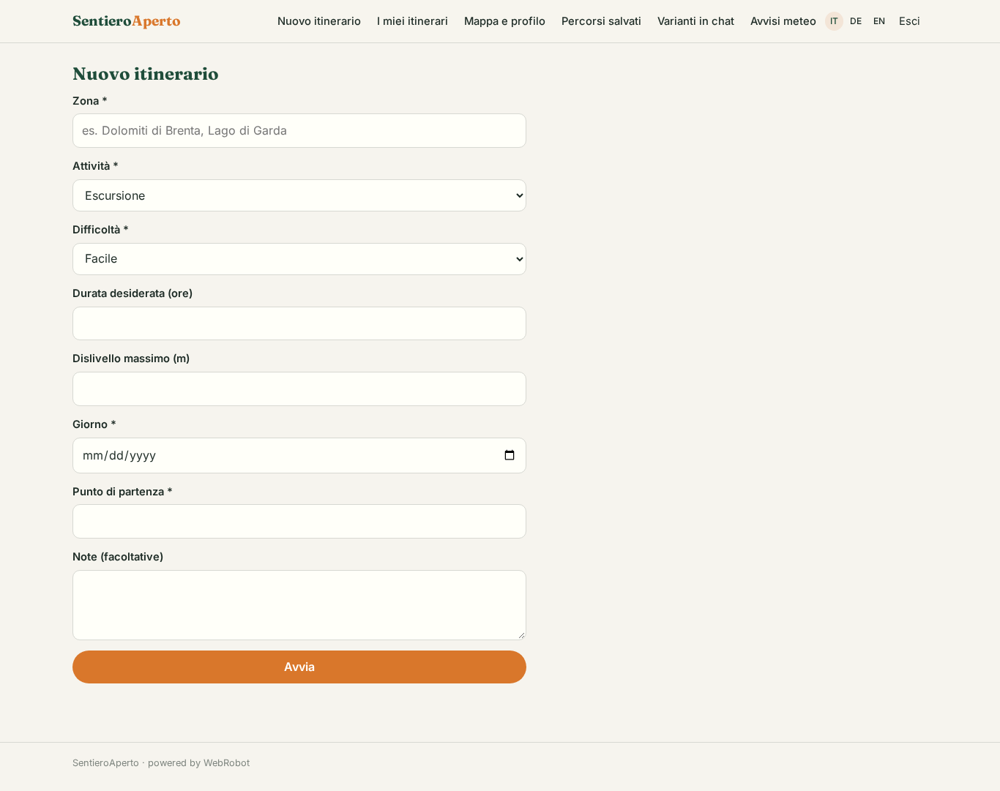
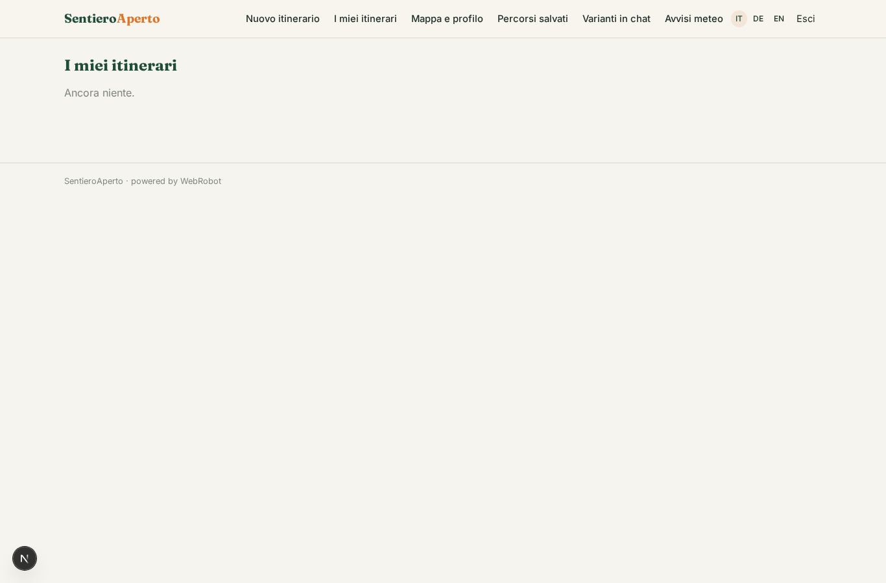
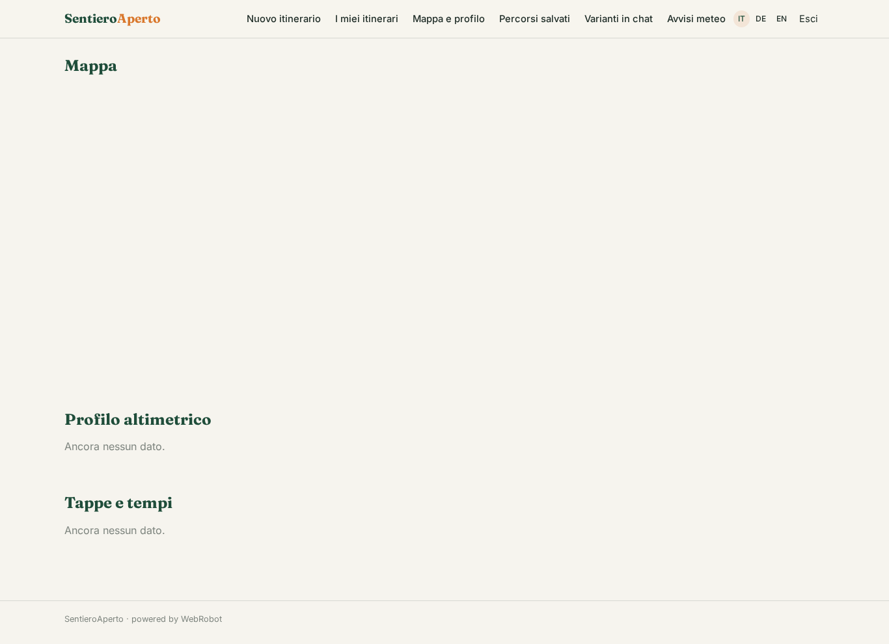
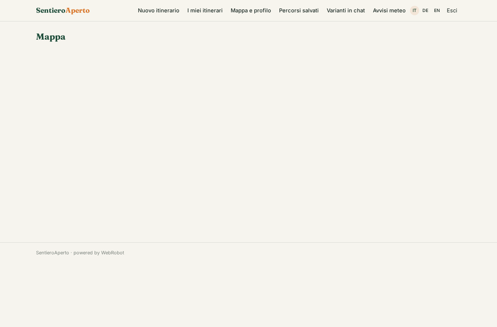
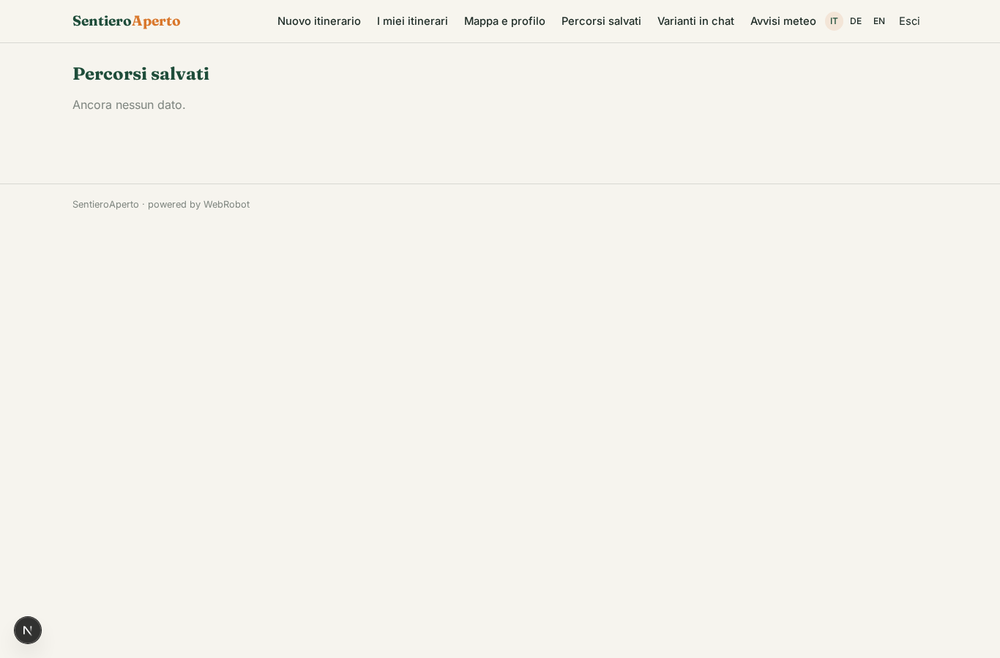
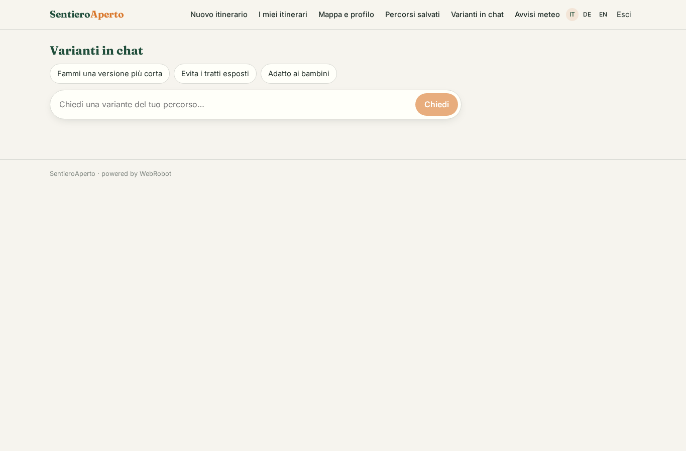
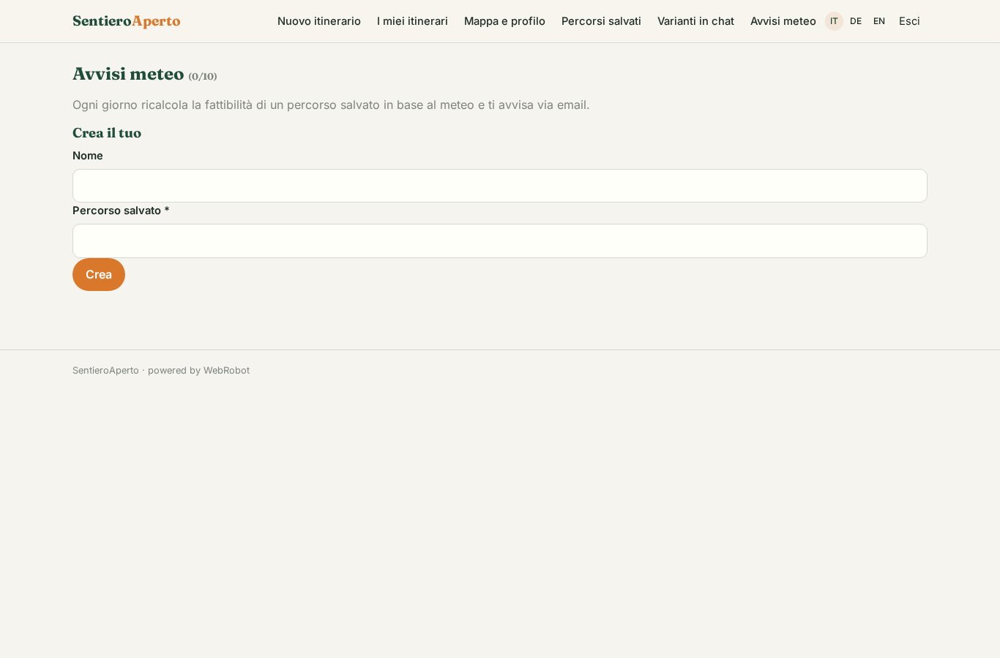
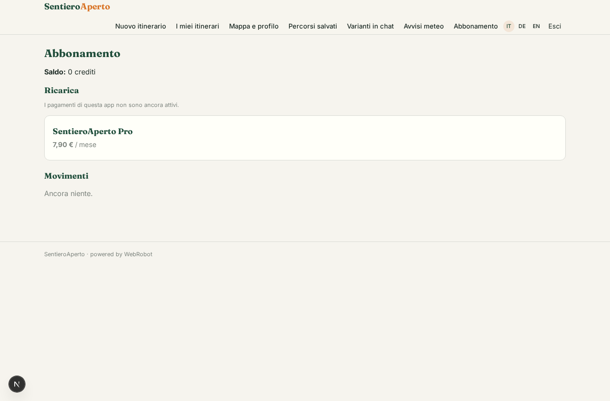

# SentieroAperto

_Itinerari all'aperto su misura, con meteo e traccia GPX._

**Manifest:** valid (schema + runtime contract) · **Functional test:** 1 failure(s) (10 checks passed)

## Description given to the app builder (Italian)

SentieroAperto genera itinerari per escursioni, bici e attivita all'aperto. L'utente compila un modulo con zona, tipo di attivita, difficolta, durata o dislivello desiderato, periodo e punto di partenza. Un agente costruisce un itinerario usando i percorsi e i punti di interesse di OpenStreetMap, aggiunge la previsione meteo lungo il tracciato da Open-Meteo e avvisa se le condizioni sono sconsigliate. L'utente vede il percorso su una mappa interattiva con profilo altimetrico, tappe e tempi stimati, puo chiedere varianti in chat ("piu corto", "evita i tratti esposti", "adatto ai bambini") e scaricare la traccia in formato GPX per il navigatore. Un modello giornaliero ricalcola la fattibilita dei percorsi salvati in base al meteo e avvisa via email. Vorrei anche un'app nativa che funzioni offline in montagna, dove non c'e campo, con il GPS per seguire la traccia. Gratuito per gli itinerari base, abbonamento per tracce offline e avvisi meteo. In italiano, tedesco e inglese.

## Functional test: what did not pass

- **template instance created and run** (template route_watch): create: 400 route is required

## Features not expressible today (spec.extensions)

- **gpx_download**: A real .gpx file download is not available: the agent gives the GPX 1.1 text in a fenced block of the report to copy/save as .gpx. A dedicated download endpoint would need custom code.
- **offline_native_gps**: Native app working offline in the mountains with GPS track following needs offline map tiles, local storage of routes and on-device location: the Capacitor shell (spec.mobile) wraps the web app only, so offline caching, GPS tracking and the Pro-only offline tracks gate are not covered by the manifest.
- **open_meteo_commercial**: Open-Meteo's free API is for non-commercial use; the subscription model needs a commercial Open-Meteo API key/plan before publishing.
- **elevation_profile_on_map**: The map shows stages as markers and the elevation profile is a separate chart; a drawn track polyline with a cursor linked to the profile is not available.

## Screenshots (interpretive runtime, no data)

### home-anon

### home-mobile

### home

### new

### itineraries

### explore

### route_map

### my_routes

### variants_chat

### watches

### account

