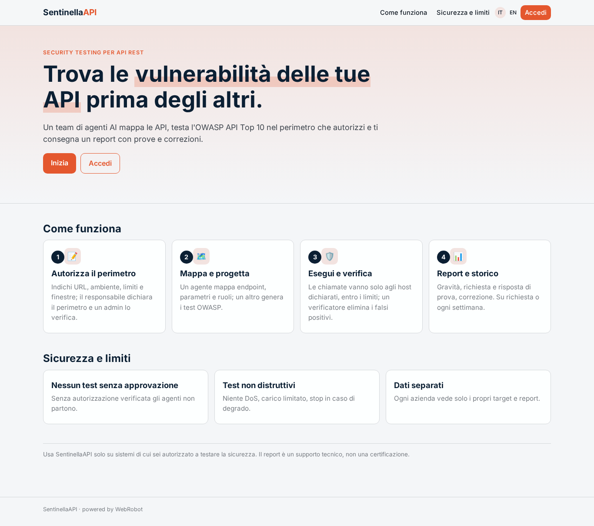
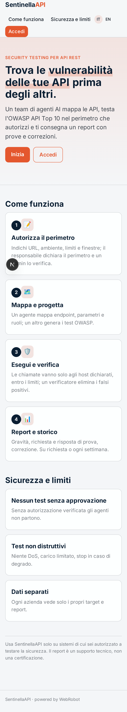
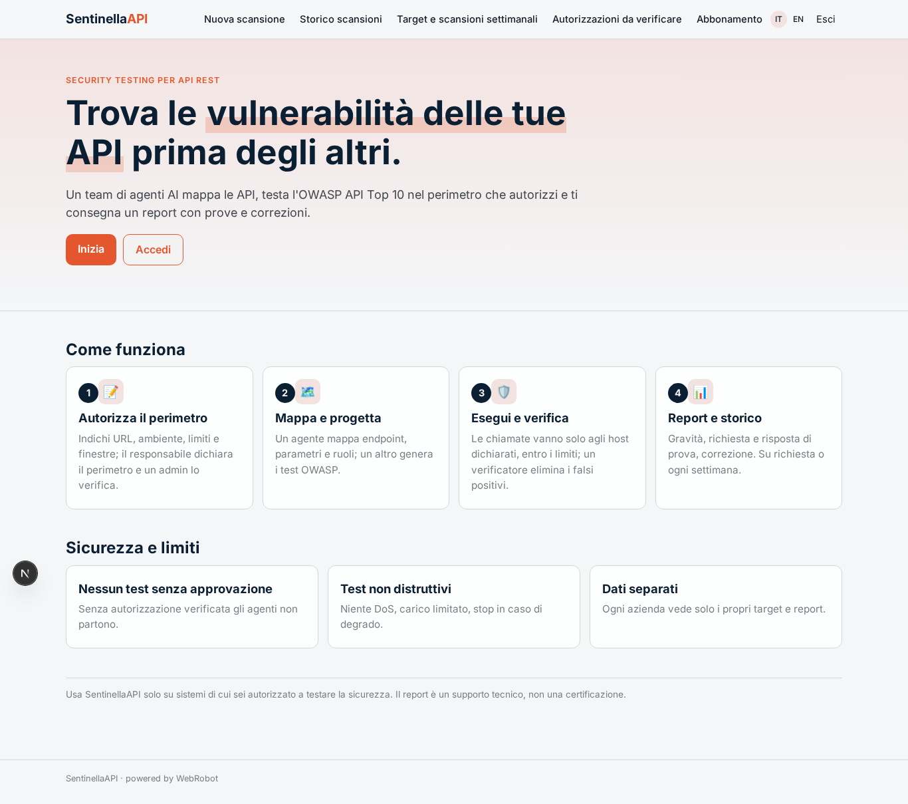
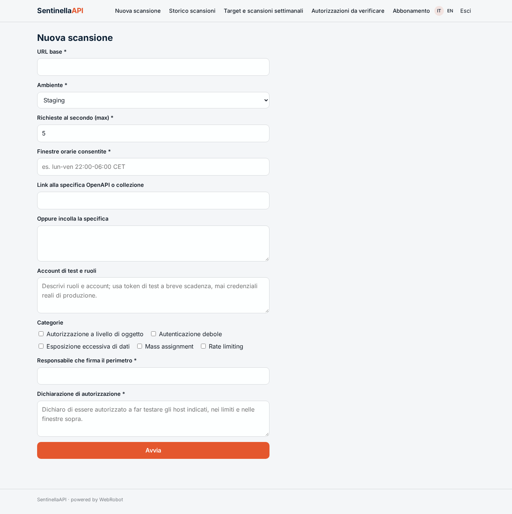
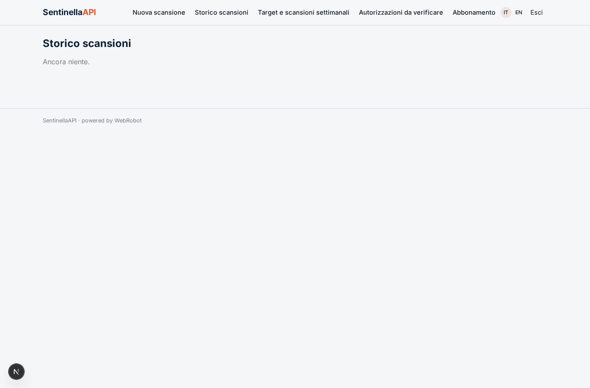
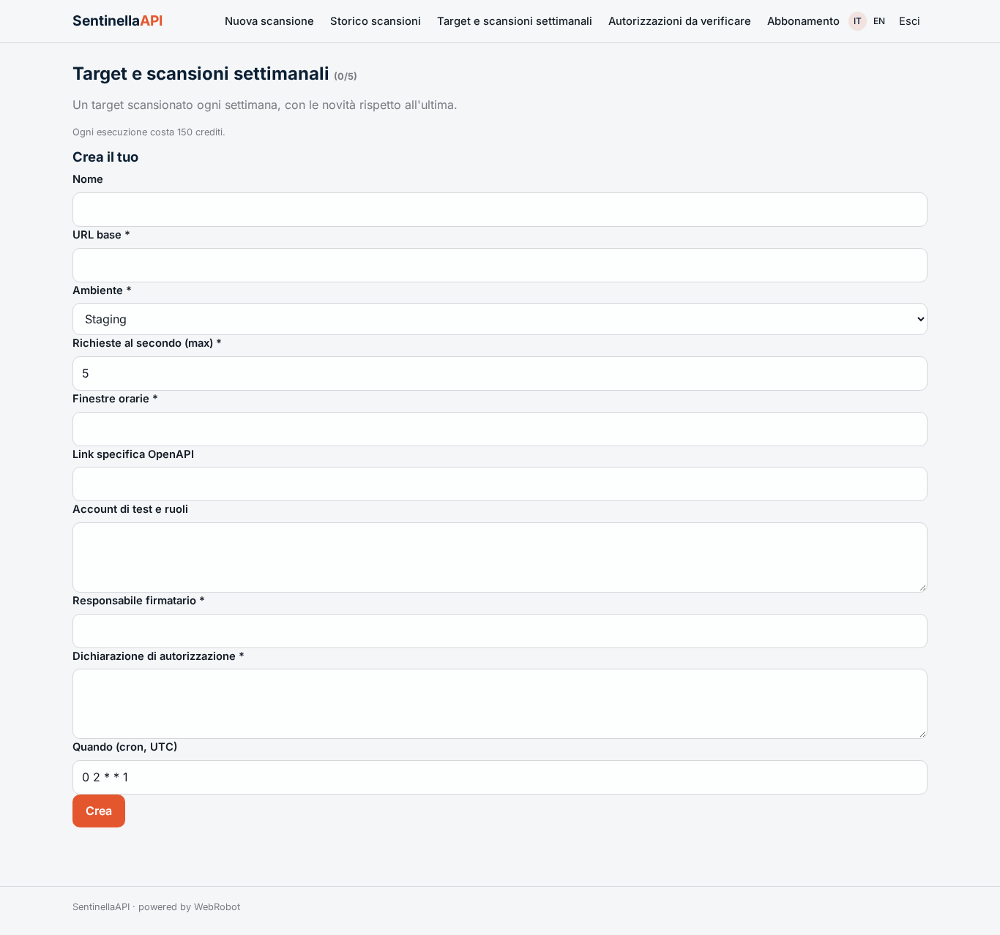
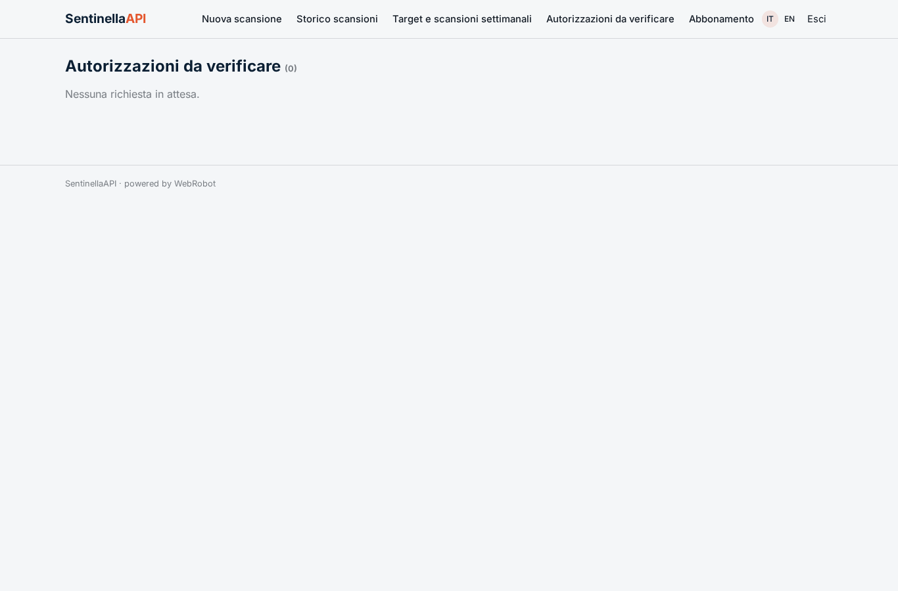
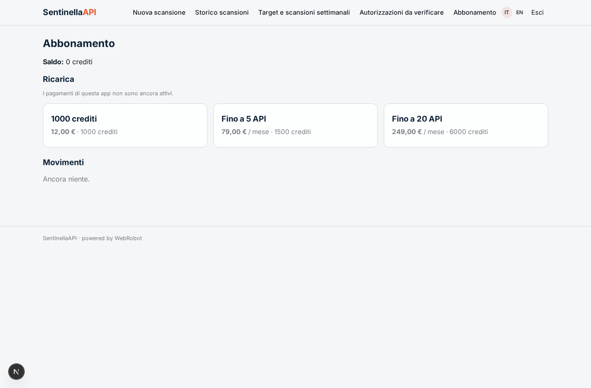

# SentinellaAPI

_Security testing automatico delle tue API REST, solo con autorizzazione scritta._

**Stato manifest:** valido (validatore Python + contratto runtime)

## Descrizione data all'app builder

Voglio realizzare SentinellaAPI, un servizio di security testing automatico delle API REST per team di sviluppo e responsabili della sicurezza. Il cliente crea un target indicando URL base, ambiente (staging consigliato), credenziali di test, limiti di richieste al secondo, finestre orarie consentite, e carica la specifica OpenAPI o una collezione di chiamate. Prima di qualsiasi test serve un'autorizzazione scritta: il responsabile firma digitalmente il perimetro e un admin della piattaforma lo verifica; senza approvazione gli agenti non partono. Un team di agenti lavora in sequenza: il primo mappa endpoint, parametri e ruoli; il secondo genera casi di test per le categorie OWASP API Top 10 (autorizzazione a livello di oggetto, autenticazione debole, esposizione eccessiva di dati, mass assignment, rate limiting); il terzo esegue le chiamate solo verso gli host dichiarati e rispettando i limiti di carico; il quarto verifica i risultati per eliminare i falsi positivi. L'utente vede un report con vulnerabilità, gravità, richiesta e risposta di prova e suggerimento di correzione, più lo storico delle scansioni. Scansioni su richiesta o settimanali, con alert email sulle criticità. Ruoli: owner, sviluppatore, auditor; ogni azienda vede solo i propri target. Abbonamento per numero di API; in italiano e inglese.

## Funzioni non esprimibili oggi (spec.extensions)

- **email_alerts**: Email alerts on critical findings are not available yet: criticals are shown at the top of each report and in the history; the weekly report is read in the app.
- **file_upload**: Uploading OpenAPI files or call collections is not available yet: the customer gives a link or pastes the spec as text.
- **digital_signature**: A qualified digital signature is not available: the signatory declares the perimeter in the form and a platform admin verifies it in the approvals view before any scan.
- **hard_gate_and_host_enforcement**: The authorization gate and the single-host restriction are enforced by the agents' instructions and the authorized_scopes records, not by a runtime-level network filter; per-target egress allow-lists would need a platform feature.
- **company_sharing**: Sharing targets and reports between users of the same company (owner, developer, auditor) and plan limits on the number of APIs are not expressible yet; records are per user and the API count is a commercial limit to enforce manually.
- **test_credentials**: Per-target credential storage is not available: customers describe test accounts in notes and must use short-lived staging test tokens, never production secrets.

## Screenshot (runtime interpretativo)

### home-anon

### home-mobile

### home

### new_scan

### scans

### targets

### authorizations

### account

