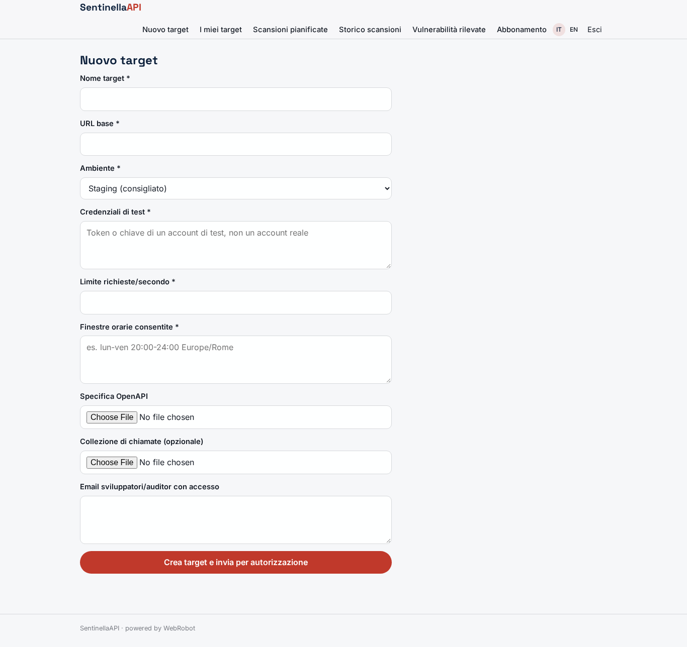
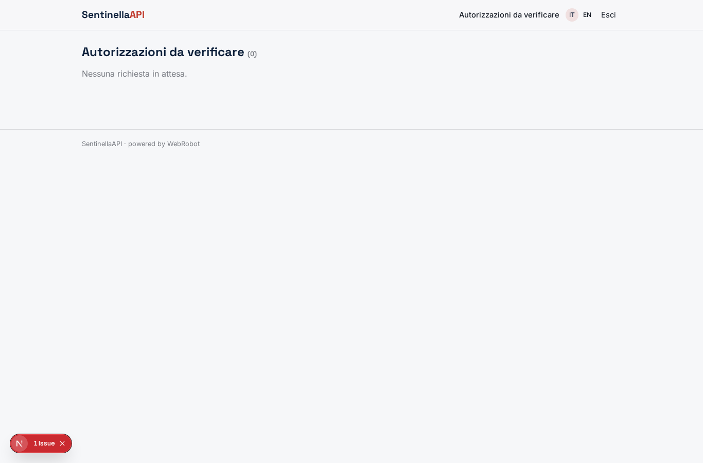
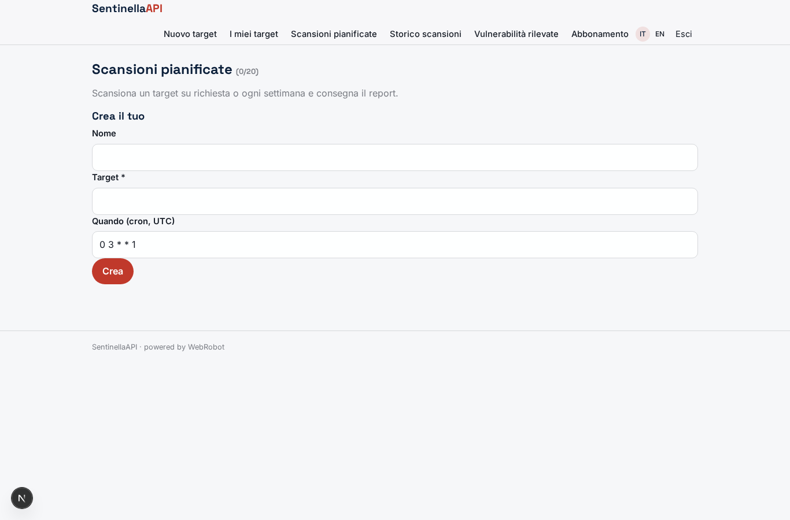
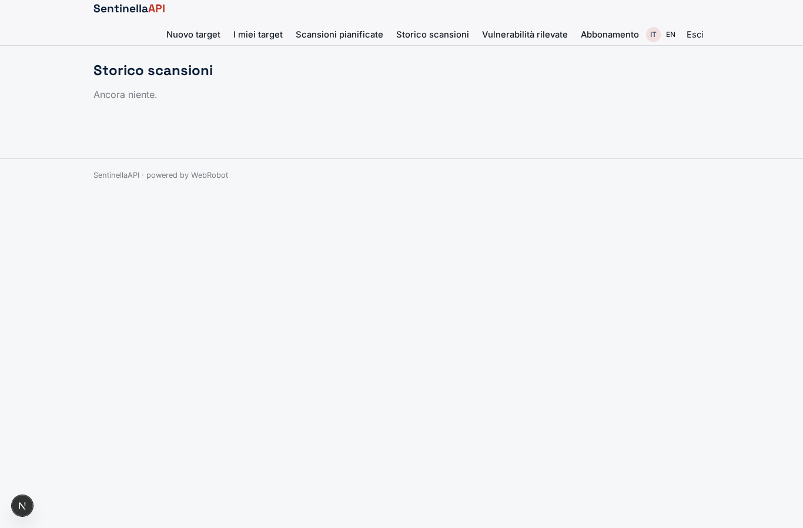
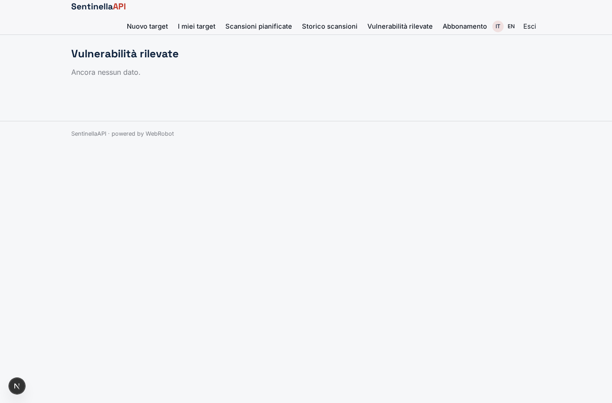
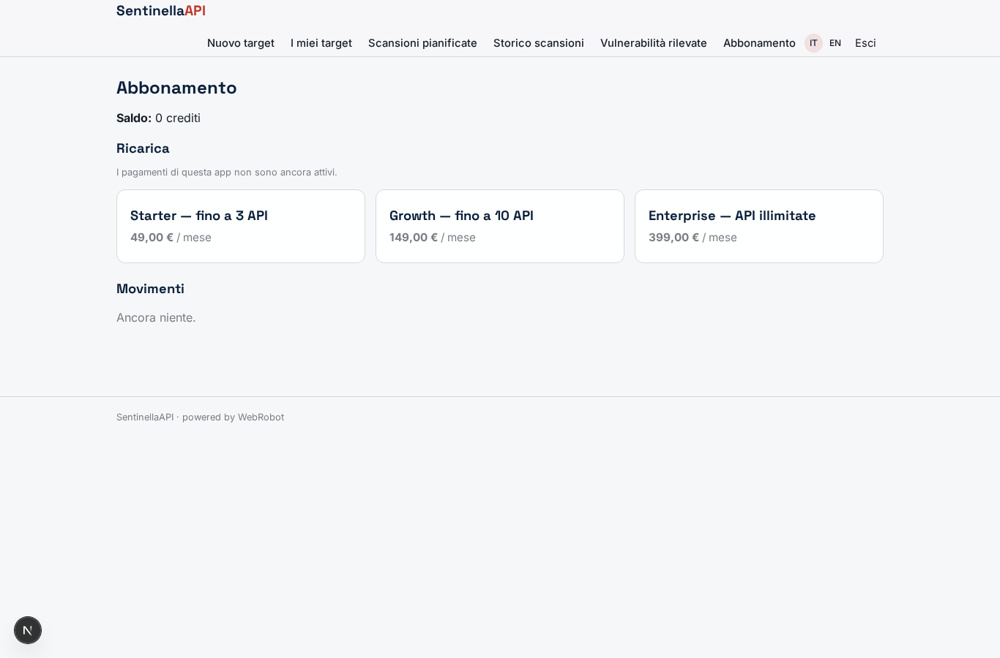

# SentinellaAPI

_Security testing automatico delle tue API REST, con autorizzazione scritta prima di ogni scansione._

**Manifest:** valid (schema + runtime contract) · **Functional test:** passed (12 checks passed)

## Description given to the app builder (Italian)

Voglio realizzare SentinellaAPI, un servizio di security testing automatico delle API REST per team di sviluppo e responsabili della sicurezza. Il cliente crea un target indicando URL base, ambiente (staging consigliato), credenziali di test, limiti di richieste al secondo, finestre orarie consentite, e carica la specifica OpenAPI o una collezione di chiamate. Prima di qualsiasi test serve un'autorizzazione scritta: il responsabile firma digitalmente il perimetro e un admin della piattaforma lo verifica; senza approvazione gli agenti non partono. Un team di agenti lavora in sequenza: il primo mappa endpoint, parametri e ruoli; il secondo genera casi di test per le categorie OWASP API Top 10 (autorizzazione a livello di oggetto, autenticazione debole, esposizione eccessiva di dati, mass assignment, rate limiting); il terzo esegue le chiamate solo verso gli host dichiarati e rispettando i limiti di carico; il quarto verifica i risultati per eliminare i falsi positivi. L'utente vede un report con vulnerabilità, gravità, richiesta e risposta di prova e suggerimento di correzione, più lo storico delle scansioni. Scansioni su richiesta o settimanali, con alert email sulle criticità. Ruoli: owner, sviluppatore, auditor; ogni azienda vede solo i propri target. Abbonamento per numero di API; in italiano e inglese.

## Features not expressible today (spec.extensions)

- **digital_signature**: La 'firma digitale' del perimetro da parte del responsabile è approssimata come conferma in-app all'invio del form target; una firma qualificata (es. con certificato) non è ancora disponibile nella piattaforma.
- **runtime_rate_limit_enforcement**: Il rispetto dei limiti di richieste al secondo e delle finestre orarie durante l'esecuzione è imposto dalle istruzioni dell'agente executor, non da un limitatore di rete a livello di piattaforma.

## Screenshots (interpretive runtime, no data)

### home-anon

### home-mobile

### home

### new_target

### targets_list

### approvals_view

### scan_watch

### scan_history

### results_table

### account

