# ShopPilot

_Il CRM marketing del tuo e-commerce, guidato da un agente AI._

**Manifest:** valid (schema + runtime contract) · **Functional test:** passed (16 checks passed)

## Description given to the app builder (Italian)

Voglio un'app per negozi e-commerce che fa il lavoro di un CRM marketing con un agente AI. Il negozio collega il suo shop (Shopify o WooCommerce) e l'app importa clienti, ordini e catalogo. Ogni lunedì un agente propone un piano settimanale: quali campagne mandare (email e WhatsApp), a quali segmenti di clienti (es. 'ha comprato scarpe negli ultimi 90 giorni ma non ha riacquistato'), con quali prodotti del catalogo e con il testo dei messaggi. Il titolare approva, modifica o rifiuta ogni campagna: non parte niente senza approvazione. Flussi automatici per carrello abbandonato, post-acquisto e riacquisto. Un assistente risponde ai clienti su WhatsApp e sul sito su ordini, spedizioni, resi e consigli di prodotto. Report settimanale dei ricavi per campagna. I messaggi marketing vanno solo a chi ha dato il consenso. Nome: ShopPilot. Lingue italiano e inglese. Abbonamento mensile per negozio.

## Features not expressible today (spec.extensions)

- **campaign_sending**: Email campaign sending to lists and WhatsApp messages (sending and customer replies on WhatsApp) are not available yet: approved campaigns are stored and exportable (CSV of consented customers) but not delivered by the platform.
- **woocommerce**: WooCommerce connection not available: its hosts are arbitrary per store and the egress allow-list only supports named hosts or Shopify wildcard. Shopify only for now.
- **public_widget**: Embeddable site chat widget for the shop's own visitors (anonymous, per-shop data) is not available yet; the assistant runs in the signed-in chat view.

## Screenshots (interpretive runtime, no data)

### home-anon
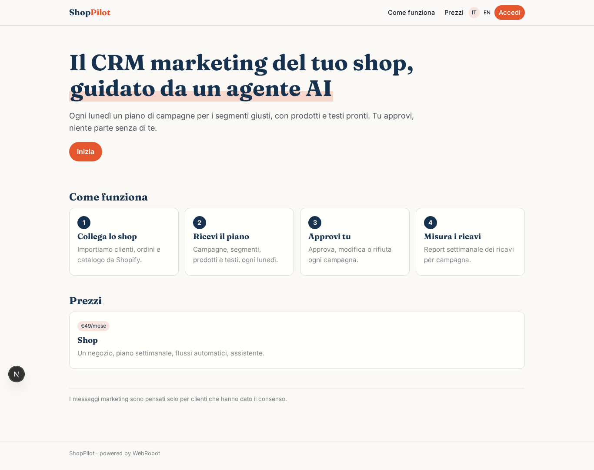

### home-mobile
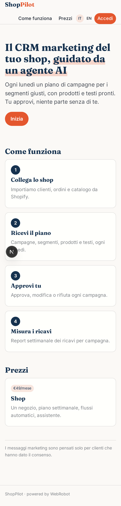

### home
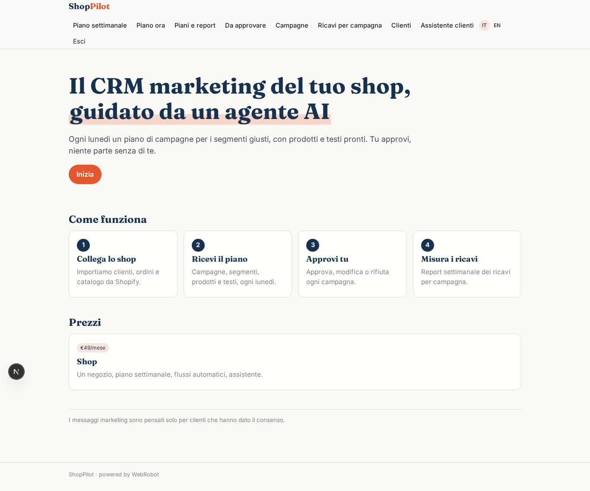

### plans
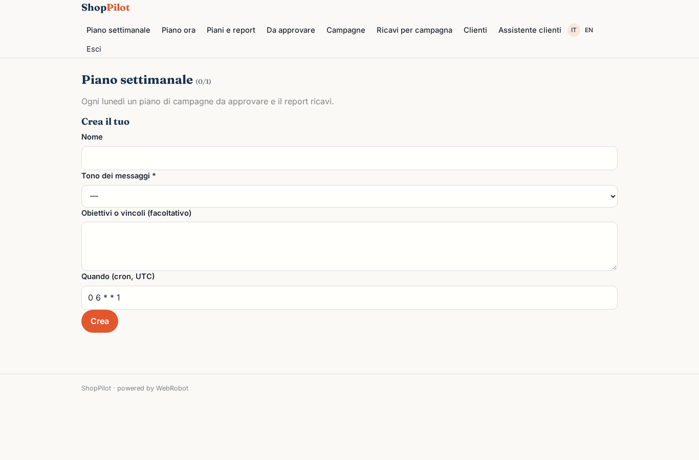

### new
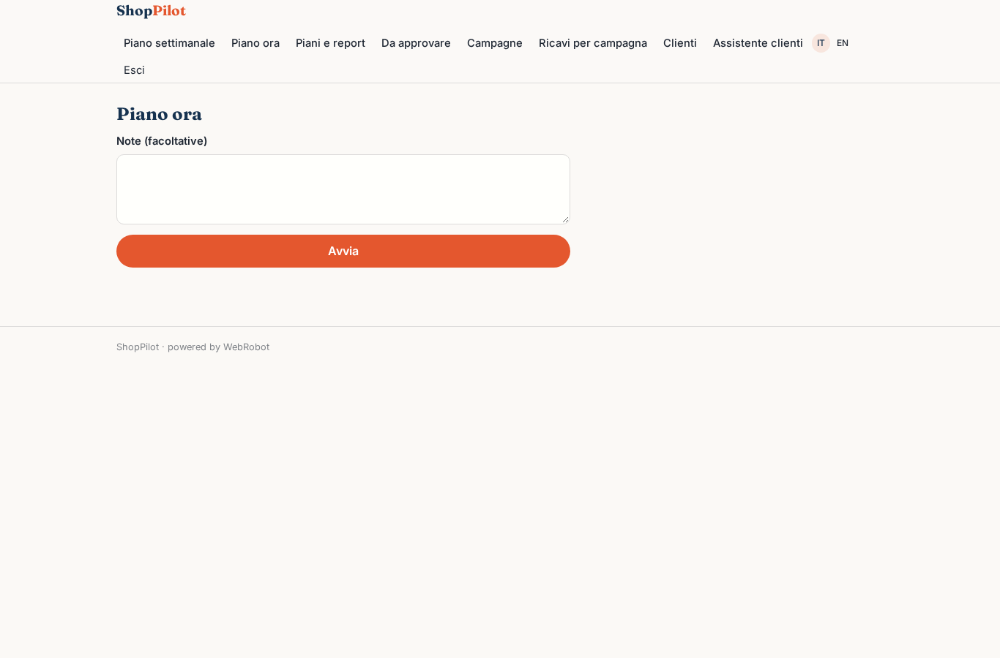

### history
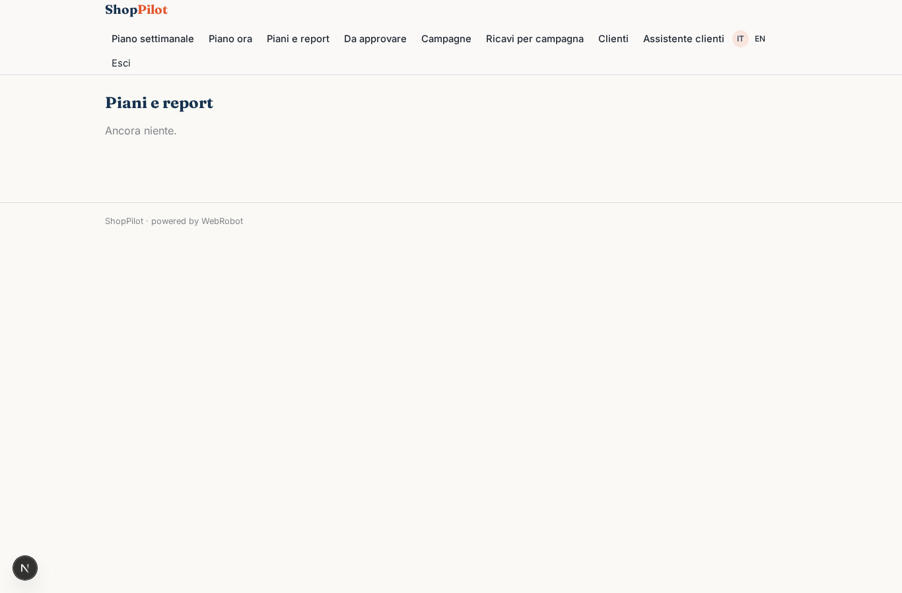

### approve
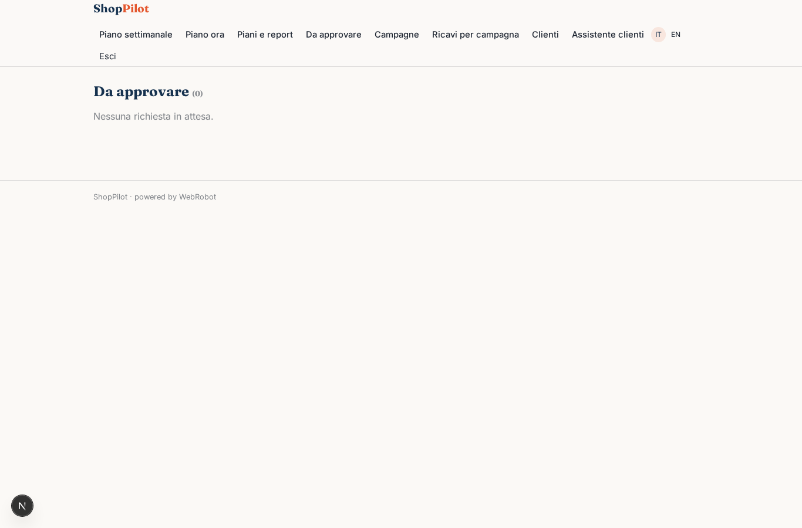

### campaigns
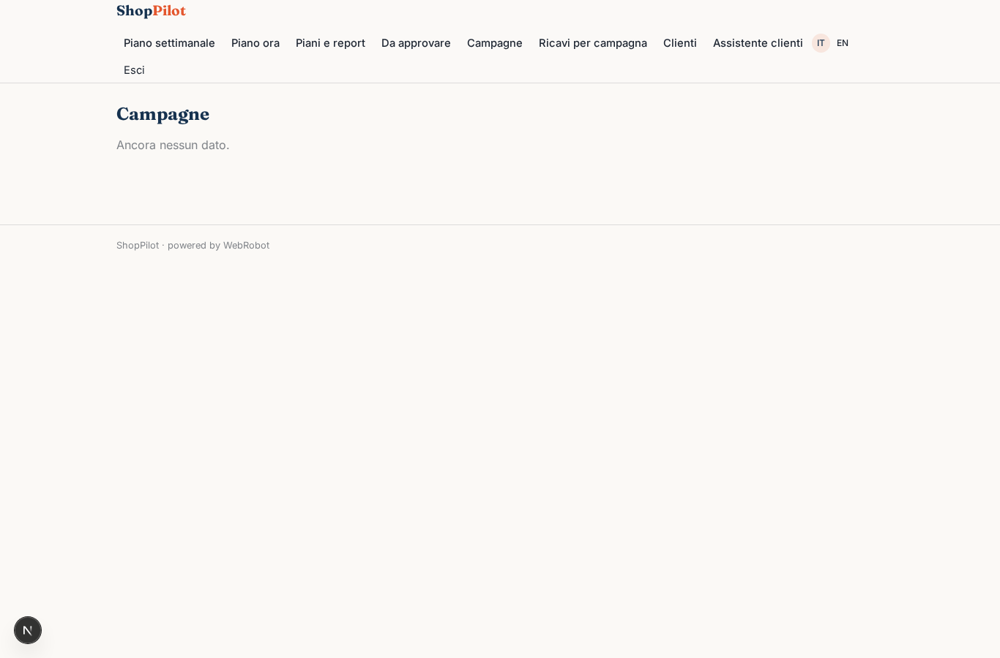

### edit_campaign
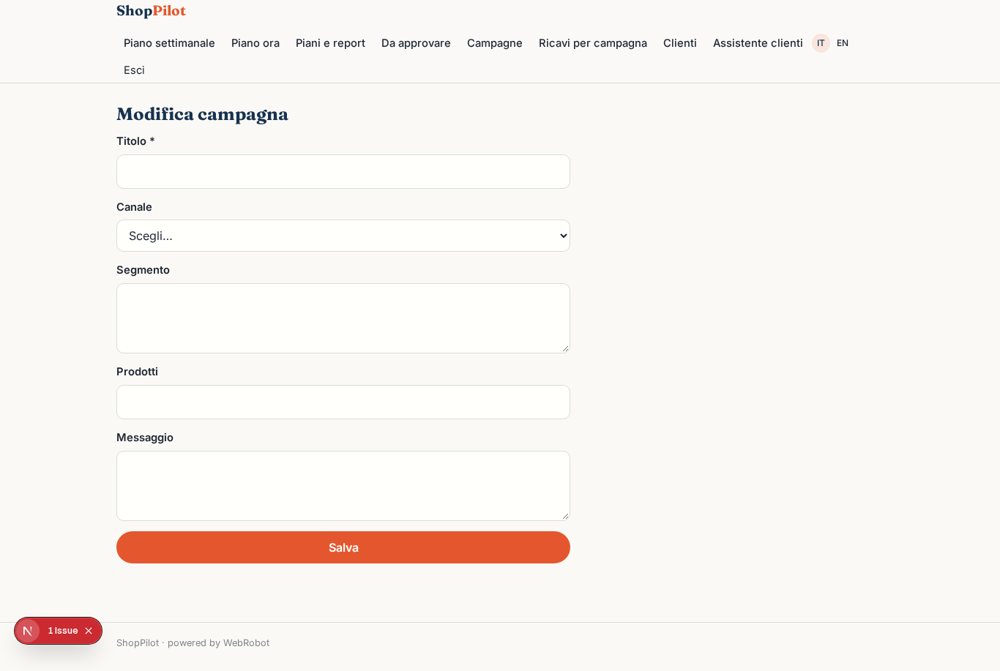

### revenue
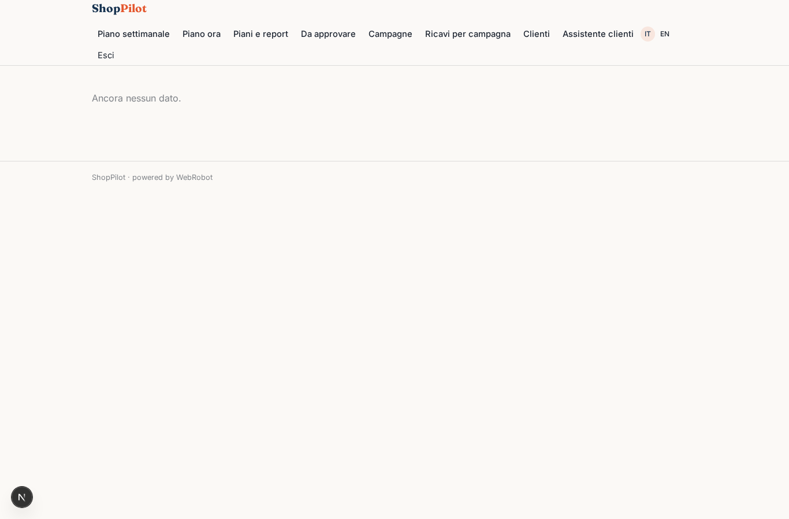

### customers
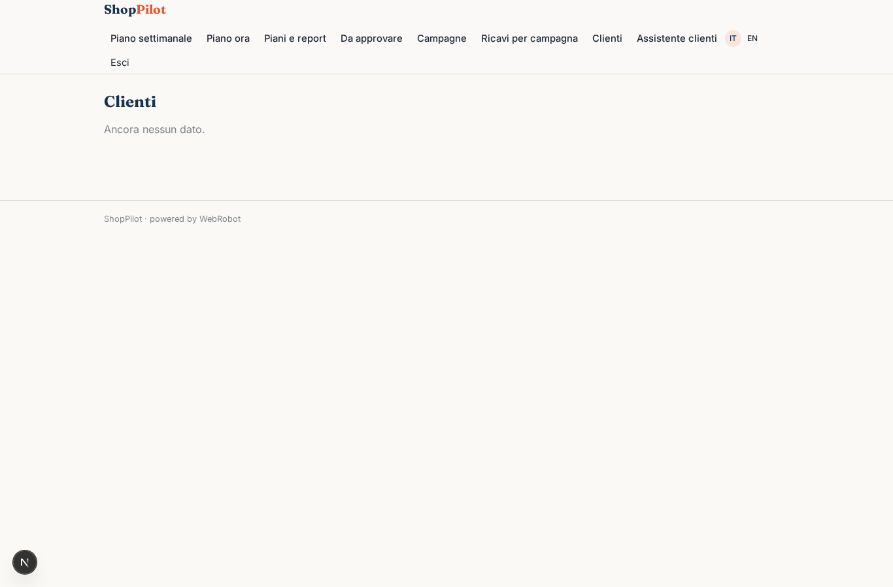

### chat
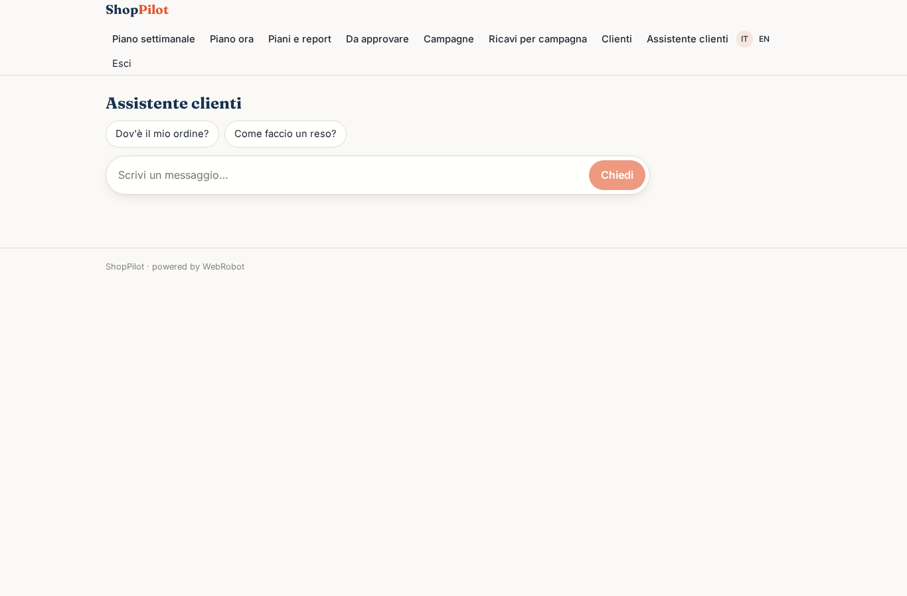

### account
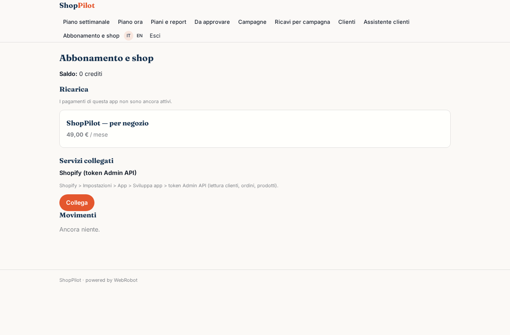
