# SoldiSereni

_Educazione finanziaria, spese sotto controllo e consulenza a parcella._

**Manifest:** valid (schema + runtime contract) · **Functional test:** passed (21 checks passed)

## Description given to the app builder (Italian)

SoldiSereni e un'app di educazione finanziaria con tracciamento delle spese e consulenza a parcella (fee-only); descrivo lo strato software, mentre la consulenza regolamentata resta in capo a consulenti iscritti all'albo. L'utente si registra e segue brevi percorsi formativi su budget, risparmio e investimenti, con quiz. Puo registrare entrate e spese manualmente e categorizzarle; un agente analizza l'andamento, mostra dove vanno i soldi e suggerisce obiettivi di risparmio. In futuro vorrei collegare i conti correnti via open banking (PSD2) per importare i movimenti in automatico. Chi vuole un parere personale prenota e paga una sessione con un consulente indipendente iscritto all'albo, che usa i dati che l'utente decide di condividere e fornisce lui la consulenza. L'utente chatta con un assistente per domande generali di educazione finanziaria, che non da raccomandazioni di investimento personalizzate. Ogni utente vede solo i propri dati, il consulente solo i clienti che lo hanno scelto. Piano gratuito, abbonamento per funzioni avanzate, pagamento a sessione per la consulenza. In italiano.

## Features not expressible today (spec.extensions)

- **open_banking**: Collegamento dei conti via open banking PSD2 per importare i movimenti: non disponibile ora (richiede OAuth/provider AISP). Per ora i movimenti si inseriscono a mano.
- **pagamento_sessione**: Il pagamento a sessione usa il pack 'sessione'; l'accredito al consulente e la visibilità delle prenotazioni al consulente richiedono un'estensione dedicata.

## Screenshots (interpretive runtime, no data)

### home-anon
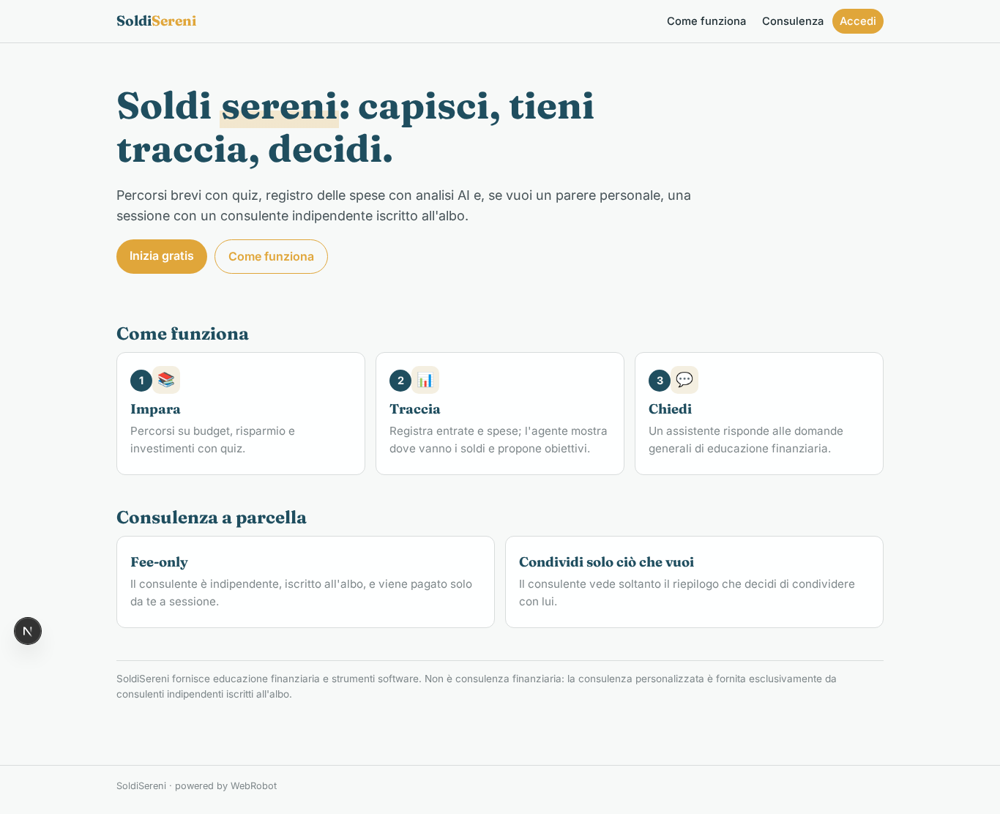

### home-mobile

### home
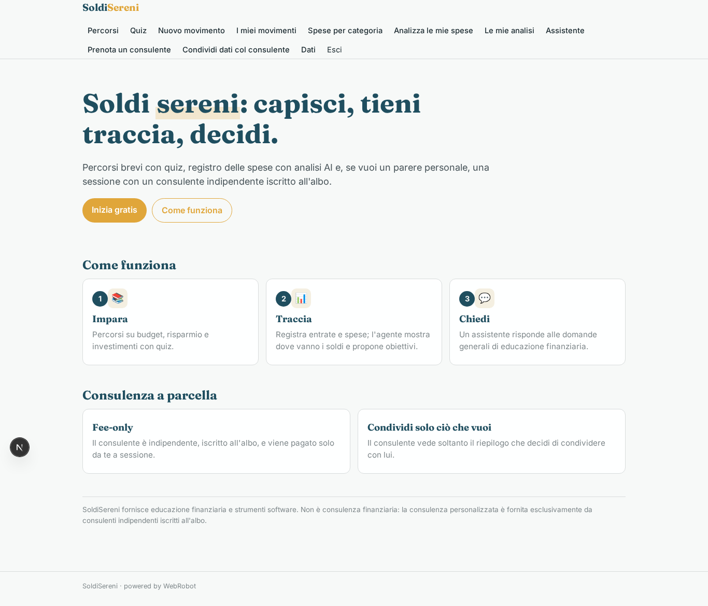

### learn
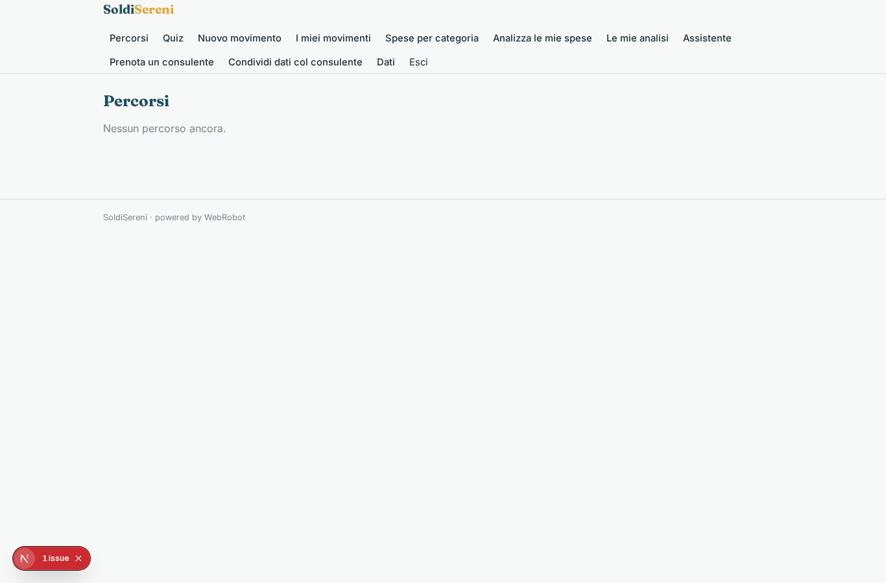

### quiz
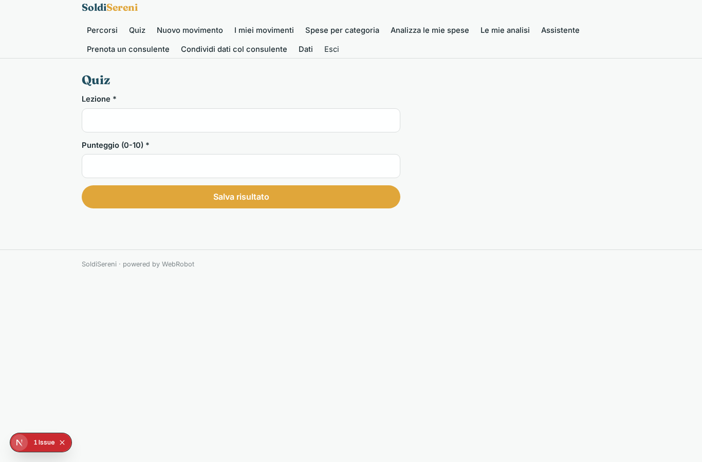

### add_tx
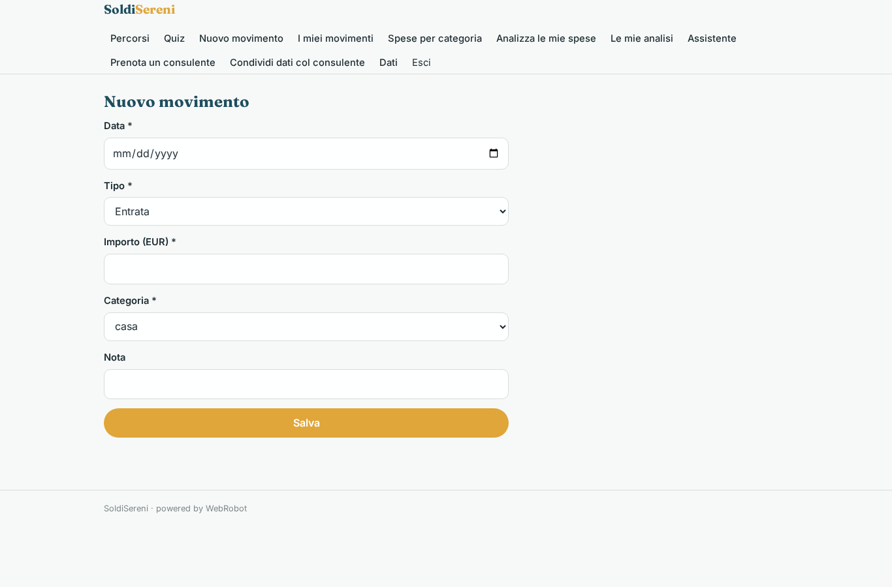

### movements

### by_category
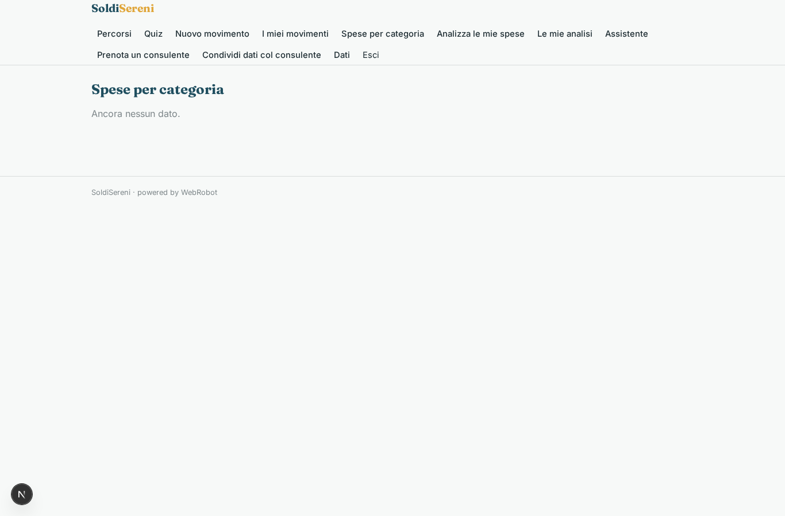

### new_analysis
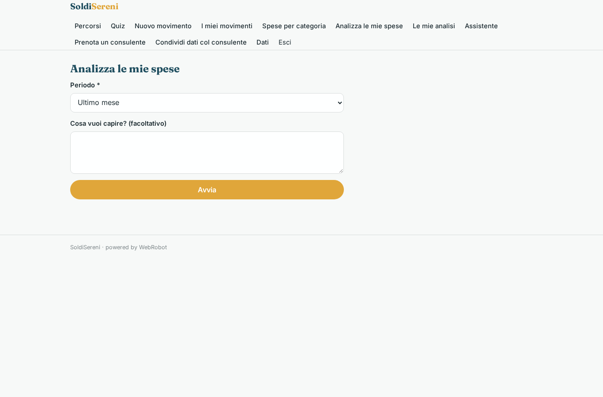

### analyses
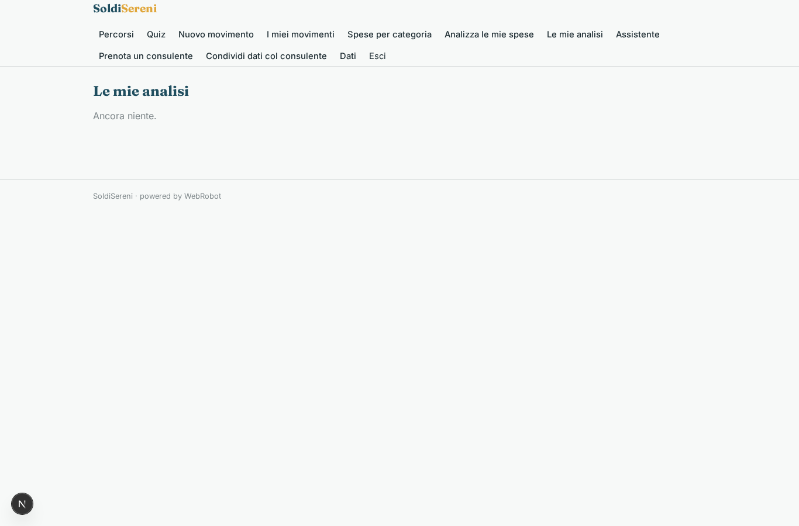

### chat
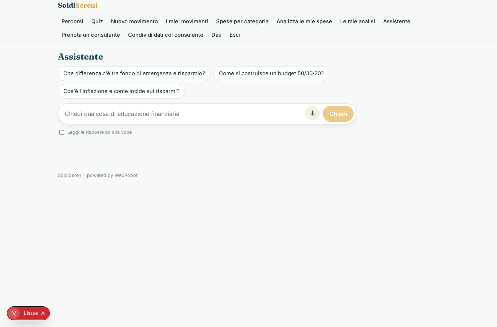

### book
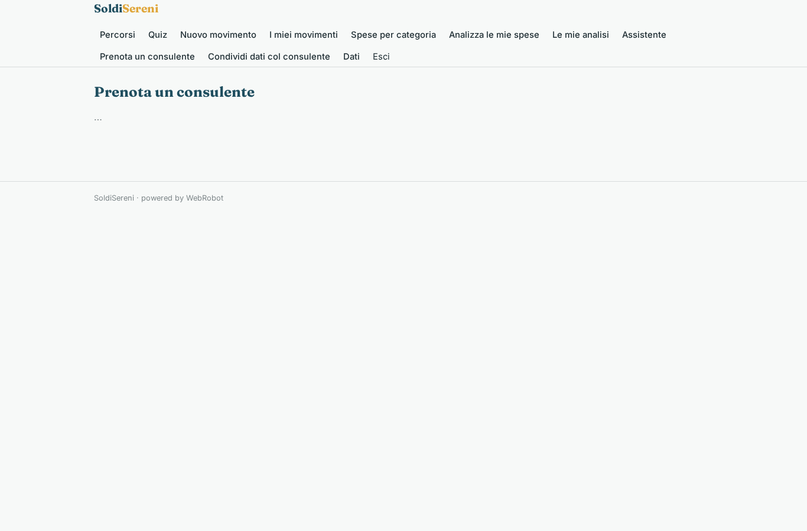

### share
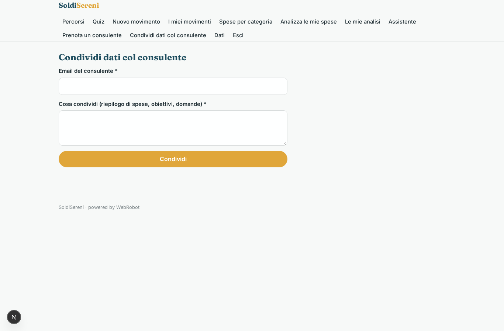

### clients
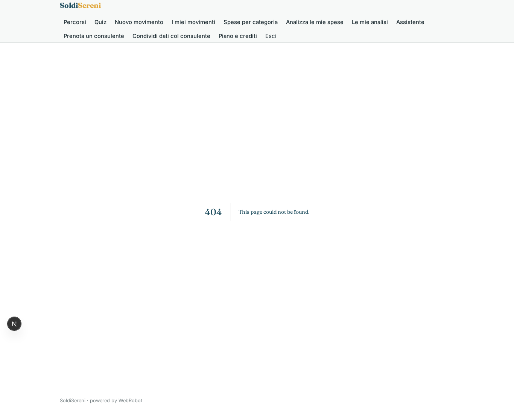

### account
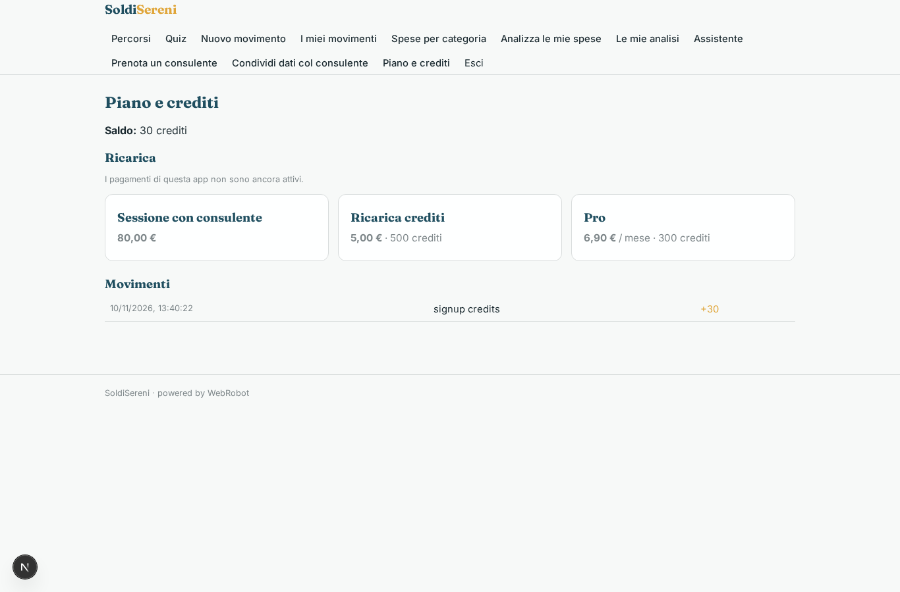
