# FitSlot

_Prenota uno spazio fitness e paghi solo il tempo che usi._

**Stato manifest:** valido (validatore Python + contratto runtime)

## Descrizione data all'app builder

Descrivo solo lo strato software, cioe la piattaforma che gestisce la prenotazione pay per use di spazi fitness; gli spazi fisici e le attrezzature sono un servizio a parte. L'utente cerca una palestra o uno spazio per orario, zona e tipo di attivita, vede disponibilita e prezzo a sessione, prenota uno slot e paga online con carta solo per il tempo che usa, ricevendo un codice o un QR per l'accesso. Un agente suggerisce gli spazi piu adatti in base alle preferenze e agli orari abituali dell'utente e invia promemoria prima della sessione prenotata. Il gestore dello spazio pubblica orari, capienza e prezzi, vede le prenotazioni e la saturazione delle fasce, e gestisce aperture straordinarie. L'utente vede le proprie prenotazioni e lo storico, il gestore quelle del proprio spazio, l'admin tutto. Report periodico via email al gestore su utilizzo e incassi. Monetizzazione: commissione sulle prenotazioni. In italiano e inglese.

## Funzioni non esprimibili oggi (spec.extensions)

- **slot_booking_payment**: Availability by slot, booking with card payment per session and commission on each booking need booking logic beyond the manifest; collections hold the data.
- **access_qr**: Generation of the access code / QR for each paid booking.
- **manager_booking_view**: Managers must see bookings and occupancy of their own space only; bookings are user-owned, so a per-space view and the space_stats aggregates need custom code.
- **email_reminders_and_reports**: Not available yet: email reminders before a session and the periodic email report to managers. Reports are available in the app (space_reports); reminders require notifications.

## Screenshot (runtime interpretativo)

### home-anon
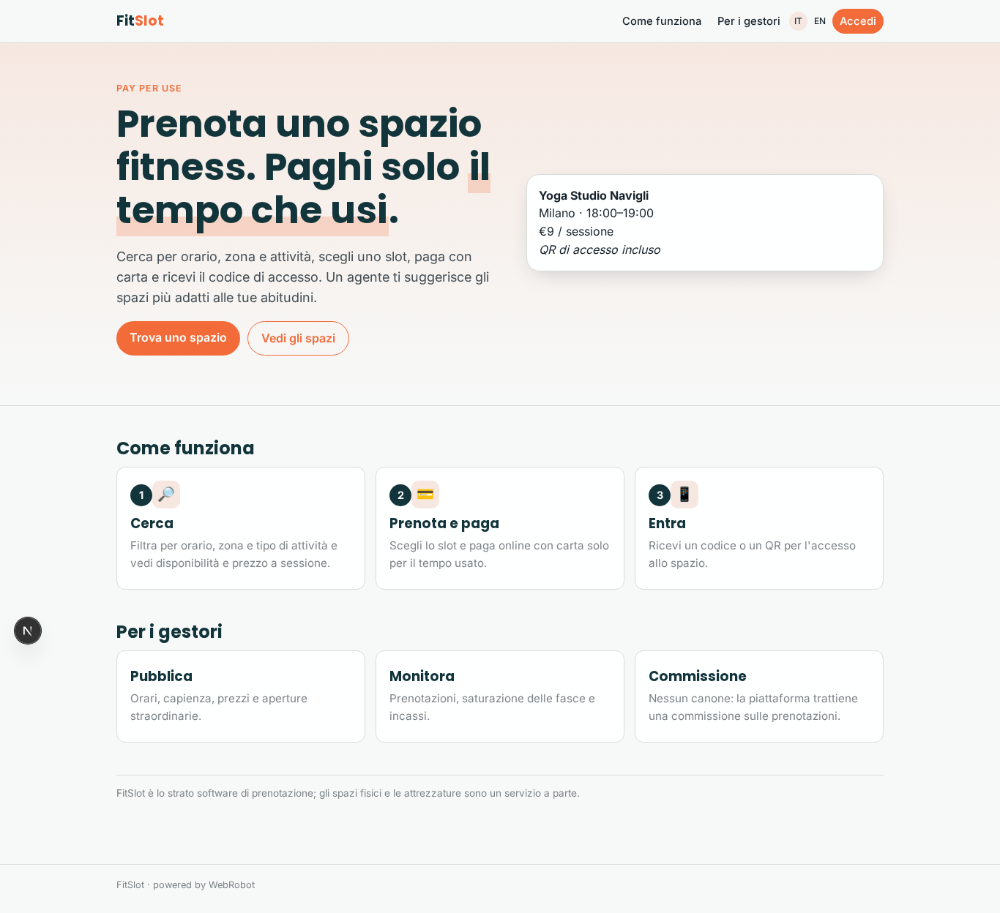

### home-mobile
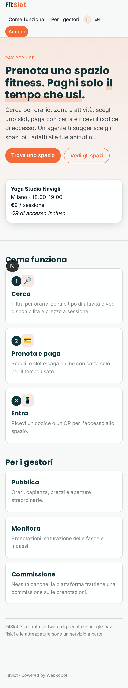

### home
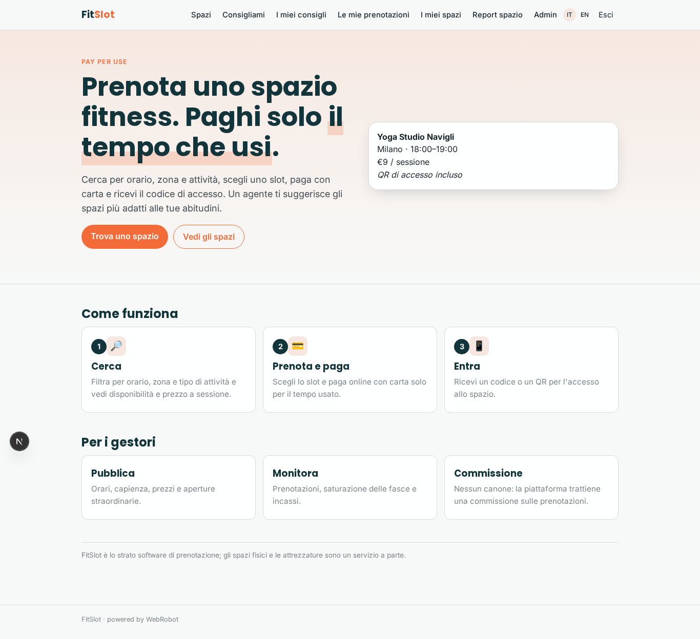

### spaces
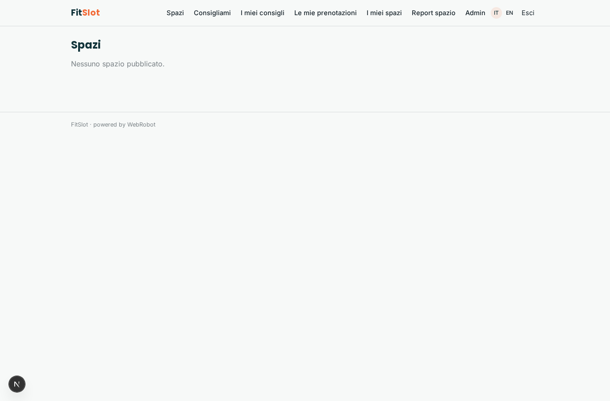

### new_search
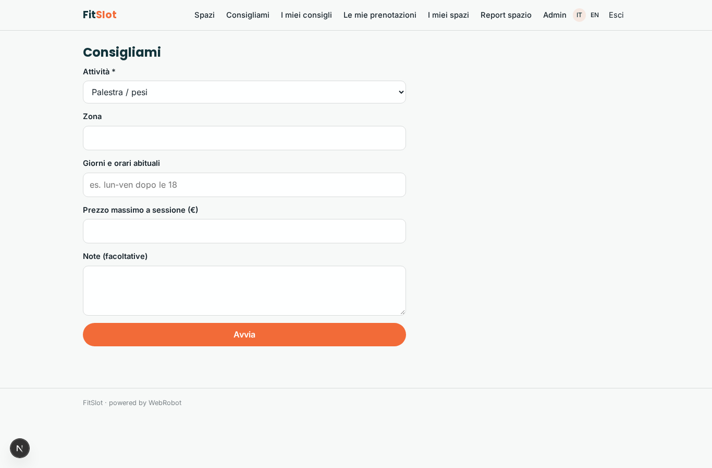

### suggestions
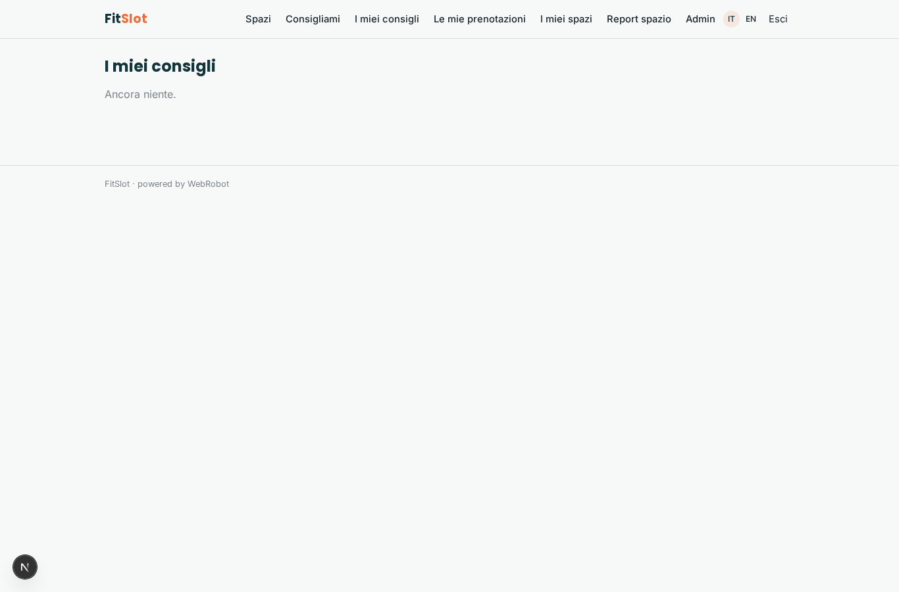

### my_bookings
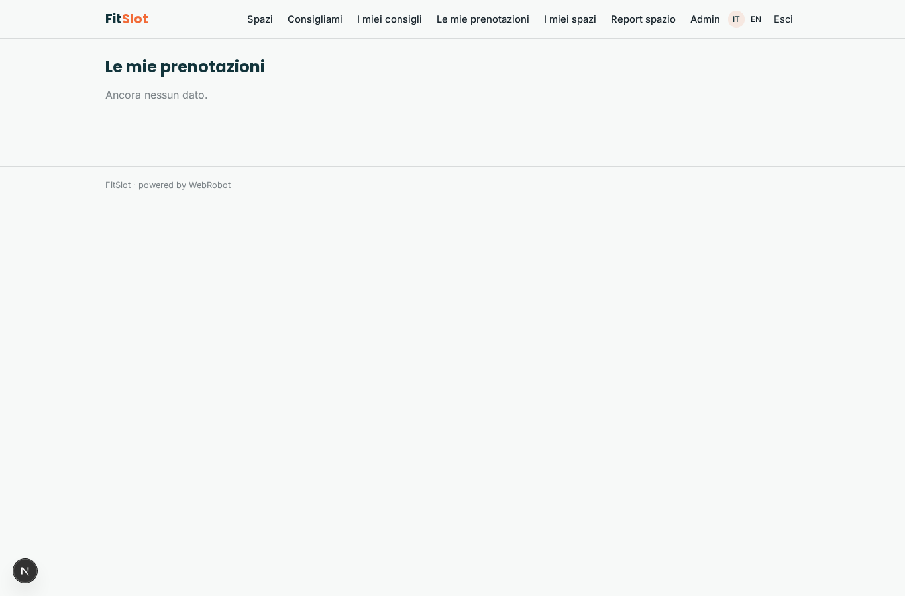

### manager_spaces
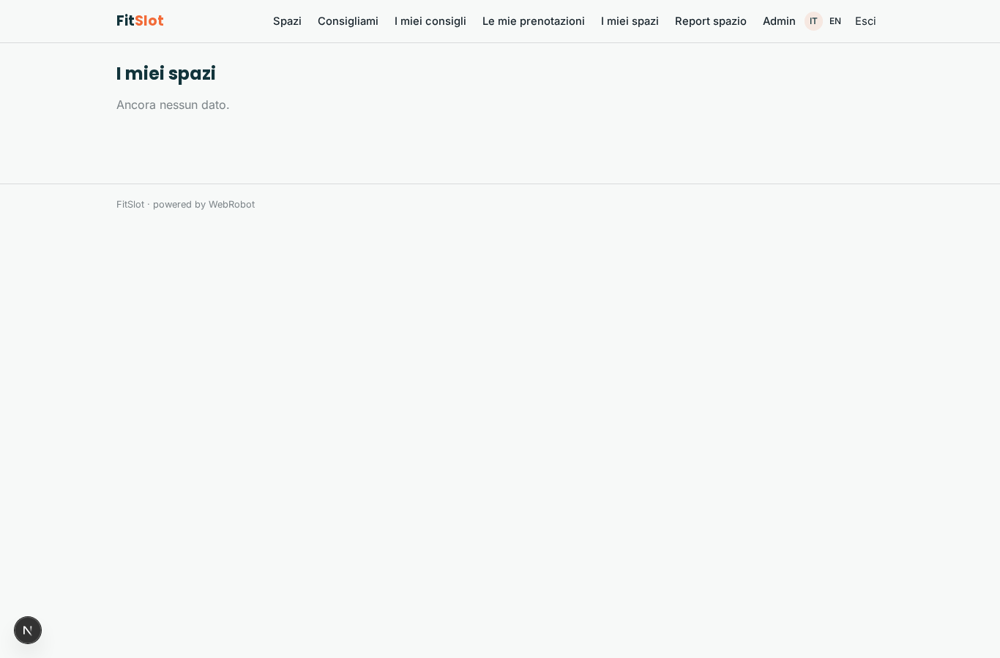

### space_reports_view
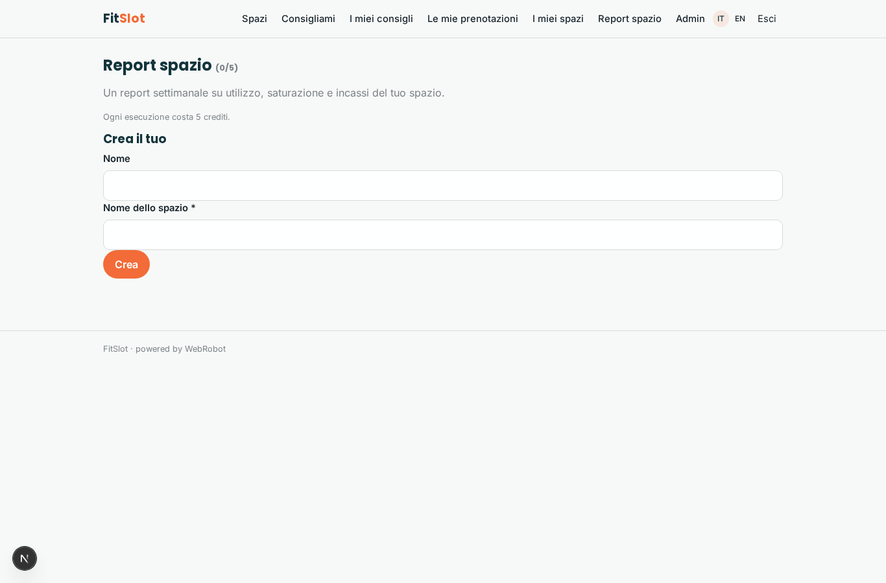

### account
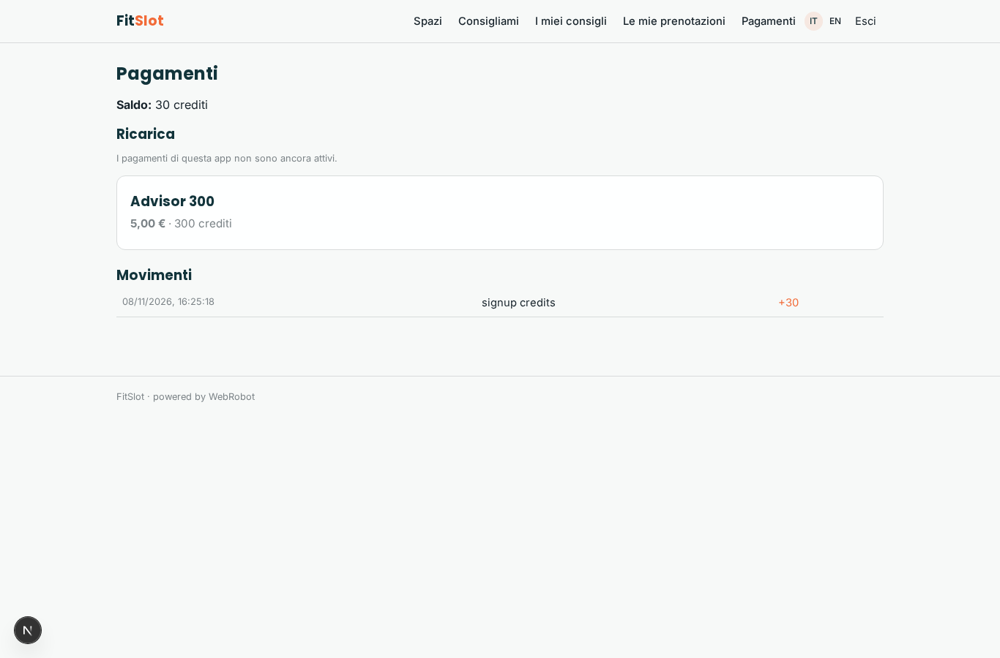

### admin
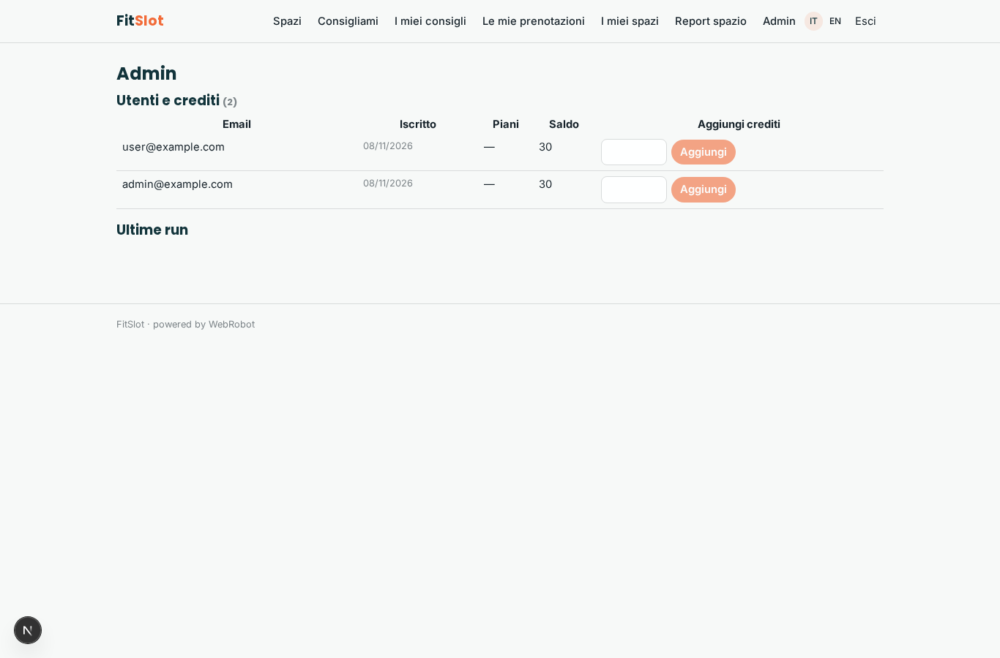

