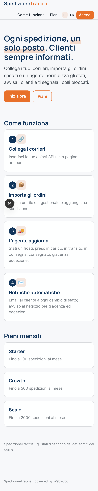
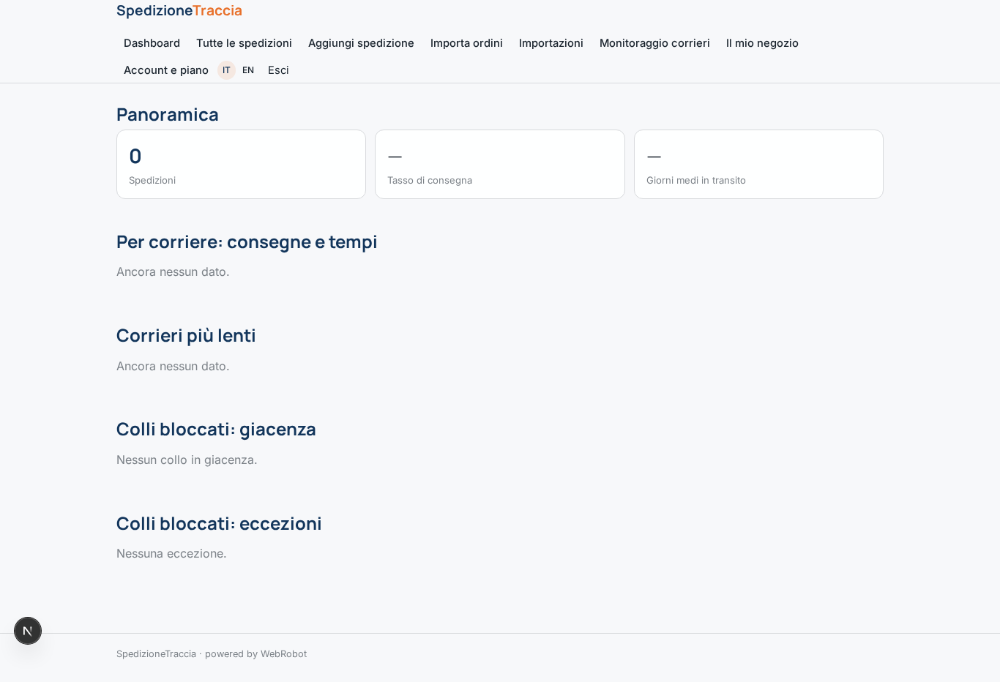
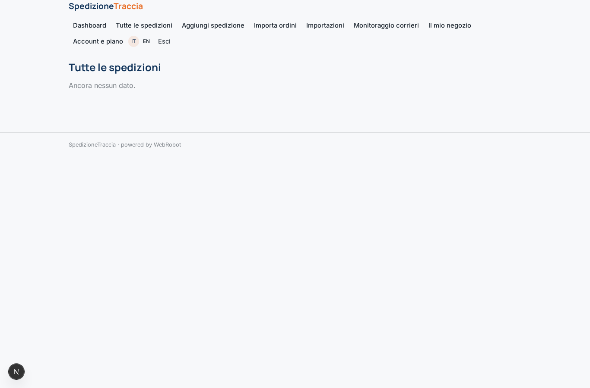
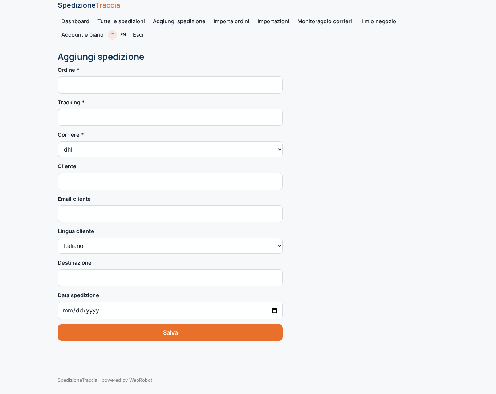
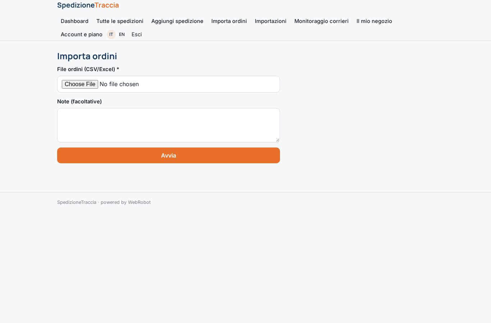
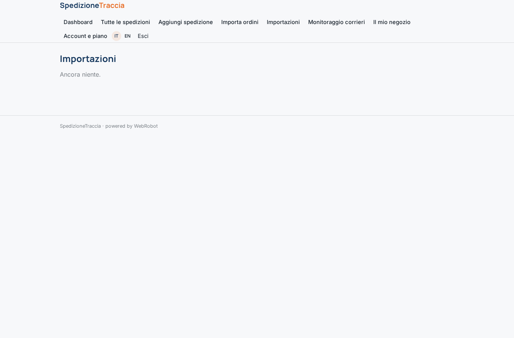
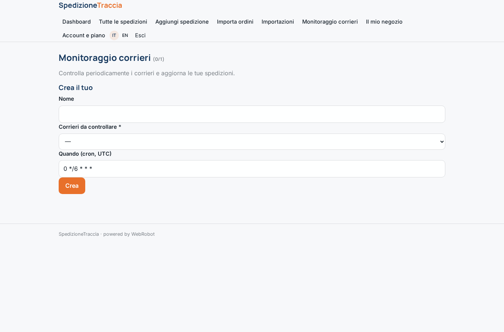
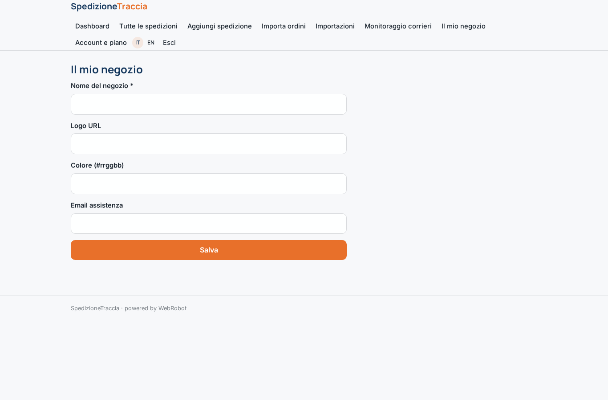
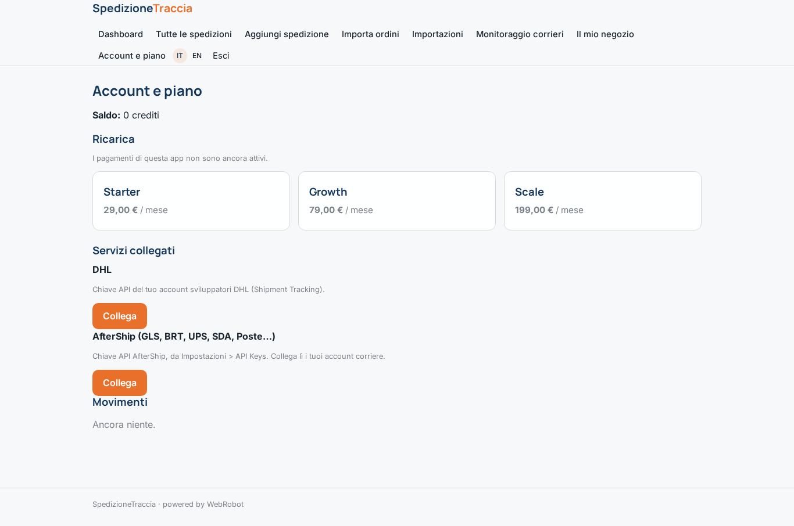

# SpedizioneTraccia

_Tracciamento spedizioni e notifiche ai clienti, in un unico posto._

**Manifest:** valid (schema + runtime contract) · **Functional test:** passed (15 checks passed)

## Description given to the app builder (Italian)

SpedizioneTraccia da agli e-commerce il tracciamento delle spedizioni e le notifiche ai clienti in un unico posto. Il negozio collega i propri corrieri tramite accesso autorizzato e invia gli ordini spediti con numero di tracking, oppure li importa via webhook dal proprio gestionale. Un agente interroga periodicamente i corrieri, normalizza i diversi stati in un percorso unico (preso in carico, in transito, in consegna, consegnato, giacenza, eccezione) e aggiorna ogni spedizione. Quando lo stato cambia, parte una notifica email al cliente finale con la grafica del negozio e un link a una pagina di tracciamento brandizzata; per gli stati critici come giacenza o mancata consegna l'agente avvisa anche il negozio. Una dashboard mostra tutte le spedizioni, i corrieri piu lenti, i tassi di consegna e i colli bloccati, con filtri e ricerca. Ogni negozio vede solo i propri ordini. Abbonamento mensile a scaglioni di spedizioni gestite. Interfaccia in italiano e inglese, notifiche nella lingua del cliente.

## Features not expressible today (spec.extensions)

- **carrier_oauth**: OAuth authorisation to carriers is not available yet: stores connect carriers with API keys (DHL directly; GLS, BRT, UPS, SDA, Poste through their AfterShip key).
- **orders_webhook**: Per-store webhook import of orders from the store's management system is not available yet: use the file import or the add-shipment form.
- **branded_emails**: Customer emails are plain text, bilingual (IT/EN in one message) and not styled with the store's logo/colours; the store branding is saved but not yet applied. Per-customer language selection of the message is not available.
- **public_tracking_page**: A public branded tracking page for end customers (no login) is not available yet, because shipment records are private to each store; emails therefore carry no tracking link.

## Screenshots (interpretive runtime, no data)

### home-anon

### home-mobile

### home

### dashboard

### shipments_table

### add_shipment

### import

### imports

### watches

### store_settings

### account

