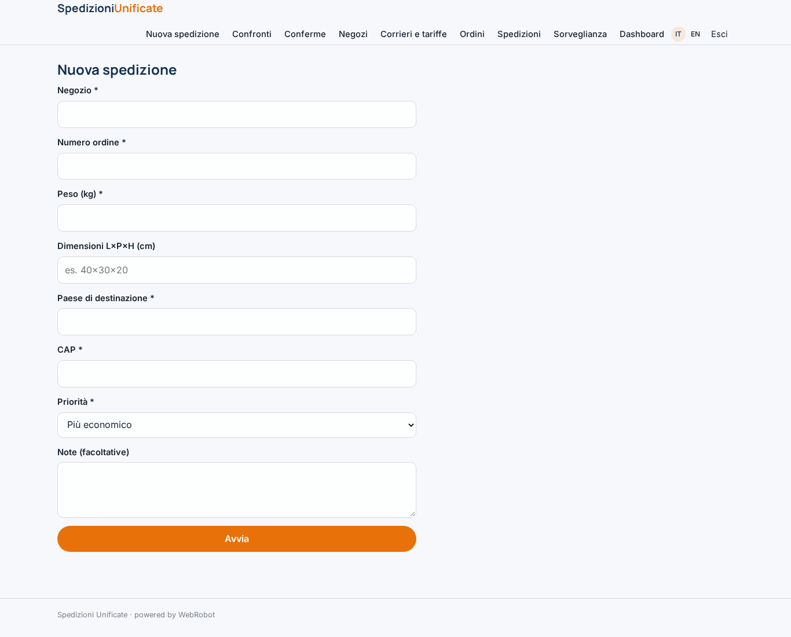
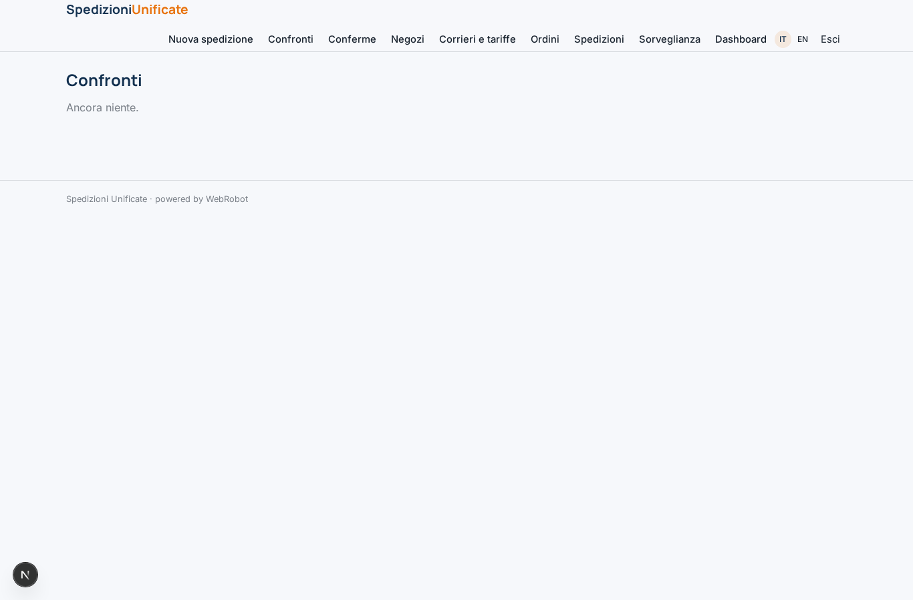
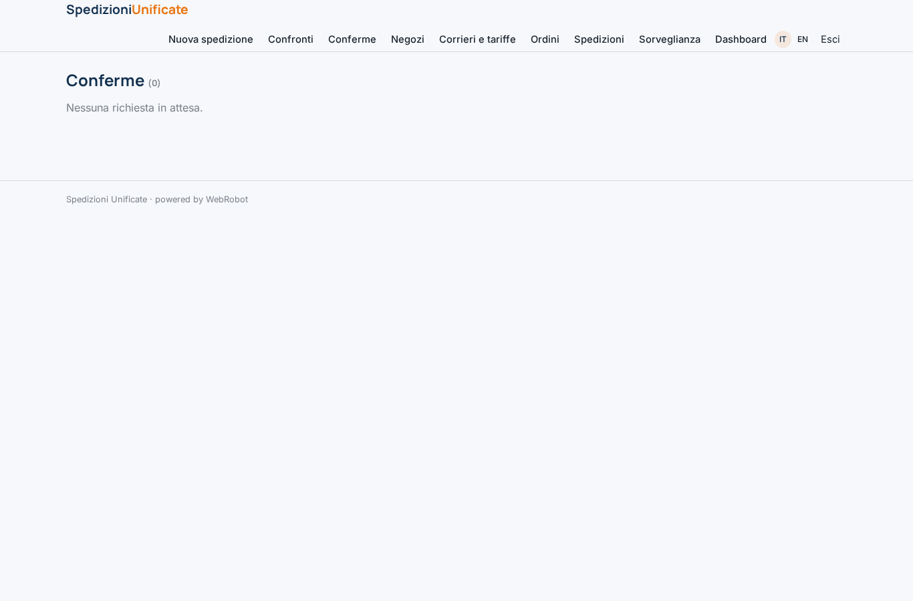
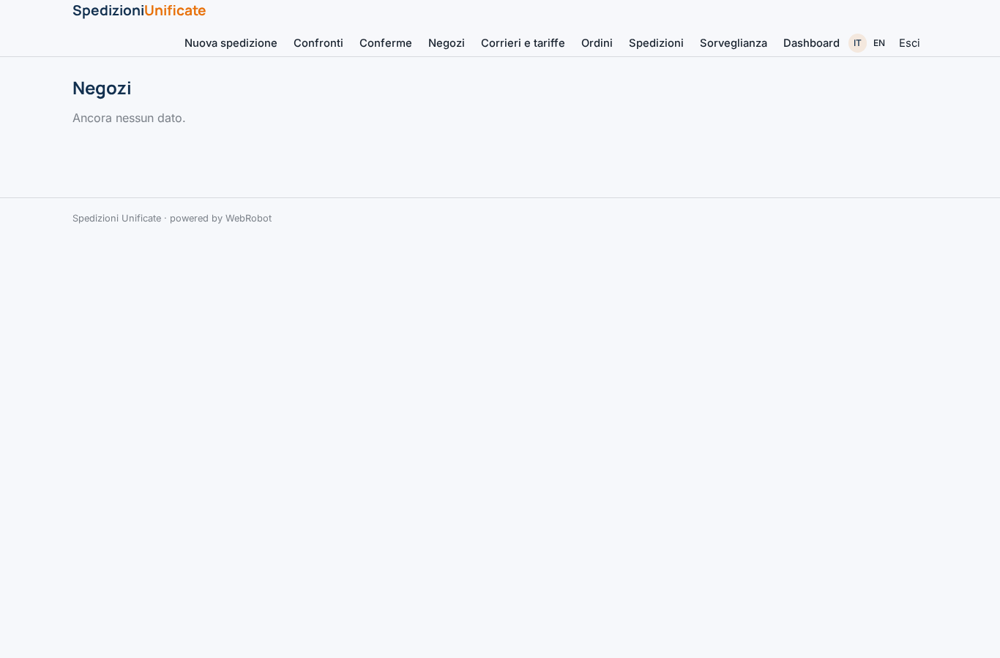
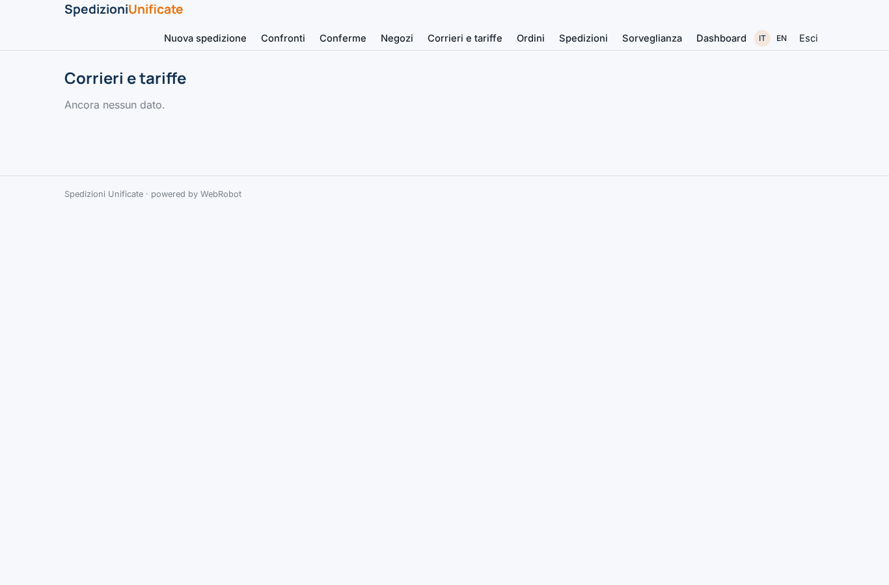
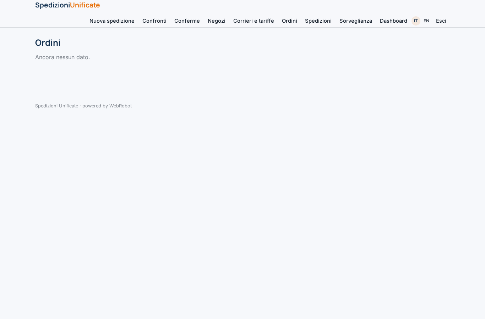
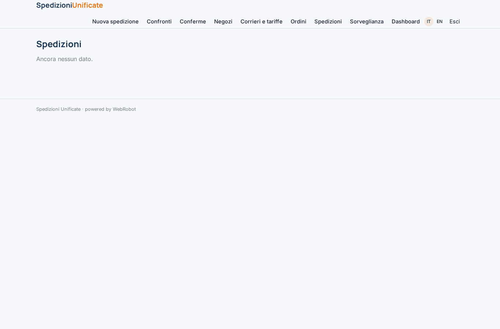
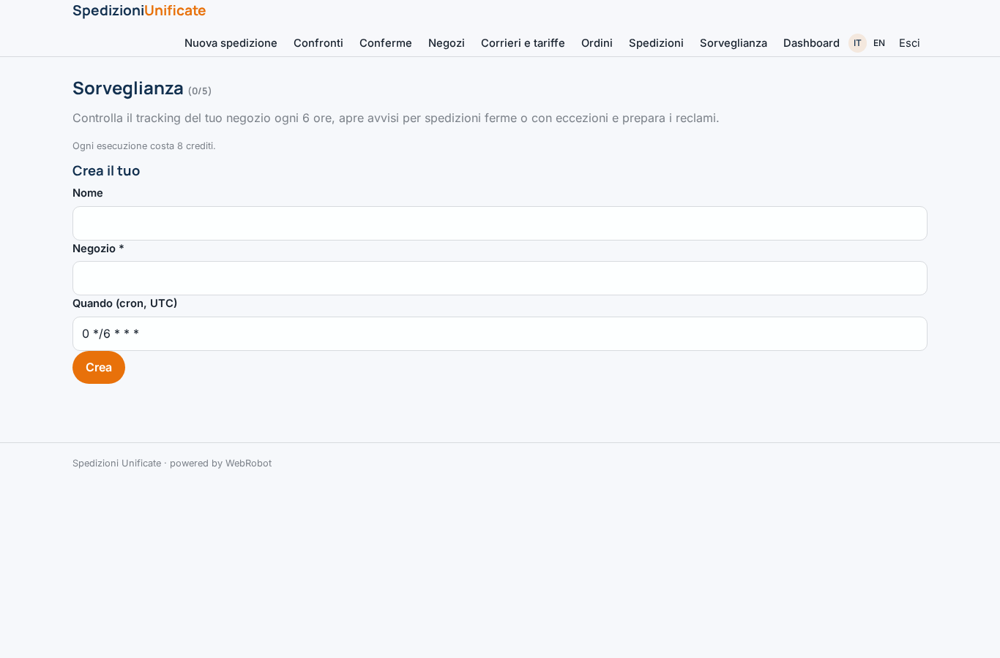
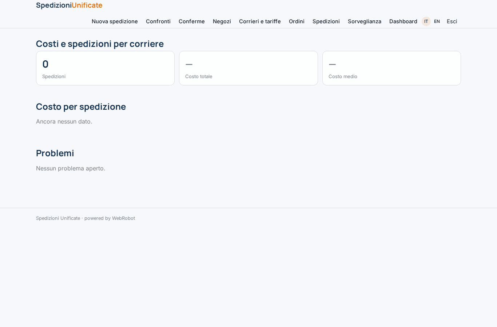
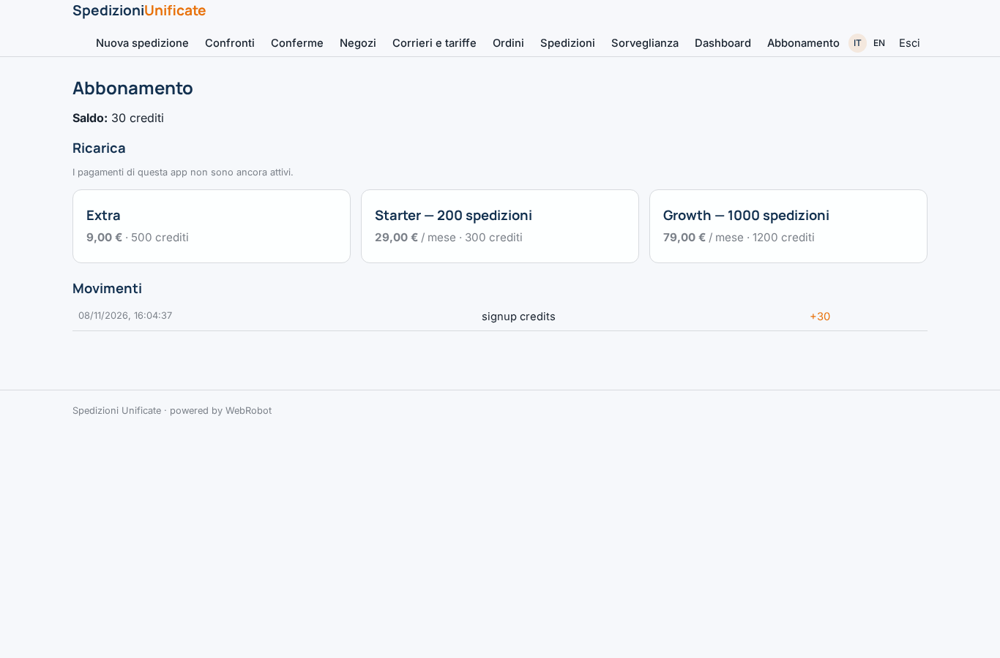

# Spedizioni Unificate

_Un pannello unico per spedire con più corrieri: tariffe a confronto, tracking e reclami._

**Manifest status:** valid (schema validator + runtime contract)

## Description given to the app builder (Italian)

Ci serve Spedizioni Unificate, un pannello unico per negozi online che spediscono con più corrieri. Il negoziante si registra, collega via OAuth il suo negozio Shopify, WooCommerce o un marketplace per importare gli ordini in automatico, e inserisce i propri contratti con i corrieri (chiavi API). Per ogni ordine un agente confronta le tariffe dei corrieri collegati in base a peso, dimensioni e destinazione, propone il più conveniente o il più veloce secondo le regole del negoziante e crea la spedizione stampando l'etichetta. Poi interroga ogni poche ore le API di tracking dei corrieri e riceve i loro webhook; a ogni cambio di stato manda al cliente finale un'email brandizzata con lo stato aggiornato. Se una spedizione è ferma da più di due giorni o c'è un'eccezione di consegna, crea un avviso nella coda del negoziante e prepara il reclamo al corriere. Il cliente finale può aprire una pagina di tracking e chiedere un reso compilando un modulo. Il negoziante vede dashboard di costi, tempi e problemi per corriere; ogni membro del team vede solo i suoi negozi. Abbonamento mensile per numero di spedizioni.

## Features not expressible today (spec.extensions)

- **shop_oauth**: Collegamento OAuth a Shopify, WooCommerce e marketplace con import automatico degli ordini: non disponibile, gli ordini si inseriscono a mano.
- **carrier_api**: Chiavi API dei corrieri, tariffe live, creazione spedizione e stampa etichetta, webhook di tracking: non disponibili (servono credenziali per cliente); si usano tabelle tariffarie inserite dal negoziante e il tracking pubblico.
- **customer_emails**: Email brandizzate al cliente finale a ogni cambio di stato e notifiche al negoziante: non disponibili.
- **public_tracking_returns**: Pagina di tracking pubblica per il cliente finale e modulo di reso: richiede lettura/scrittura anonima su dati del negoziante, non disponibile.
- **team_sharing**: Più membri del team sugli stessi negozi con visibilità per negozio: oggi i dati sono per singolo utente.

## Screenshots (interpretive runtime)

### home-anon

### home-mobile

### home

### new_shipment

### history

### approvals

### shops_view

### carriers_view

### orders_view

### shipments_view

### watches

### stats

### account

