# Spedizioni Unificate

_Tutti i tuoi corrieri in un solo pannello: tariffe, etichette, tracking e reclami._

**Manifest:** valid (schema + runtime contract) · **Functional test:** passed (18 checks passed)

## Description given to the app builder (Italian)

Ci serve Spedizioni Unificate, un pannello unico per negozi online che spediscono con più corrieri. Il negoziante si registra, collega via OAuth il suo negozio Shopify, WooCommerce o un marketplace per importare gli ordini in automatico, e inserisce i propri contratti con i corrieri (chiavi API). Per ogni ordine un agente confronta le tariffe dei corrieri collegati in base a peso, dimensioni e destinazione, propone il più conveniente o il più veloce secondo le regole del negoziante e crea la spedizione stampando l'etichetta. Poi interroga ogni poche ore le API di tracking dei corrieri e riceve i loro webhook; a ogni cambio di stato manda al cliente finale un'email brandizzata con lo stato aggiornato. Se una spedizione è ferma da più di due giorni o c'è un'eccezione di consegna, crea un avviso nella coda del negoziante e prepara il reclamo al corriere. Il cliente finale può aprire una pagina di tracking e chiedere un reso compilando un modulo. Il negoziante vede dashboard di costi, tempi e problemi per corriere; ogni membro del team vede solo i suoi negozi. Abbonamento mensile per numero di spedizioni.

## Features not expressible today (spec.extensions)

- **oauth_stores**: Il collegamento OAuth a Shopify, WooCommerce e marketplace non è ancora disponibile: Shopify si collega con il token di un'app personalizzata, WooCommerce e i marketplace inviano gli ordini via webhook (/api/hooks/order_in).
- **carrier_webhooks_routing**: I webhook dei corrieri sono salvati come eventi (codice e stato) e letti al controllo successivo; l'instradamento istantaneo per negozio e le API esatte dei corrieri vanno verificati con la documentazione di ciascun contratto.
- **return_routing**: Il modulo di reso pubblico arriva all'inbox del proprietario e al negoziante tramite l'email indicata nel link; l'instradamento automatico al negozio e l'etichetta di reso non sono ancora disponibili.
- **label_printing**: L'etichetta è salvata come link restituito dal corriere; la stampa avviene dal browser.

## Screenshots (interpretive runtime, no data)

### home-anon

### home-mobile

### home

### dashboard
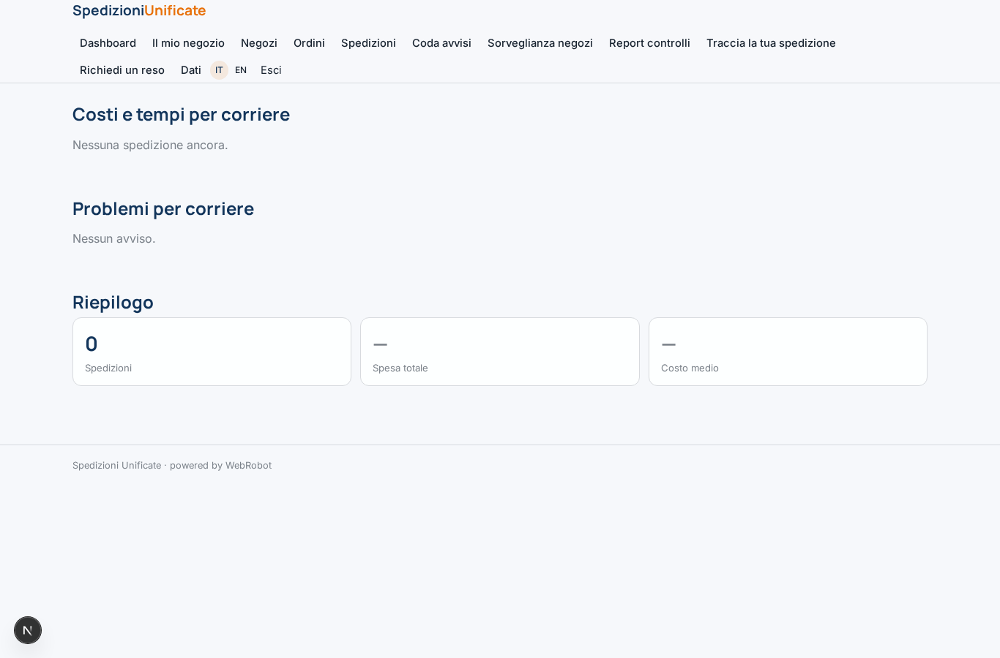

### shop_form
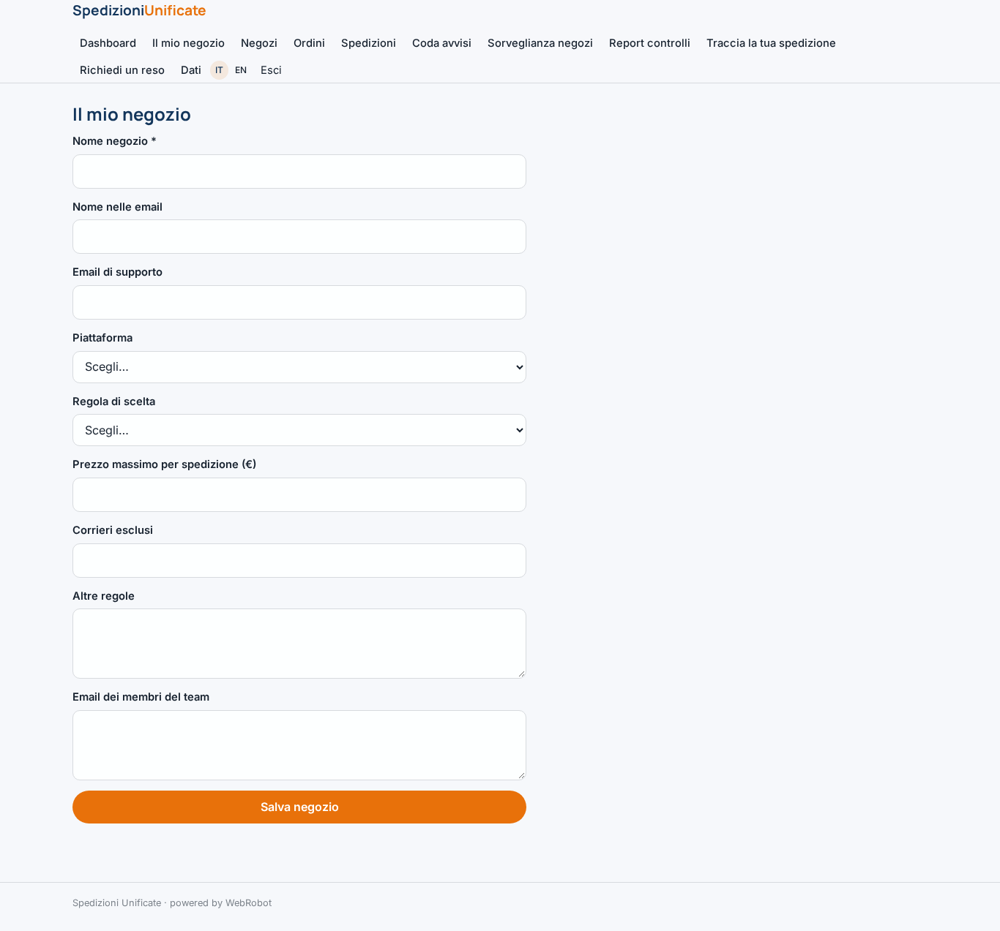

### shops
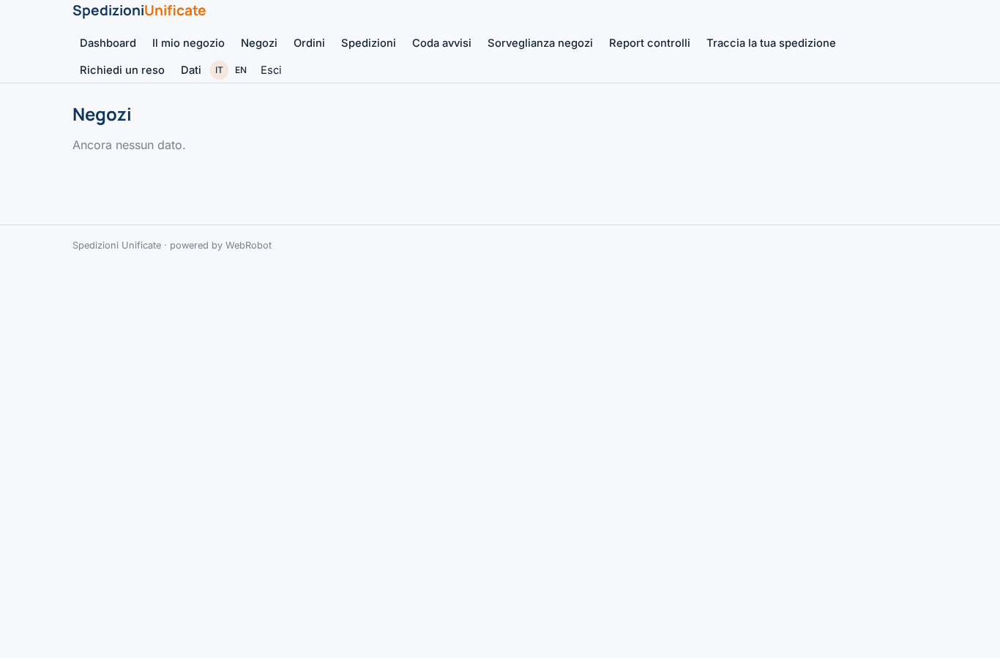

### orders
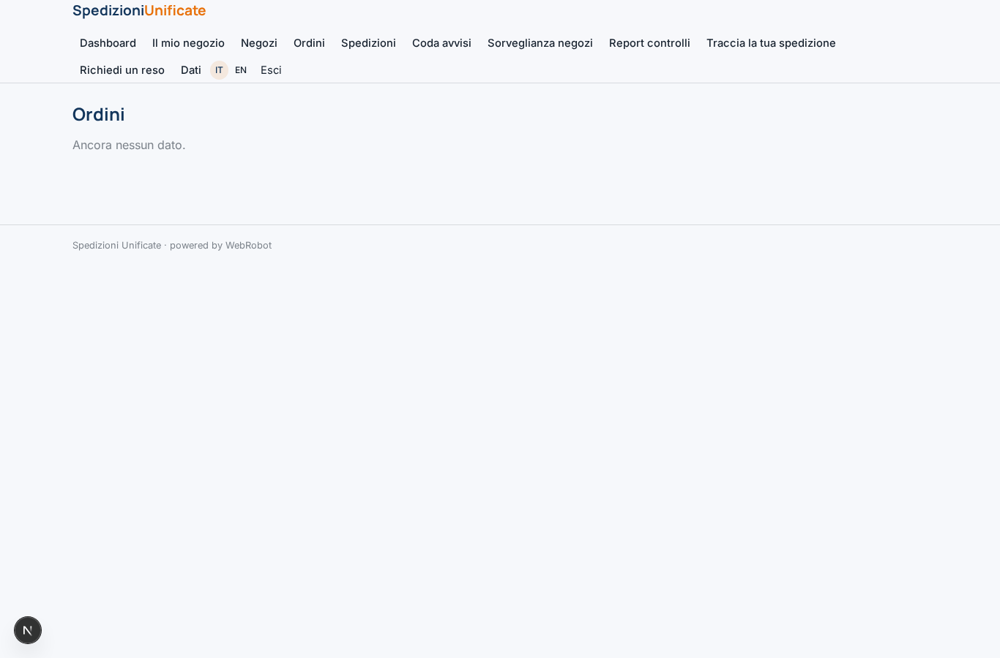

### shipments
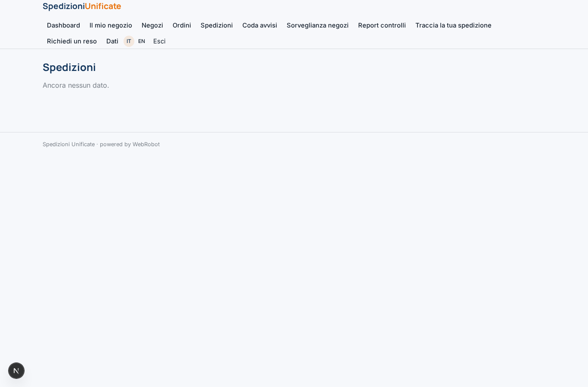

### queue
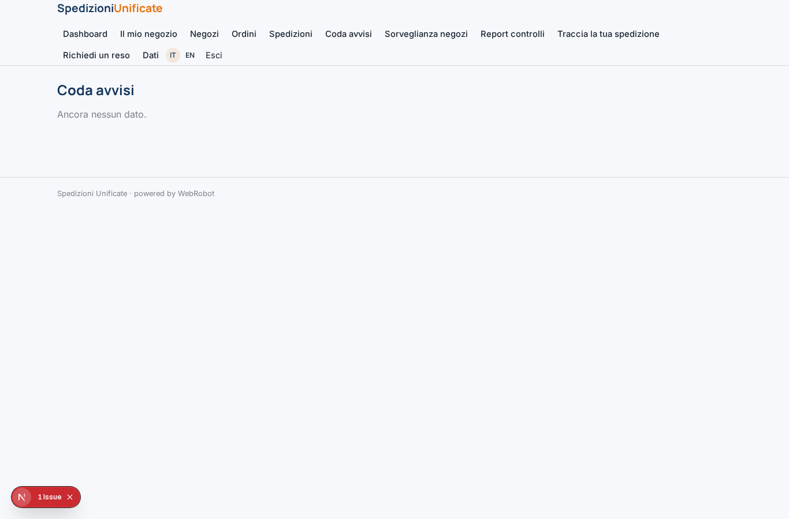

### watches
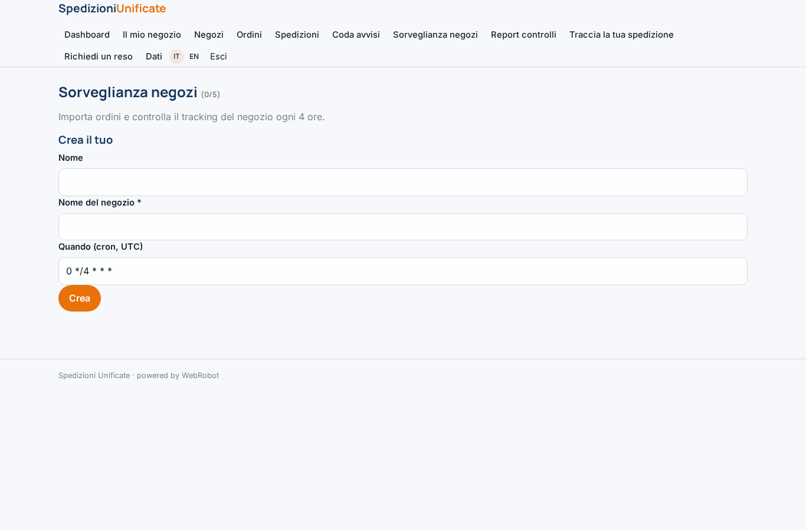

### watch_reports
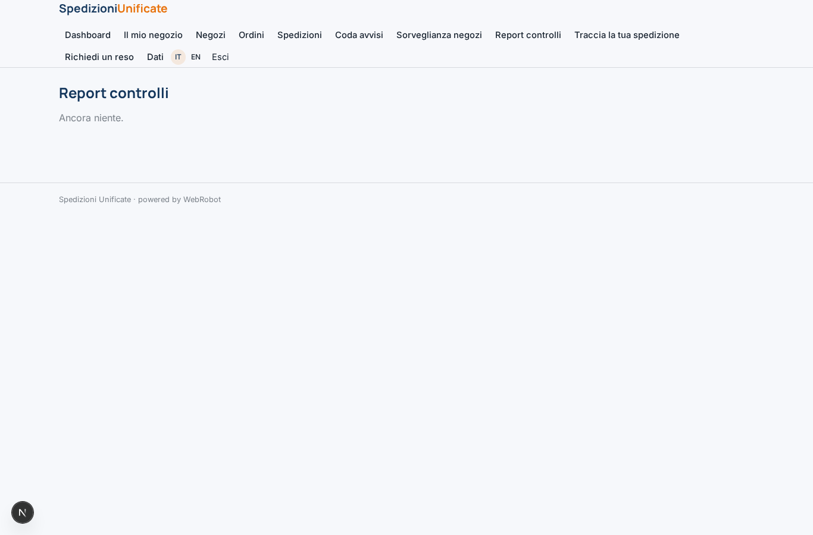

### track
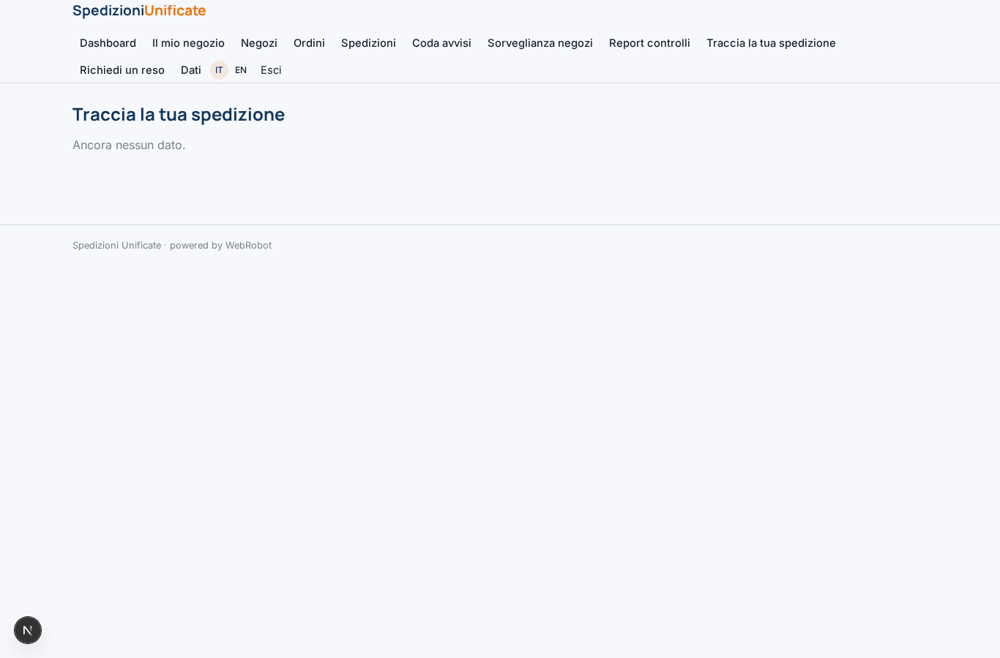

### return
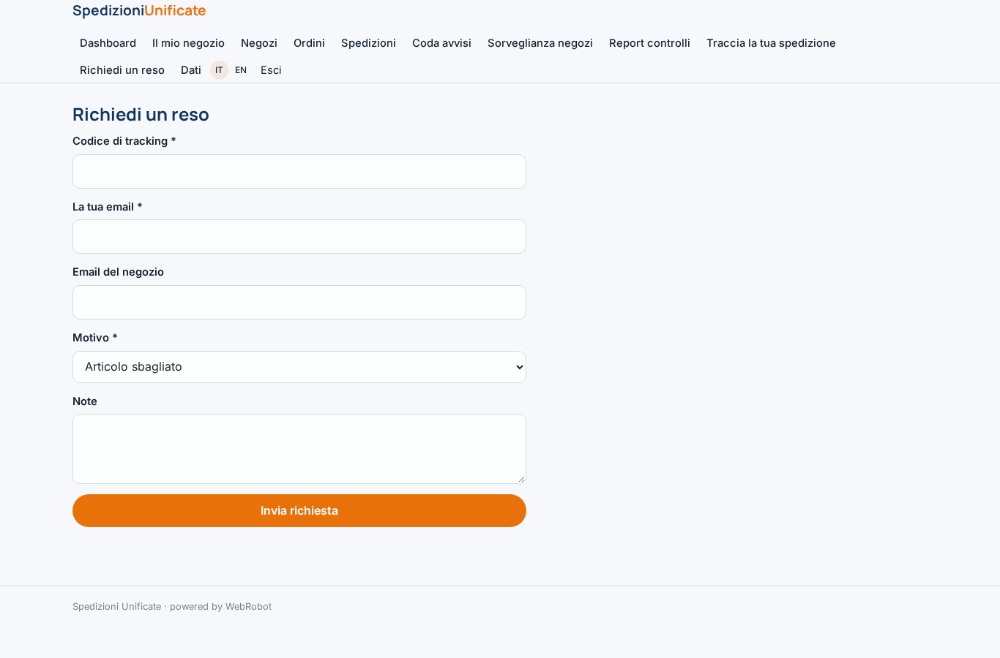

### account
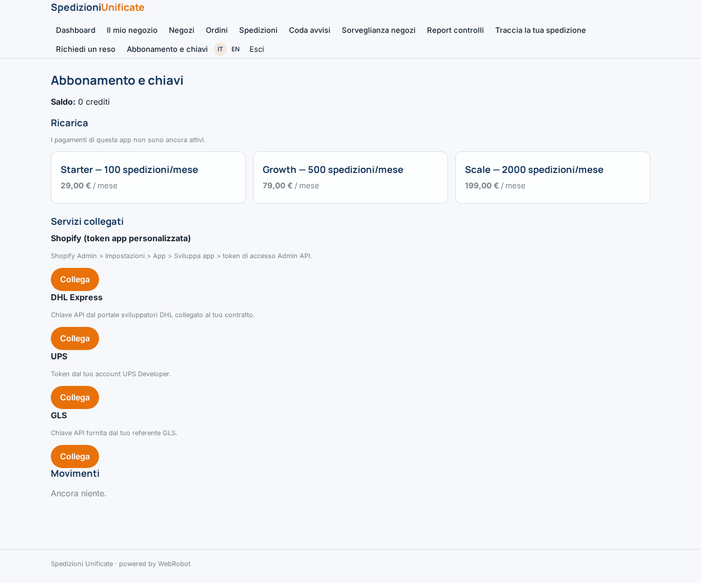
