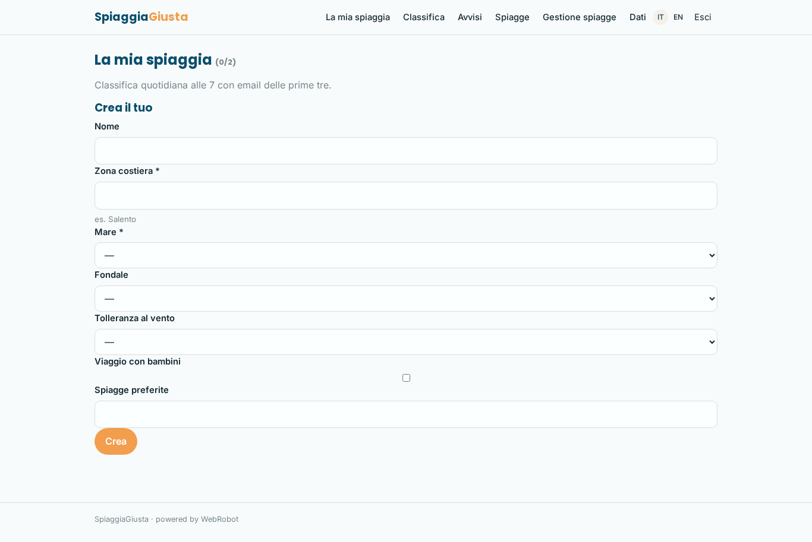
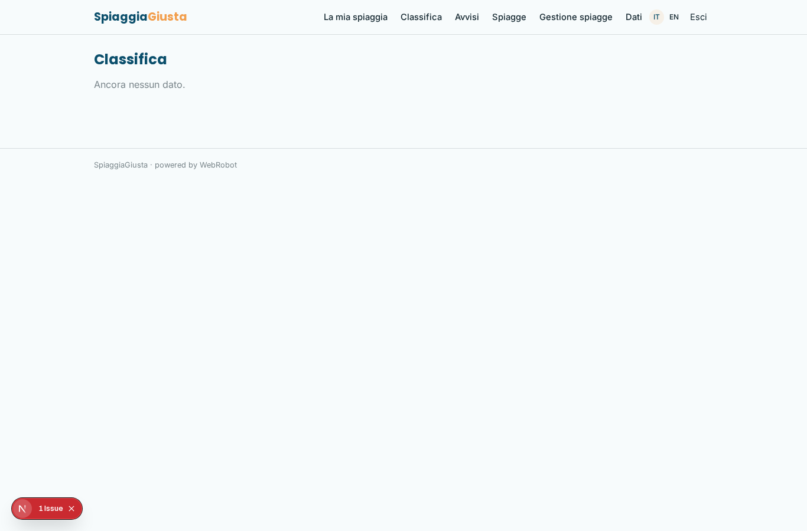
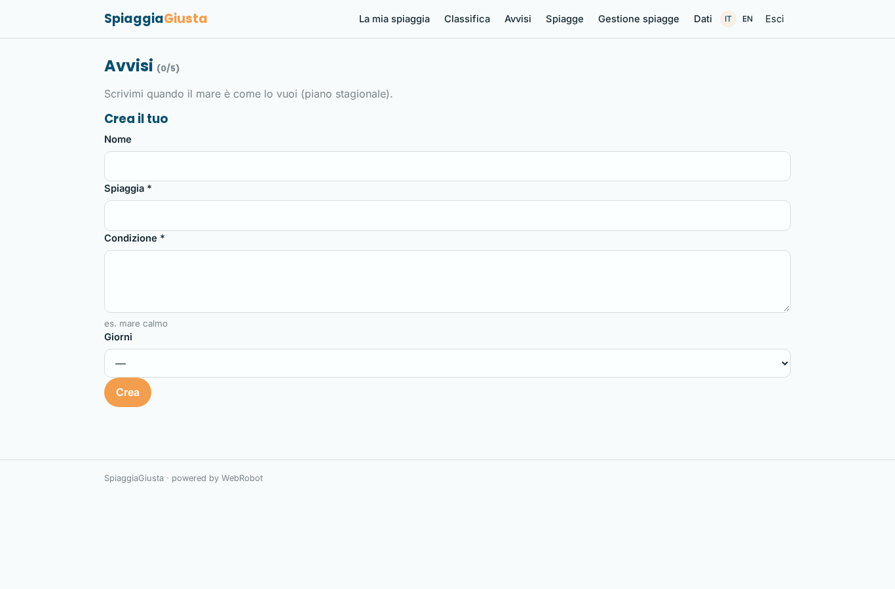
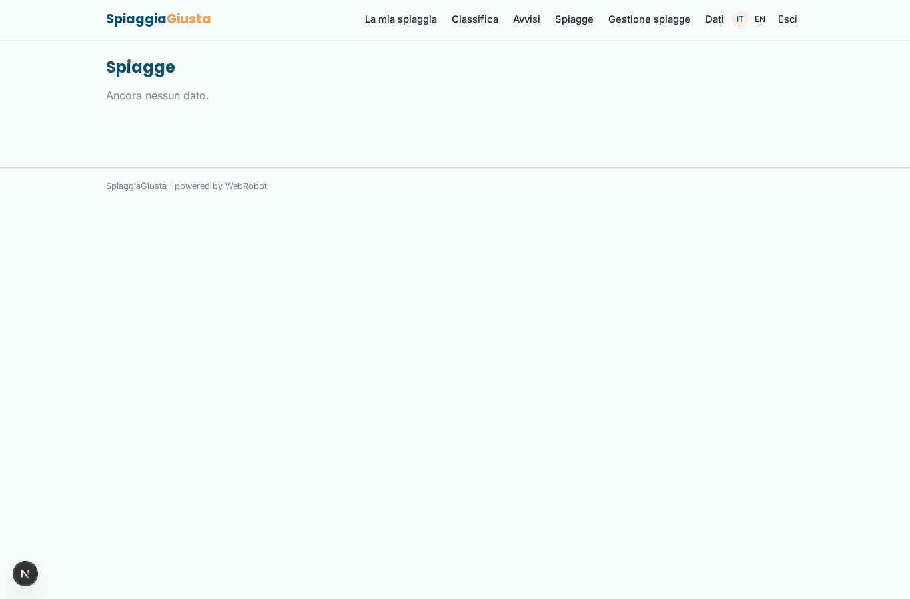
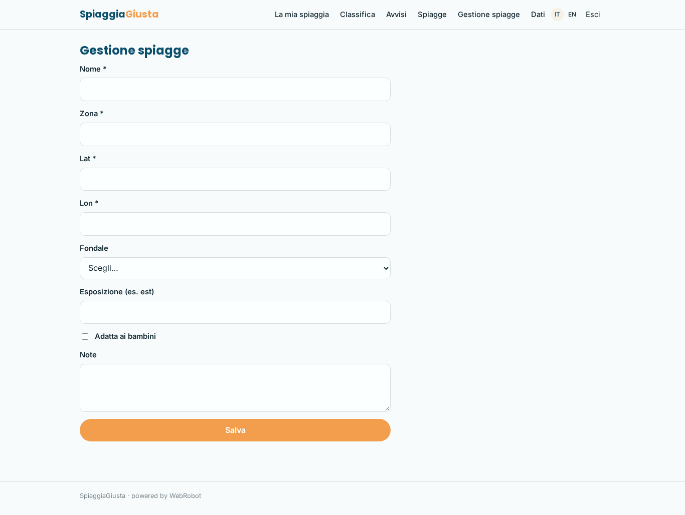
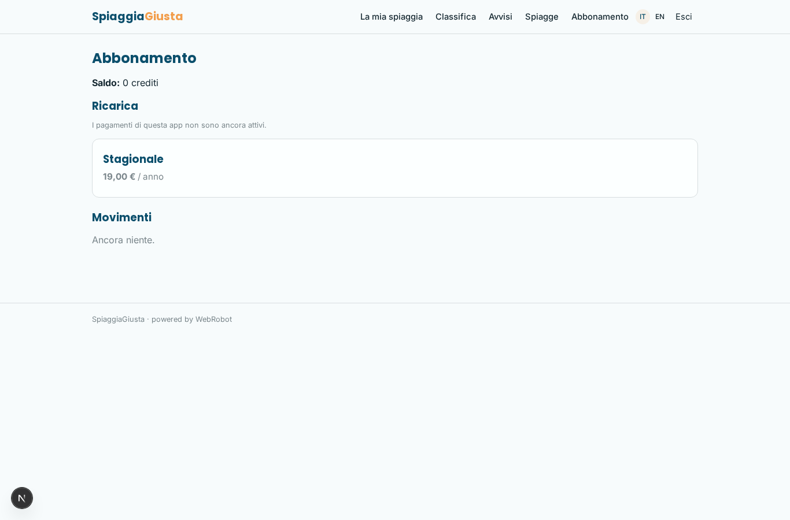

# SpiaggiaGiusta

_La spiaggia migliore di oggi, in base a mare e vento._

**Manifest:** valid (schema + runtime contract) · **Functional test:** passed (12 checks passed)

## Description given to the app builder (Italian)

SpiaggiaGiusta consiglia ogni giorno la spiaggia migliore in base al mare e al vento. L'utente si registra, sceglie una zona costiera, indica le sue preferenze (mare calmo o onde per il surf, sabbia o scogli, tolleranza al vento, presenza di bambini) e le spiagge preferite. Ogni mattina alle 7 un agente scarica le previsioni di Copernicus Marine (onda, temperatura dell'acqua, correnti) e di Open-Meteo (vento, nuvolosità, UV) per le spiagge della zona, calcola un punteggio da 0 a 10 per ciascuna in base alle preferenze dell'utente e spiega il perché in due righe. L'utente vede una classifica giornaliera con punteggi, icone meteo e la previsione per i tre giorni successivi, e riceve un'email mattutina con le prime tre spiagge consigliate. Può anche impostare un avviso del tipo "scrivimi quando nel weekend c'è mare calmo a Torre dell'Orso". Le spiagge e le loro caratteristiche le gestisce l'admin. Gratuito con funzioni base, abbonamento stagionale per avvisi personalizzati. In italiano e inglese.

## Features not expressible today (spec.extensions)

- **copernicus_direct**: Direct access to Copernicus Marine (needs a Copernicus account/credentials and its client): not available; marine data come through the Open-Meteo Marine API.
- **alert_only_when_met**: Alert emails are sent after each daily check (onlyIfNew limits repeats); an email only when the condition is met would need a trigger on a hits collection.

## Screenshots (interpretive runtime, no data)

### home-anon

### home-mobile

### home

### picks

### ranking

### alerts

### beaches_list

### beaches_admin

### account

