# Sportello Sempre Aperto

_Il servizio clienti della tua azienda, aperto 24 ore su 24._

**Stato manifest:** valido (validatore Python + contratto runtime)

## Descrizione data all'app builder

Ci serve Sportello Sempre Aperto, un servizio clienti fatto di agenti per aziende di servizi, per esempio utility locali o centri medici. L'admin dell'azienda carica la base di conoscenza: FAQ, listini, procedure, orari, condizioni contrattuali. Il cliente finale può contattare l'azienda in quattro modi: chiamata telefonica al numero aziendale, messaggio WhatsApp, email alla casella di assistenza, oppure voce e chat dal sito. In tutti i canali risponde lo stesso agente, che riconosce la richiesta, risponde usando la base di conoscenza, raccoglie dati come numero cliente e motivo del contatto, apre un ticket e, se la questione è complessa o il cliente è arrabbiato, passa a un operatore umano con un riassunto. Le email in arrivo vengono lette e ricevono una risposta in bozza che l'operatore può approvare con un clic. Gli operatori vedono una coda unica dei ticket con trascrizioni; il responsabile vede una dashboard con volumi, tempi e soddisfazione. Ogni azienda vede solo i propri clienti. Pagamento a consumo per minuti di voce e conversazioni, con canone base mensile.

## Funzioni non esprimibili oggi (spec.extensions)

- **whatsapp_channel**: WhatsApp is not available yet: it needs each company's own WhatsApp Business credentials. Use phone, email and web for now.
- **file_upload**: File upload is not available: the knowledge base is entered as pasted text or links.
- **public_web_widget**: A public website widget for the company's end customers (anonymous, tied to one company's data) is not available yet; the chat view here is for testing and internal use.
- **operator_roles**: Separate operator and manager roles seeing the company's tickets are not expressible yet: operators use the company account. Approvals are decided by the company user.
- **voice_minute_billing**: Billing per voice minute is approximated by metered credits (tokens and compute); an explicit per-minute rate is not available. Notifications to the operator on escalation are not available.

## Screenshot (runtime interpretativo)

### home-anon
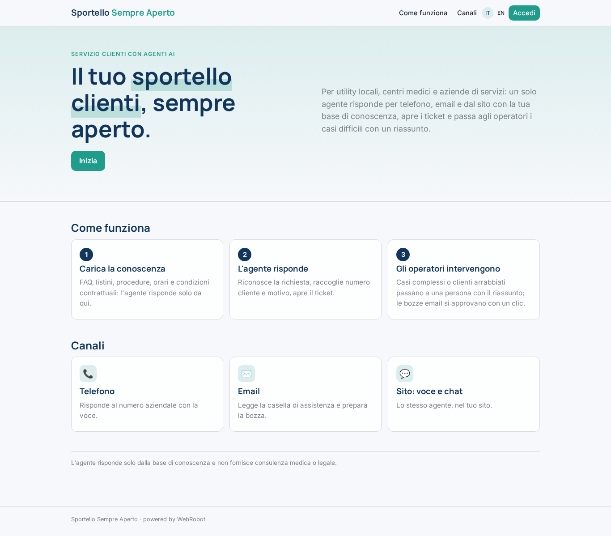

### home-mobile
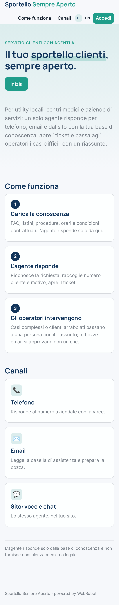

### home
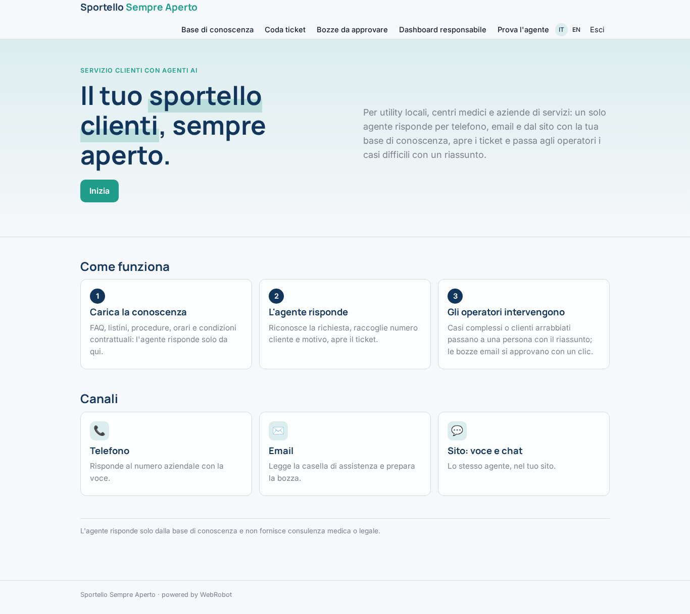

### knowledge_base
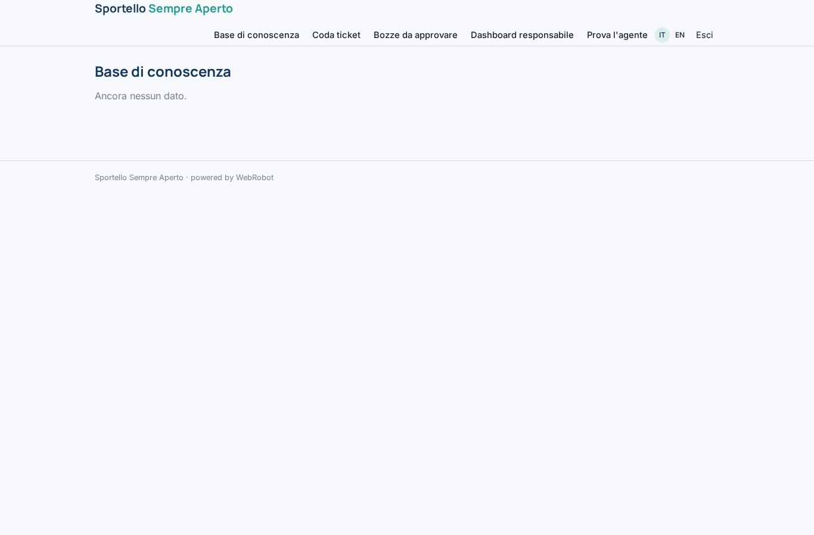

### queue
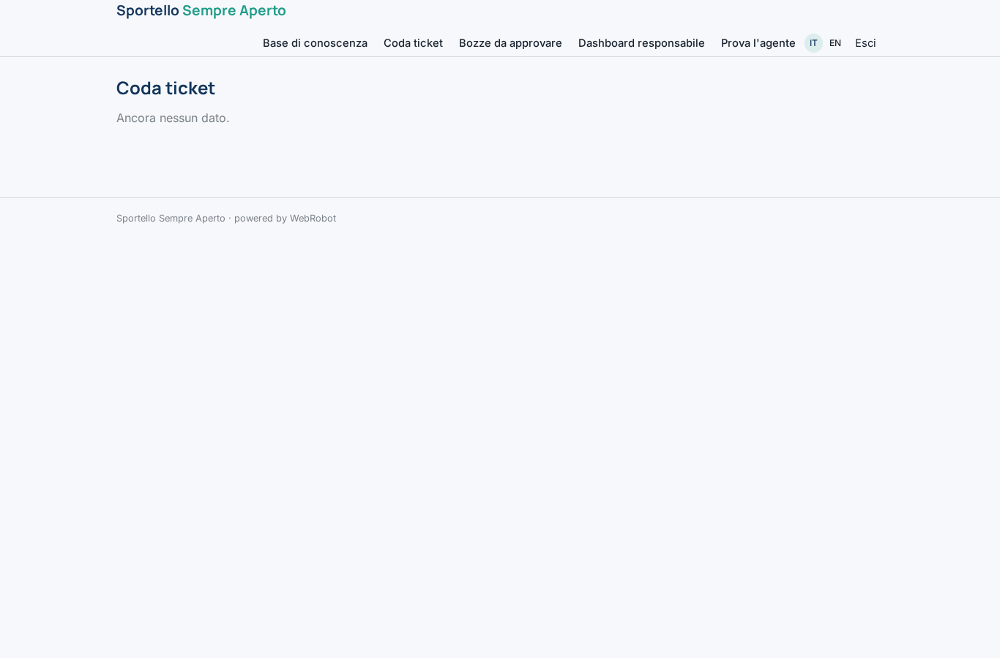

### drafts
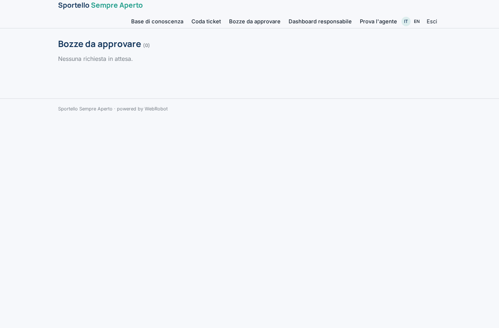

### kpis
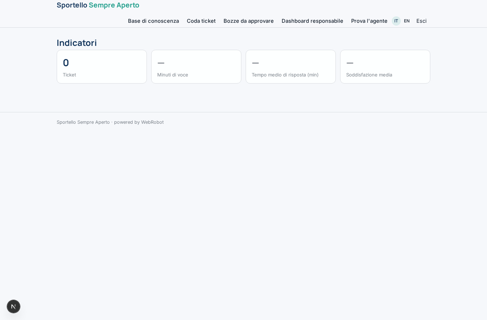

### by_channel
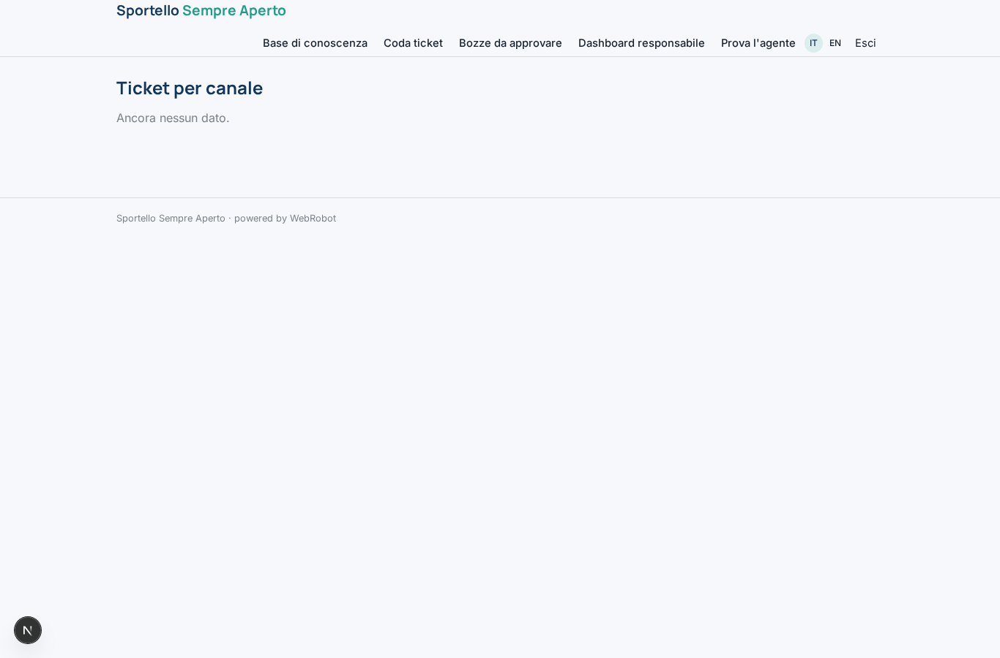

### dashboard
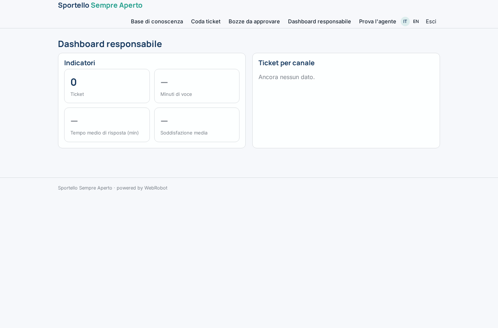

### test_chat
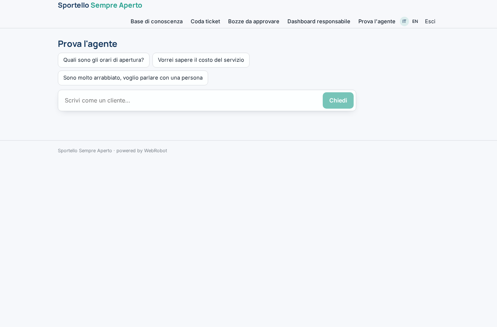

### account
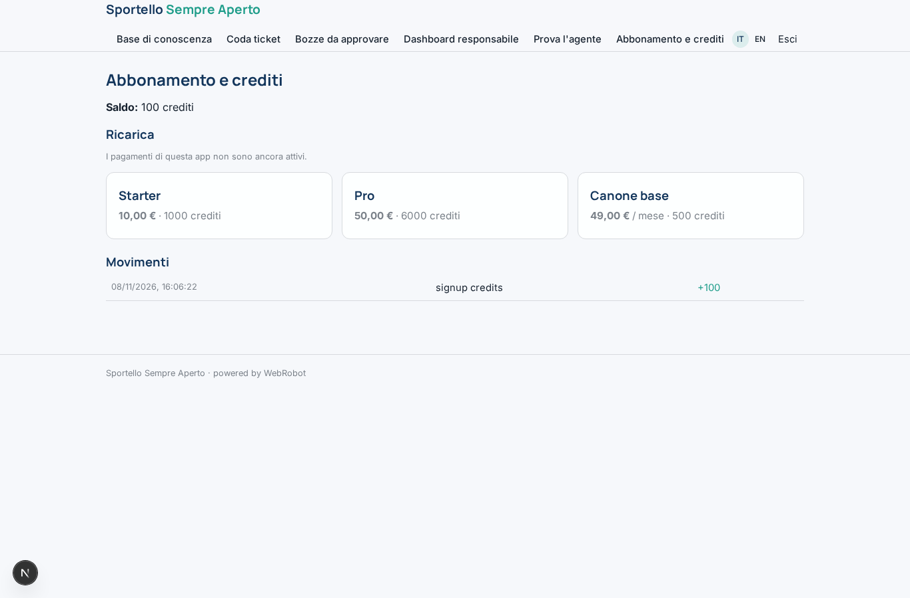

