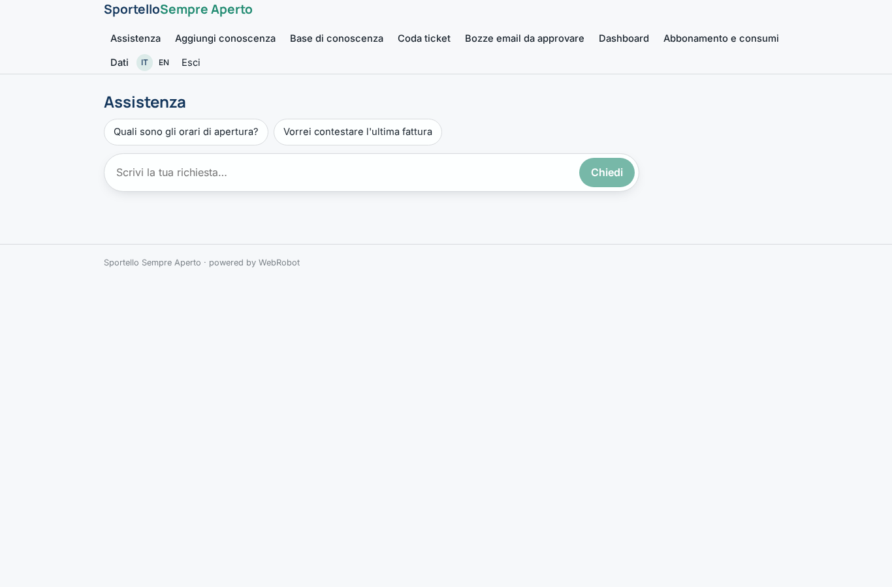
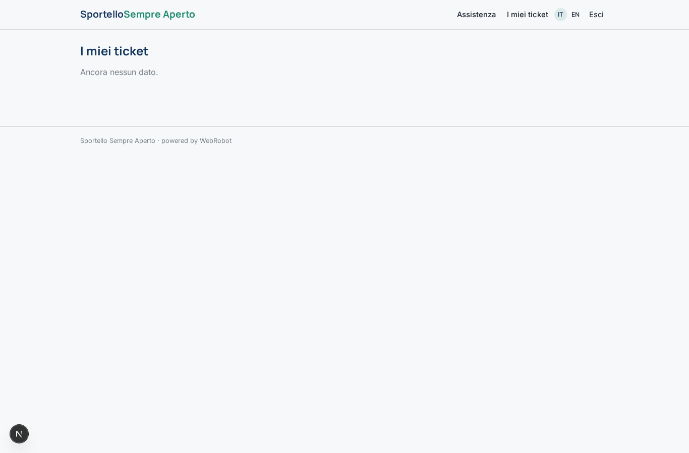
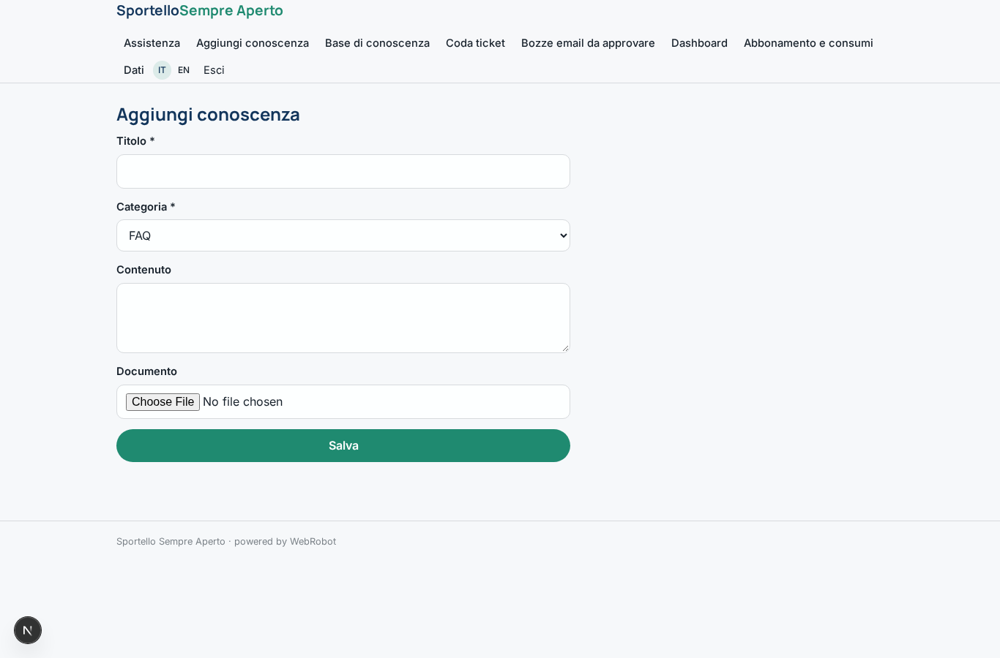
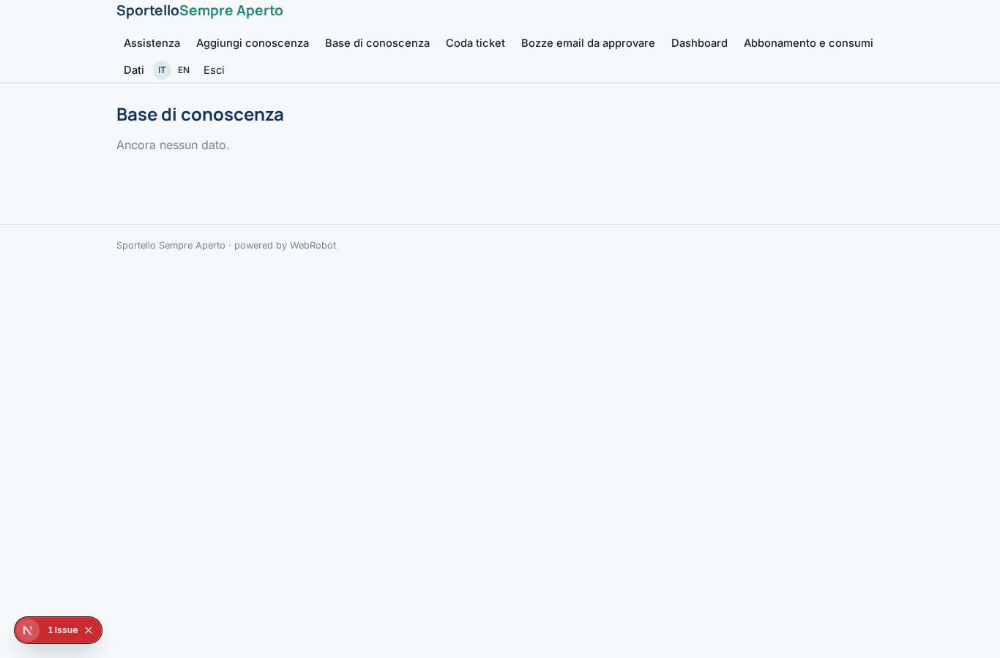
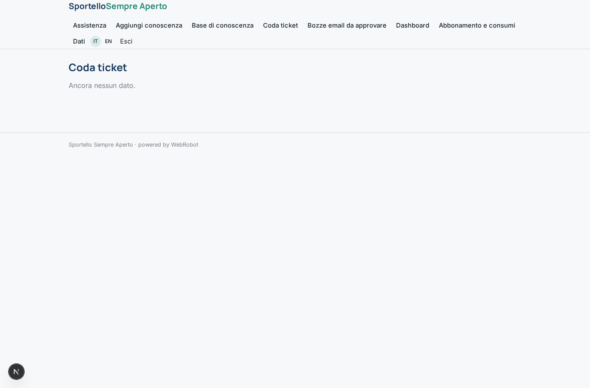
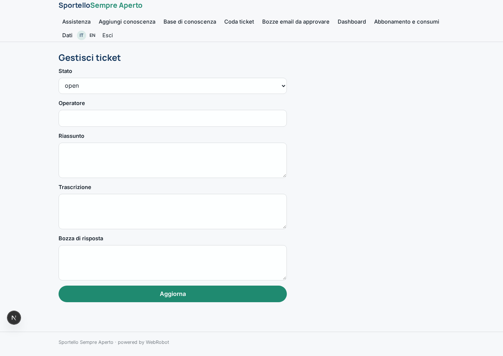
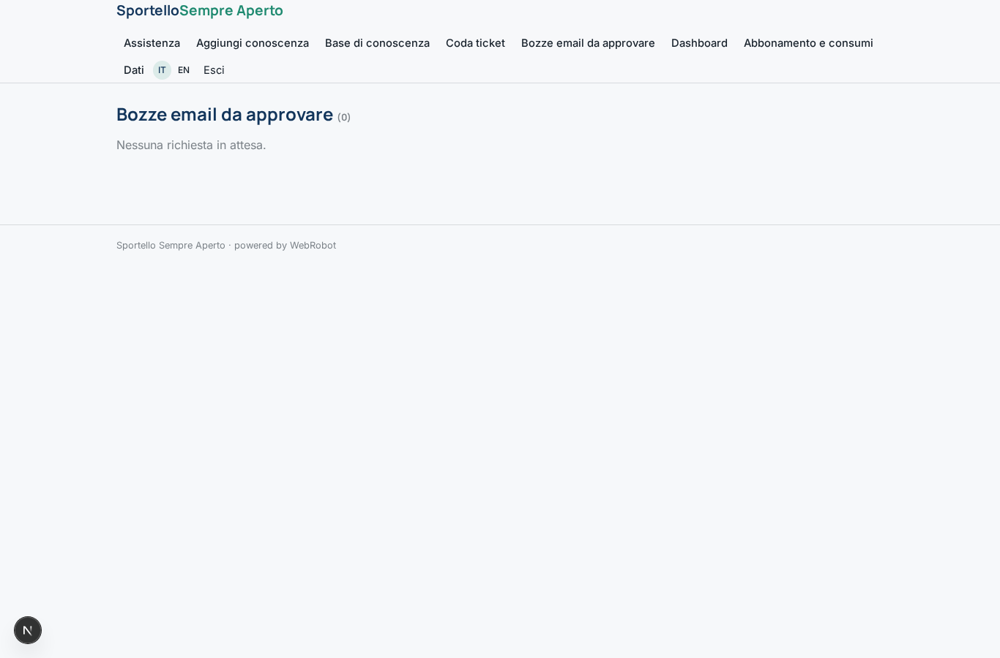
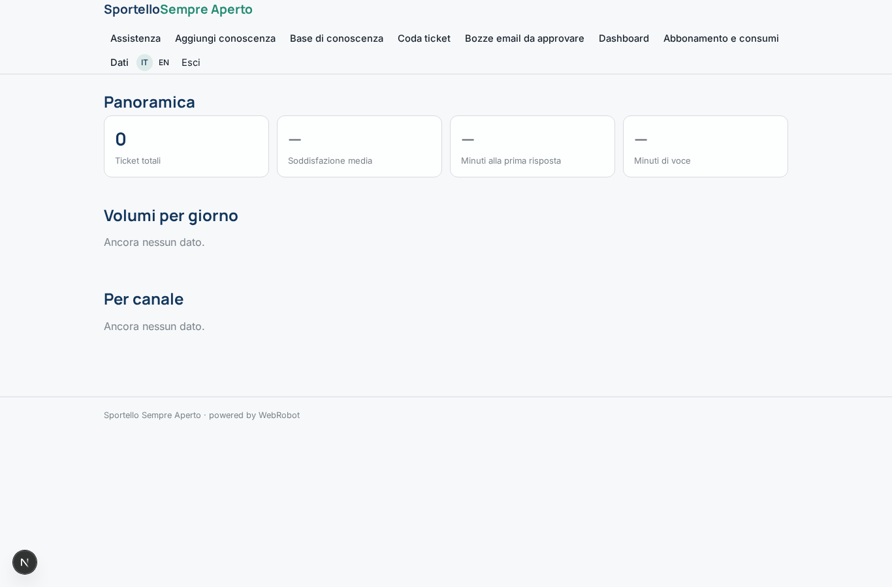
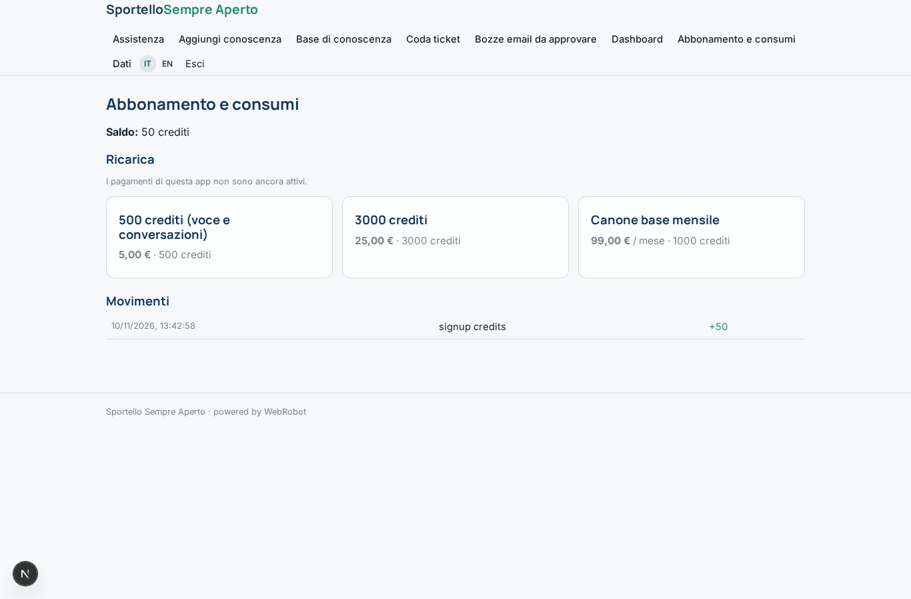

# Sportello Sempre Aperto

_Il servizio clienti che risponde sempre, su ogni canale._

**Manifest:** valid (schema + runtime contract) · **Functional test:** passed (21 checks passed)

## Description given to the app builder (Italian)

Ci serve Sportello Sempre Aperto, un servizio clienti fatto di agenti per aziende di servizi, per esempio utility locali o centri medici. L'admin dell'azienda carica la base di conoscenza: FAQ, listini, procedure, orari, condizioni contrattuali. Il cliente finale può contattare l'azienda in quattro modi: chiamata telefonica al numero aziendale, messaggio WhatsApp, email alla casella di assistenza, oppure voce e chat dal sito. In tutti i canali risponde lo stesso agente, che riconosce la richiesta, risponde usando la base di conoscenza, raccoglie dati come numero cliente e motivo del contatto, apre un ticket e, se la questione è complessa o il cliente è arrabbiato, passa a un operatore umano con un riassunto. Le email in arrivo vengono lette e ricevono una risposta in bozza che l'operatore può approvare con un clic. Gli operatori vedono una coda unica dei ticket con trascrizioni; il responsabile vede una dashboard con volumi, tempi e soddisfazione. Ogni azienda vede solo i propri clienti. Pagamento a consumo per minuti di voce e conversazioni, con canone base mensile.

## Functional test: what did not pass

- **saved record shown where its collection is read** (view my_tickets): a record was saved in tickets (by admin) but the page does not show it (as user) _(warning)_

## Features not expressible today (spec.extensions)

- **whatsapp_channel**: Canale WhatsApp per i messaggi dei clienti: non ancora disponibile (SMS/WhatsApp/push). Per ora telefono, email e chat dal sito.
- **voice_minutes_metering**: Fatturazione a minuti di voce: oggi il consumo è misurato in crediti (token e calcolo); il conteggio dei minuti di chiamata va registrato nel campo voice_minutes del ticket.
- **multi_company**: Ogni azienda corrisponde a una propria istanza dell'app, così vede solo i propri clienti e ticket.

## Screenshots (interpretive runtime, no data)

### home-anon

### home-mobile

### home

### assistant

### my_tickets

### knowledge_new

### knowledge

### tickets

### ticket_edit

### approvals

### dashboard

### account

