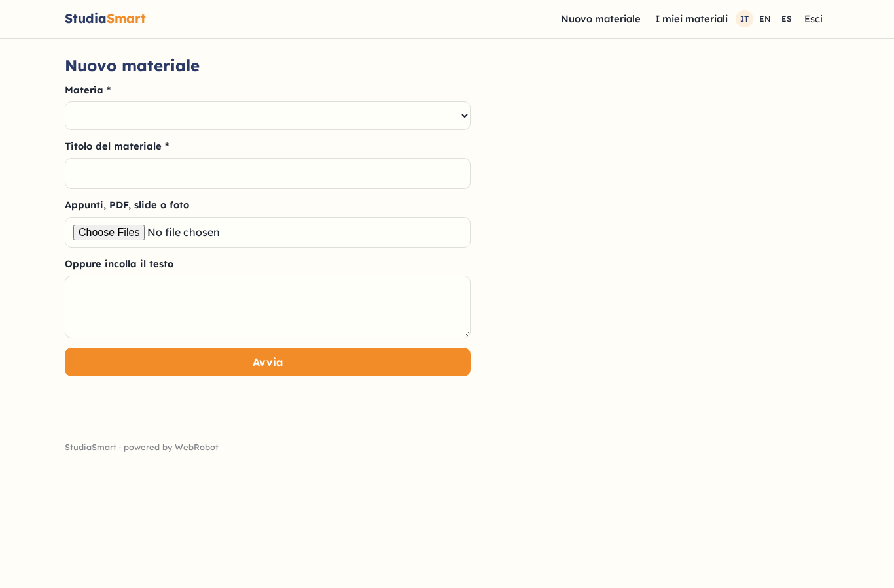
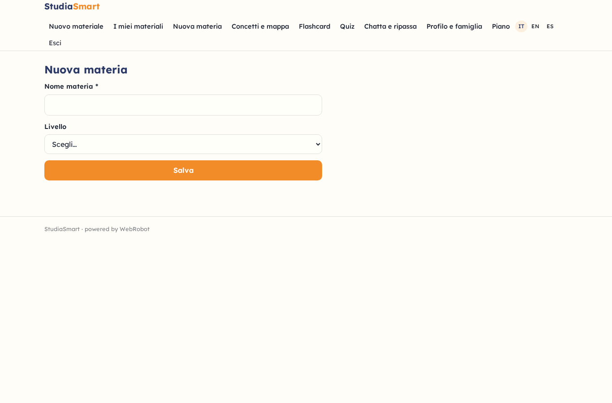
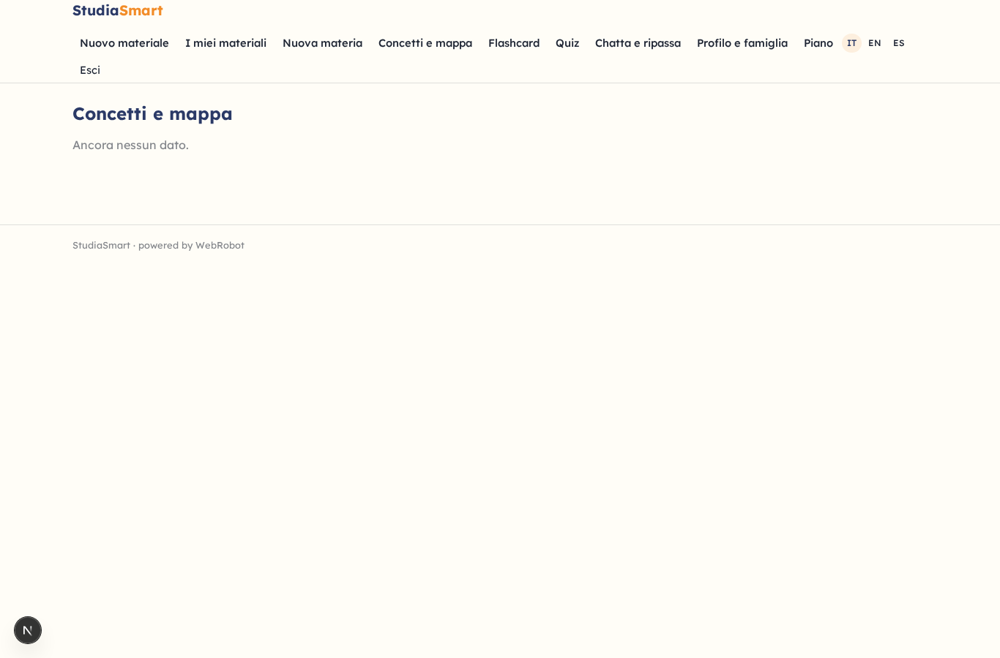
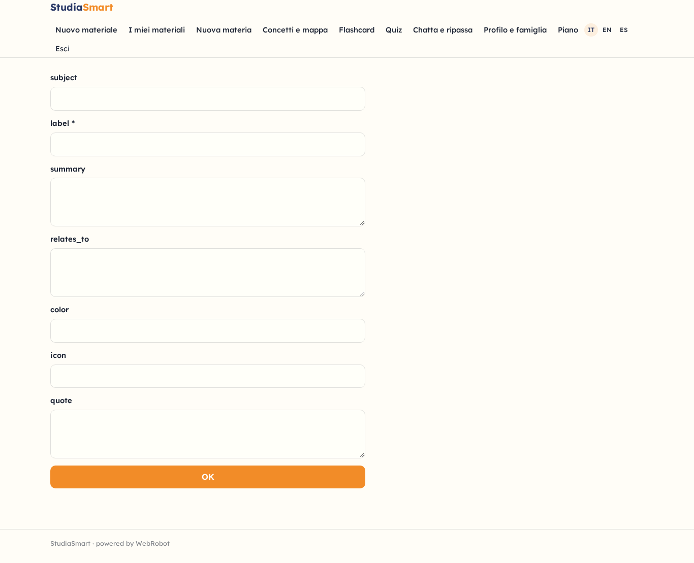
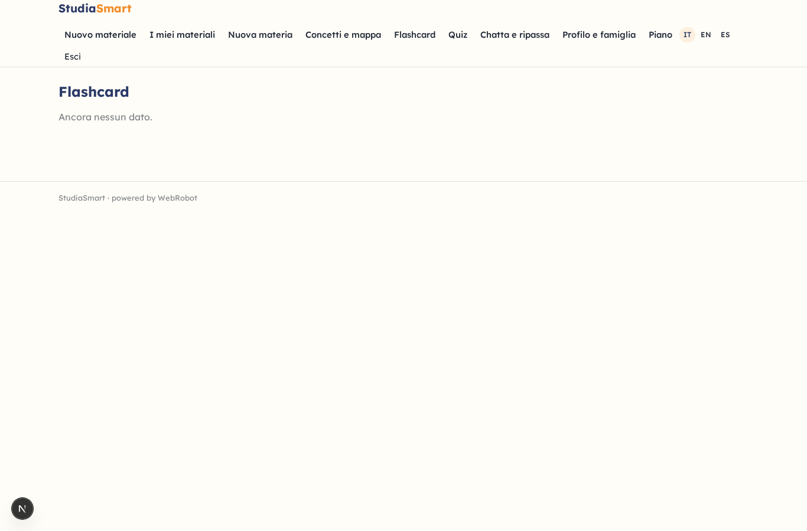
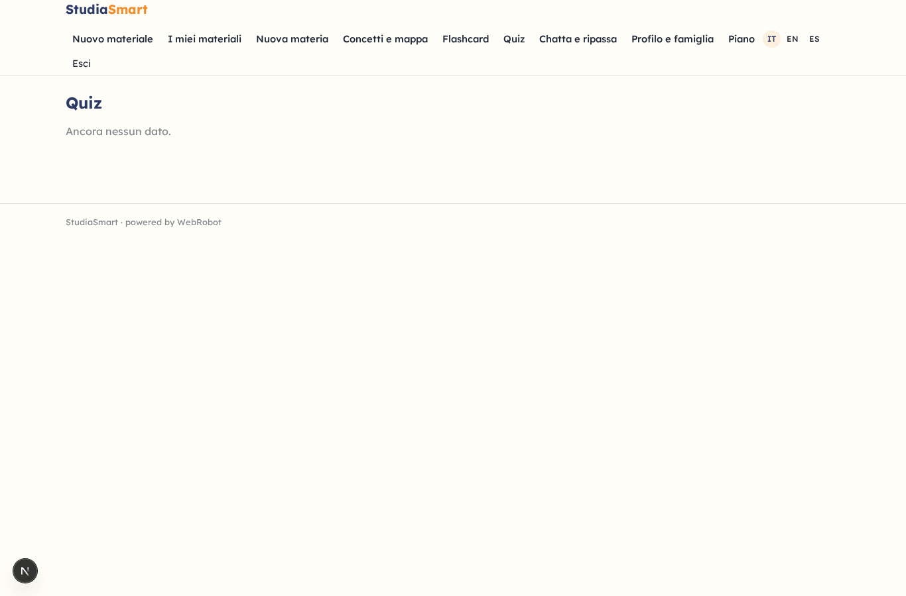
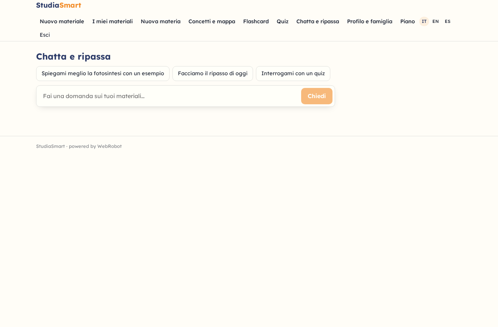
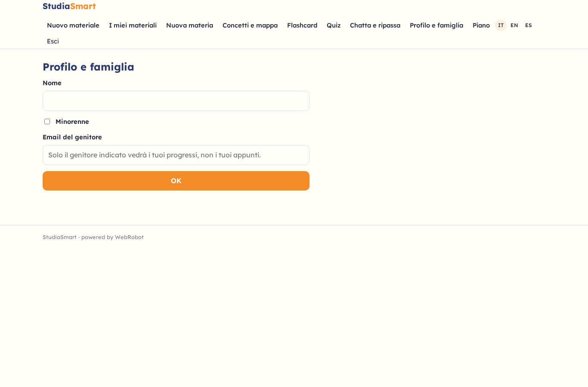
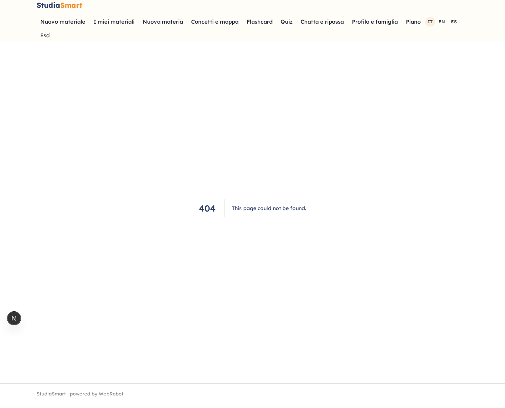
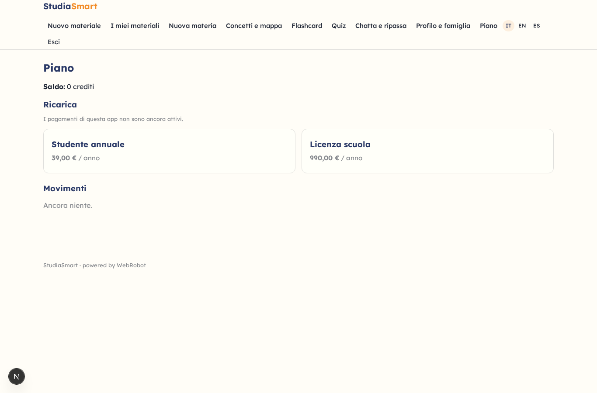

# StudiaSmart

_Trasforma appunti e dispense in mappe, flashcard e quiz._

**Manifest:** valid (schema + runtime contract) · **Functional test:** passed (20 checks passed)

## Description given to the app builder (Italian)

Vorrei StudiaSmart, un'app per studenti di scuola superiore e università, inclusi studenti con DSA, che trasforma i materiali di studio in strumenti visivi. Lo studente si registra, crea una materia e carica appunti, dispense PDF, slide o foto di pagine, oppure incolla il testo. Un agente legge il materiale, lo indicizza e ne estrae concetti chiave e relazioni; da qui genera una mappa concettuale navigabile e modificabile (nodi, collegamenti, colori, icone), un set di flashcard e un quiz a risposta multipla con spiegazione delle risposte. Lo studente può chattare con i propri materiali ("spiegami meglio la fotosintesi con un esempio") e l'agente risponde citando la parte del documento. C'è un'opzione di lettura ad alta voce e font ad alta leggibilità. Ripetizione spaziata: ogni giorno l'app propone le flashcard da ripassare e manda una notifica. Ruoli: studente, docente e famiglia. Il docente crea una classe, condivide materiali e mappe con gli studenti e vede i risultati aggregati dei quiz, non gli appunti privati; il genitore vede solo i progressi del figlio minorenne. Freemium con limite di documenti al mese, abbonamento annuale per studenti e licenza per scuole. Italiano, inglese, spagnolo.

## Functional test: what did not pass

- **form saves a record** (form class_new): only role teacher may fill it, and the test cannot hold that role _(warning)_
- **form saves a record** (form class_share): only role teacher may fill it, and the test cannot hold that role _(warning)_
- **page opened by a role allowed to** (view class_new): only role teacher may open it, the test cannot hold it _(warning)_
- **page opened by a role allowed to** (view class_share): only role teacher may open it, the test cannot hold it _(warning)_
- **page opened by a role allowed to** (view class_results): only role teacher may open it, the test cannot hold it _(warning)_
- **page opened by a role allowed to** (view class_stats): only role teacher may open it, the test cannot hold it _(warning)_

## Features not expressible today (spec.extensions)

- **concept_map_canvas**: Interactive drag-and-drop concept map canvas (nodes, links, colours, icons). For now concepts and relations are shown and edited as table/form rows.
- **read_aloud**: Read-aloud (text-to-speech) is a browser feature, not yet a manifest option; the high-legibility Lexend font is set in branding.
- **student_seat_licensing**: School licence seats and linking students to a school are not modelled yet; teachers add students by email in their class.
- **daily_digest**: The daily reminder is sent per card due today (capped per day by the platform); a single per-user digest needs a per-user scheduled run.

## Screenshots (interpretive runtime, no data)

### home-anon

### home-mobile

### home

### new_material

### history

### subjects_form

### concepts_table

### concept_edit

### cards_table

### quiz_table

### chat

### profile

### class_new

### class_share

### class_results

### class_stats

### family

### account

