# StudiaSmart

_Trasforma i tuoi appunti in mappe, flashcard e quiz._

**Manifest status:** valid (schema validator + runtime contract)

## Description given to the app builder (Italian)

Vorrei StudiaSmart, un'app per studenti di scuola superiore e università, inclusi studenti con DSA, che trasforma i materiali di studio in strumenti visivi. Lo studente si registra, crea una materia e carica appunti, dispense PDF, slide o foto di pagine, oppure incolla il testo. Un agente legge il materiale, lo indicizza e ne estrae concetti chiave e relazioni; da qui genera una mappa concettuale navigabile e modificabile (nodi, collegamenti, colori, icone), un set di flashcard e un quiz a risposta multipla con spiegazione delle risposte. Lo studente può chattare con i propri materiali ("spiegami meglio la fotosintesi con un esempio") e l'agente risponde citando la parte del documento. C'è un'opzione di lettura ad alta voce e font ad alta leggibilità. Ripetizione spaziata: ogni giorno l'app propone le flashcard da ripassare e manda una notifica. Ruoli: studente, docente e famiglia. Il docente crea una classe, condivide materiali e mappe con gli studenti e vede i risultati aggregati dei quiz, non gli appunti privati; il genitore vede solo i progressi del figlio minorenne. Freemium con limite di documenti al mese, abbonamento annuale per studenti e licenza per scuole. Italiano, inglese, spagnolo.

## Features not expressible today (spec.extensions)

- **file_upload**: Upload of PDF, slides and photos of pages (with OCR) is not available yet: the student pastes text.
- **daily_notification**: The daily push/email reminder for flashcards is not available yet: the student opens the Daily review view.
- **read_aloud_and_accessibility**: Read-aloud (speech synthesis), dyslexia font toggle and size/spacing controls are client features not expressible in the manifest; the base font is already high-legibility.
- **interactive_map_editor**: A visual node-link editor (drag nodes, colours, icons) for concept_maps; today maps are stored as JSON nodes/edges and shown as cards.
- **class_scoping_and_family_view**: Per-class visibility (teacher sees only own classes and only aggregated quiz scores) and per-child filtering for the family role need cross-user record scoping the runtime does not offer yet; quiz_results holds only scores and aliases, never notes.
- **spaced_repetition_grading**: Updating each card's due date and interval after the student rates it (SM-2) needs a small slot or client action.

## Screenshots (interpretive runtime)

### home-anon
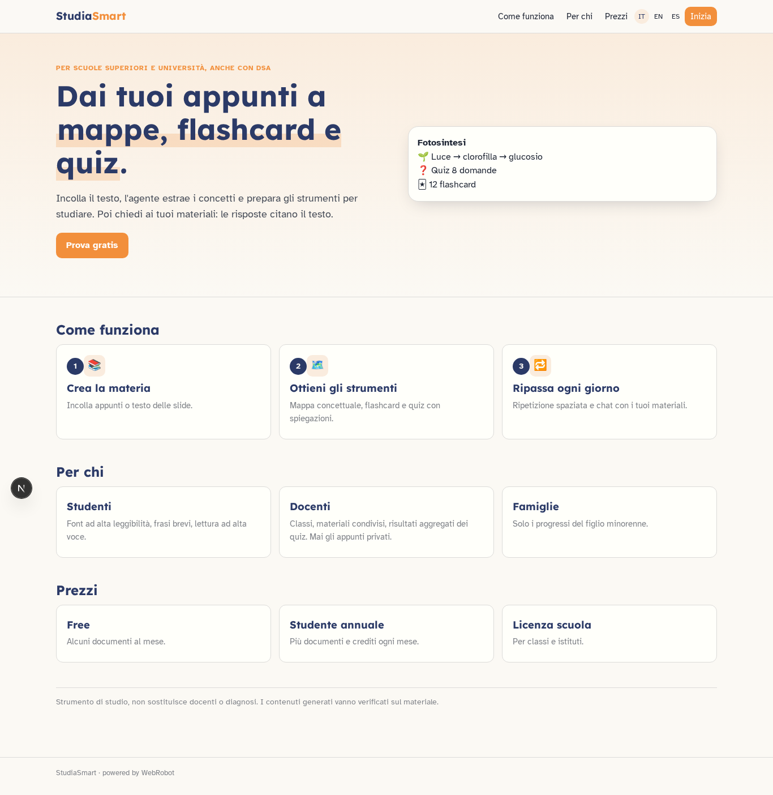

### home-mobile

### home

### new
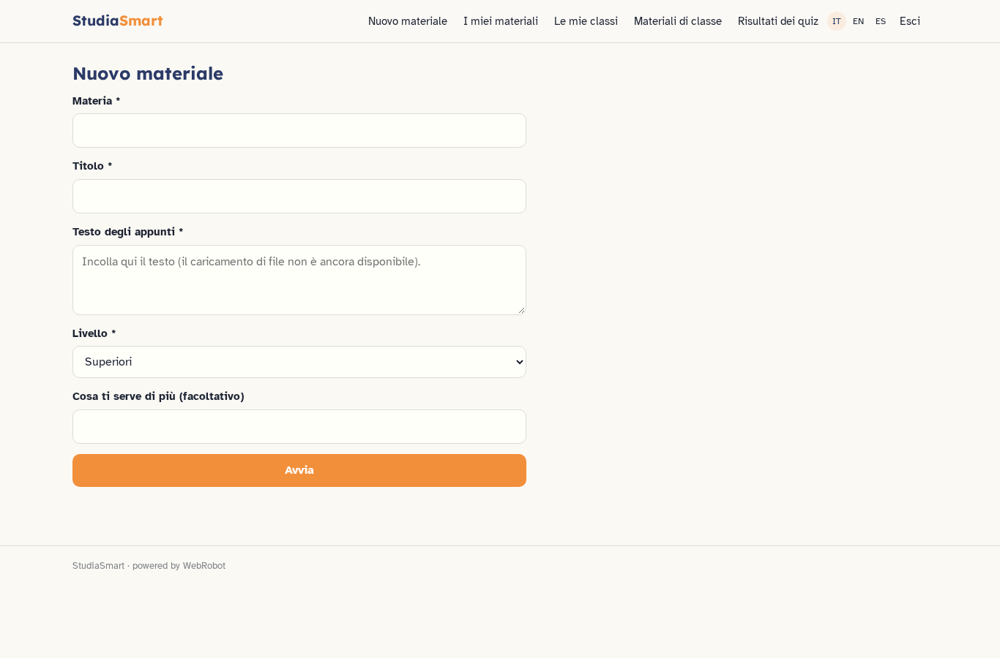

### history
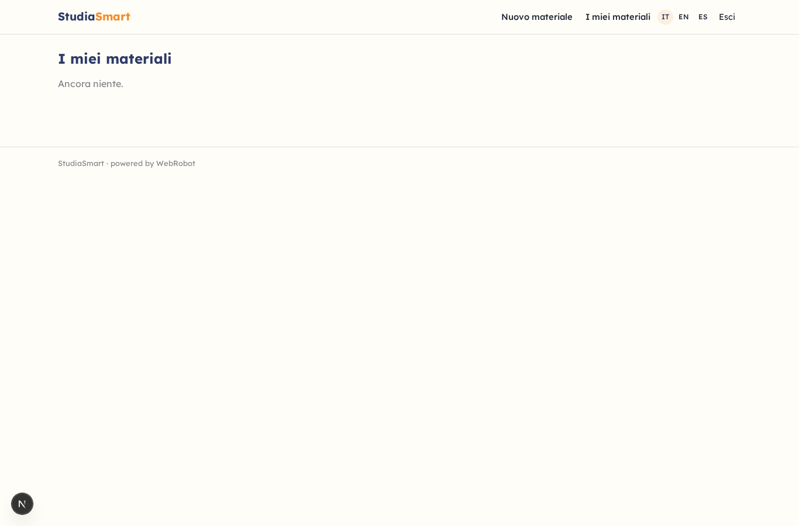

### maps
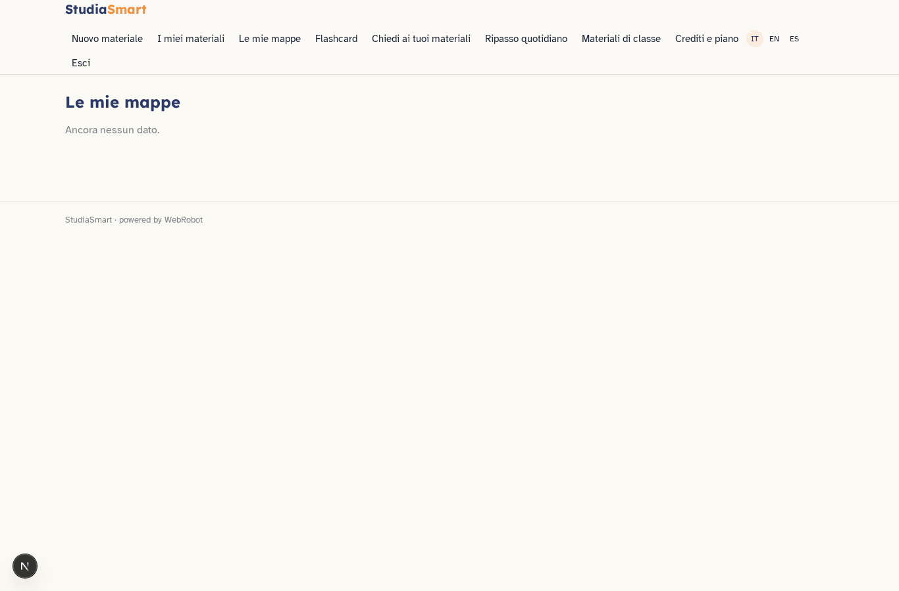

### cards
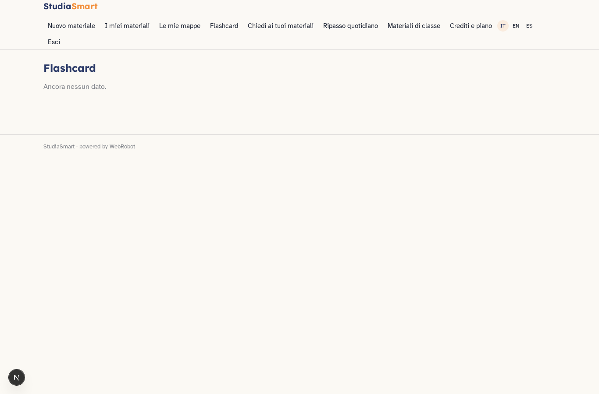

### chat
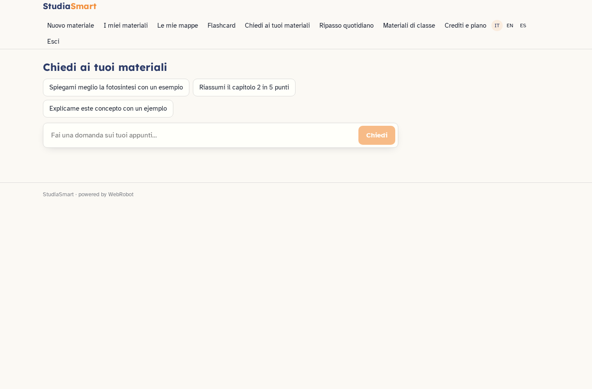

### reviews
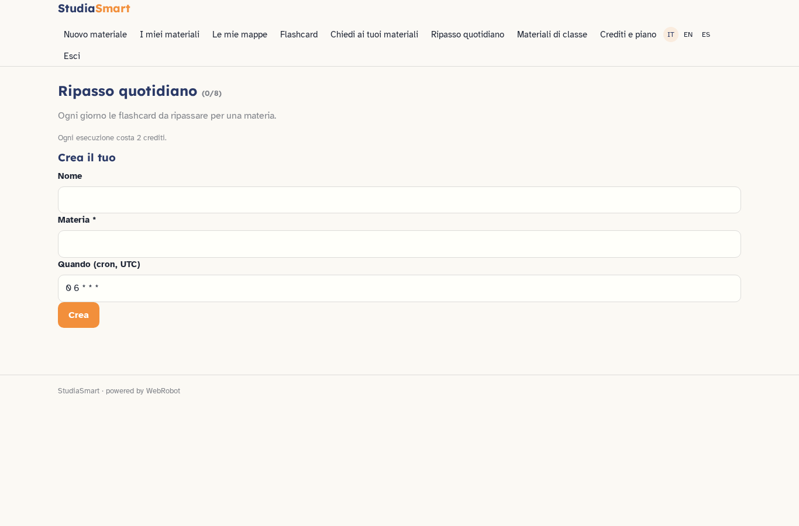

### class_list
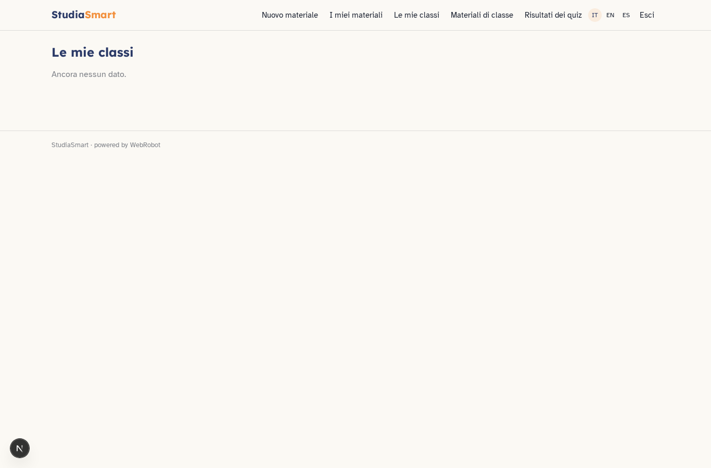

### class_shared

### class_results
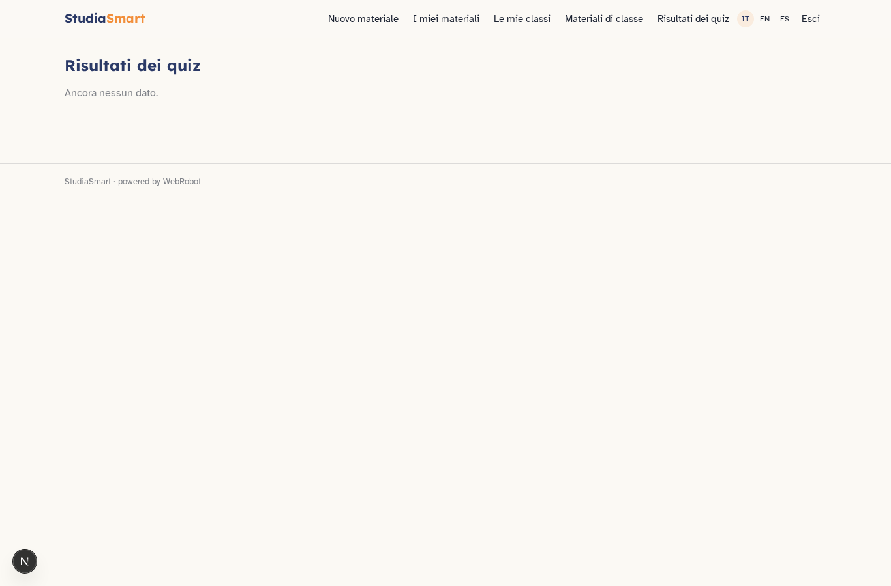

### family_progress
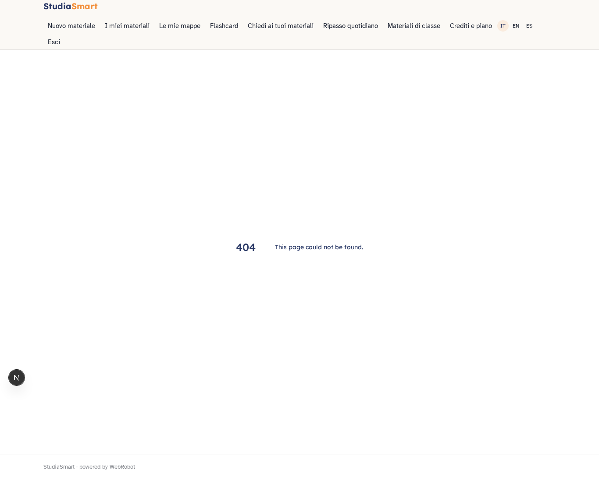

### account
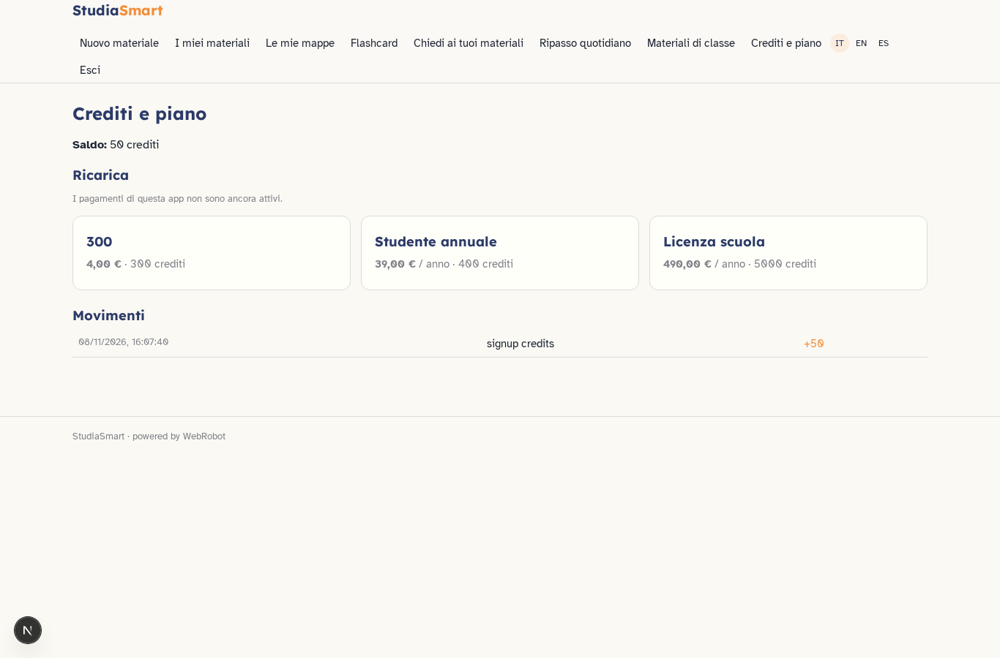

