# Studio Dentistico

_Agenda, pazienti e comunicazioni per il tuo studio dentistico._

**Manifest:** valid (schema + runtime contract) · **Functional test:** passed (28 checks passed)

## Description given to the app builder (Italian)

Descrivo lo strato software gestionale per studi dentistici: agenda, anagrafiche e comunicazioni, con la dovuta attenzione ai dati sanitari (categoria particolare, art. 9 GDPR) che sono visibili solo al personale autorizzato dello studio. La segretaria gestisce il calendario degli appuntamenti con medici e poltrone, registra i pazienti con anagrafica, piano di cure e storico delle visite. Un agente ottimizza l'agenda proponendo gli slot migliori quando si prenota, invia ai pazienti promemoria dell'appuntamento via email ed eventualmente un messaggio, e avvisa chi e in ritardo con i controlli periodici di richiamo (recall). Il dentista vede la cartella dei propri pazienti e i piani di cura, la segretaria l'agenda e le anagrafiche, il paziente puo accedere a una propria area per vedere appuntamenti e documenti condivisi. In futuro vorrei la firma elettronica dei consensi informati direttamente nell'app. Ogni studio vede solo i propri pazienti. Abbonamento mensile per studio in base al numero di poltrone o utenti. In italiano.

## Functional test: what did not pass

- **saved record shown where its collection is read** (view my_documents): a record was saved in documents (by admin-data, admin-data, admin) but the page does not show it (as patient) _(warning)_
- **saved record shown where its collection is read** (view patients): a record was saved in patients (by admin-data, admin-data, admin) but the page does not show it (as dentist) _(warning)_
- **saved record shown where its collection is read** (view care_plans): a record was saved in care_plans (by admin-data, admin-data, admin) but the page does not show it (as dentist) _(warning)_
- **saved record shown where its collection is read** (view visits): a record was saved in visits (by admin-data, admin-data, admin) but the page does not show it (as dentist) _(warning)_
- **saved record shown where its collection is read** (view recalls): a record was saved in recall_reports (by admin-data, admin-data) but the page does not show it (as dentist) _(warning)_

## Features not expressible today (spec.extensions)

- **firma_consensi**: Firma elettronica dei consensi informati nell'app: non ancora disponibile, prevista in futuro.
- **sms_whatsapp**: Messaggi SMS/WhatsApp ai pazienti non disponibili: i promemoria sono inviati via email.
- **multi_studio**: Ogni studio usa la propria istanza dell'app, così i pazienti restano separati; DPA e registro dei trattamenti art. 9 GDPR a cura dello studio.

## Screenshots (interpretive runtime, no data)

### home-anon
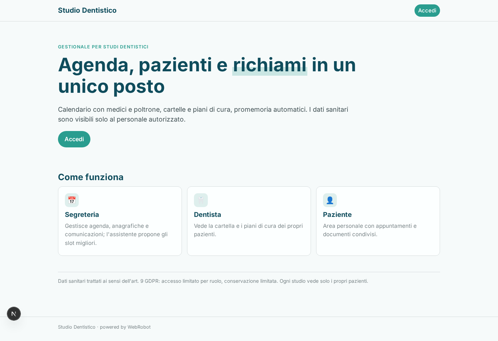

### home-mobile
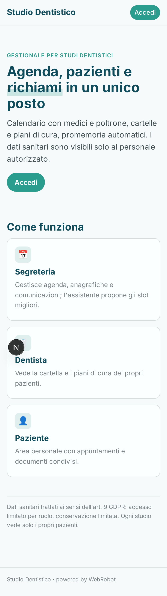

### home
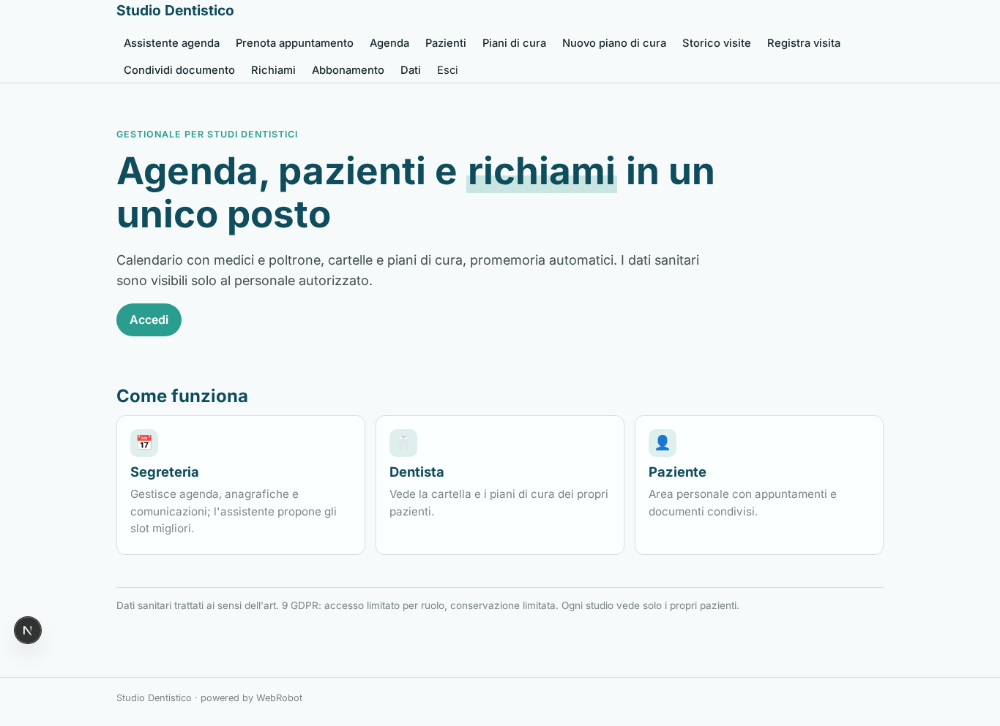

### assistant
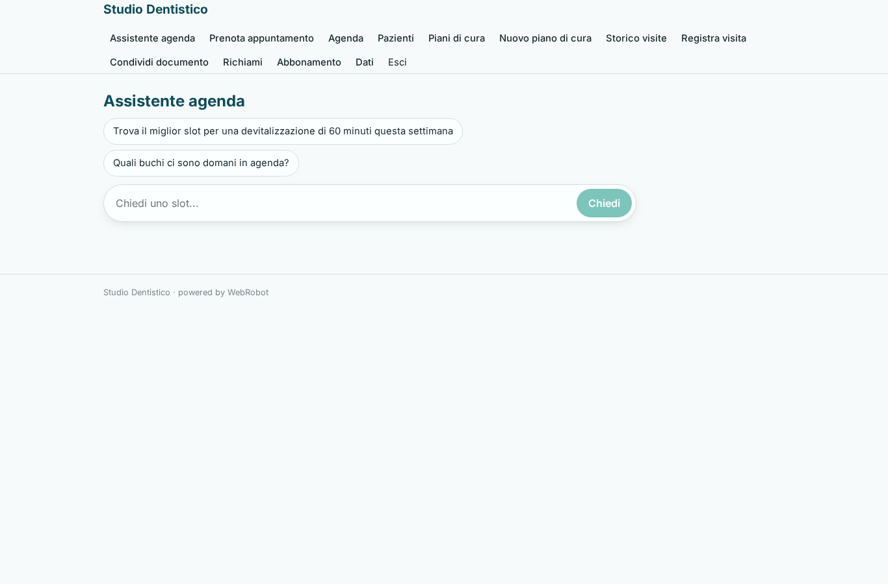

### book
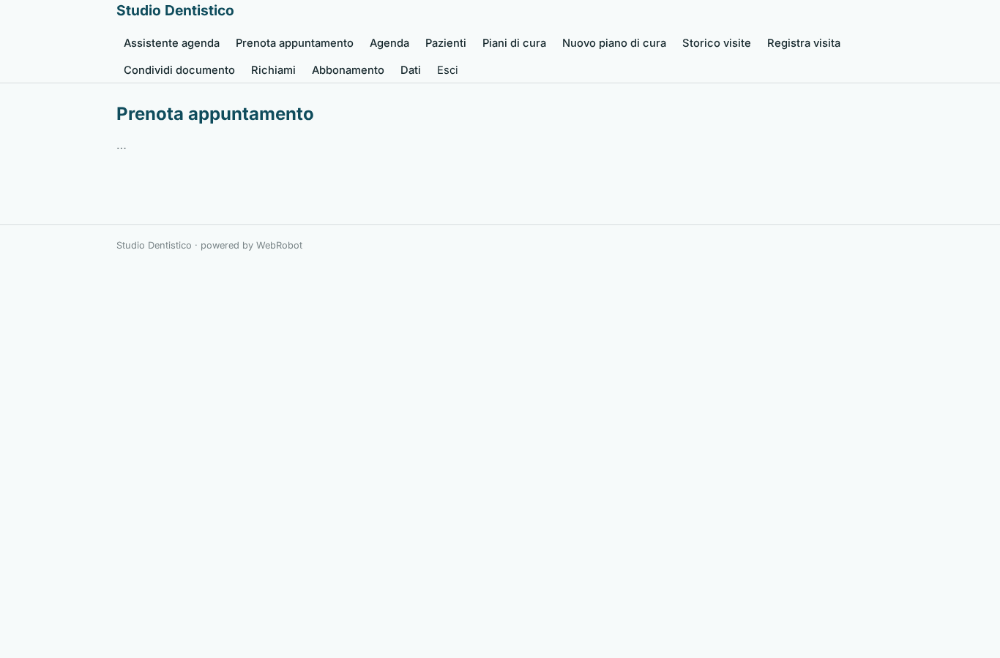

### agenda

### my_appointments
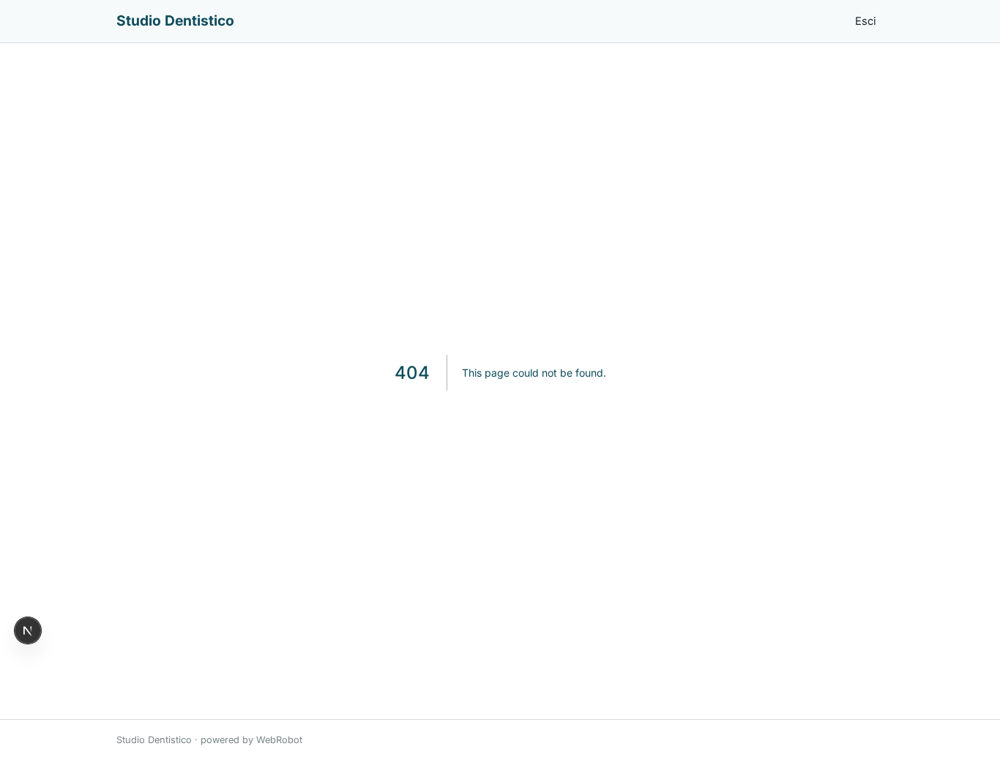

### my_documents

### patients

### patient_form
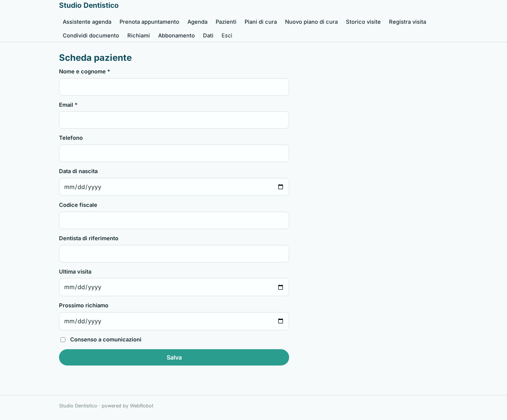

### care_plans

### care_plan_form
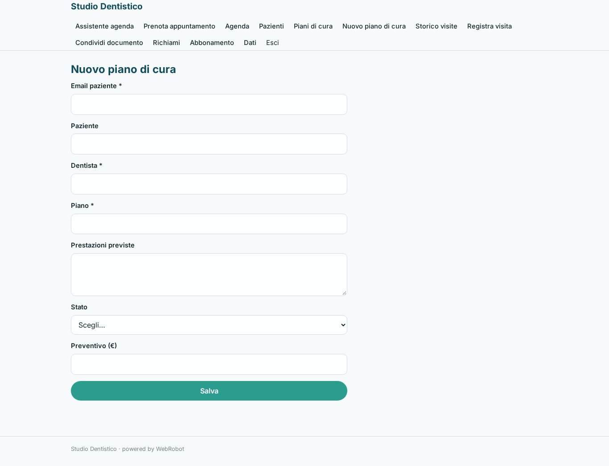

### visits

### visit_form
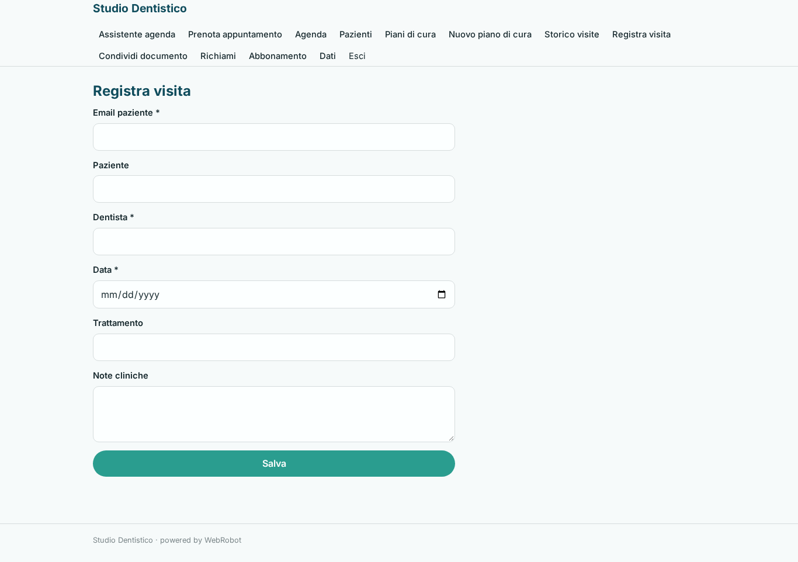

### document_form
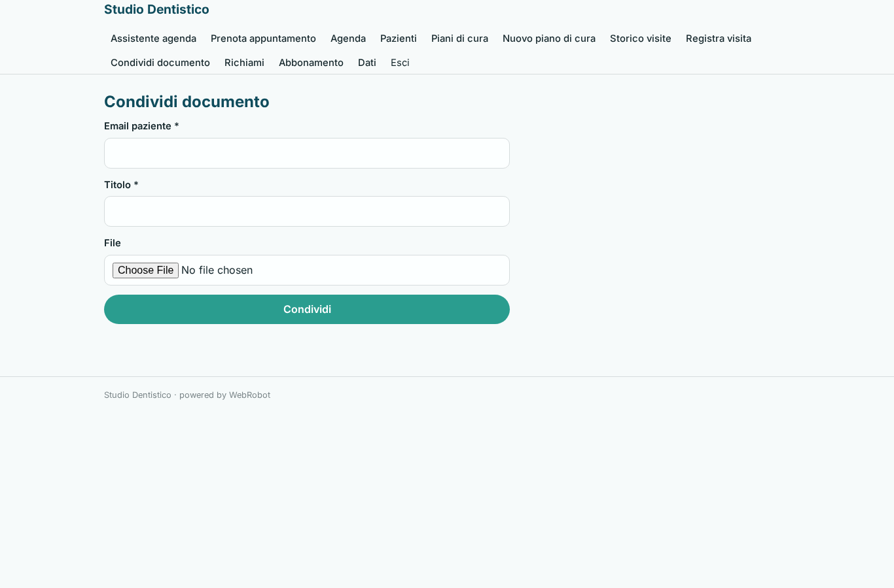

### recalls
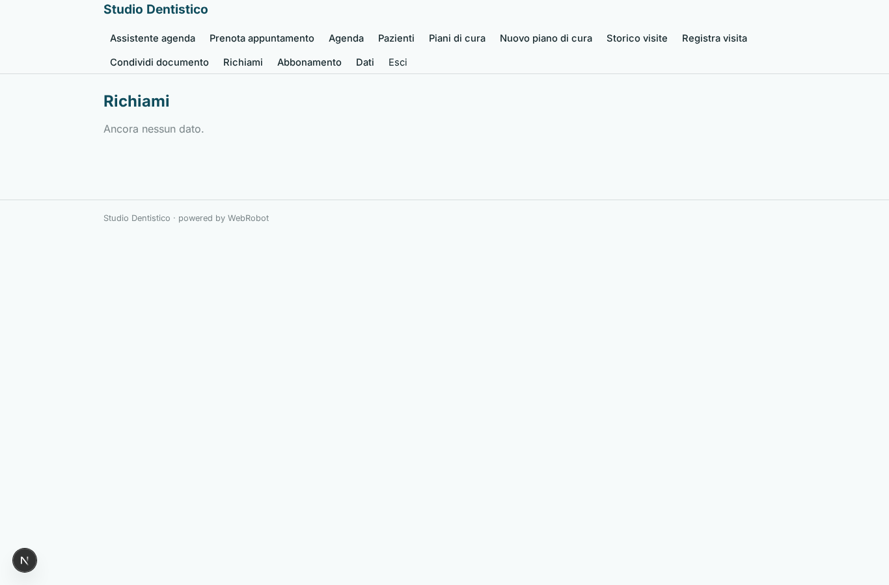

### account
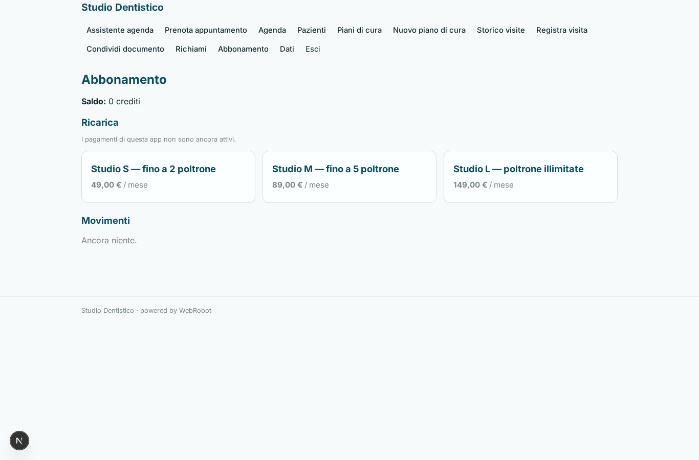
