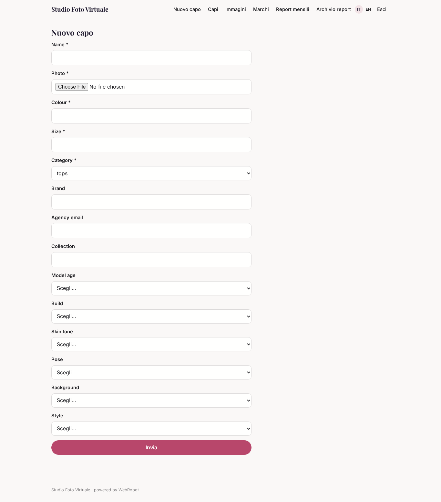
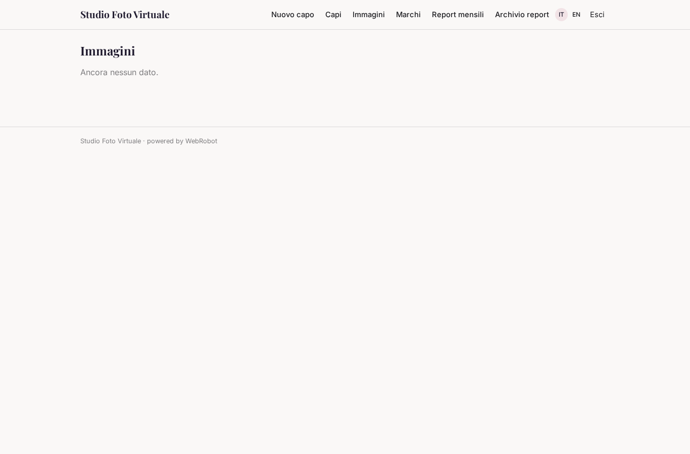
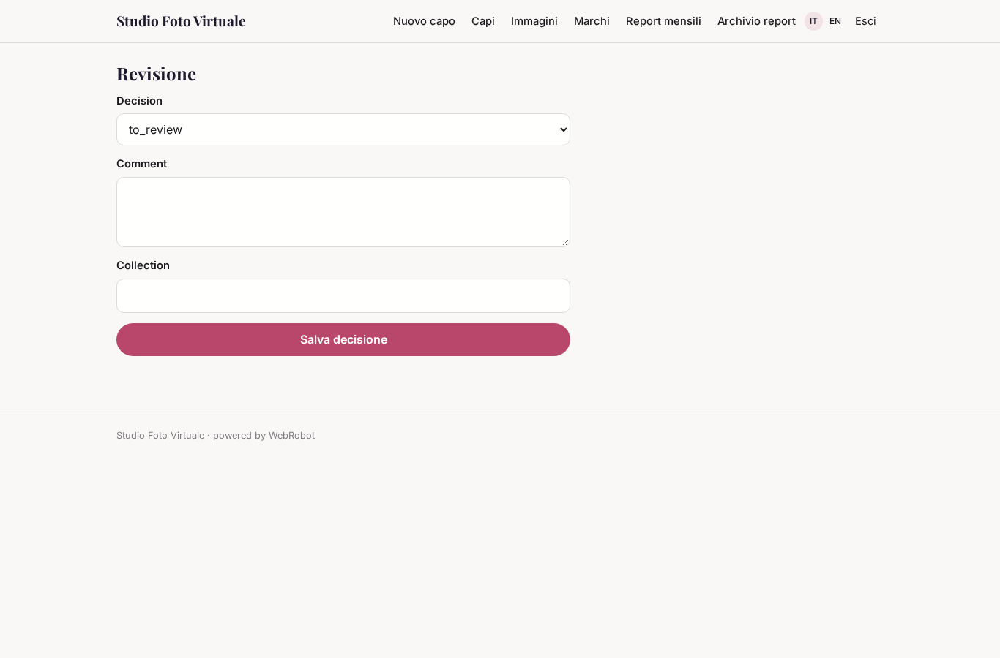
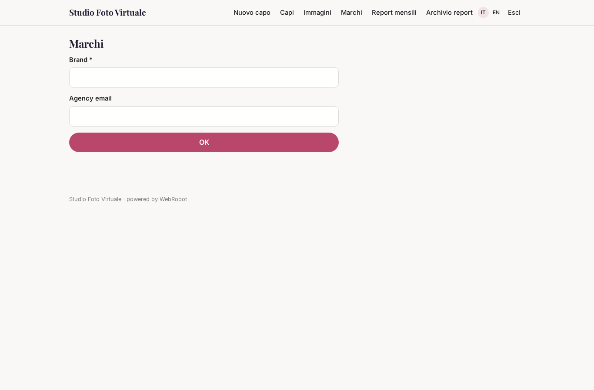
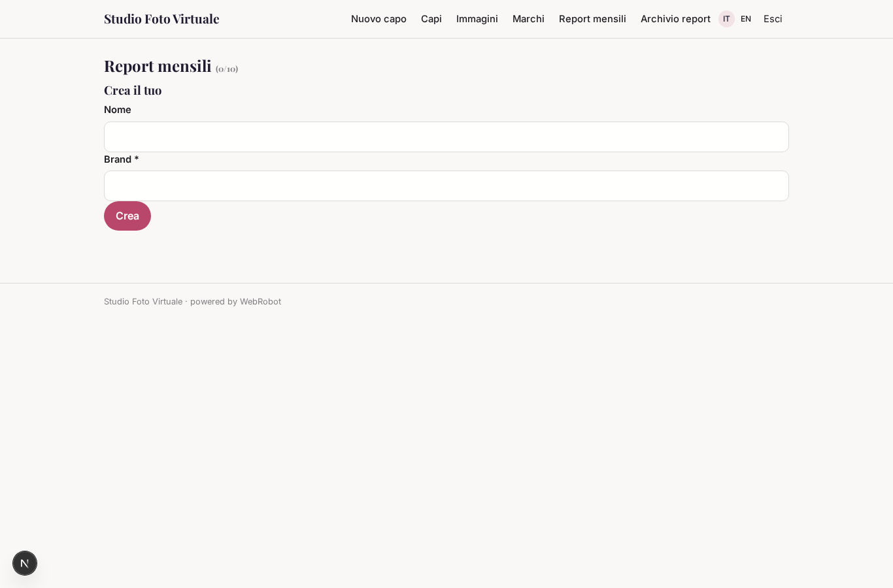
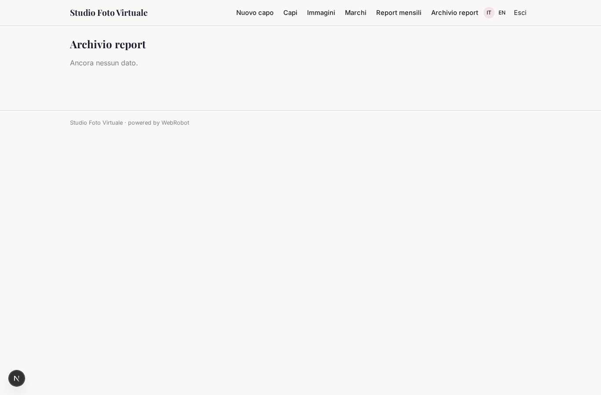
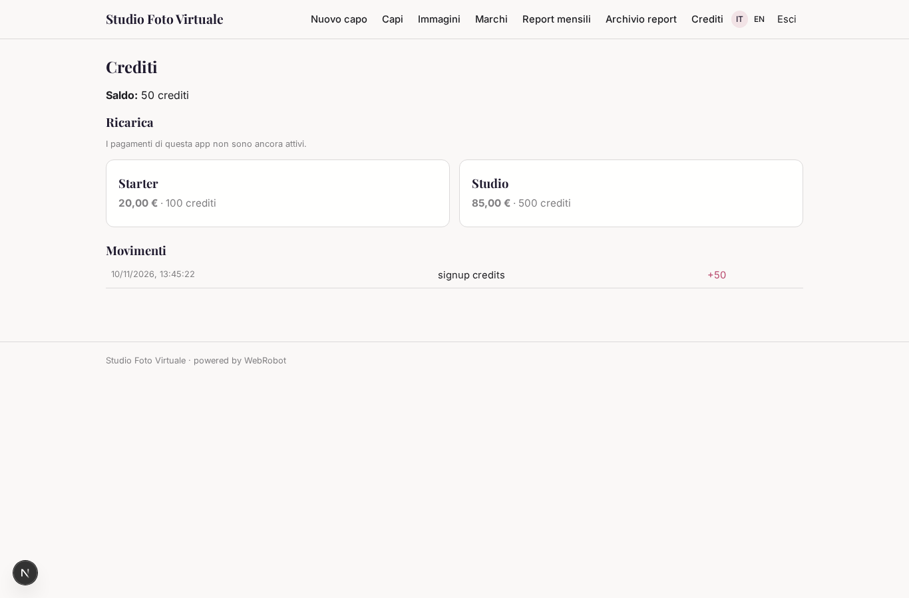

# Studio Foto Virtuale

_Foto dei capi indossati senza set fotografico._

**Manifest:** valid (schema + runtime contract) · **Functional test:** passed (14 checks passed)

## Description given to the app builder (Italian)

Mi serve Studio Foto Virtuale, un servizio per brand di moda che vogliono foto dei capi indossati senza servizi fotografici. Descrivo solo lo strato di gestione: la generazione delle immagini la fa un motore esterno specializzato. Il brand carica le foto dei capi su manichino o in still life, con nome, colore, taglia e categoria, e sceglie modelli virtuali (età, corporatura, tono della pelle), posa, sfondo e stile. Un agente controlla che le foto caricate siano adatte, prepara le richieste per il motore di generazione e, quando arrivano i risultati, li confronta con il capo originale per individuare errori su colore, logo o dettagli. Il team creativo del brand rivede ogni immagine, la approva o chiede una rigenerazione con un commento. Le immagini approvate vengono organizzate per collezione e scaricate in alta risoluzione o inviate al gestionale del catalogo. Il brand vede solo i suoi progetti; un'agenzia può gestire più brand. Ogni mese un report con immagini generate, tasso di approvazione e tempi. Pagamento a crediti per immagine approvata.

## Features not expressible today (spec.extensions)

- **catalog_sync**: Sending approved images to the brand's catalogue system (PIM/ERP) needs the system's API details; not designed yet. Use the CSV export of approved images meanwhile.
- **engine_link**: The external engine reads requests from /api/requests and posts results to /api/hooks/engine_result with the hook secret.

## Screenshots (interpretive runtime, no data)

### home-anon

### home-mobile

### home

### new_garment

### garments_list

### review_list

### review

### brands_view

### reports

### reports_list

### account

