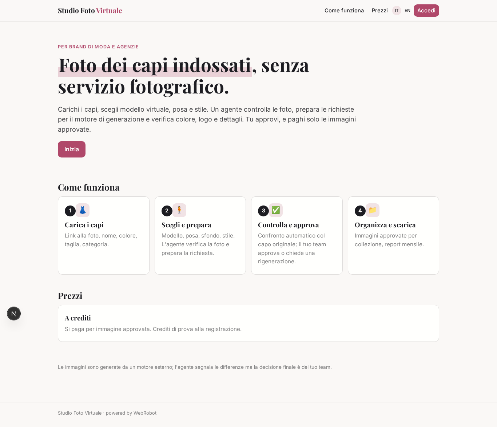
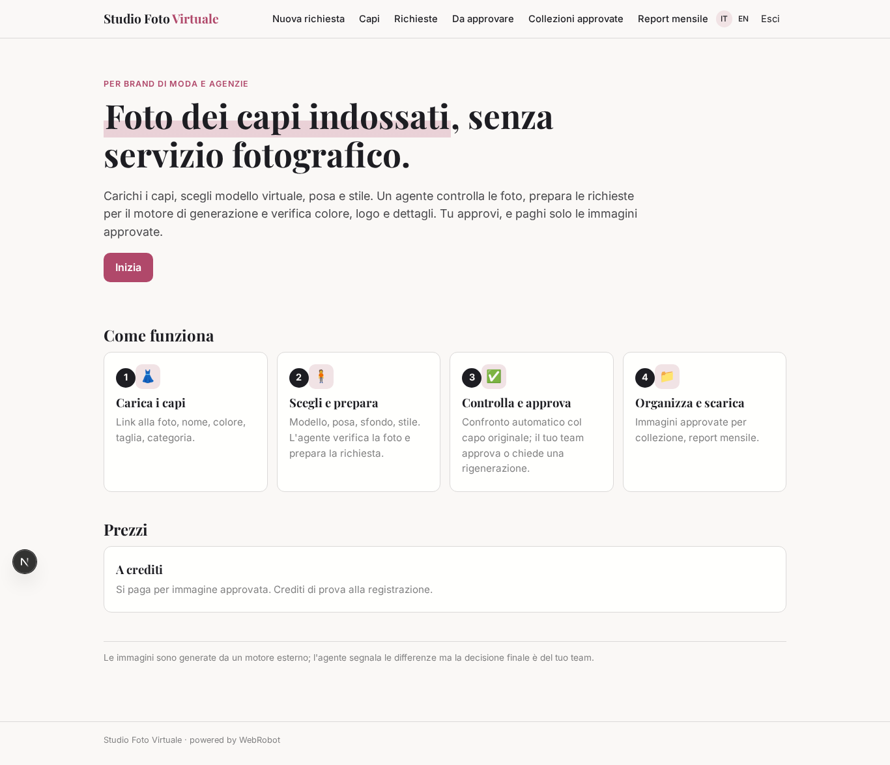
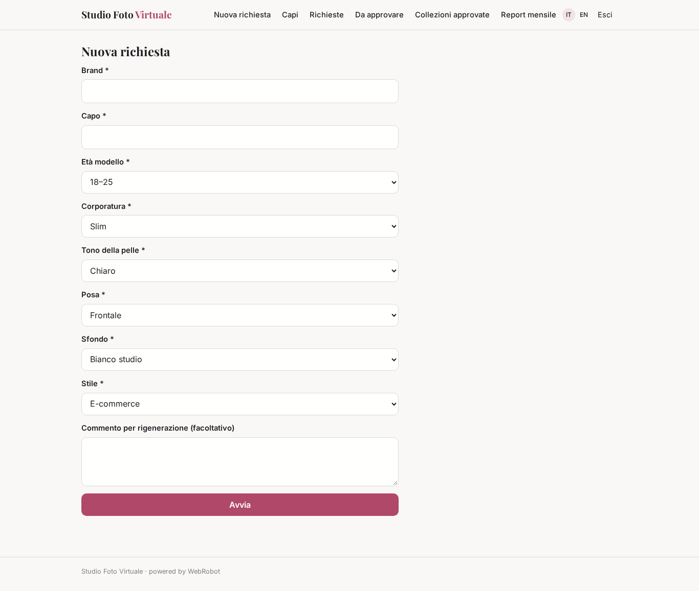
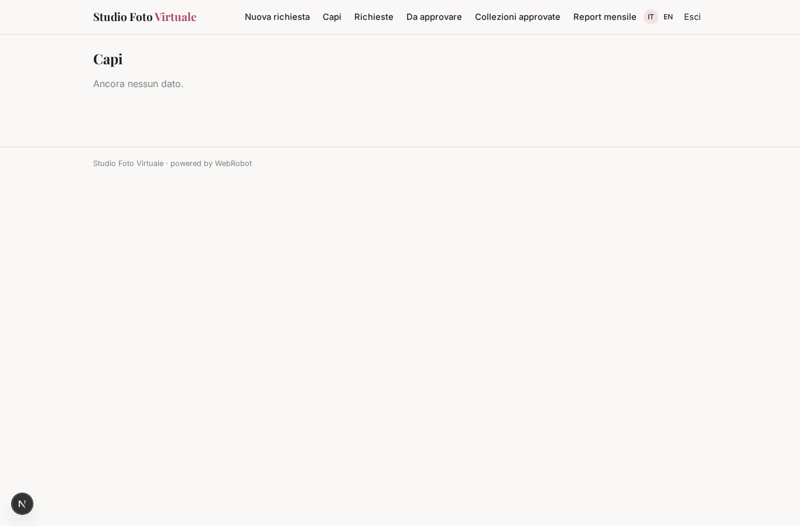
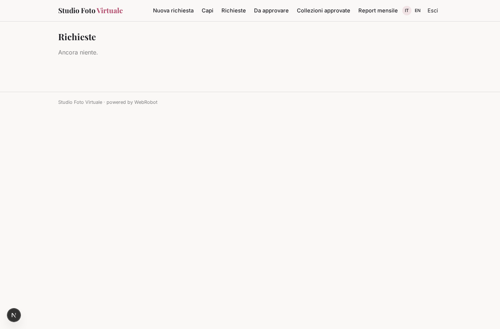
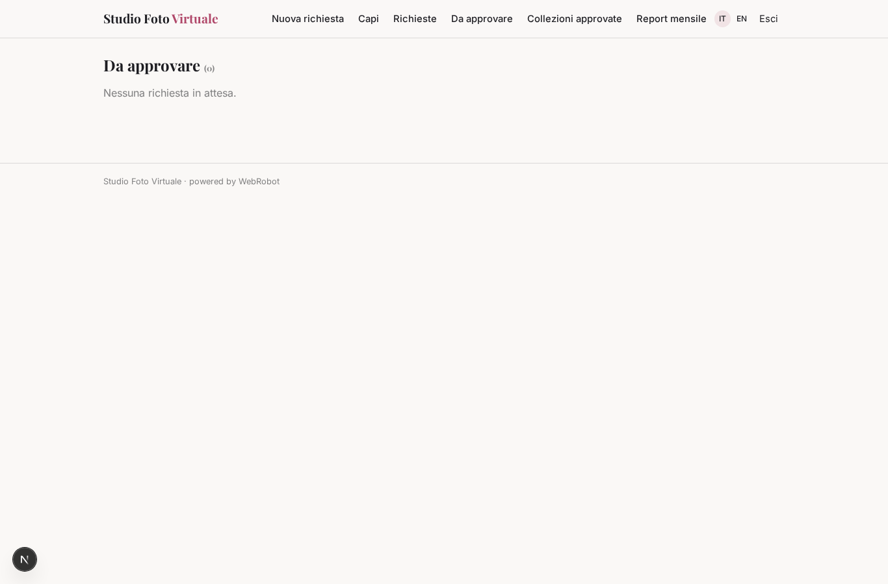
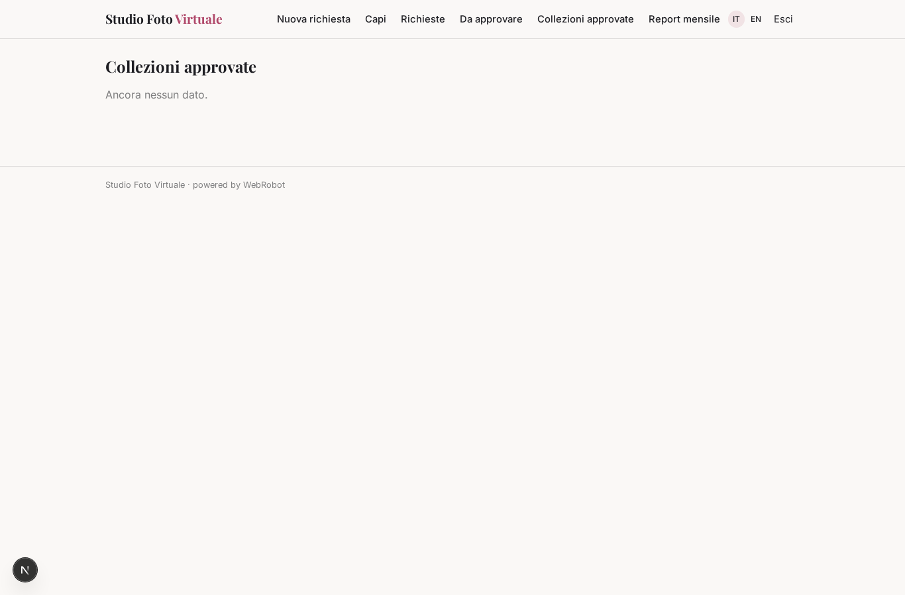
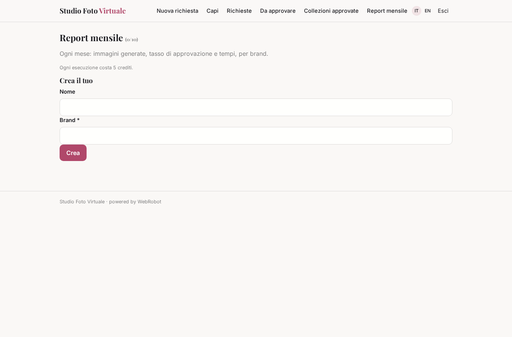
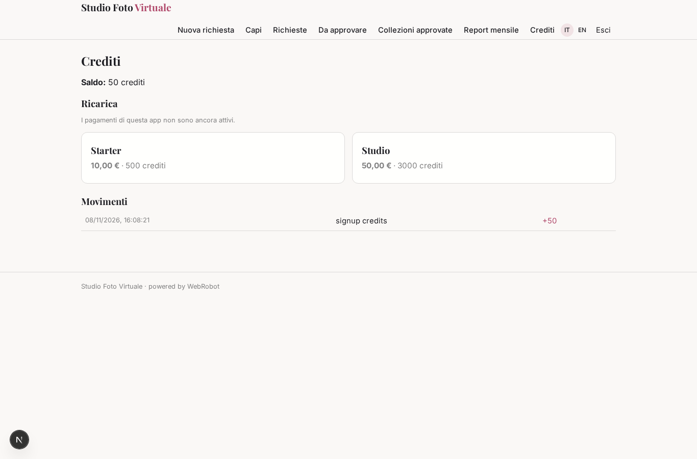

# Studio Foto Virtuale

_Foto dei capi indossati, senza servizio fotografico._

**Stato manifest:** valido (validatore Python + contratto runtime)

## Descrizione data all'app builder

Mi serve Studio Foto Virtuale, un servizio per brand di moda che vogliono foto dei capi indossati senza servizi fotografici. Descrivo solo lo strato di gestione: la generazione delle immagini la fa un motore esterno specializzato. Il brand carica le foto dei capi su manichino o in still life, con nome, colore, taglia e categoria, e sceglie modelli virtuali (età, corporatura, tono della pelle), posa, sfondo e stile. Un agente controlla che le foto caricate siano adatte, prepara le richieste per il motore di generazione e, quando arrivano i risultati, li confronta con il capo originale per individuare errori su colore, logo o dettagli. Il team creativo del brand rivede ogni immagine, la approva o chiede una rigenerazione con un commento. Le immagini approvate vengono organizzate per collezione e scaricate in alta risoluzione o inviate al gestionale del catalogo. Il brand vede solo i suoi progetti; un'agenzia può gestire più brand. Ogni mese un report con immagini generate, tasso di approvazione e tempi. Pagamento a crediti per immagine approvata.

## Funzioni non esprimibili oggi (spec.extensions)

- **generation_engine**: Sending requests to the external generation engine and receiving results (webhook to /api/hooks/engine_result) needs the engine's API and credentials: not available yet. Until then requests are stored with status 'ready' and results are registered by the engine's webhook.
- **file_upload**: Uploading garment photos is not available: the brand gives a link to each photo.
- **pay_per_approved_image**: Credits are charged per agent run (estimate); charging exactly one credit amount per approved image needs a hook on the approval decision.
- **hires_download_and_catalog_push**: High-resolution download and sending to the catalogue management system need file storage and each brand's catalogue credentials: not available yet.
- **agency_multi_brand**: An agency manages several brands through the brand field on every record; separate sub-accounts per brand with their own users are not available yet.
- **monthly_email**: Emailing the monthly report is not available; it is read in the Monthly report view.

## Screenshot (runtime interpretativo)

### home-anon

### home-mobile

### home

### new_request

### garments_list

### requests_list

### reviews

### collections_view

### monthly

### account

