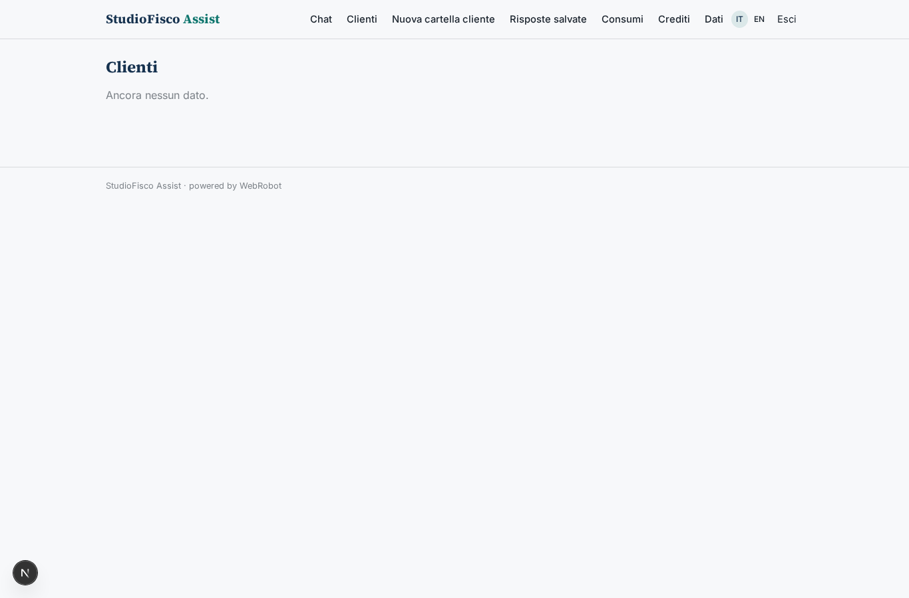
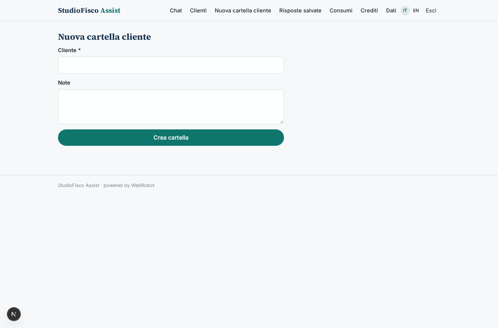
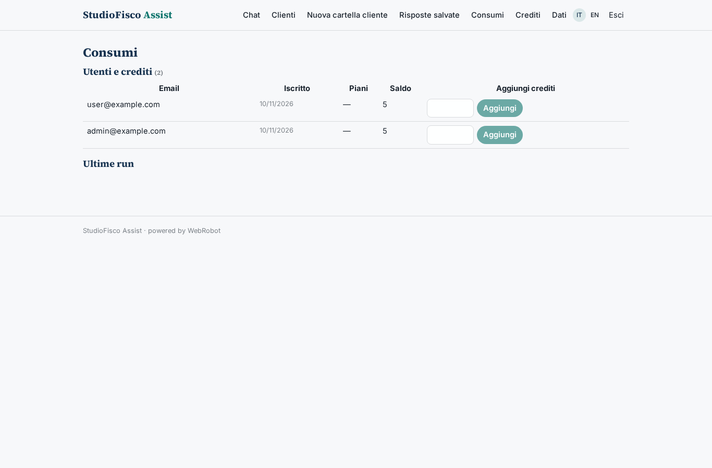
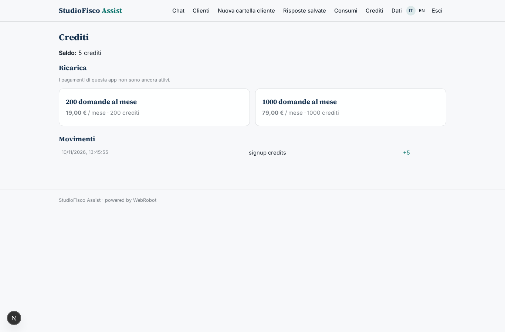

# StudioFisco Assist

_L'assistente per commercialisti e consulenti del lavoro, con fonti sempre citate._

**Manifest:** valid (schema + runtime contract) · **Functional test:** passed (11 checks passed)

## Description given to the app builder (Italian)

Voglio creare StudioFisco Assist, un assistente per commercialisti e consulenti del lavoro. Gli utenti sono professionisti registrati con login; l'admin dello studio invita i collaboratori e vede i consumi di tutti. Il professionista apre una chat e fa domande in italiano su IVA, regimi forfettari, scadenze, crediti d'imposta. L'agente cerca nella base di conoscenza costruita dalle circolari, risoluzioni e risposte a interpello dell'Agenzia delle Entrate e dai testi di legge di Normattiva, risponde citando sempre la fonte con link e data, e segnala quando una norma è stata modificata di recente. Ogni notte un agente aggiorna l'indice con i nuovi documenti pubblicati. L'utente può salvare le risposte in cartelle per cliente ed esportarle in PDF da allegare a un parere. Ogni professionista vede solo le proprie conversazioni, l'admin vede solo le statistiche d'uso. Si paga a crediti: ogni domanda consuma un credito, con pacchetti mensili da 200 o 1000 domande acquistabili con carta. Quando l'agente non è sicuro deve dirlo e suggerire di verificare con la norma originale, mai inventare.

## Features not expressible today (spec.extensions)

- **pdf_export**: L'esportazione in PDF usa la stampa del browser sulla vista 'saved' (printable); un PDF generato lato server con intestazione dello studio non è disponibile.
- **admin_usage_only**: La vista admin mostra solo statistiche d'uso (utenti, domande, crediti consumati); il contenuto delle conversazioni resta del singolo professionista. Gli admin tecnicamente rientrano tra chi può leggere i record: va verificato in fase di pubblicazione.

## Screenshots (interpretive runtime, no data)

### home-anon

### home-mobile

### home

### chat

### folders

### new_folder

### saved

### admin

### account

