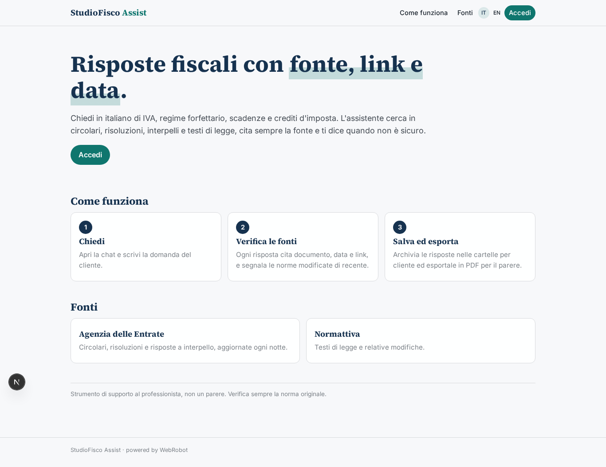
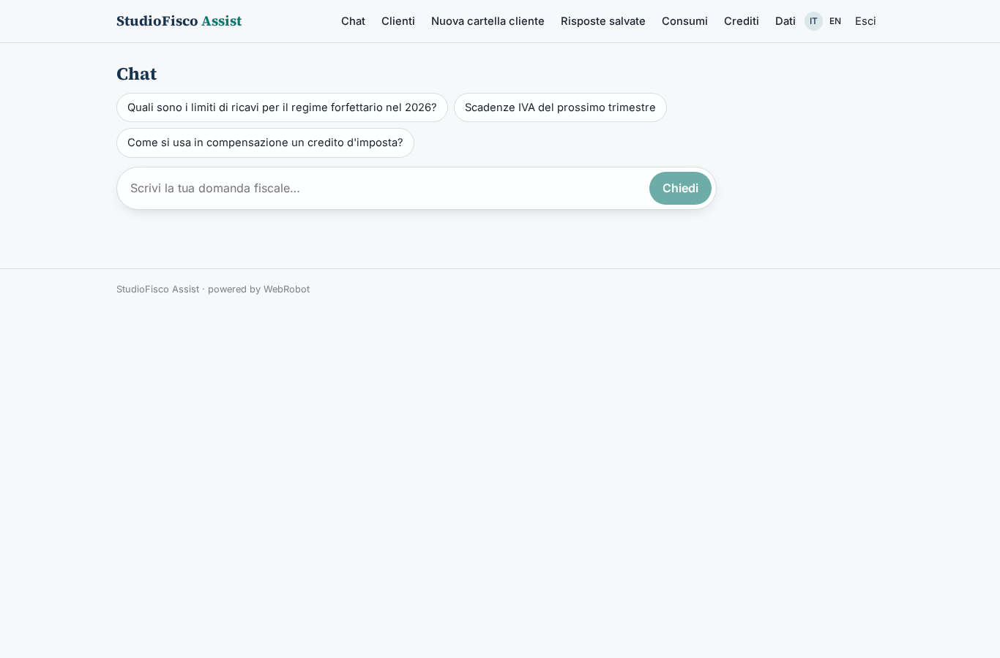
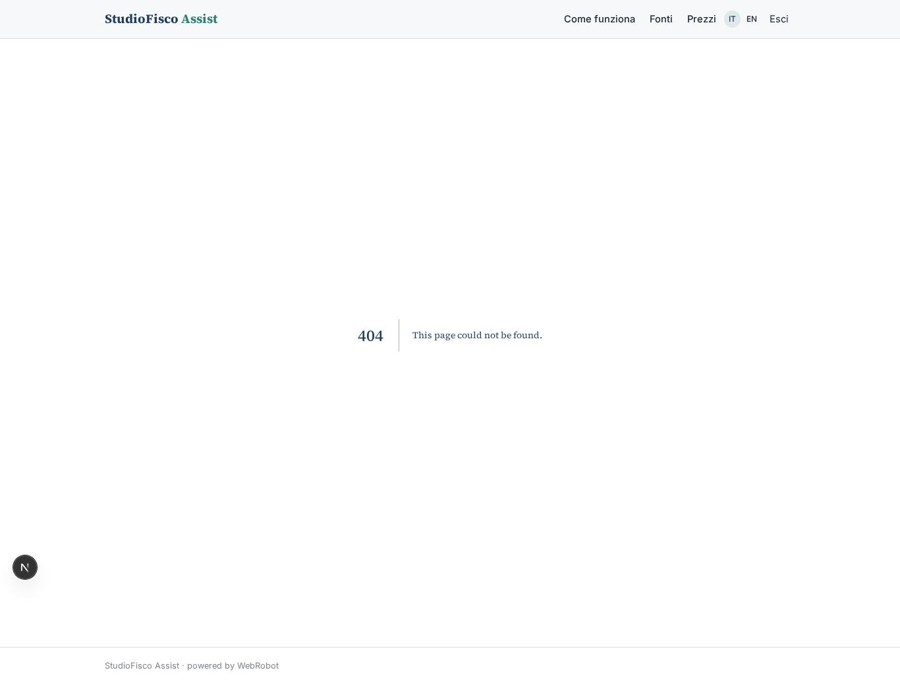
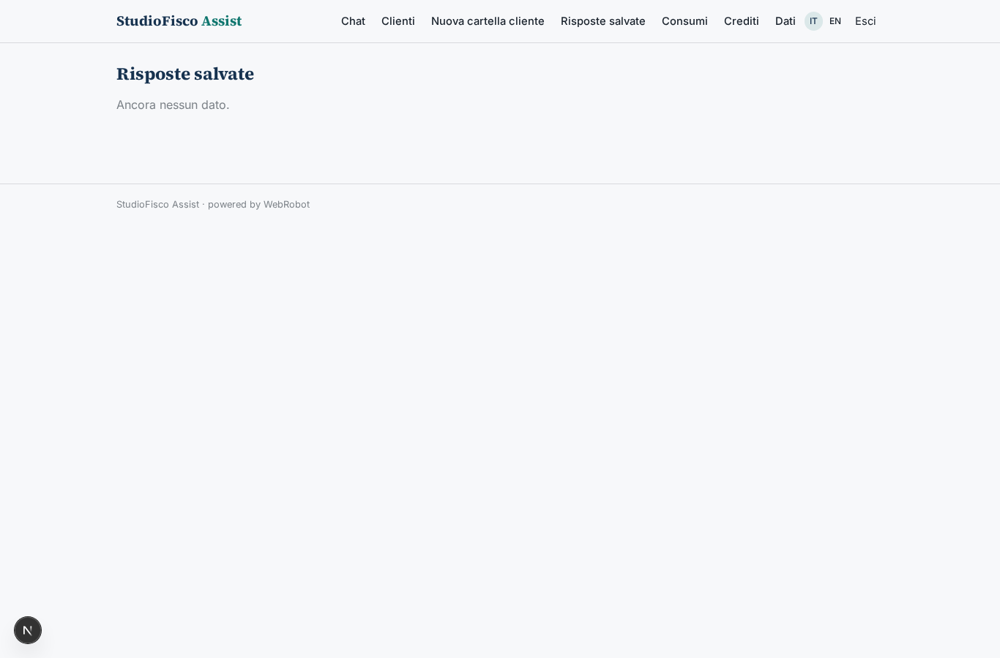
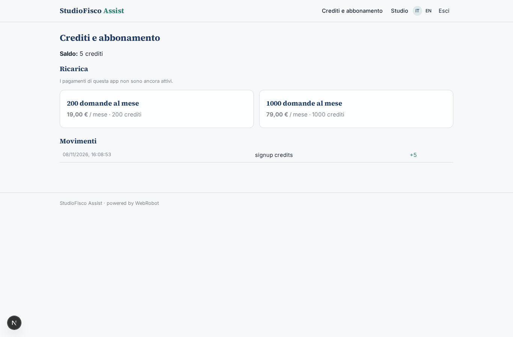
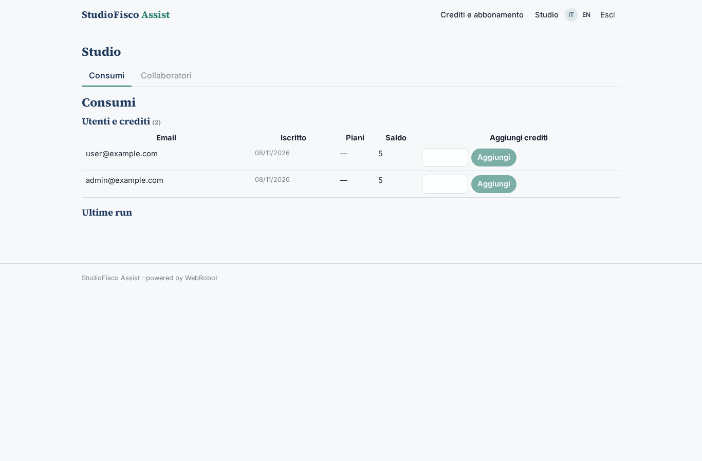
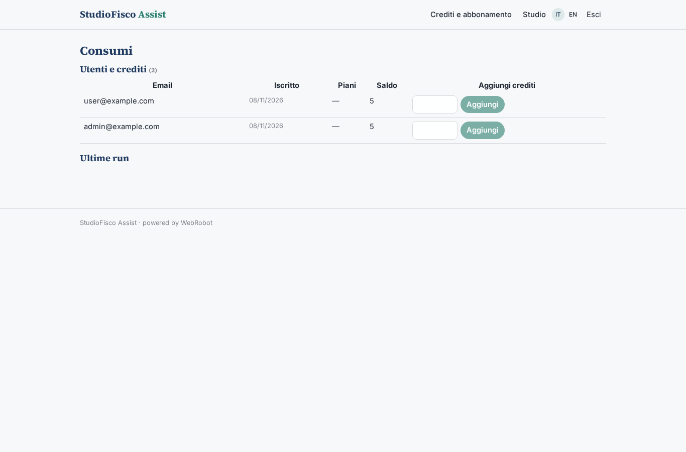
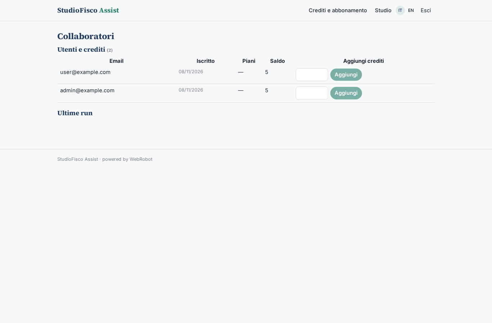

# StudioFisco Assist

_L'assistente fiscale che cita sempre la fonte._

**Manifest status:** valid (schema validator + runtime contract)

## Description given to the app builder (Italian)

Voglio creare StudioFisco Assist, un assistente per commercialisti e consulenti del lavoro. Gli utenti sono professionisti registrati con login; l'admin dello studio invita i collaboratori e vede i consumi di tutti. Il professionista apre una chat e fa domande in italiano su IVA, regimi forfettari, scadenze, crediti d'imposta. L'agente cerca nella base di conoscenza costruita dalle circolari, risoluzioni e risposte a interpello dell'Agenzia delle Entrate e dai testi di legge di Normattiva, risponde citando sempre la fonte con link e data, e segnala quando una norma è stata modificata di recente. Ogni notte un agente aggiorna l'indice con i nuovi documenti pubblicati. L'utente può salvare le risposte in cartelle per cliente ed esportarle in PDF da allegare a un parere. Ogni professionista vede solo le proprie conversazioni, l'admin vede solo le statistiche d'uso. Si paga a crediti: ogni domanda consuma un credito, con pacchetti mensili da 200 o 1000 domande acquistabili con carta. Quando l'agente non è sicuro deve dirlo e suggerire di verificare con la norma originale, mai inventare.

## Features not expressible today (spec.extensions)

- **pdf_export**: L'esportazione in PDF usa la stampa del browser sulle viste stampabili (risposte salvate, conversazione); non c'è un generatore PDF dedicato.
- **admin_usage_only**: L'admin vede solo consumi e collaboratori tramite le viste admin; il contenuto delle conversazioni non è esposto e va verificato nel runtime.
- **invites**: Gli inviti ai collaboratori sono gestiti dall'admin nella vista Collaboratori; l'email di invito non è disponibile (notifiche non ancora supportate), il link va condiviso a mano.

## Screenshots (interpretive runtime)

### home-anon

### home-mobile

### home

### chat

### history

### folders

### saved

### account

### admin

### admin_overview

### admin_users

