# TargetScope

_Intelligence sui mercati privati: dalla tesi di investimento alle aziende target._

**Manifest:** valid (schema + runtime contract) · **Functional test:** passed (15 checks passed)

## Description given to the app builder (Italian)

Voglio un'app di intelligence sui mercati privati per fondi di private equity, search fund e advisor M&A. L'utente scrive una tesi di investimento in linguaggio naturale (es. 'PMI manifatturiere nel nord Italia, ricavi 10-50 milioni, a controllo familiare, settore packaging') e l'app restituisce una lista di aziende target con scheda: descrizione, sito, settore, dimensione stimata, notizie recenti, segnali (assunzioni, nuovi stabilimenti, appalti vinti, brevetti), fonte di ogni dato. Le aziende si possono salvare in una pipeline con fasi (screening, analisi, approvata, contattata, due diligence). L'utente può caricare documenti (bilanci, memo, cap table) e chiedere a un agente un memo di investimento o un confronto con i comparabili, con le fonti citate. Alert settimanali sulle aziende in pipeline (nuove notizie, nomine, operazioni). Usare solo fonti aperte o dati caricati dall'utente: Companies House UK ha un'API gratuita, TED e ANAC per gli appalti, siti aziendali e comunicati stampa. Nome: TargetScope. Lingue italiano e inglese. Abbonamento per utente.

## Features not expressible today (spec.extensions)

- **companies_house_key**: Companies House needs an HTTP Basic credential: the admin pastes the base64 of "API_KEY:" once in the app credentials.
- **pipeline_kanban**: A kanban board by stage is not available yet; the pipeline is a table filterable by stage.

## Screenshots (interpretive runtime, no data)

### home-anon
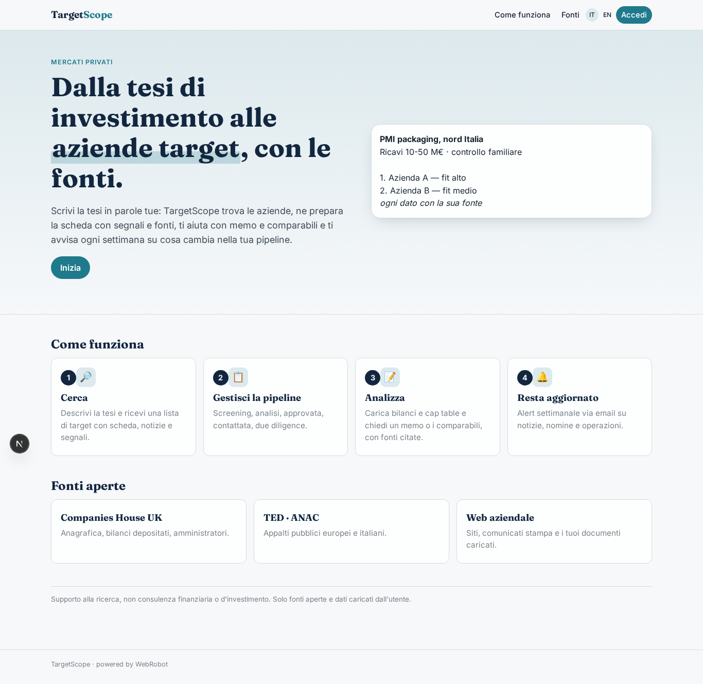

### home-mobile
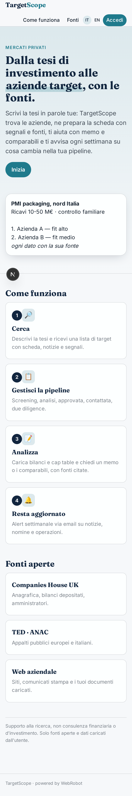

### home
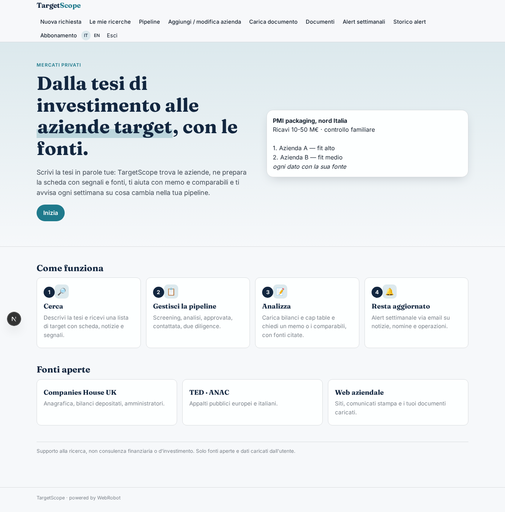

### new_run
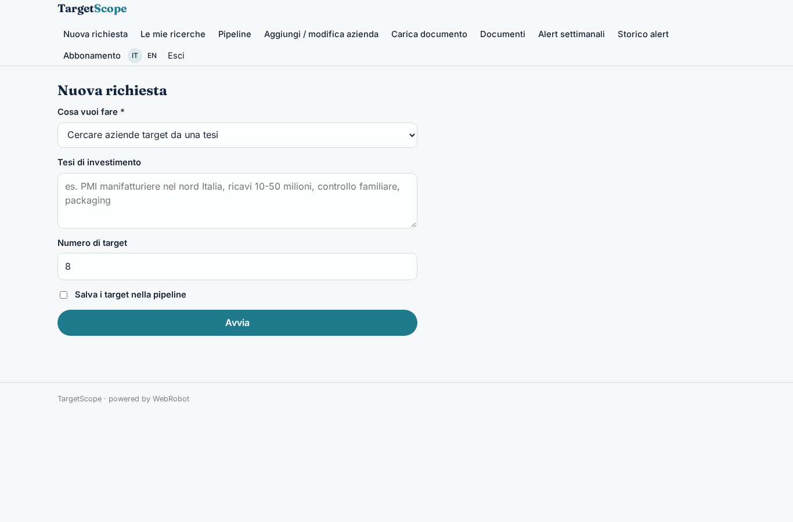

### history
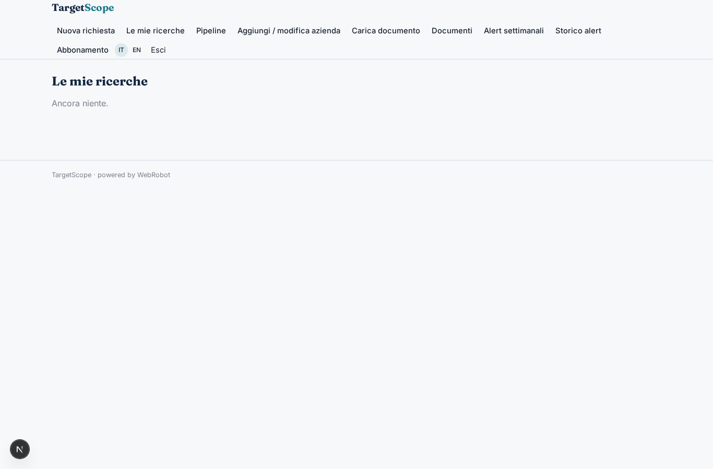

### pipeline
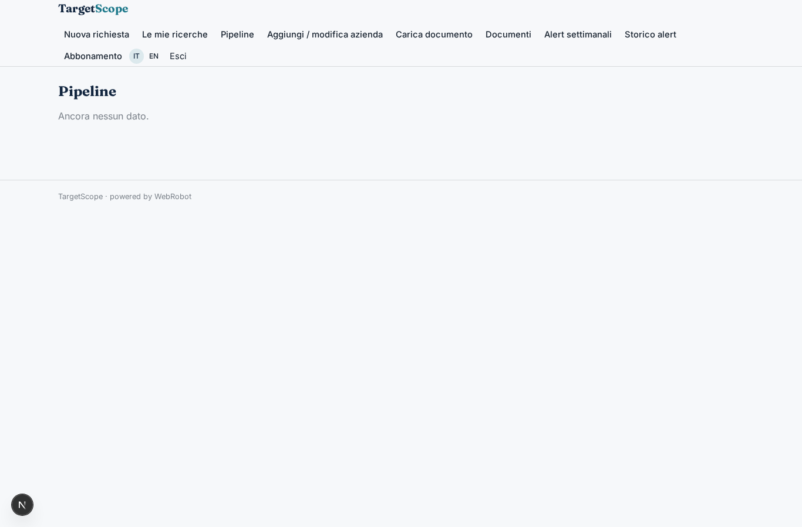

### add_target
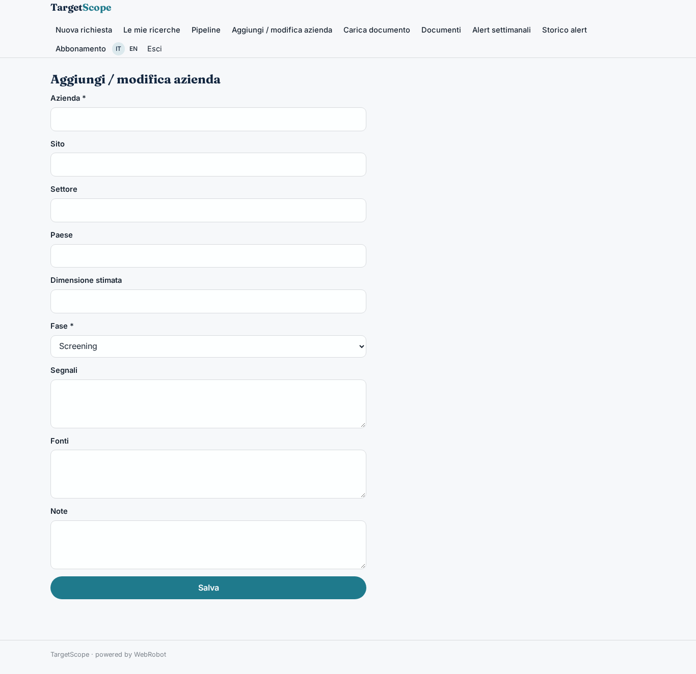

### add_document
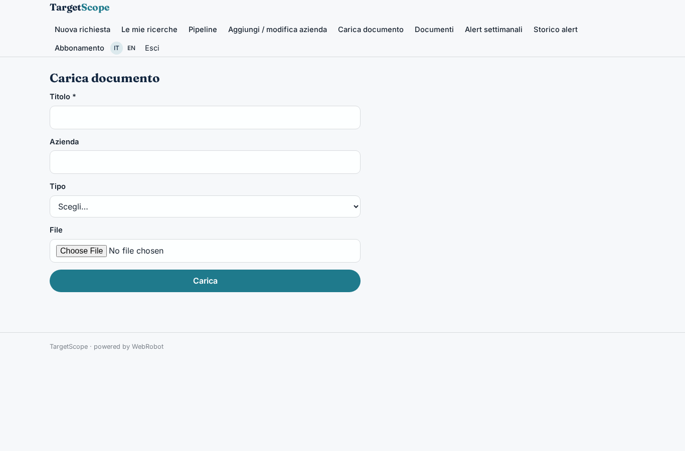

### docs

### watches
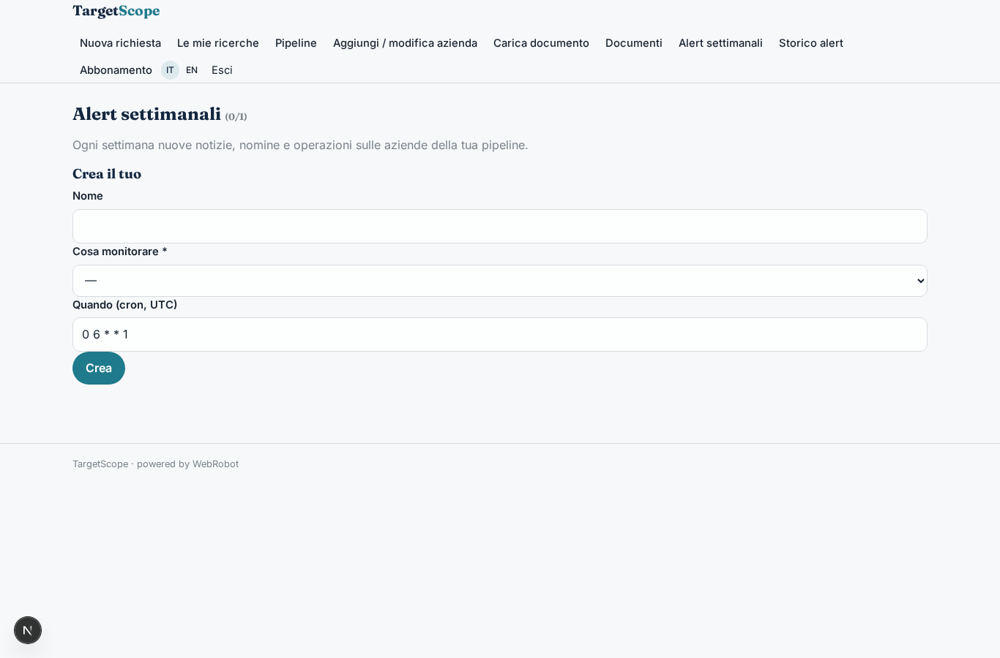

### alert_list
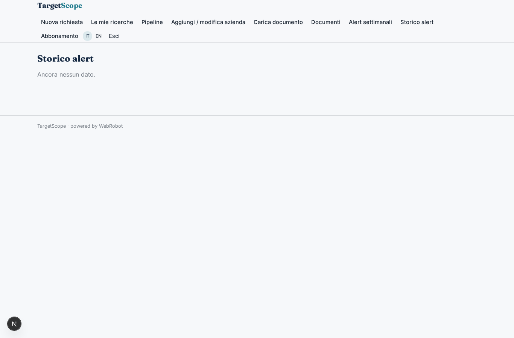

### account
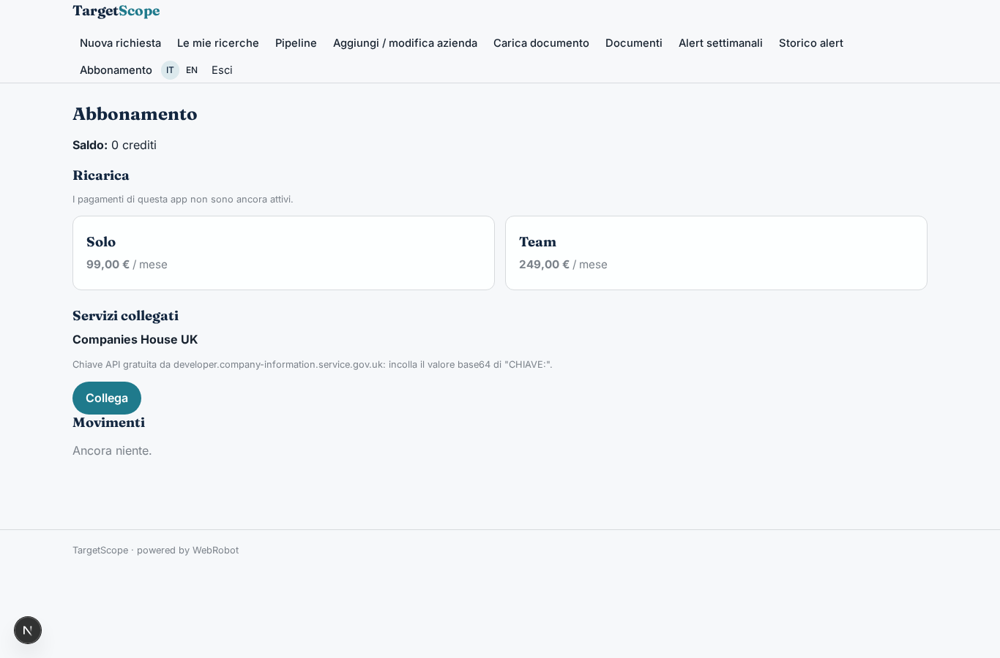
