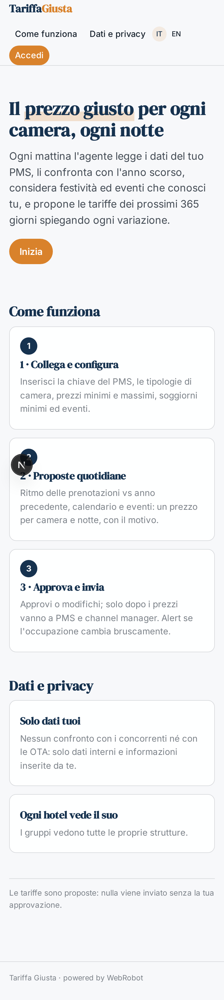
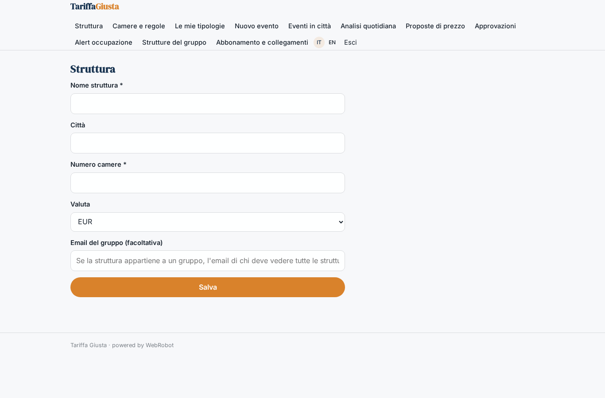
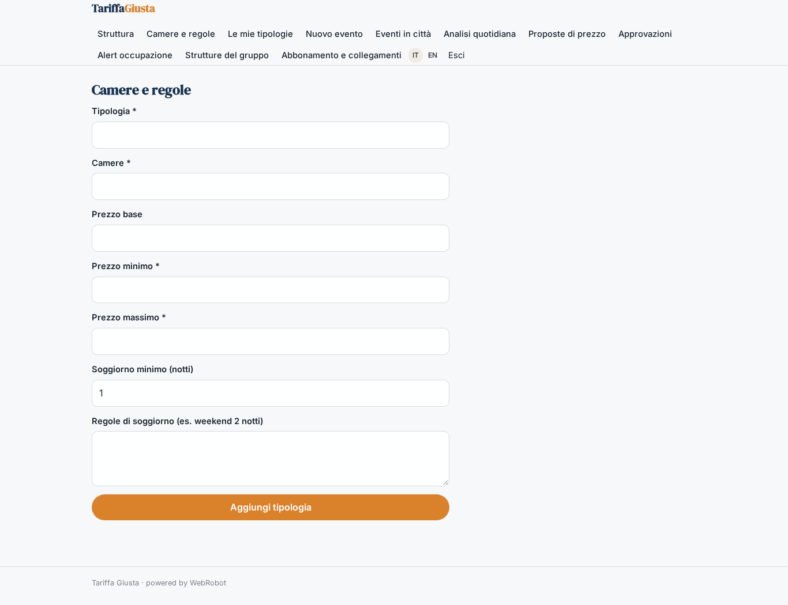
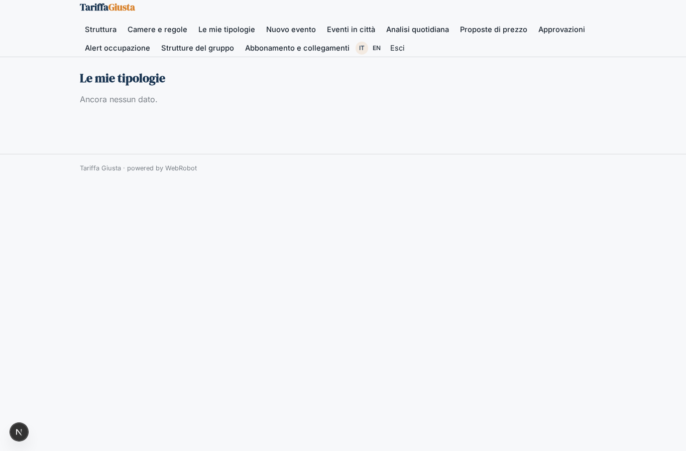
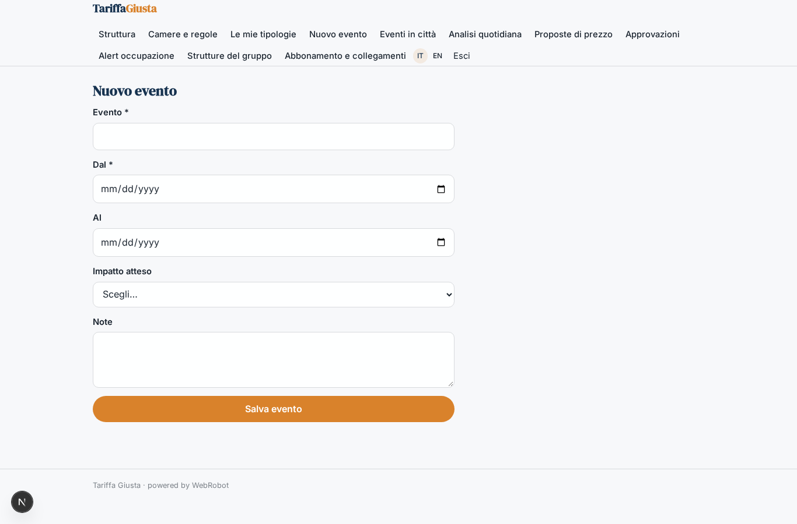
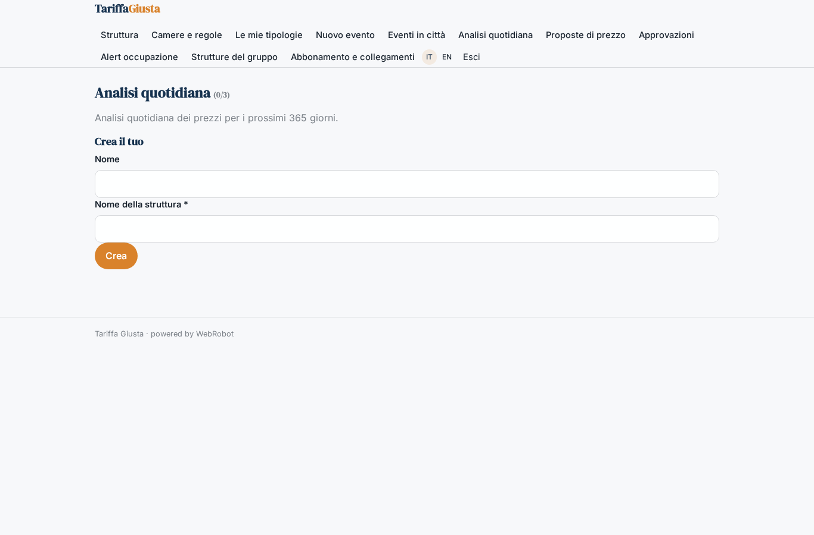
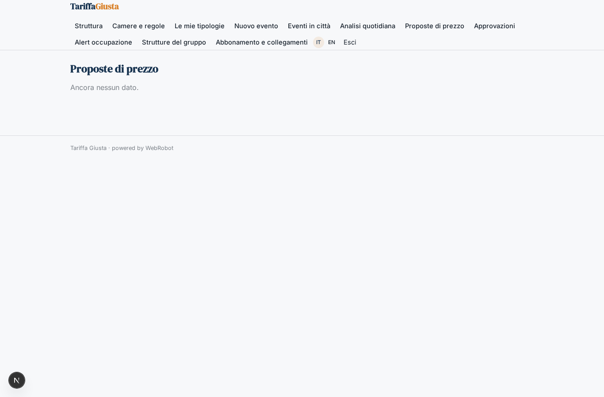
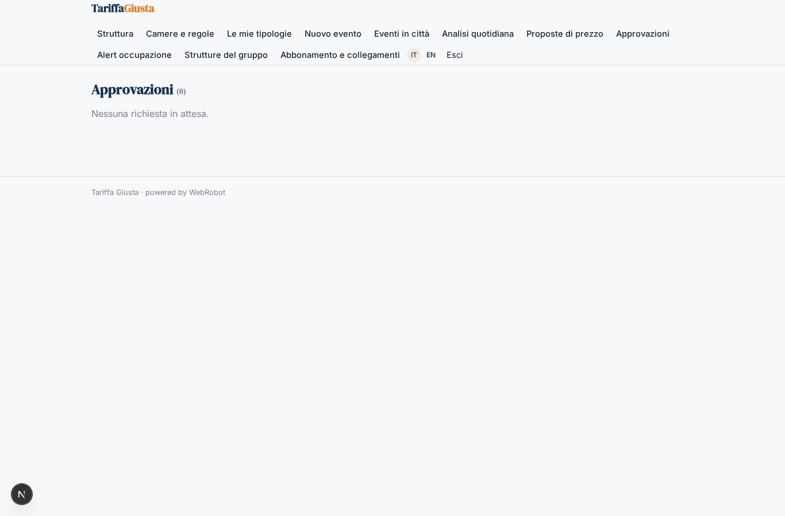
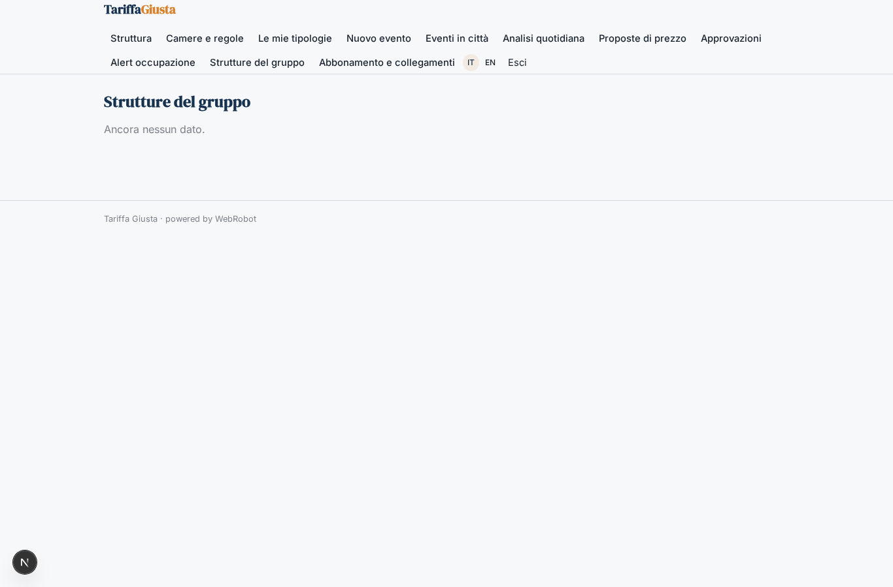
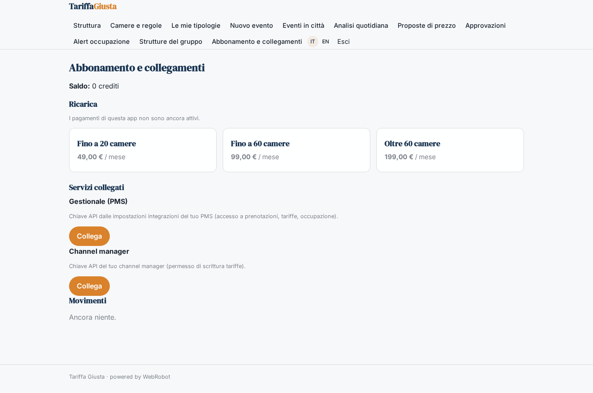

# Tariffa Giusta

_Il prezzo giusto per ogni camera e ogni notte, ogni mattina._

**Manifest:** valid (schema + runtime contract) · **Functional test:** passed (17 checks passed)

## Description given to the app builder (Italian)

Vorrei Tariffa Giusta, un assistente di revenue management per hotel. Il revenue manager o il titolare collega il gestionale della struttura (PMS) per leggere prenotazioni, occupazione, tariffe e cancellazioni, e inserisce tipologie di camera, prezzi minimi e massimi, regole di soggiorno minimo ed eventi in città che conosce. Ogni mattina un agente analizza il ritmo delle prenotazioni per ogni data futura rispetto all'anno precedente, il calendario di festività ed eventi, e propone il prezzo per ogni camera e notte dei prossimi 365 giorni, spiegando il motivo di ogni variazione. Ci piacerebbe confrontare i prezzi dei concorrenti, ma le OTA lo vietano, quindi l'app usa solo dati interni dell'hotel e informazioni che l'albergatore inserisce a mano. Le proposte compaiono in un calendario a colori: il revenue manager approva in blocco o modifica, e dopo l'approvazione i prezzi devono essere inviati al PMS e al channel manager. Se l'occupazione di una data cambia bruscamente arriva un alert. Ogni hotel vede solo i suoi dati; i gruppi vedono tutte le strutture. Abbonamento mensile per camera.

## Features not expressible today (spec.extensions)

- **color_calendar**: Calendario a colori delle proposte (camera × notte, colore per livello di variazione) con approvazione in blocco e modifica per cella: non disponibile come vista; per ora tabella delle proposte e approvazione dell'intera proposta.
- **per_room_pricing**: Abbonamento calcolato per numero di camere: approssimato con tre piani a fasce di camere.
- **pms_connectors**: Connettori specifici per PMS e channel manager (host e formato API reali di ogni fornitore, eventuale OAuth): da definire per fornitore.
- **proposal_editing**: Modifica cella per cella dei prezzi proposti prima dell'approvazione e stato 'sent' dopo l'invio.

## Screenshots (interpretive runtime, no data)

### home-anon

### home-mobile

### home

### hotel

### rooms

### room_list

### event_new

### event_list

### watches

### proposals

### approve

### alerts

### group_overview

### account

