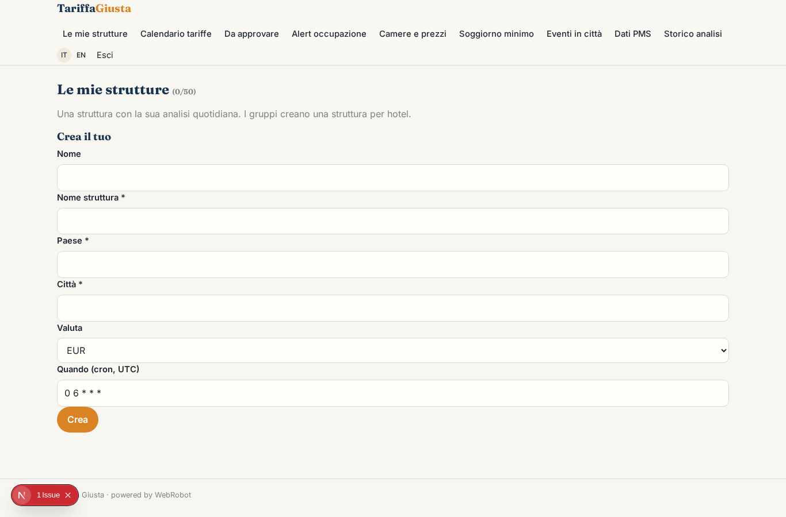
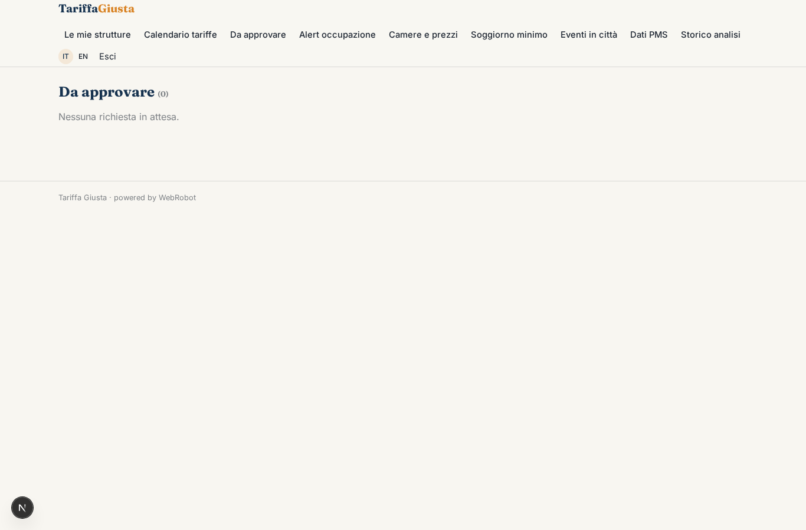
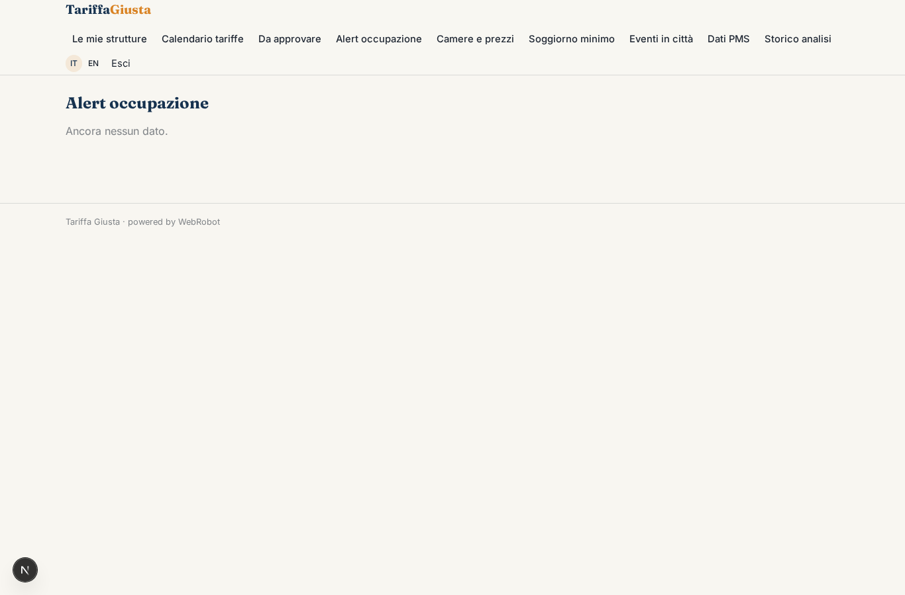
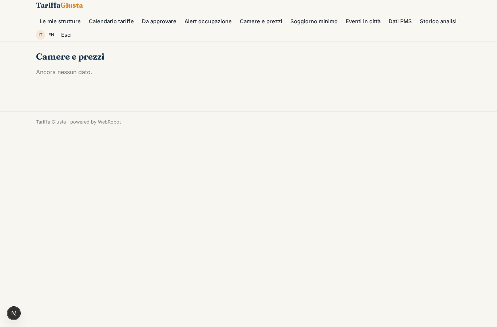
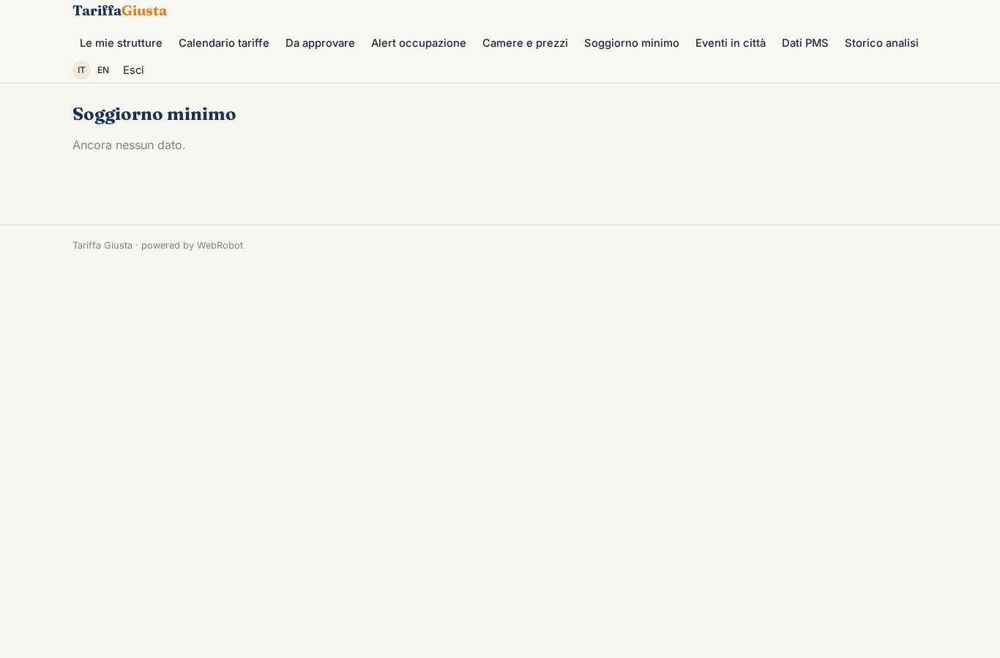
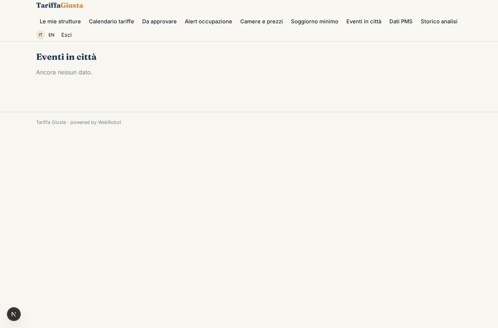
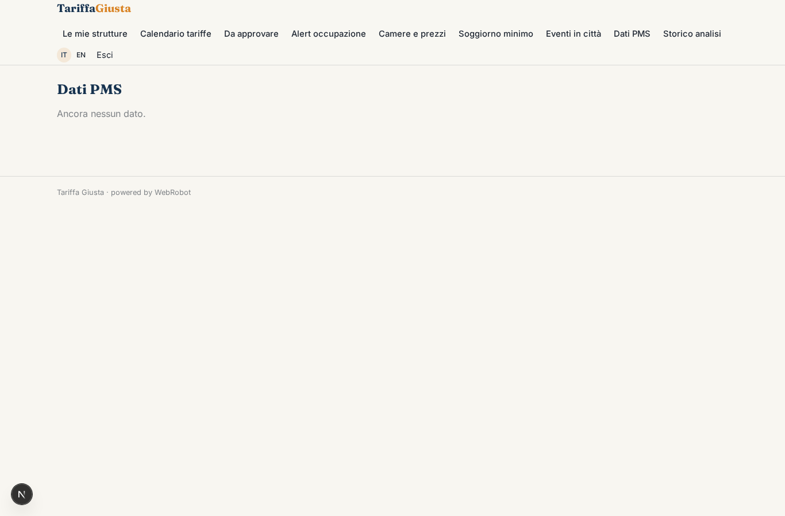
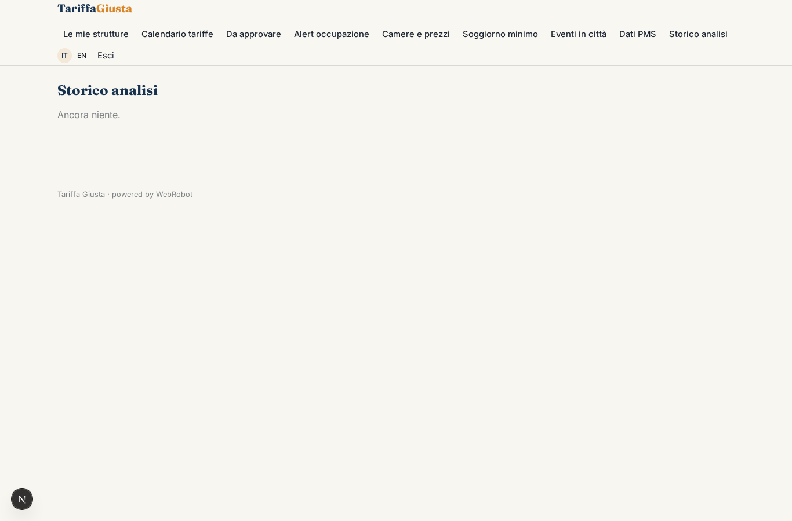
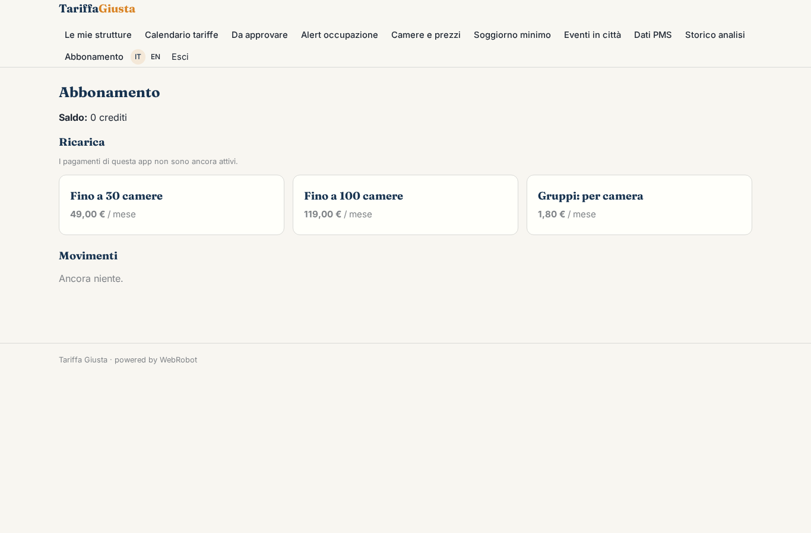

# Tariffa Giusta

_Il prezzo giusto per ogni camera e ogni notte, spiegato._

**Manifest status:** valid (schema validator + runtime contract)

## Description given to the app builder (Italian)

Vorrei Tariffa Giusta, un assistente di revenue management per hotel. Il revenue manager o il titolare collega il gestionale della struttura (PMS) per leggere prenotazioni, occupazione, tariffe e cancellazioni, e inserisce tipologie di camera, prezzi minimi e massimi, regole di soggiorno minimo ed eventi in città che conosce. Ogni mattina un agente analizza il ritmo delle prenotazioni per ogni data futura rispetto all'anno precedente, il calendario di festività ed eventi, e propone il prezzo per ogni camera e notte dei prossimi 365 giorni, spiegando il motivo di ogni variazione. Ci piacerebbe confrontare i prezzi dei concorrenti, ma le OTA lo vietano, quindi l'app usa solo dati interni dell'hotel e informazioni che l'albergatore inserisce a mano. Le proposte compaiono in un calendario a colori: il revenue manager approva in blocco o modifica, e dopo l'approvazione i prezzi devono essere inviati al PMS e al channel manager. Se l'occupazione di una data cambia bruscamente arriva un alert. Ogni hotel vede solo i suoi dati; i gruppi vedono tutte le strutture. Abbonamento mensile per camera.

## Features not expressible today (spec.extensions)

- **pms_connector**: Collegamento diretto al PMS (prenotazioni, occupazione, tariffe, cancellazioni) richiede credenziali di ogni hotel: non disponibile. Per ora l'hotel incolla export CSV nella sezione Dati PMS.
- **price_push**: Invio automatico dei prezzi approvati al PMS e al channel manager non disponibile: richiede connettori con credenziali del cliente. Per ora le tariffe approvate si esportano e si caricano a mano.
- **alert_notifications**: Gli alert di occupazione compaiono in app; email o notifiche push non sono ancora disponibili.
- **calendar_heatmap**: Calendario a colori mese per mese e approvazione in blocco con modifica cella per cella: oggi tabella con badge di segnale; il calendario grafico richiede un blocco dedicato.
- **group_overview**: Vista consolidata per gruppi: oggi un gruppo crea una struttura per hotel nello stesso account; un riepilogo aggregato tra strutture non e' ancora disponibile.
- **per_room_billing**: Abbonamento mensile per camera: oggi piani a scaglioni; il conteggio per camera richiede un'estensione di fatturazione.

## Screenshots (interpretive runtime)

### home-anon

### home-mobile

### home

### properties

### calendar

### approvals

### alerts

### rooms

### rules

### events

### pms

### history

### account

