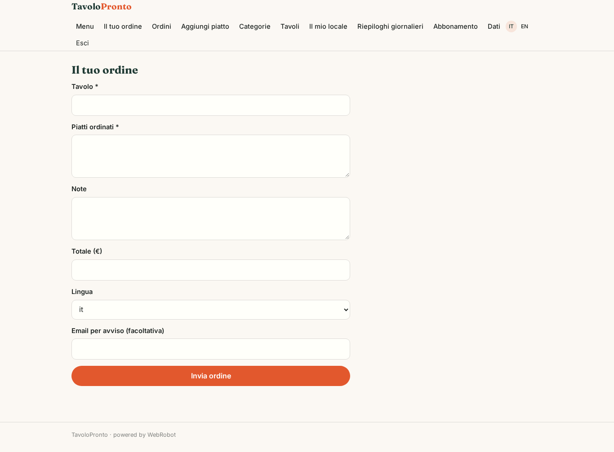
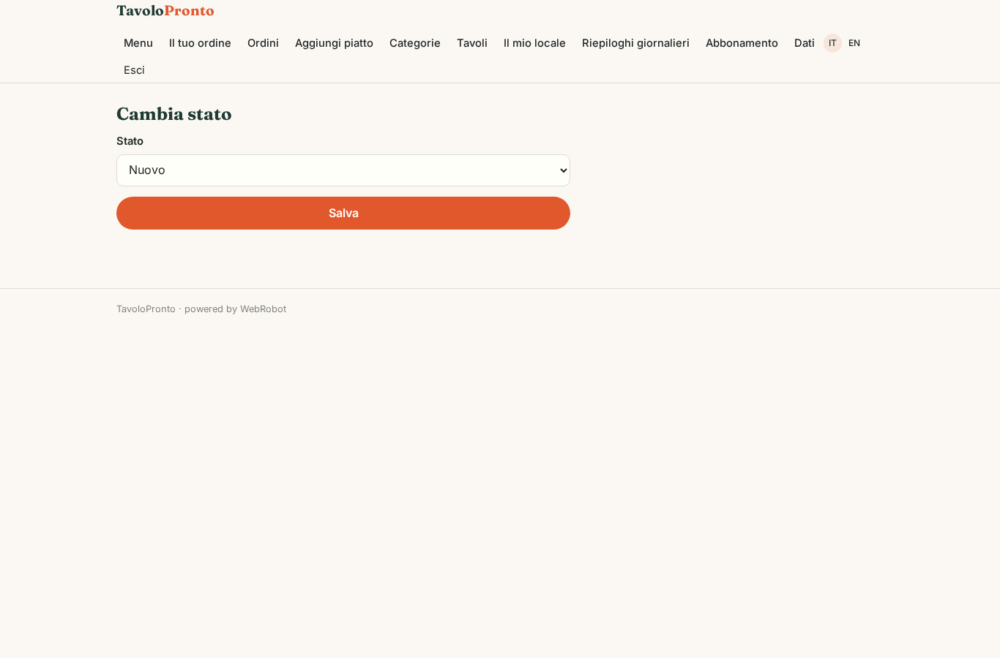
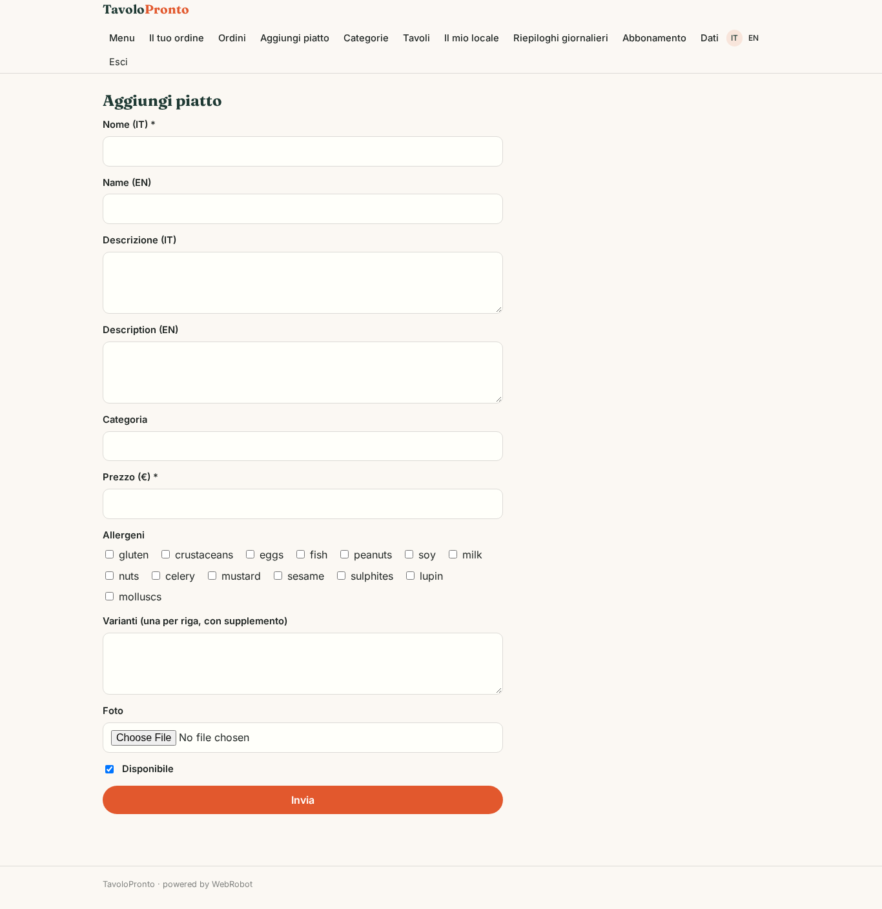
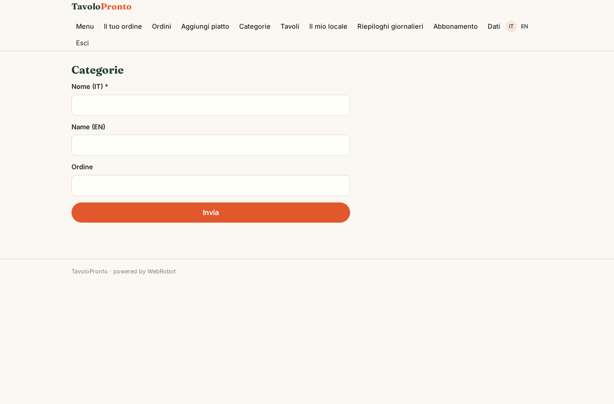
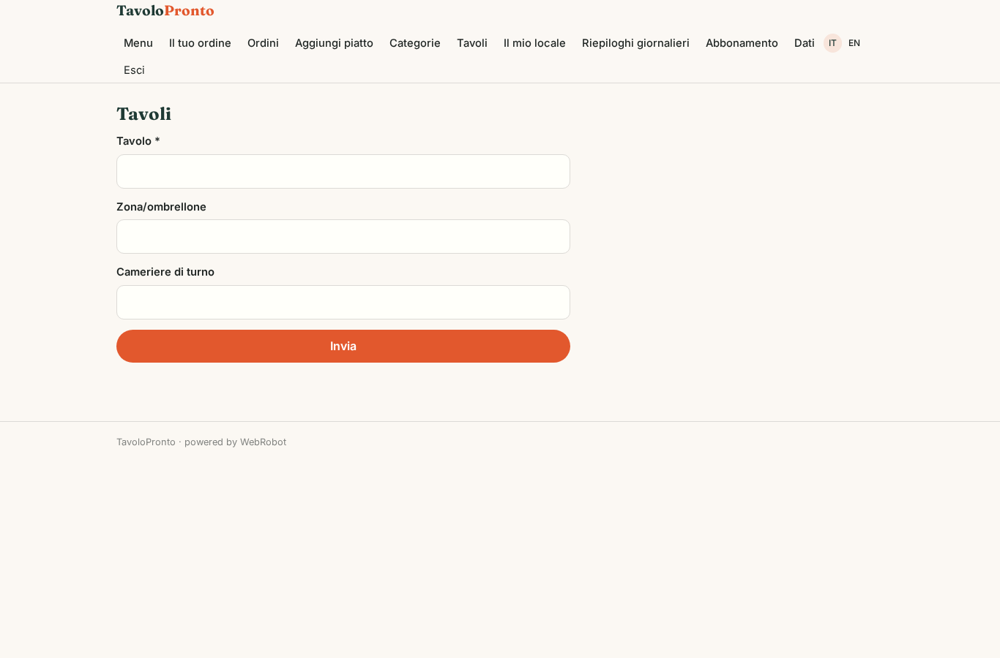
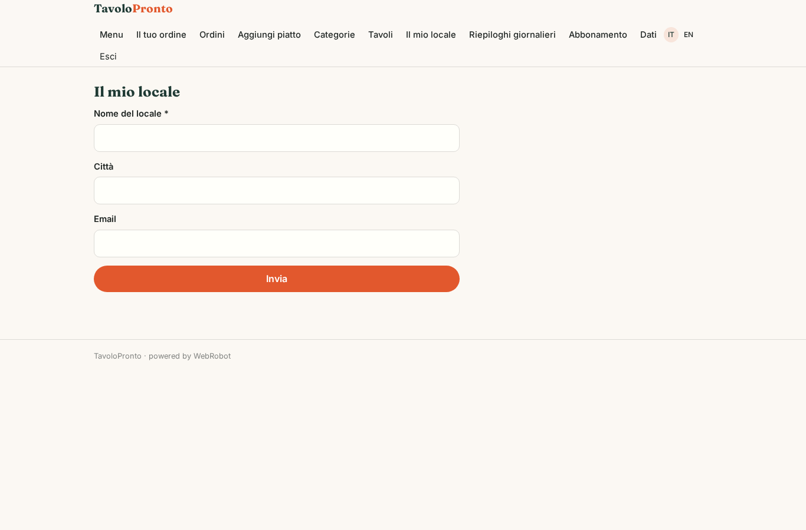
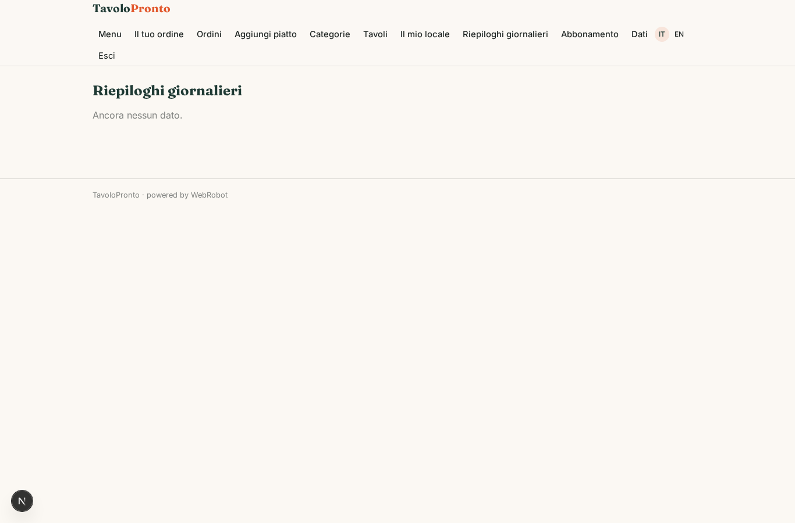
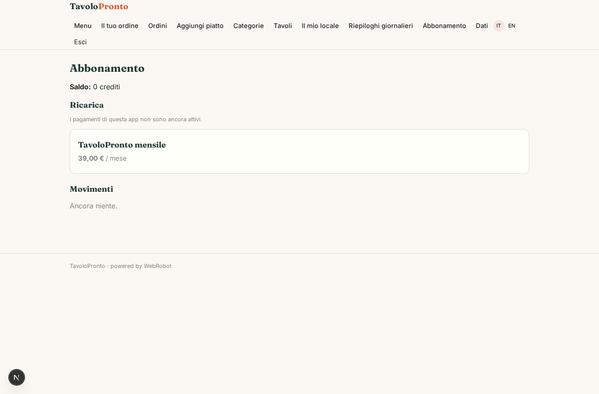

# TavoloPronto

_Ordina e paga dal tavolo, senza app e senza registrarti._

**Manifest:** valid (schema + runtime contract) · **Functional test:** passed (27 checks passed)

## Description given to the app builder (Italian)

Ci serve TavoloPronto, un sistema di ordinazione e pagamento al tavolo per ristoranti, bar e lidi. Il ristoratore si registra come admin, collega il suo conto Stripe per ricevere gli incassi, carica il menu con categorie, piatti, prezzi, allergeni, varianti e foto, e crea i tavoli, ognuno con il suo QR code. Il cliente seduto inquadra il QR senza registrarsi, sfoglia il menu, ordina, aggiunge note e paga subito con carta, oppure divide il conto con gli amici. Ogni ordine entra in una lista visibile al personale di sala e cucina, che cambia lo stato in preparazione, pronto e servito; quando un ordine diventa pronto il cliente riceve una notifica sul telefono. In cucina l'ordine deve uscire anche sulla stampante comande. Un agente a fine giornata riassume incassi, piatti più venduti, tempi medi di preparazione e suggerisce piatti da spingere o togliere. Il cameriere vede solo gli ordini del suo turno, il titolare tutto. Il ristoratore paga un abbonamento mensile e la piattaforma trattiene una piccola commissione su ogni pagamento. Lingua del menu selezionabile dal cliente tra italiano e inglese.

## Functional test: what did not pass

- **saved record shown where its collection is read** (view reports): a record was saved in daily_reports (by admin-data, admin-data) but the page does not show it (as admin) _(warning)_

## Features not expressible today (spec.extensions)

- **table_qr**: QR code per tavolo che apre /v/order con il tavolo precompilato e il menu.
- **customer_payment**: Pagamento carta al tavolo (Stripe Connect sul conto del ristoratore) e conto diviso tra amici, anche per clienti anonimi.
- **push_notification**: Notifica push sul telefono quando l'ordine è pronto: non disponibile, per ora email se il cliente la indica.
- **kitchen_printer**: Stampa dell'ordine sulla stampante comande, non disponibile.
- **shift_assignment**: Il campo waiter_email dell'ordine va derivato dal tavolo assegnato; anche selezione lingua del menu e carrello.

## Screenshots (interpretive runtime, no data)

### home-anon

### home-mobile

### home

### menu

### order

### orders_queue

### order_status

### menu_admin

### categories_admin

### tables_admin

### venue

### reports

### account

