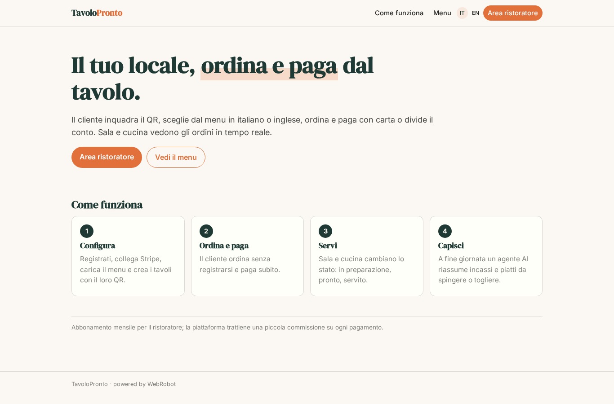
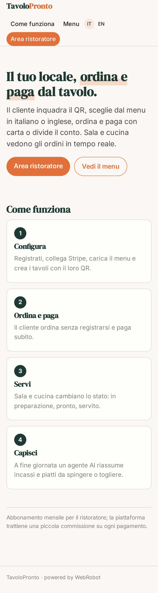
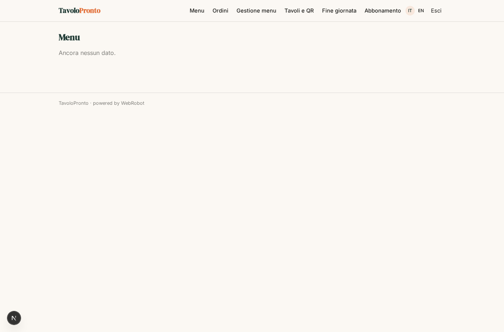
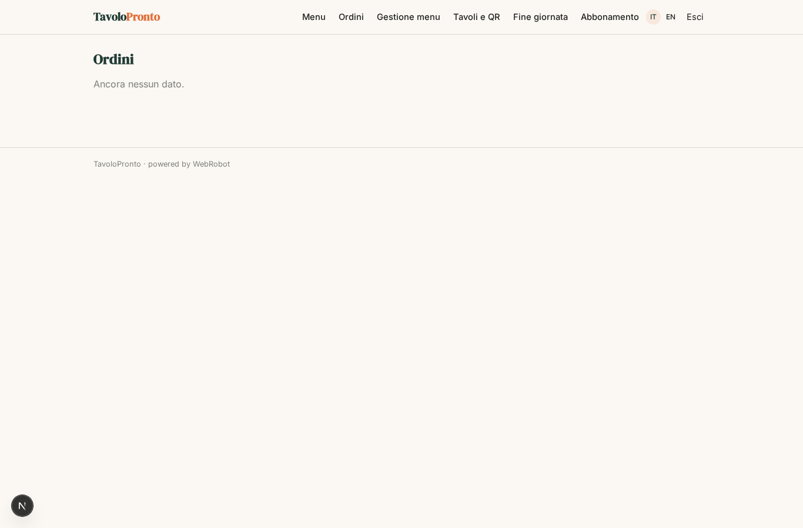
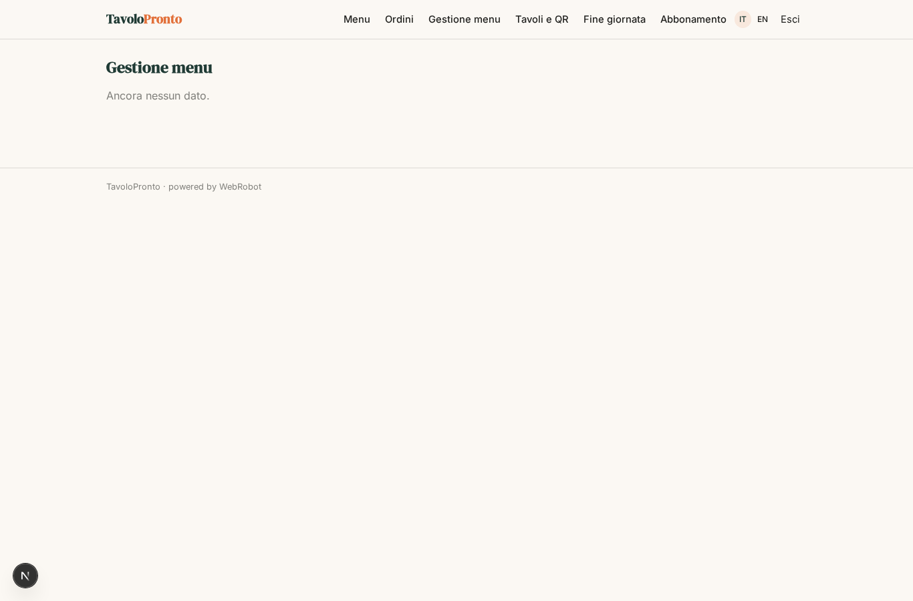
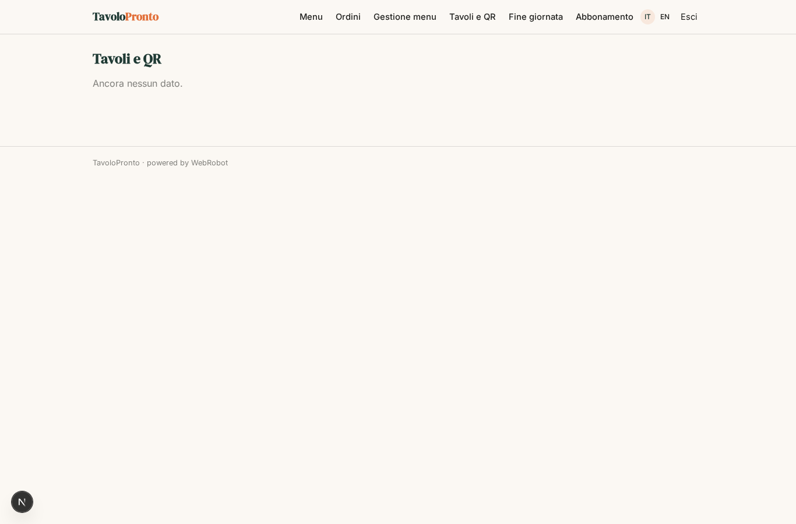
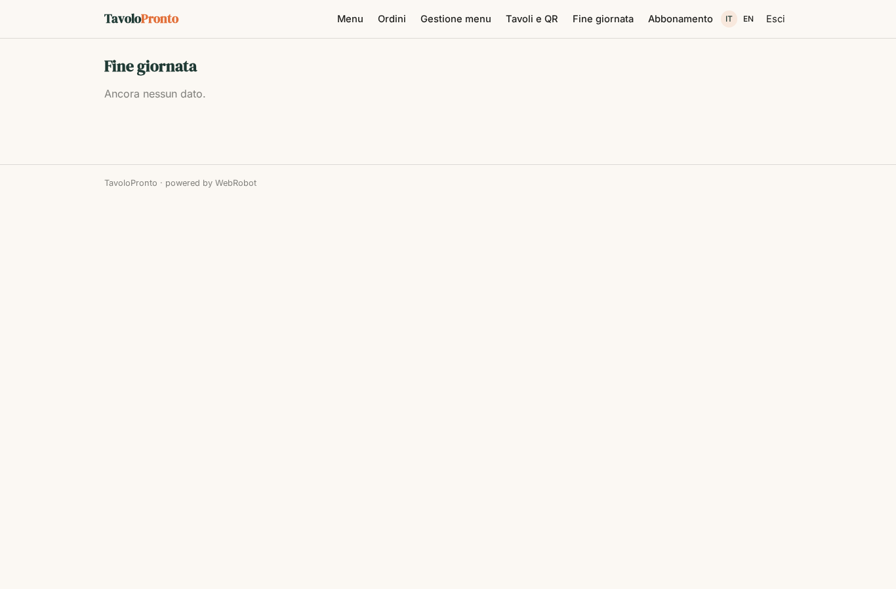
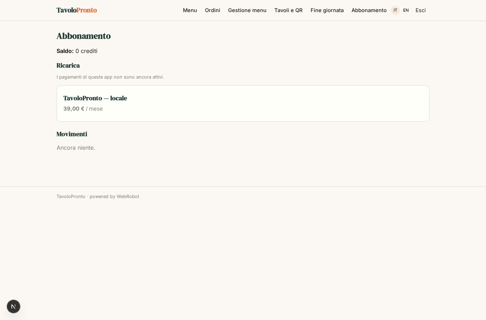

# TavoloPronto

_Ordina e paga al tavolo, senza app e senza registrazione._

**Stato manifest:** valido (validatore Python + contratto runtime)

## Descrizione data all'app builder

Ci serve TavoloPronto, un sistema di ordinazione e pagamento al tavolo per ristoranti, bar e lidi. Il ristoratore si registra come admin, collega il suo conto Stripe per ricevere gli incassi, carica il menu con categorie, piatti, prezzi, allergeni, varianti e foto, e crea i tavoli, ognuno con il suo QR code. Il cliente seduto inquadra il QR senza registrarsi, sfoglia il menu, ordina, aggiunge note e paga subito con carta, oppure divide il conto con gli amici. Ogni ordine entra in una lista visibile al personale di sala e cucina, che cambia lo stato in preparazione, pronto e servito; quando un ordine diventa pronto il cliente riceve una notifica sul telefono. In cucina l'ordine deve uscire anche sulla stampante comande. Un agente a fine giornata riassume incassi, piatti più venduti, tempi medi di preparazione e suggerisce piatti da spingere o togliere. Il cameriere vede solo gli ordini del suo turno, il titolare tutto. Il ristoratore paga un abbonamento mensile e la piattaforma trattiene una piccola commissione su ogni pagamento. Lingua del menu selezionabile dal cliente tra italiano e inglese.

## Funzioni non esprimibili oggi (spec.extensions)

- **anonymous_orders**: I clienti ordinano senza registrarsi, ma gli agenti anonimi non possono scrivere in collezioni app/shared: serve codice per creare ordini dal menu pubblico, dividere il conto e collegare il pagamento Stripe Connect del locale (incassi diretti al ristoratore).
- **qr_codes**: Generazione e stampa del QR per tavolo (link /v/menu?table=<codice>) non è ancora disponibile.
- **photo_upload**: Il caricamento di foto non è disponibile: il menu usa un link alla foto.
- **ready_notification**: La notifica sul telefono del cliente quando l'ordine è pronto non è disponibile (nessuna notifica supportata).
- **kitchen_printer**: La stampa delle comande sulla stampante di cucina richiede un connettore dedicato, non disponibile.
- **shift_scoping**: Il cameriere dovrebbe vedere solo gli ordini del suo turno e il titolare tutti: il filtro per turno e il cambio di stato da parte del personale richiedono logica custom.
- **menu_language_switch**: Il selettore di lingua del menu (IT/EN) per il cliente è da implementare; il menu ha già i campi nelle due lingue.

## Screenshot (runtime interpretativo)

### home-anon

### home-mobile

### home

### menu

### orders_list

### menu_admin

### tables_admin

### reports

### account

