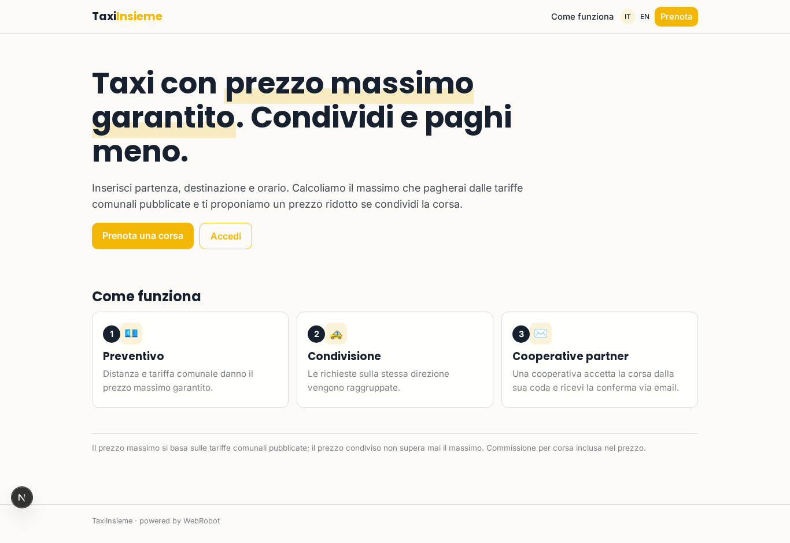
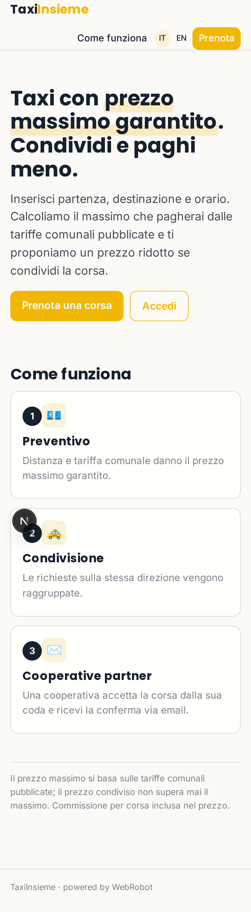
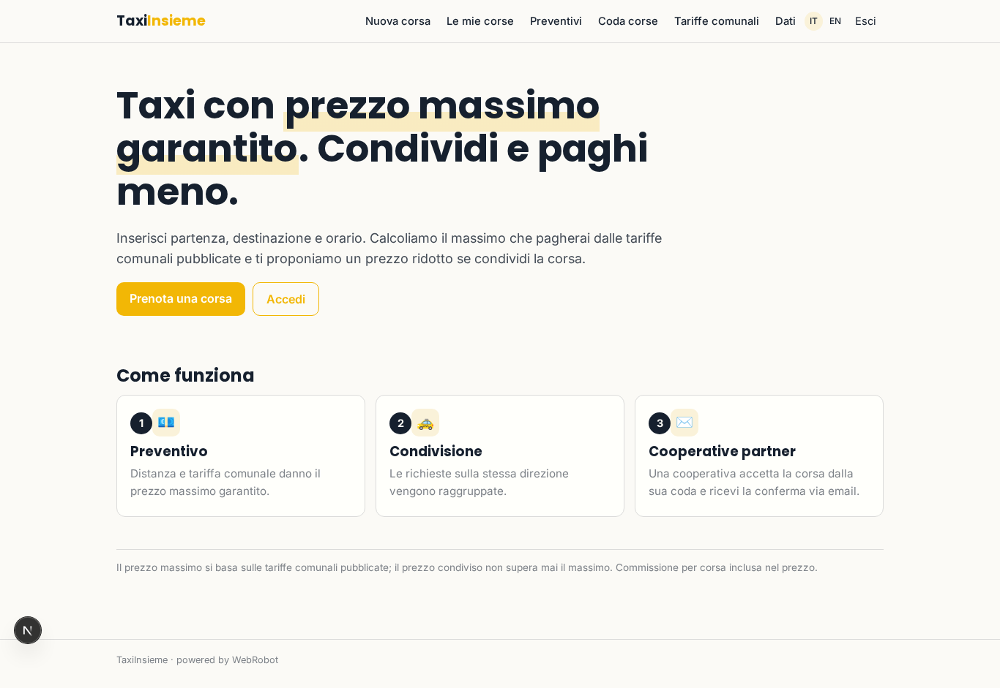
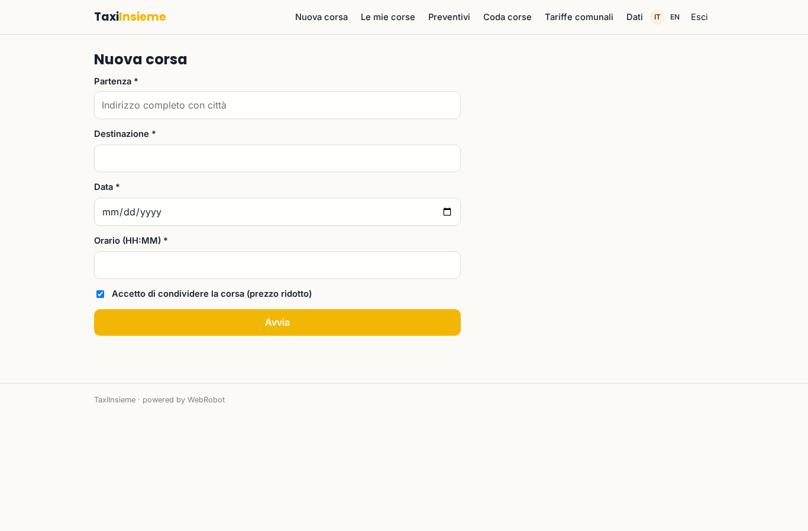
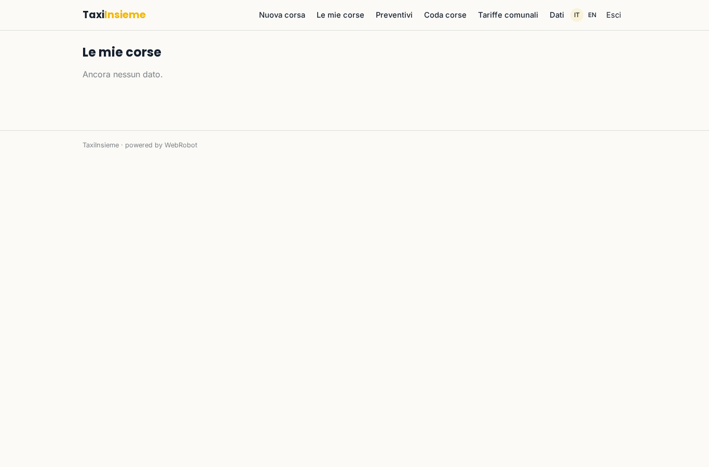
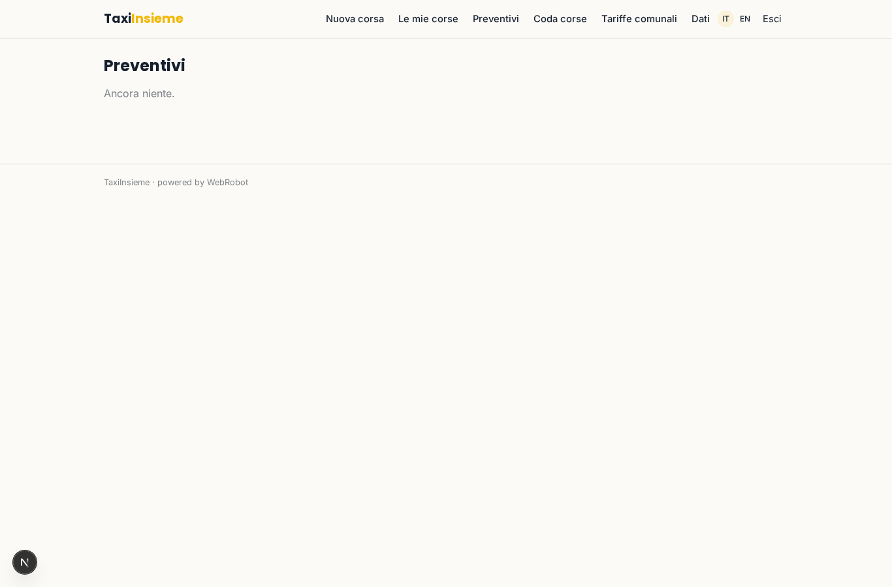
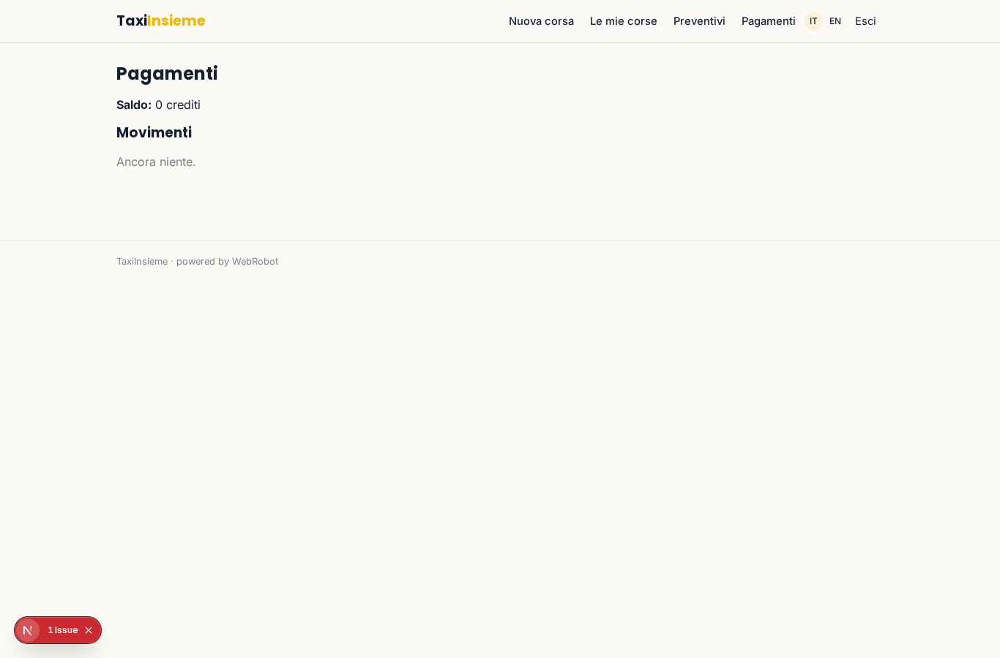
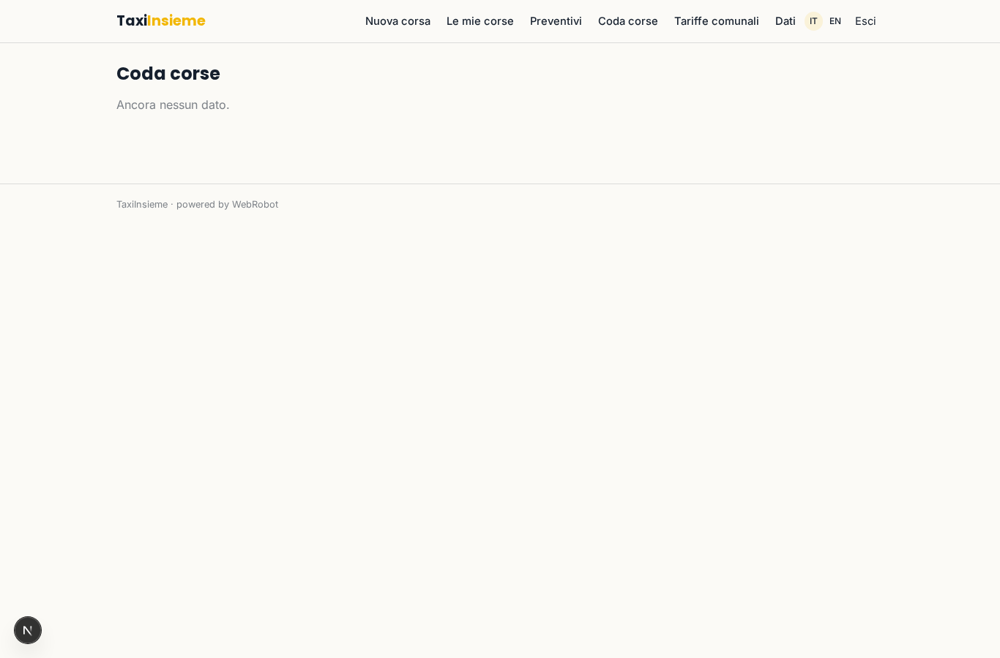
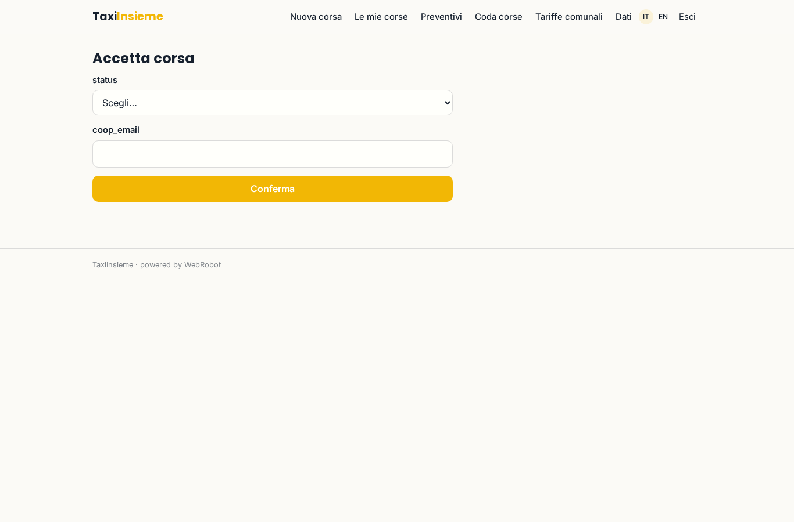
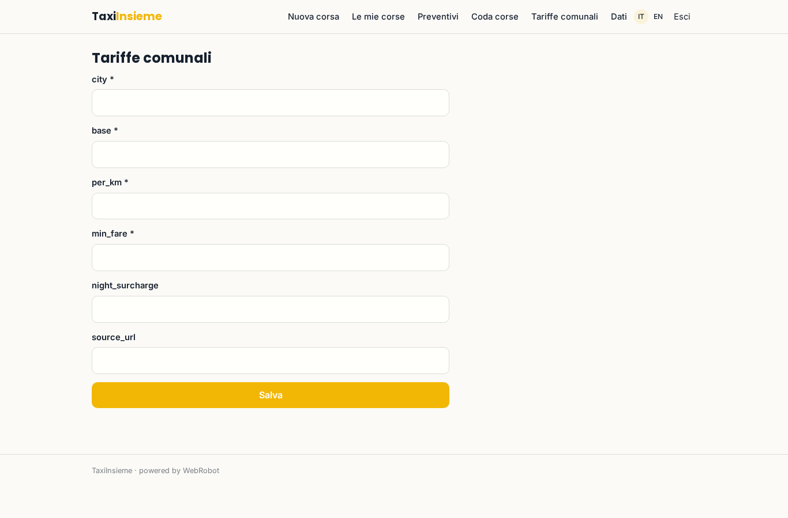

# TaxiInsieme

_Taxi con prezzo massimo garantito, e se condividi paghi meno._

**Manifest:** valid (schema + runtime contract) · **Functional test:** passed (15 checks passed)

## Description given to the app builder (Italian)

Voglio TaxiInsieme, un servizio di taxi con prezzo massimo garantito e possibilità di condividere la corsa. L'utente inserisce partenza, destinazione e orario; un calcolo stima il prezzo massimo dalla distanza e dalle tariffe comunali pubblicate, e propone un prezzo ridotto se accetta di condividere la corsa con altri passeggeri sulla stessa direzione. Le richieste compatibili vengono raggruppate e inviate alle cooperative taxi partner, che le accettano dalla loro coda. L'utente riceve conferma via email e paga con carta. Ogni utente vede solo le proprie corse. Commissione per corsa.

## Features not expressible today (spec.extensions)

- **card_checkout_per_ride**: Card payment of each accepted ride with the per-ride commission is declared via per_transaction billing; a dedicated checkout step per ride and the update of the user's ride status after cooperative acceptance may need custom logic.

## Screenshots (interpretive runtime, no data)

### home-anon

### home-mobile

### home

### new_ride

### rides

### history

### account

### queue

### accept

### tariffs_admin

