# Toeletta a Domicilio

_Il toelettatore arriva a casa tua, con il furgone attrezzato._

**Manifest status:** valid (schema validator + runtime contract)

## Description given to the app builder (Italian)

Ci serve Toeletta a Domicilio, il sito di prenotazione e gestione per un servizio di toelettatura che va a casa dei clienti con un furgone attrezzato. Descrivo solo la parte software, il servizio fisico lo fanno i nostri toelettatori. Il cliente si registra, crea la scheda dell'animale (specie, razza, peso, tipo di pelo, carattere, note sanitarie) e prenota indicando indirizzo, servizio (bagno, tosatura, unghie, trattamento antiparassitario) e fascia oraria. Un agente calcola durata e prezzo in base a razza e servizi, verifica che l'indirizzo sia nella zona coperta e propone gli slot liberi ottimizzando i giri dei furgoni sulla mappa per ridurre i chilometri. Il cliente paga online. Il toelettatore vede dal telefono il suo giro del giorno con indirizzi e schede, e dopo il servizio carica foto e note. Il cliente riceve un messaggio WhatsApp quando il furgone sta arrivando e un promemoria automatico per il prossimo appuntamento. L'admin vede calendario di tutti i furgoni, incassi e recensioni. Abbonamenti mensili per toelettature periodiche oppure pagamento a servizio.

## Features not expressible today (spec.extensions)

- **whatsapp_notifications**: WhatsApp message when the van is on its way and automatic reminder for the next appointment: notifications and WhatsApp connectors are not available yet. For now reminders must be sent by staff.
- **service_photos**: The groomer cannot upload photos after the service (file fields are not available): they can paste a link and notes in service_notes of the booking.
- **route_optimisation**: Real map routing and kilometre calculation are not available: the planner favours slots next to stops in the same or nearby zones using the zone data kept by the admin in van_availability.
- **service_payment_per_booking**: Payment is by credits (packs) or monthly plan through Stripe Connect; a direct card payment for each single booking is not modelled.
- **admin_reviews_and_revenue**: Aggregated reviews across customers and a cross-customer bookings list for the admin are not available because bookings are owned by each customer; revenue comes from the admin panel.

## Screenshots (interpretive runtime)

### home-anon
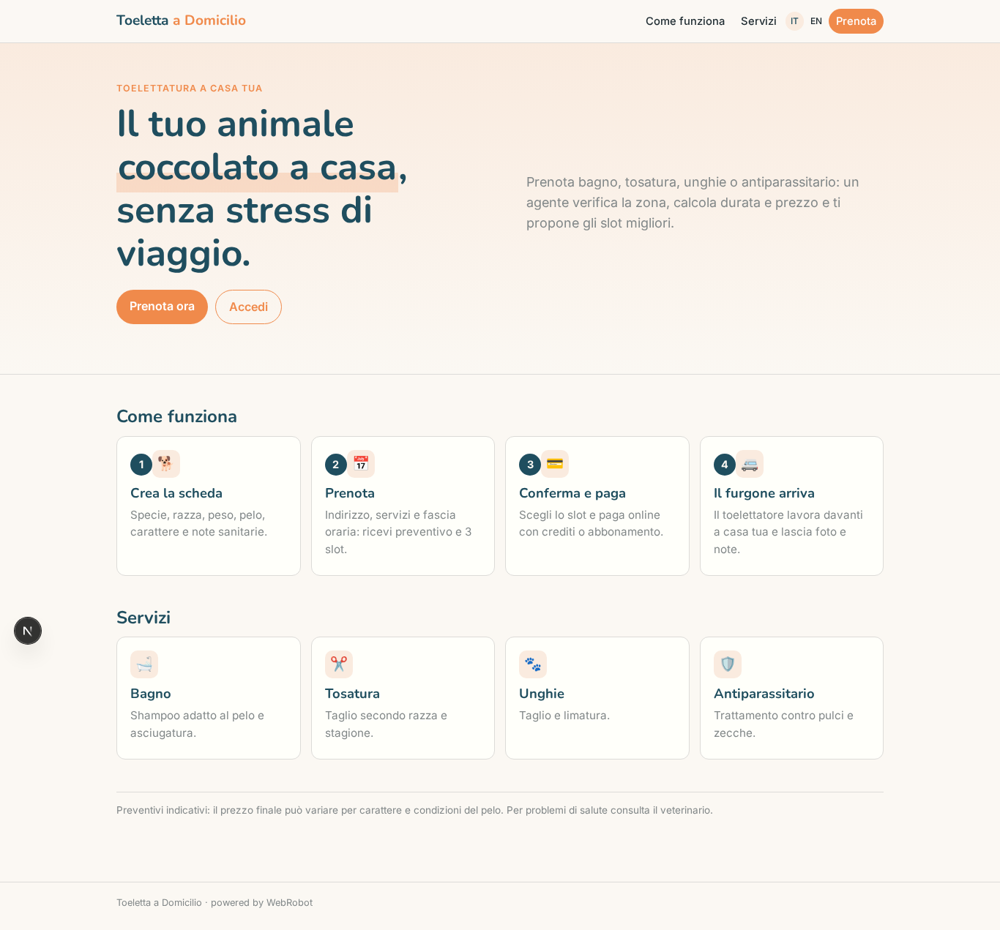

### home-mobile
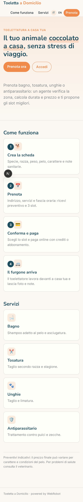

### home
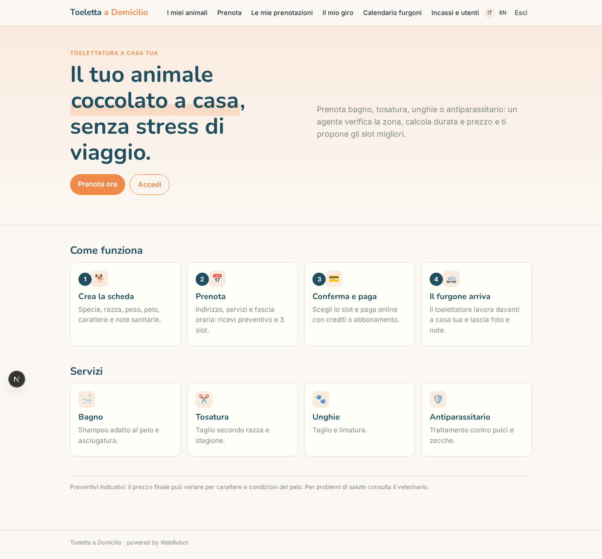

### pets
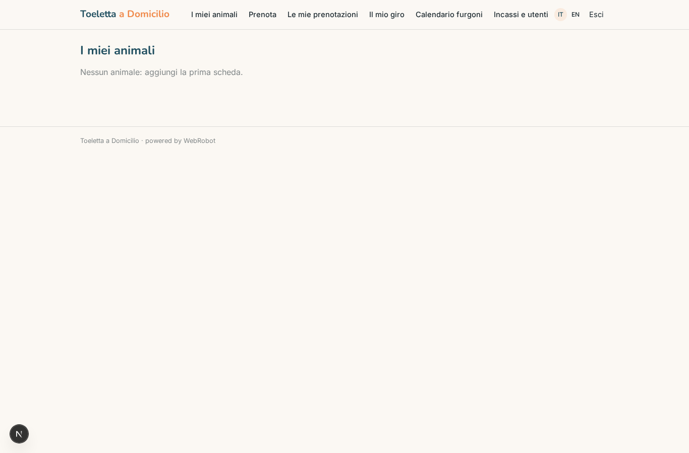

### new_booking
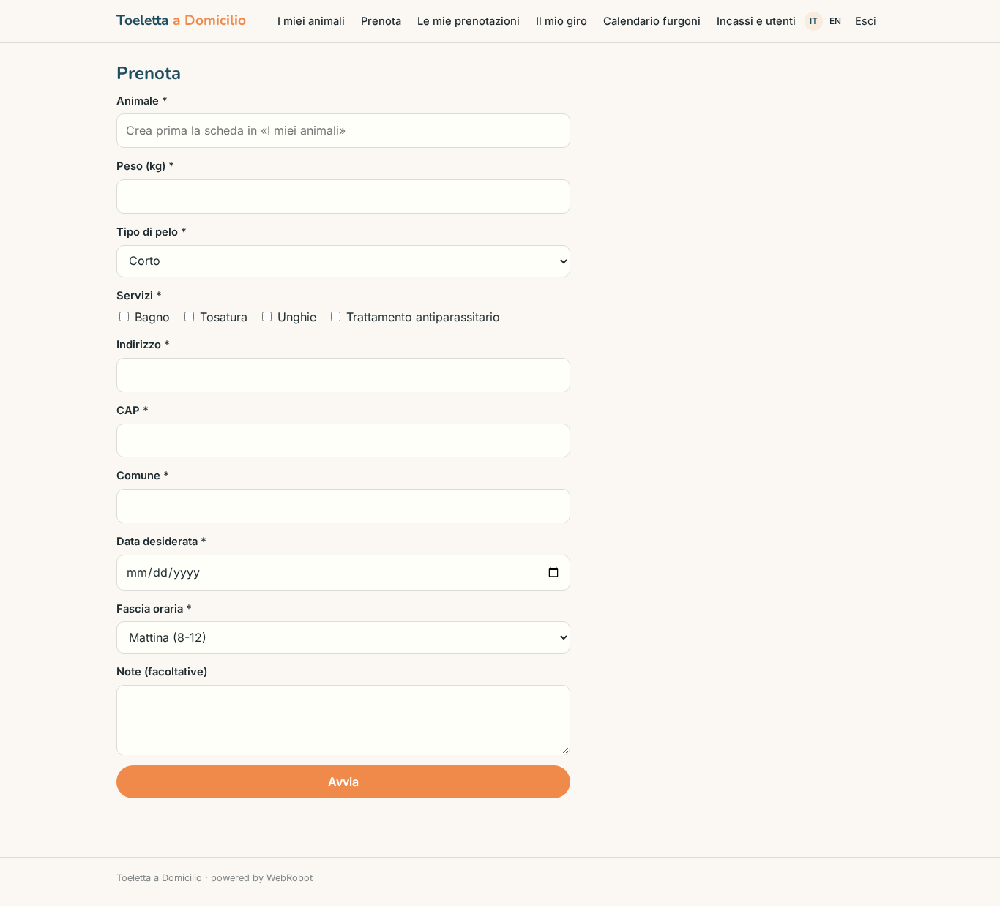

### bookings
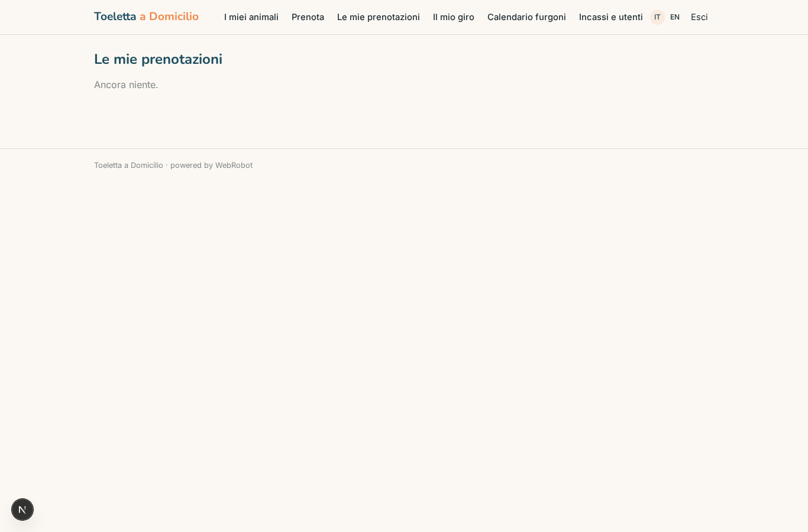

### confirmations
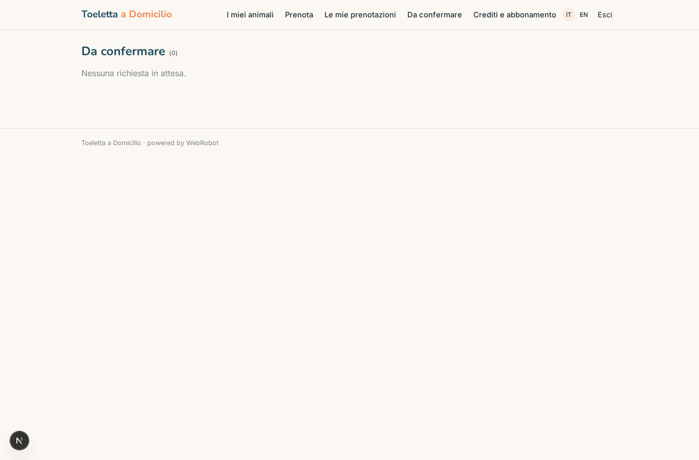

### my_route
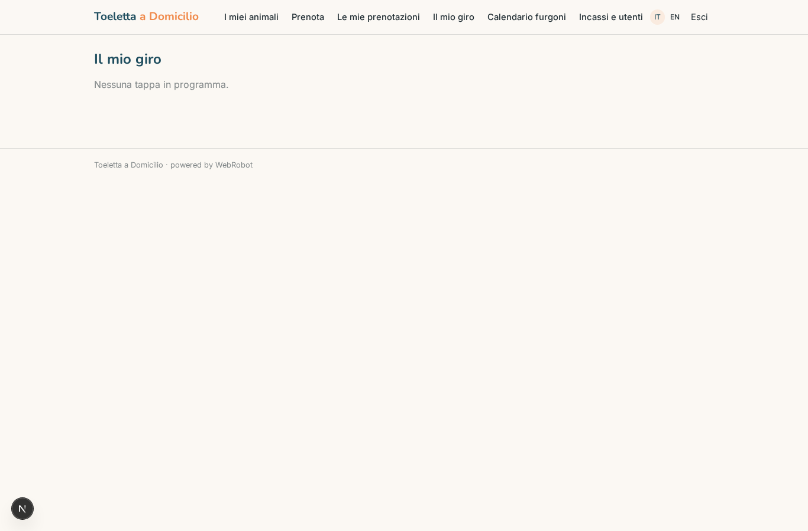

### admin_calendar
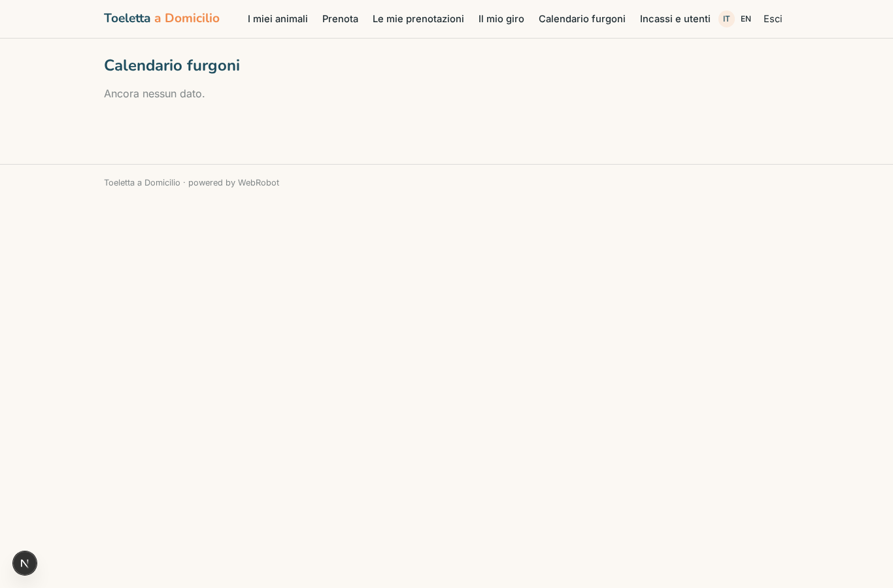

### admin
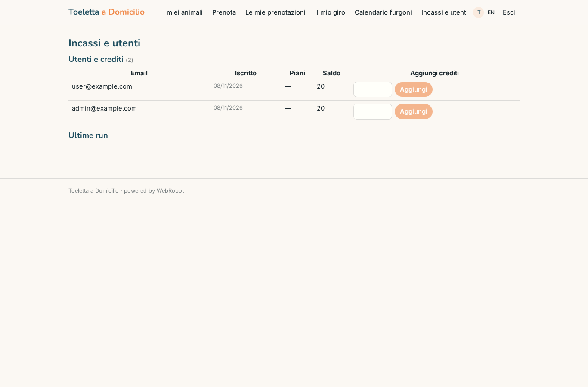

### account
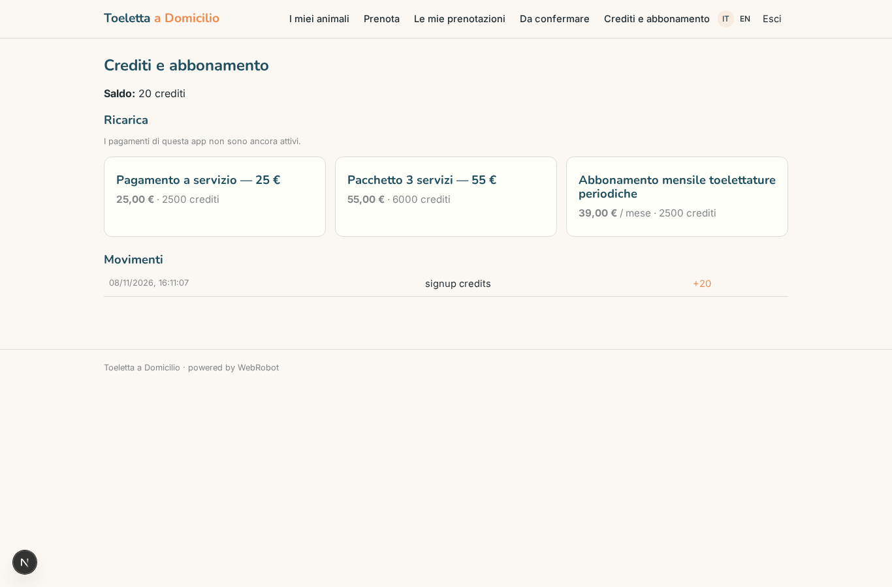

