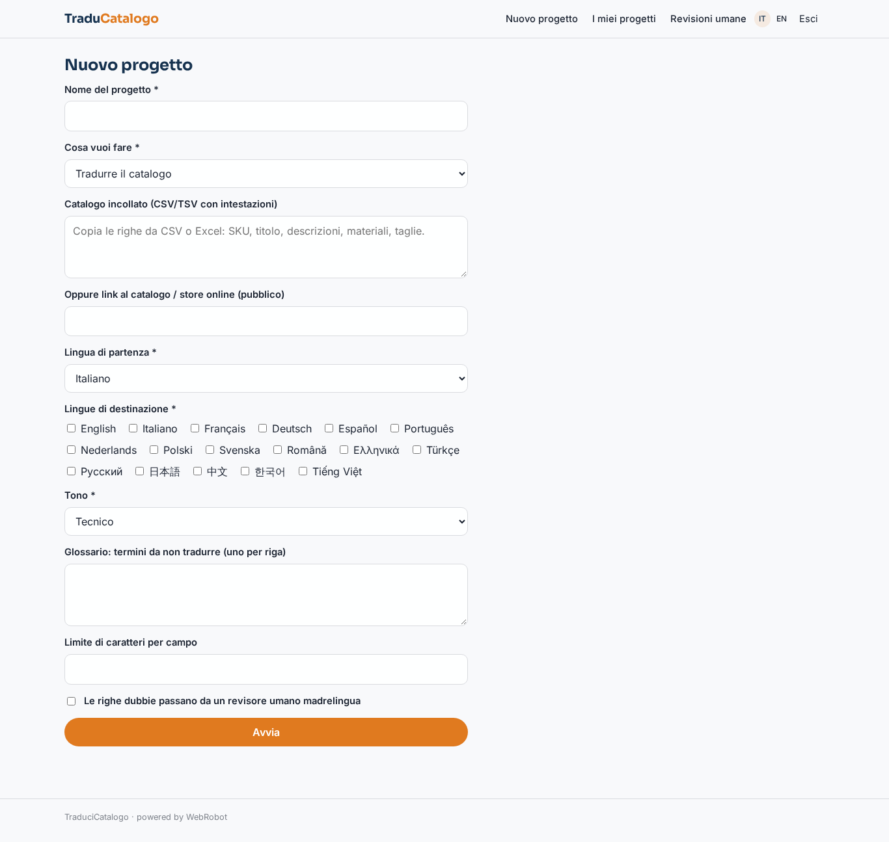
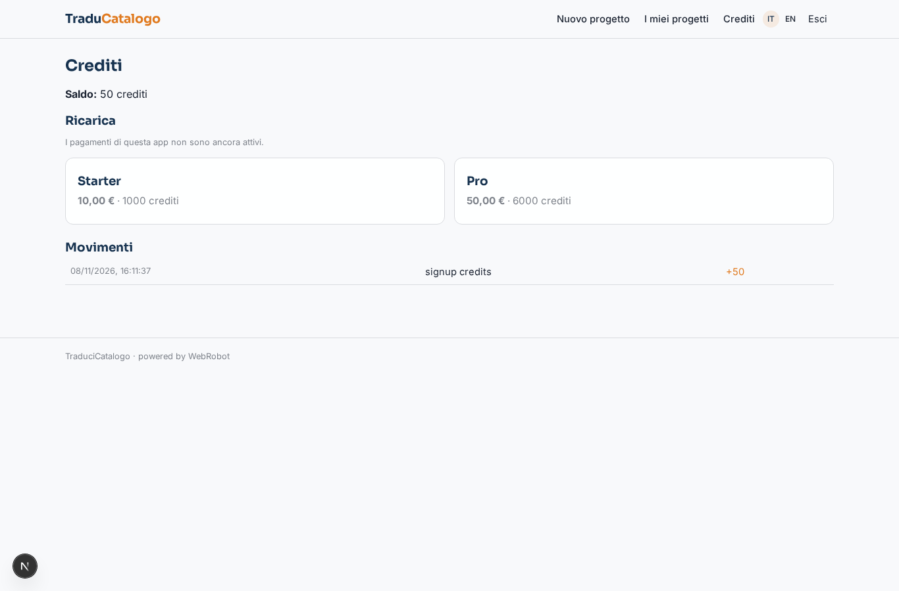

# TraduciCatalogo

_Schede prodotto tradotte in 17 lingue, con revisione automatica e umana._

**Manifest status:** valid (schema validator + runtime contract)

## Description given to the app builder (Italian)

Vorrei TraduciCatalogo, un servizio self-service per e-commerce, editori e produttori che devono tradurre schede prodotto e contenuti in 17 lingue europee e asiatiche. L'utente si registra, crea un progetto e carica il file del catalogo in CSV o XLSX con colonne tipo SKU, titolo, descrizione breve, descrizione lunga, materiali, taglie; in alternativa incolla il testo o collega lo store online. Nel modulo sceglie lingua di partenza, lingue di destinazione, tono (tecnico, lusso, colloquiale), glossario di termini da non tradurre e limite di caratteri per campo. Un agente traduttore lavora riga per riga mantenendo la struttura, un secondo agente revisore controlla coerenza terminologica col glossario, lunghezze e unità di misura, e marca le righe dubbie. L'utente vede una tabella affiancata originale/traduzione per lingua, può correggere a mano e chiedere una nuova versione di una singola cella; può scegliere che le righe marcate passino da un revisore umano madrelingua del team prima della consegna. Alla fine scarica lo stesso file con le colonne tradotte e riceve un'email. Pagamento a crediti prepagati, scalati per parola e per lingua, ricaricabili con carta. Ogni cliente vede solo i propri progetti. Interfaccia in italiano e inglese.

## Features not expressible today (spec.extensions)

- **file_upload**: Uploading CSV/XLSX files is not available yet: the user pastes the rows or gives a public link.
- **file_download**: Downloading the same CSV/XLSX file with the translated columns is not available yet: the report is shown as tables to copy or print.
- **email_on_done**: Email when the project is delivered is not available yet (notifications).
- **cell_editing**: Manual editing of cells in a side-by-side grid is not available yet; single-cell new versions are requested through the 'single cell' mode of the form.
- **store_connectors**: Connecting an online store with the customer's own credentials (Shopify, WooCommerce) is not available yet; only public links.
- **per_word_pricing**: Credits are metered on real usage (AI tokens and compute), which scales with words and languages; a fixed per-word-per-language tariff would need custom logic.

## Screenshots (interpretive runtime)

### home-anon

### home-mobile

### home

### new_project

### projects

### reviews

### account

