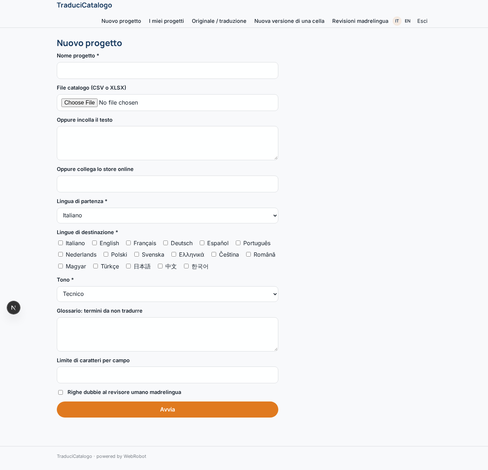
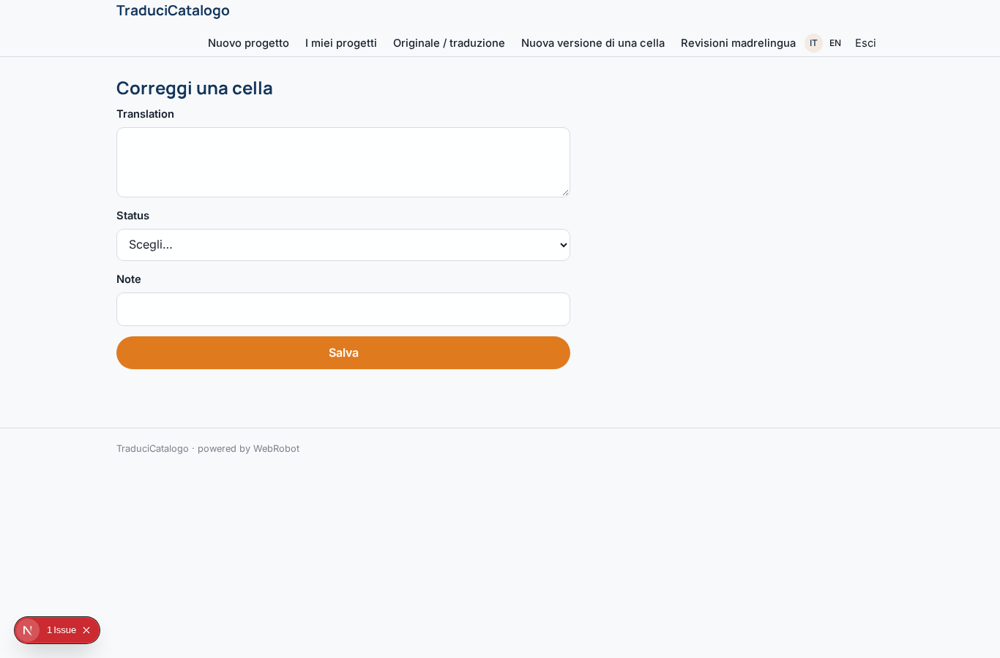
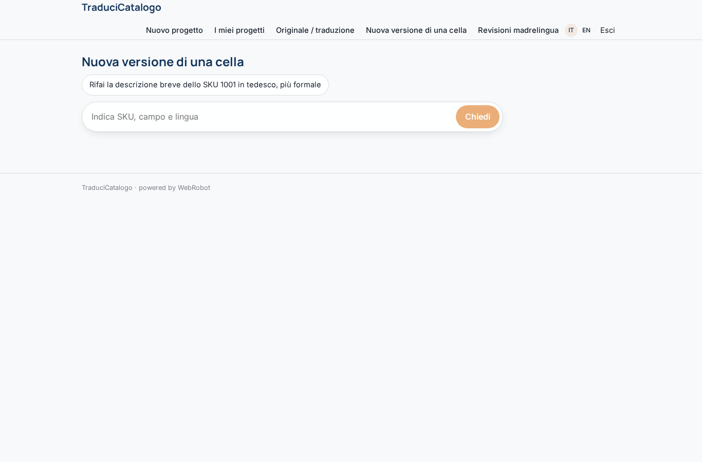
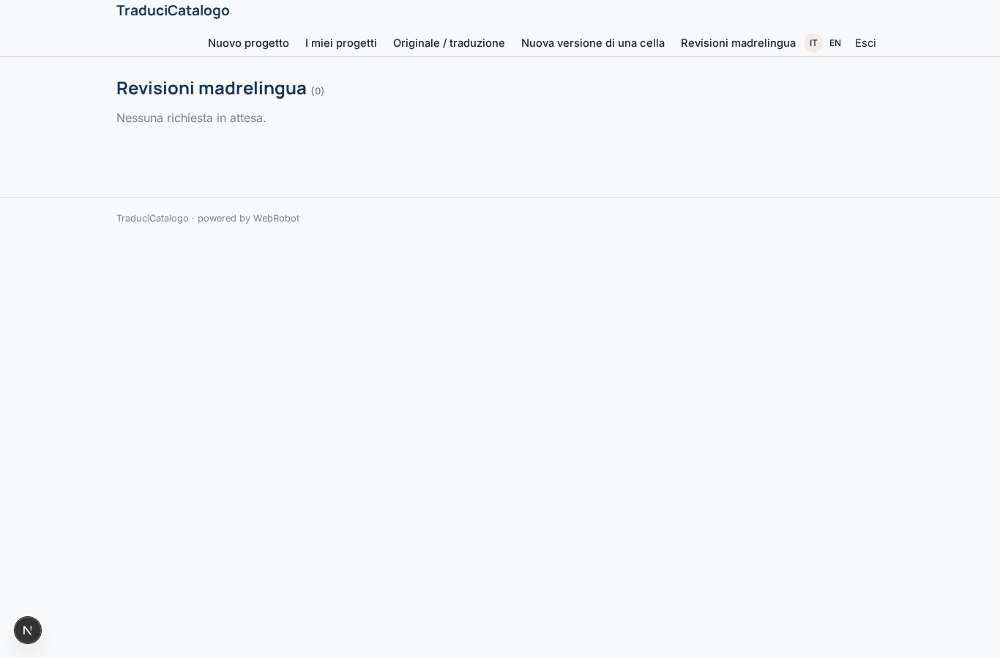
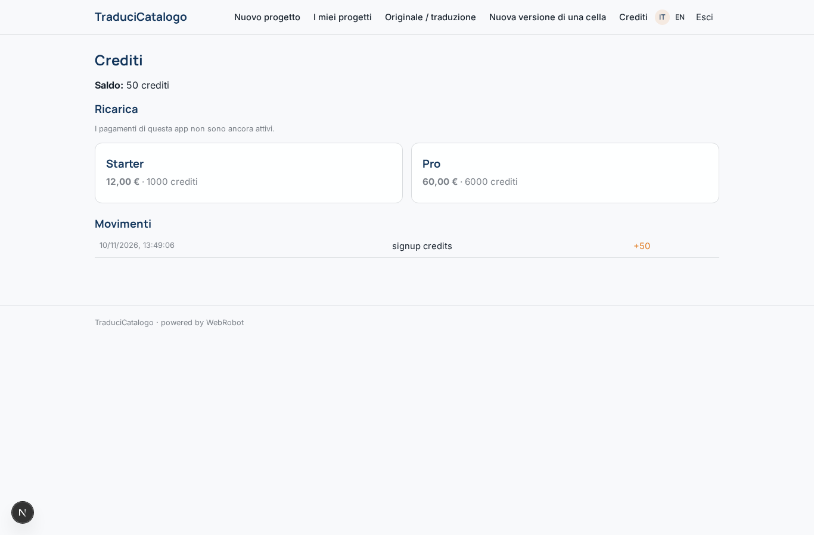

# TraduciCatalogo

_Schede prodotto tradotte in 17 lingue, con revisione automatica e umana._

**Manifest:** valid (schema + runtime contract) · **Functional test:** passed (13 checks passed)

## Description given to the app builder (Italian)

Vorrei TraduciCatalogo, un servizio self-service per e-commerce, editori e produttori che devono tradurre schede prodotto e contenuti in 17 lingue europee e asiatiche. L'utente si registra, crea un progetto e carica il file del catalogo in CSV o XLSX con colonne tipo SKU, titolo, descrizione breve, descrizione lunga, materiali, taglie; in alternativa incolla il testo o collega lo store online. Nel modulo sceglie lingua di partenza, lingue di destinazione, tono (tecnico, lusso, colloquiale), glossario di termini da non tradurre e limite di caratteri per campo. Un agente traduttore lavora riga per riga mantenendo la struttura, un secondo agente revisore controlla coerenza terminologica col glossario, lunghezze e unità di misura, e marca le righe dubbie. L'utente vede una tabella affiancata originale/traduzione per lingua, può correggere a mano e chiedere una nuova versione di una singola cella; può scegliere che le righe marcate passino da un revisore umano madrelingua del team prima della consegna. Alla fine scarica lo stesso file con le colonne tradotte e riceve un'email. Pagamento a crediti prepagati, scalati per parola e per lingua, ricaricabili con carta. Ogni cliente vede solo i propri progetti. Interfaccia in italiano e inglese.

## Features not expressible today (spec.extensions)

- **store_connection**: Direct connection to online stores (Shopify, WooCommerce) needs per-store API keys; for now the store URL is read by the agent and XLSX/CSV is the supported path.
- **file_export**: The download of the original file with added translated columns is provided as a CSV export of the translations table; a re-assembled XLSX is not yet available.

## Screenshots (interpretive runtime, no data)

### home-anon

### home-mobile

### home

### new

### projects

### side_by_side

### edit_cell

### regenerate

### reviews

### account

