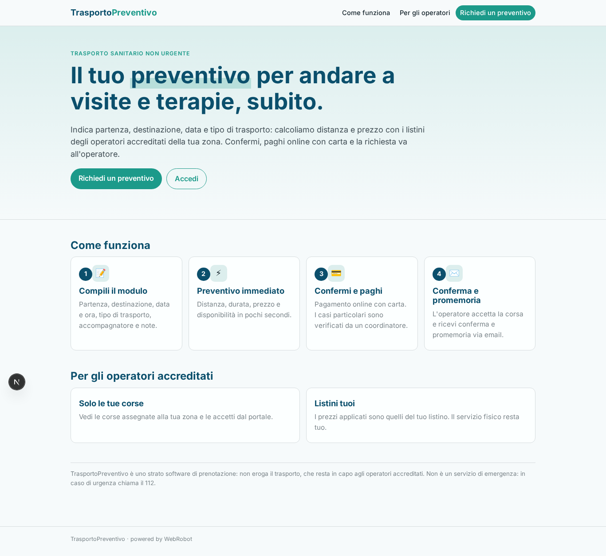
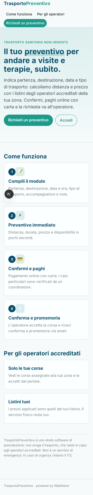
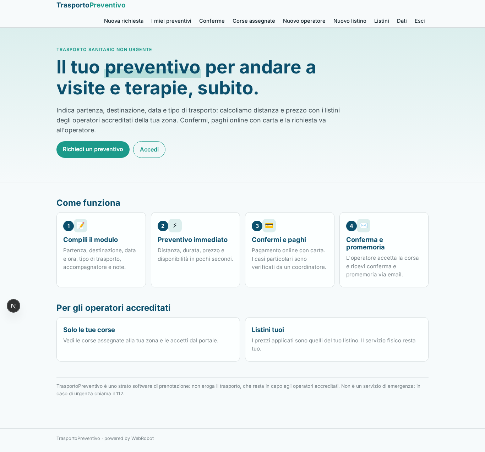
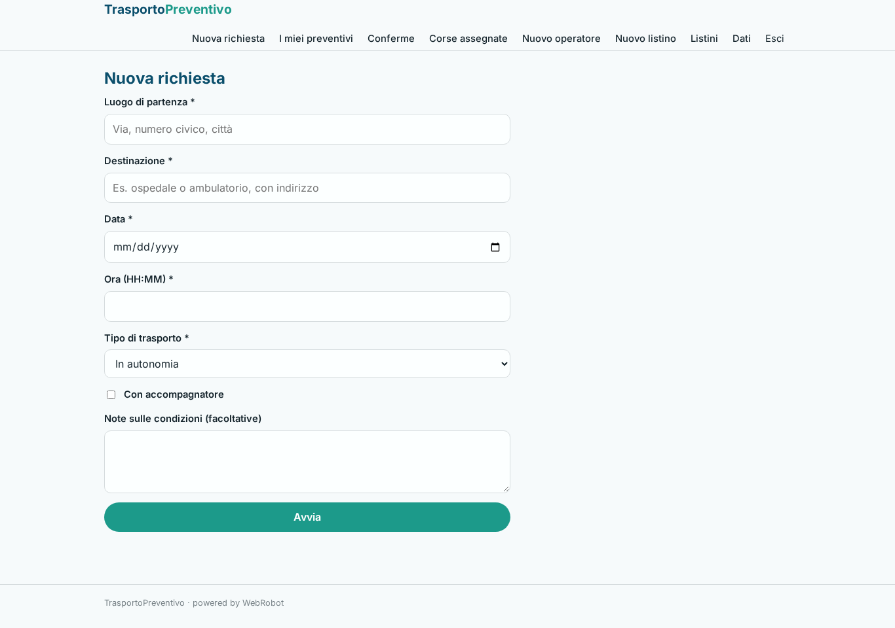
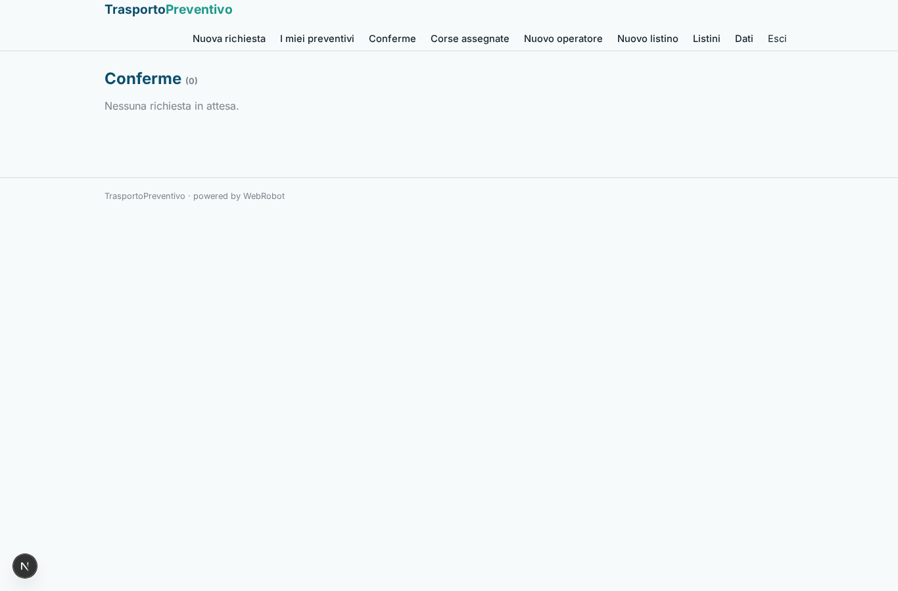
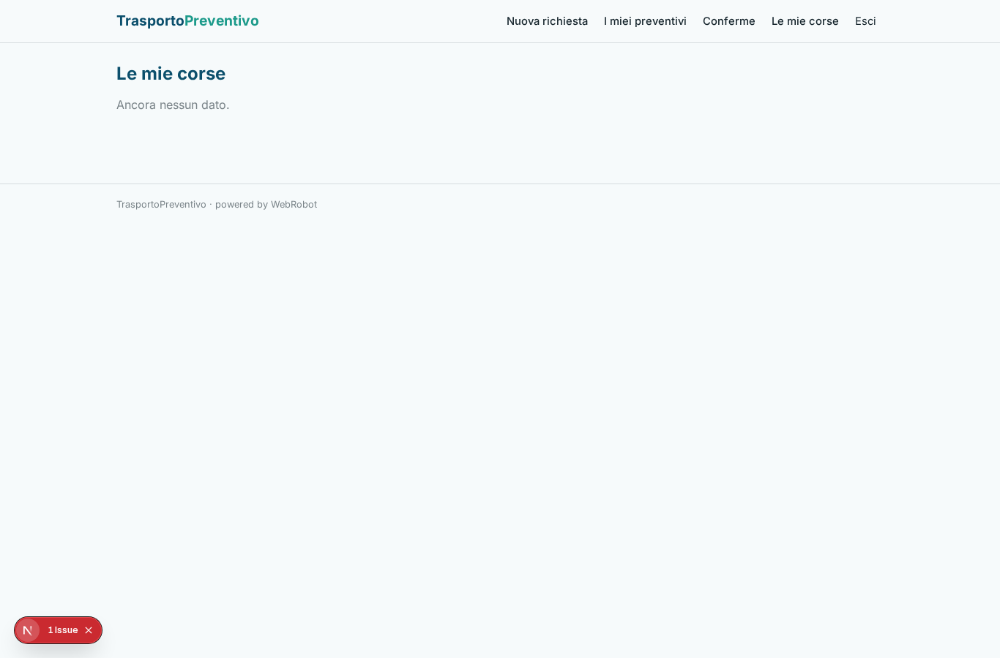
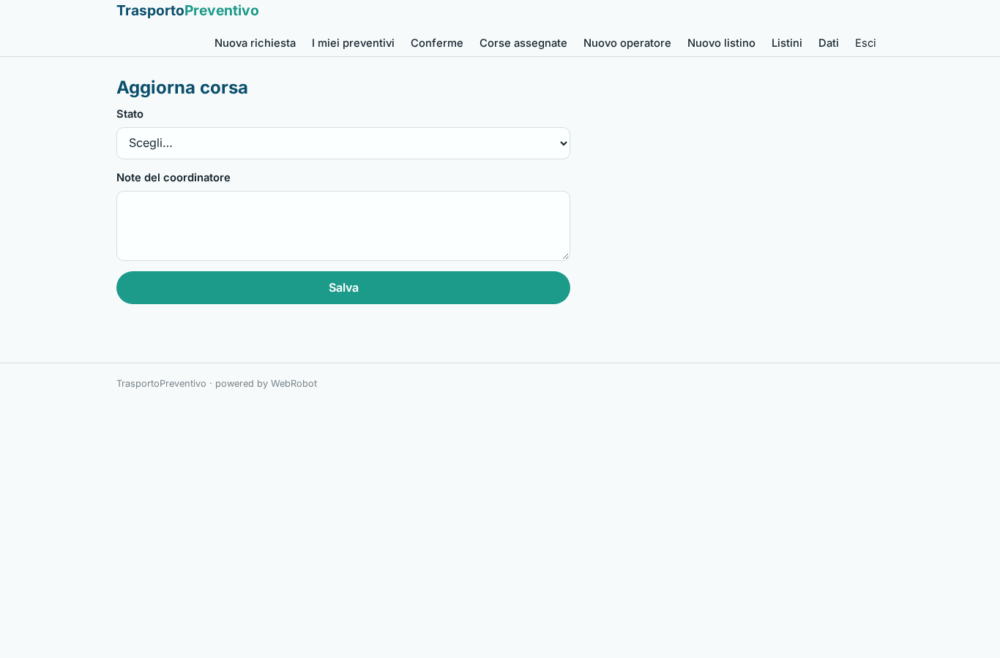
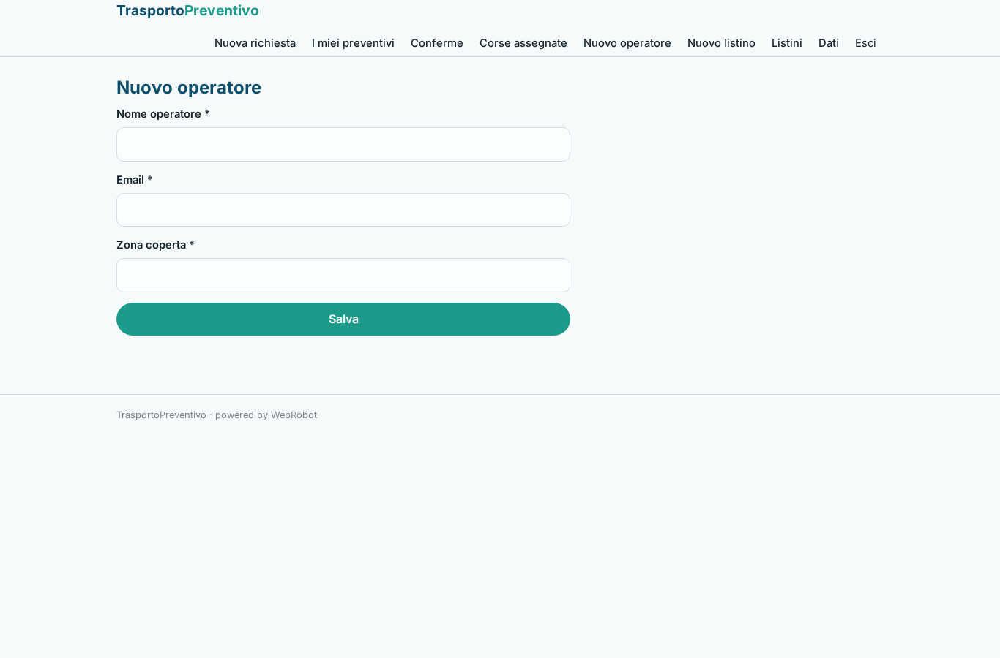
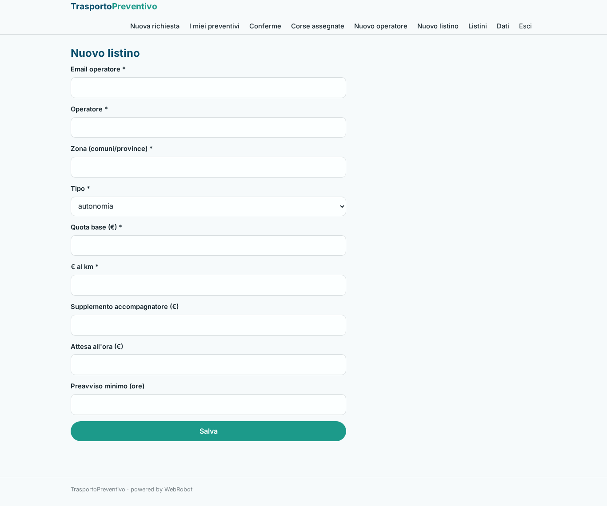

# TrasportoPreventivo

_Preventivo immediato per il trasporto sanitario non urgente._

**Manifest:** valid (schema + runtime contract) · **Functional test:** passed (21 checks passed)

## Description given to the app builder (Italian)

TrasportoPreventivo e lo strato software per prenotare trasporto sanitario non urgente (per esempio verso visite e terapie) e ottenere un preventivo immediato; non gestisco il mezzo ne il servizio fisico, che resta in capo agli operatori accreditati. L'utente o un suo familiare compila un modulo con luogo di partenza e destinazione, data e ora, tipo di trasporto (in autonomia, con sedia a rotelle, in barella), eventuale accompagnatore e note sulle condizioni. Un agente calcola distanza e durata, applica i listini degli operatori accreditati sulla piattaforma e mostra subito un preventivo con il prezzo e la disponibilita. L'utente conferma e paga online con carta. La richiesta viene inoltrata all'operatore della zona, che la accetta; un coordinatore umano supervisiona i casi particolari e puo intervenire prima della conferma definitiva. L'utente riceve conferma e promemoria via email, l'operatore vede solo le corse assegnate, l'admin tutto. Monetizzazione: commissione su ogni corsa prenotata. In italiano.

## Functional test: what did not pass

- **trigger has its effect** (trigger ride_requested_operator): email to record.operator_email: no such recipient in the test (role nobody holds or empty field) _(warning)_
- **saved record shown where its collection is read** (view my_rides): a record was saved in rides (by admin) but the page does not show it (as user) _(warning)_
- **saved record shown where its collection is read** (view assigned_rides): a record was saved in rides (by admin) but the page does not show it (as operator) _(warning)_

## Features not expressible today (spec.extensions)

- **pagamento_per_corsa**: Il pagamento con carta della singola corsa prima dell'inoltro all'operatore (checkout per corsa con commissione) va attivato collegando Stripe nello studio; la conferma del preventivo avviene qui tramite approvazione del richiedente.

## Screenshots (interpretive runtime, no data)

### home-anon

### home-mobile

### home

### new_quote

### quotes

### confirmations

### my_rides

### assigned_rides

### ride_update

### operator_form

### tariff_form

### tariffs_table

