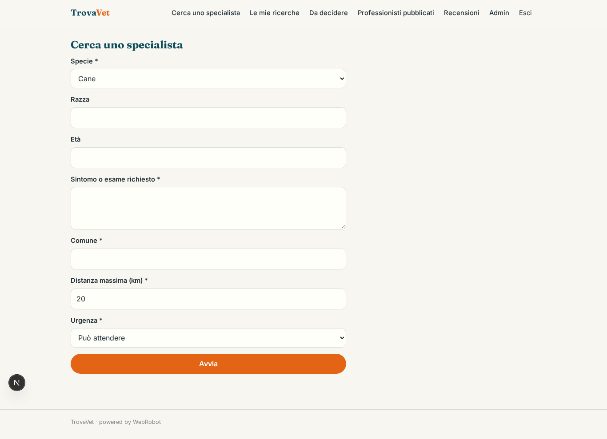
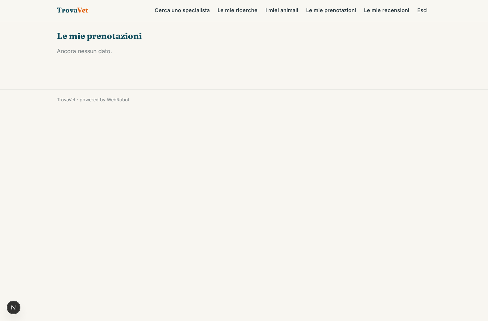
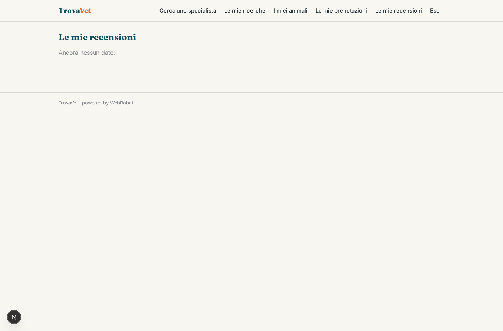
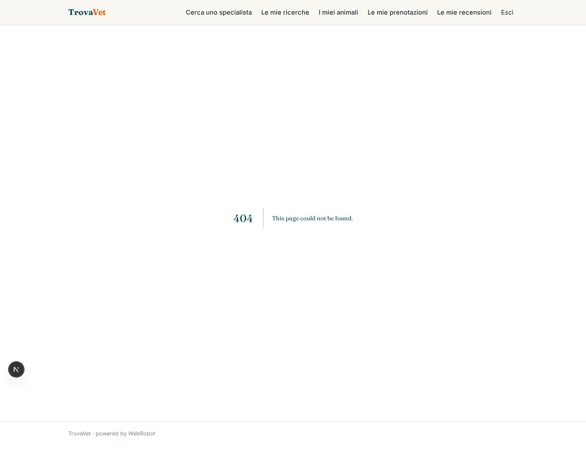
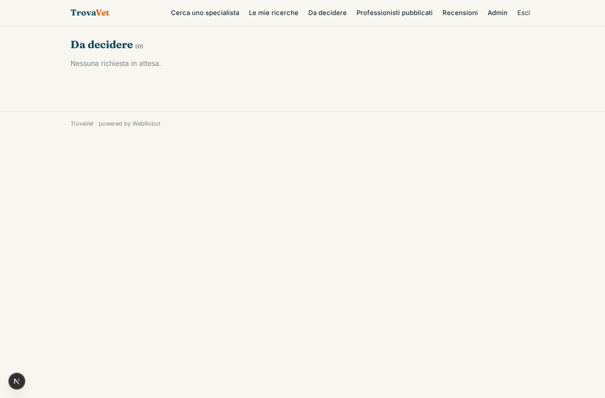
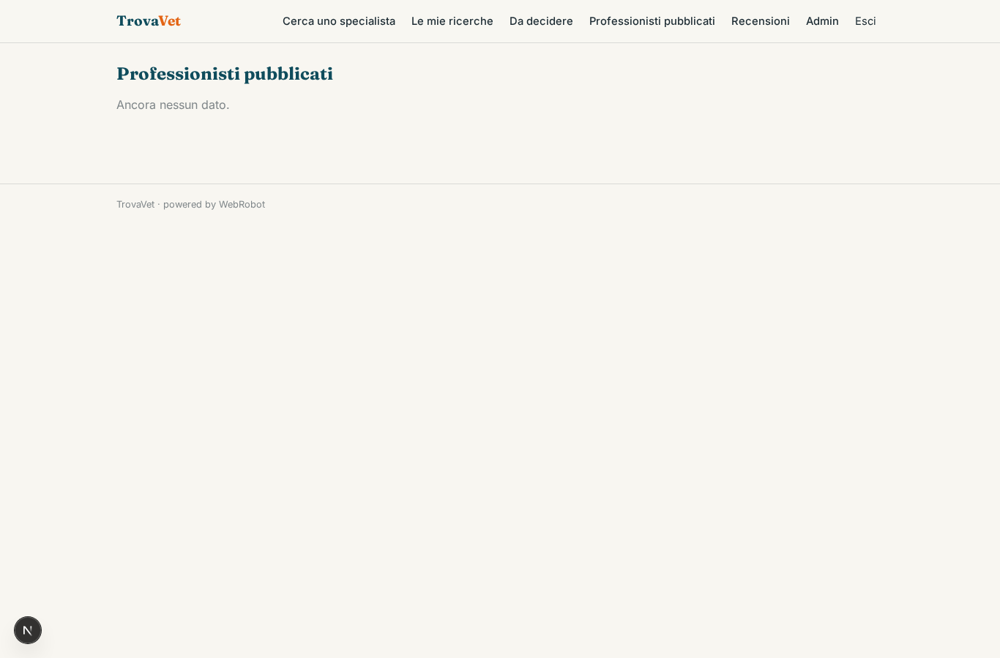
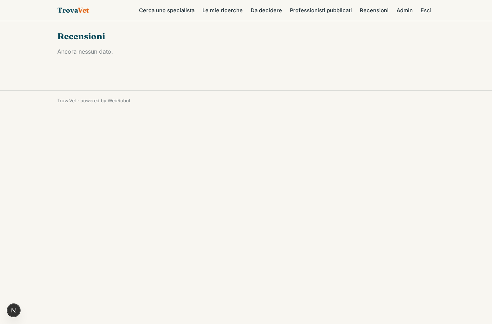
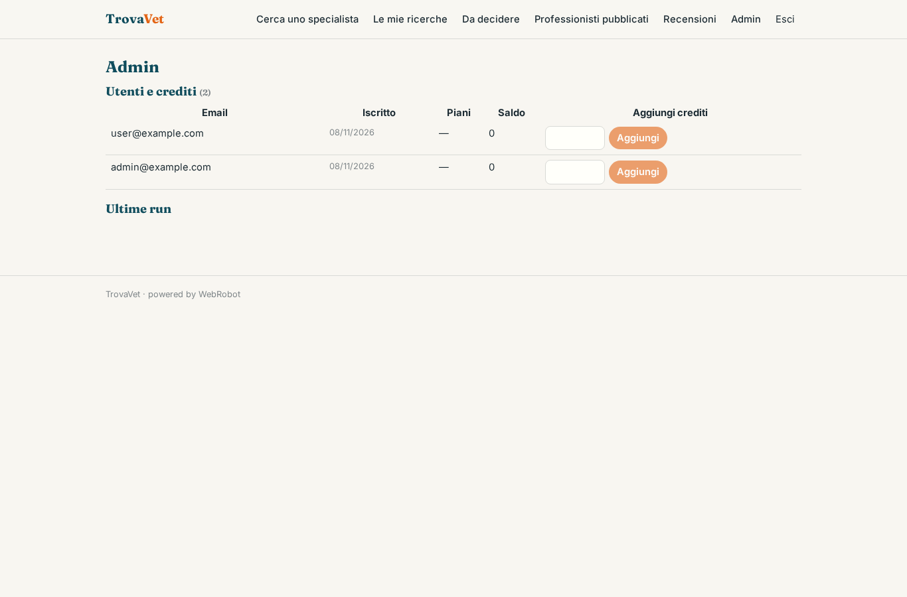

# TrovaVet

_Il veterinario specialista giusto, vicino a casa._

**Stato manifest:** valido (validatore Python + contratto runtime)

## Descrizione data all'app builder

Requisito: piattaforma TrovaVet per proprietari di animali che cercano un veterinario specialista (cardiologia, dermatologia, ortopedia, esotici) vicino a casa. Ruoli: proprietario, veterinario/clinica, admin. Il veterinario crea il profilo con specializzazioni, specie trattate, indirizzo, orari, tariffe indicative e titoli; l'admin verifica l'iscrizione all'ordine prima della pubblicazione. Il proprietario compila un modulo: specie, razza, età, sintomo o esame richiesto, comune, distanza massima, urgenza. Un agente interpreta la descrizione del problema, la mappa sulla specializzazione corretta senza fare diagnosi, cerca nella collezione dei professionisti e restituisce una lista ordinata per pertinenza e distanza, visualizzata anche su mappa. Il proprietario sceglie uno slot libero dal calendario del veterinario, sincronizzato con il suo calendario esterno, e invia la richiesta di prenotazione; il veterinario accetta o propone un altro orario. Seguono email di conferma e promemoria 24 ore prima, più un SMS opzionale. Il proprietario vede solo le sue prenotazioni e la scheda dell'animale; il veterinario vede solo le richieste ricevute; l'admin vede tutto e gestisce le recensioni dopo la visita, che vengono moderate. Gratuito per i proprietari, abbonamento mensile per le cliniche. Italiano.

## Funzioni non esprimibili oggi (spec.extensions)

- **map_view**: Visualizzazione dei risultati su mappa e calcolo esatto della distanza (geocodifica) non disponibili: la distanza è stimata dall'agente e l'elenco è testuale.
- **calendar_sync**: Sincronizzazione con il calendario esterno del veterinario (Google/Outlook) richiede credenziali per utente, non ancora disponibili: gli slot liberi sono inseriti a mano nel profilo.
- **notifications**: Email di conferma, promemoria 24 ore prima e SMS opzionale non sono ancora disponibili: lo stato della prenotazione si vede nelle viste.
- **vet_visibility**: Il veterinario vede la richiesta tramite condivisione (sharing editor) del record e la decisione in 'Da decidere'; l'invio del record al veterinario scelto va completato nello studio.
- **documents**: Il caricamento di file (titoli, referti) non è disponibile: usare link o testo.
- **free_for_owners**: I proprietari usano l'app gratuitamente: nessun costo per ricerca è dichiarato; solo le cliniche hanno un abbonamento.

## Screenshot (runtime interpretativo)

### home-anon

### home-mobile

### home

### new_search

### searches

### my_pets

### my_bookings

### my_reviews

### my_profile

### requests

### decisions

### all_vets

### all_reviews

### admin

### account

