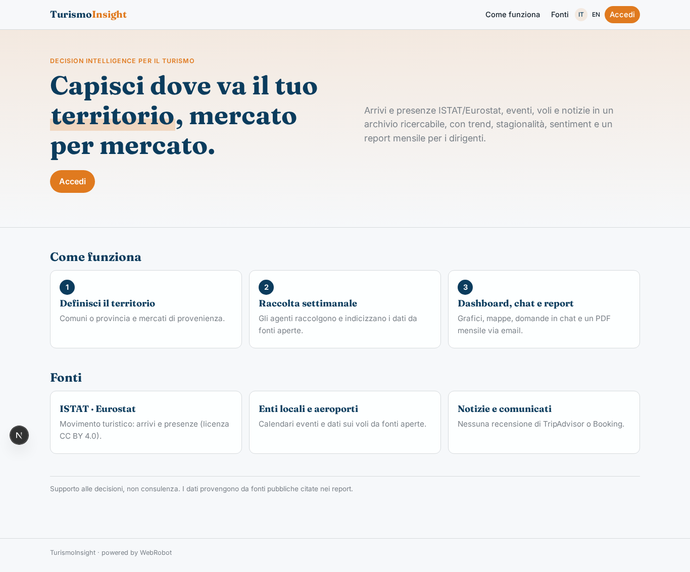
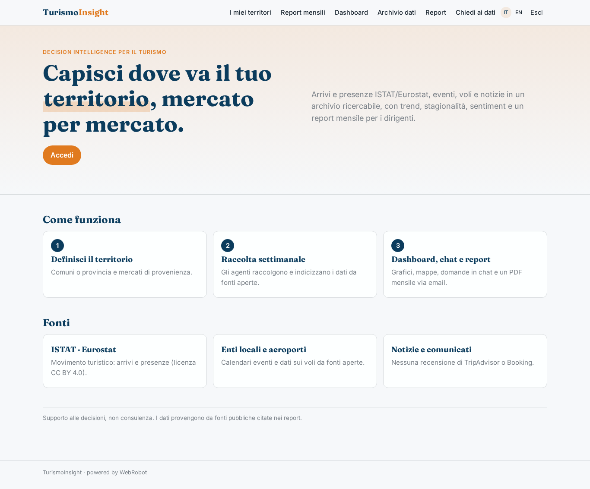
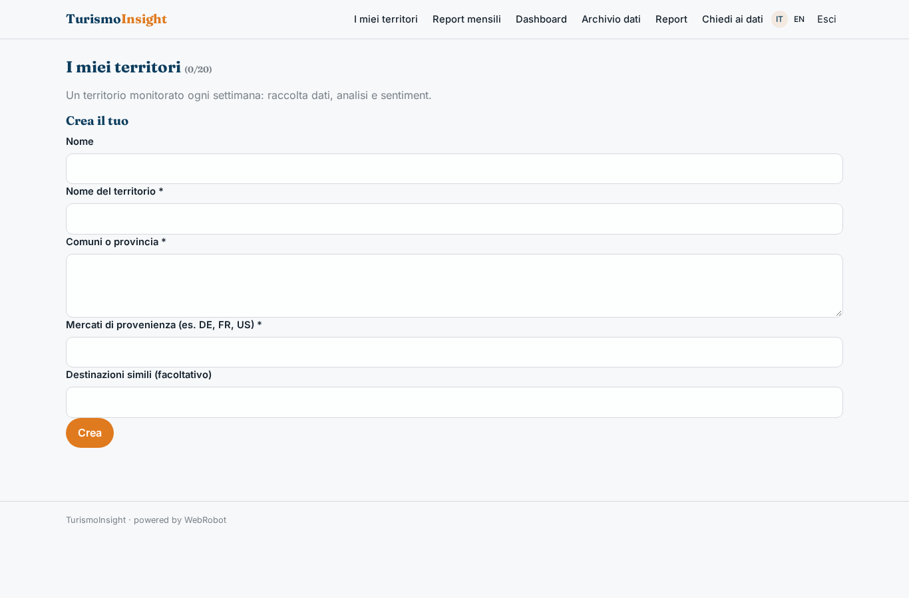
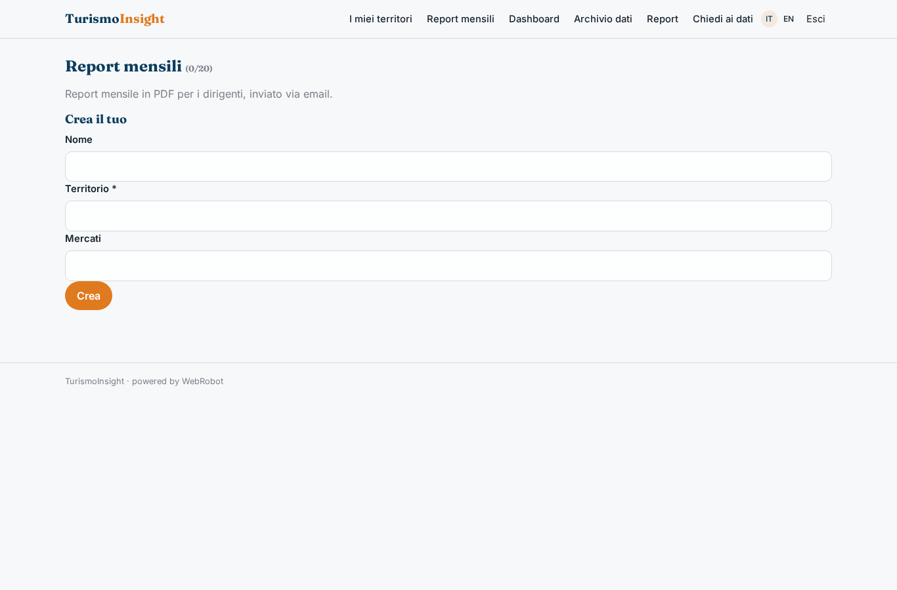
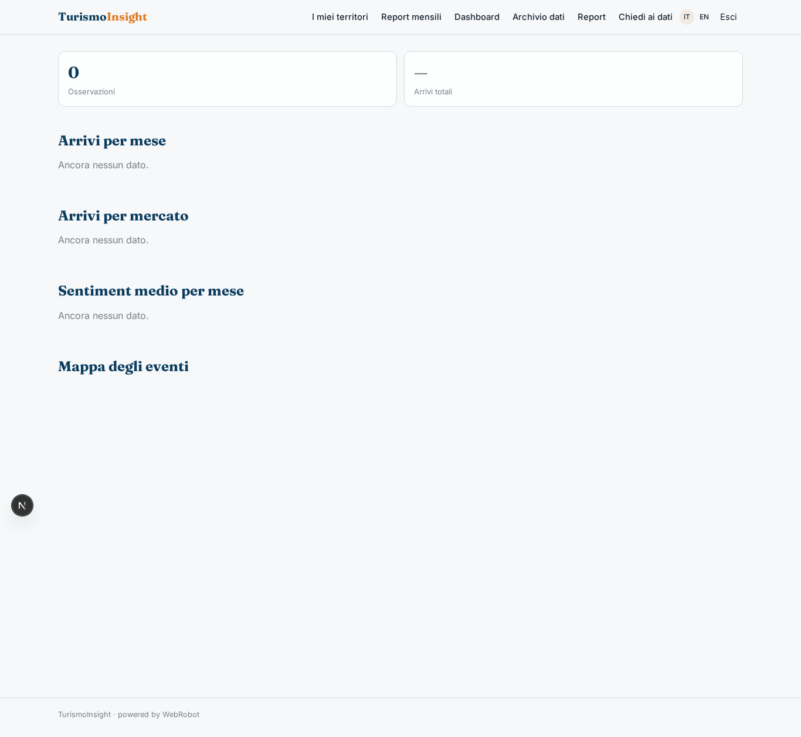
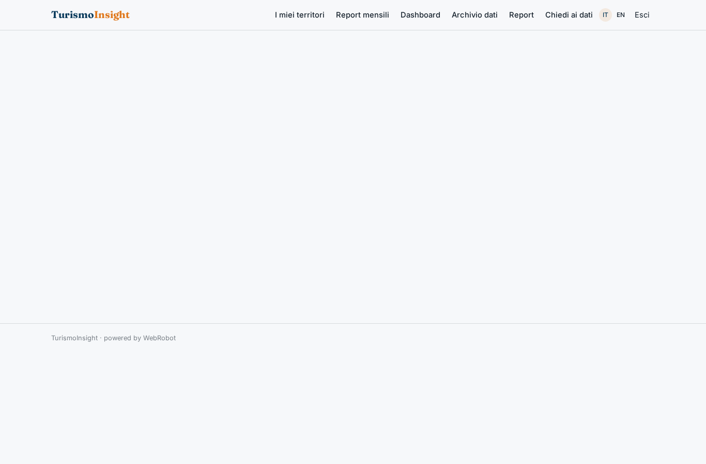
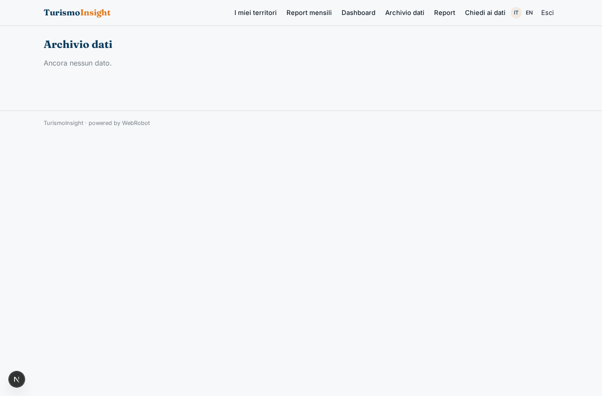
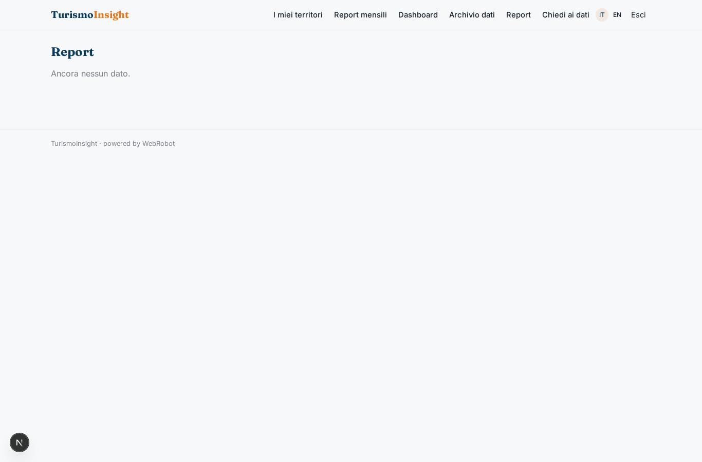
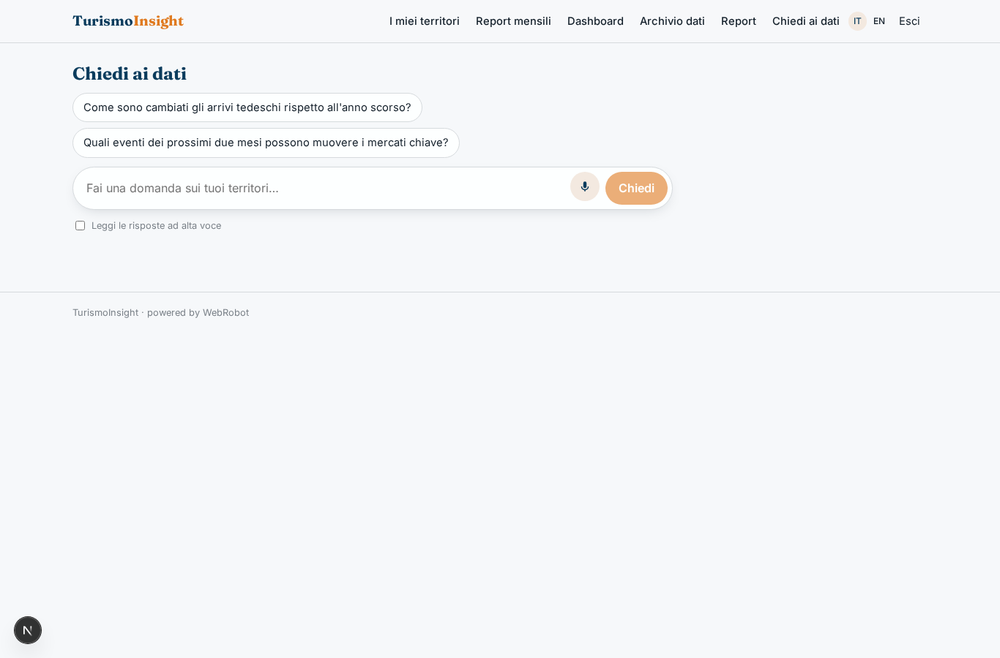
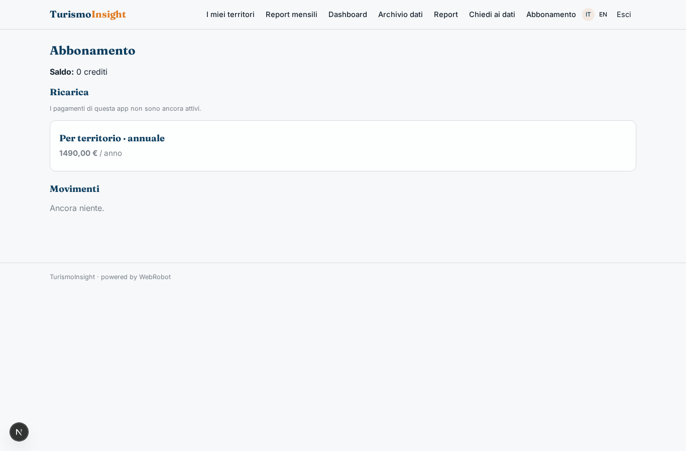

# TurismoInsight

_Decision intelligence per destinazioni turistiche, consorzi e catene alberghiere._

**Manifest:** valid (schema + runtime contract) · **Functional test:** passed (10 checks passed)

## Description given to the app builder (Italian)

Ho bisogno di TurismoInsight, uno strumento di decision intelligence per destinazioni turistiche, consorzi e catene alberghiere. L'analista del cliente definisce un territorio (comuni o provincia) e i mercati di provenienza che gli interessano. Ogni settimana un agente raccoglie arrivi e presenze da ISTAT ed Eurostat, calendari di eventi pubblicati dagli enti locali, dati sui voli e notizie di settore da fonti aperte, e li indicizza in un archivio ricercabile. Un agente di analisi calcola trend, stagionalità e confronto con destinazioni simili, mentre un altro valuta il sentiment delle notizie e dei comunicati pubblici sul territorio; non uso recensioni di TripAdvisor o Booking. Il risultato è una dashboard interattiva con grafici per mercato e periodo, filtri e mappe, più un report PDF mensile inviato via email ai dirigenti. Gli analisti possono anche fare domande in chat sui dati. Ogni cliente vede solo i propri territori. Abbonamento annuale per territorio, in italiano e inglese.

## Features not expressible today (spec.extensions)

- **per_territory_billing**: Annual price multiplied by the number of territories (quantity-based subscription) is not expressible: the plan is one territory; maxPerUser on the templates limits how many instances exist. A territory-to-plan check must be handled by the owner.
- **executive_recipients**: The monthly PDF goes to the instance owner; delivery to a list of executives' emails is not available yet (the owner can forward it).
- **flight_data**: Flight data come from open airport/authority pages through the WebRobot MCP; no dedicated flight API is declared.

## Screenshots (interpretive runtime, no data)

### home-anon

### home-mobile

### home

### territories

### monthly

### dashboard

### events_map

### archive

### reports

### chat

### account

