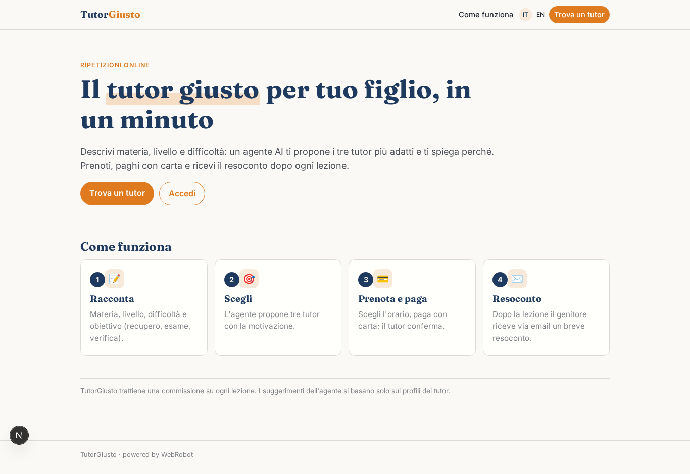
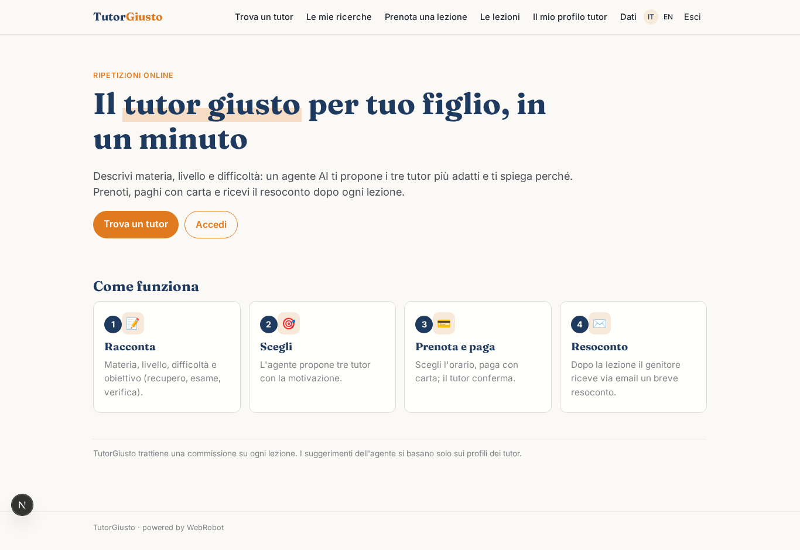
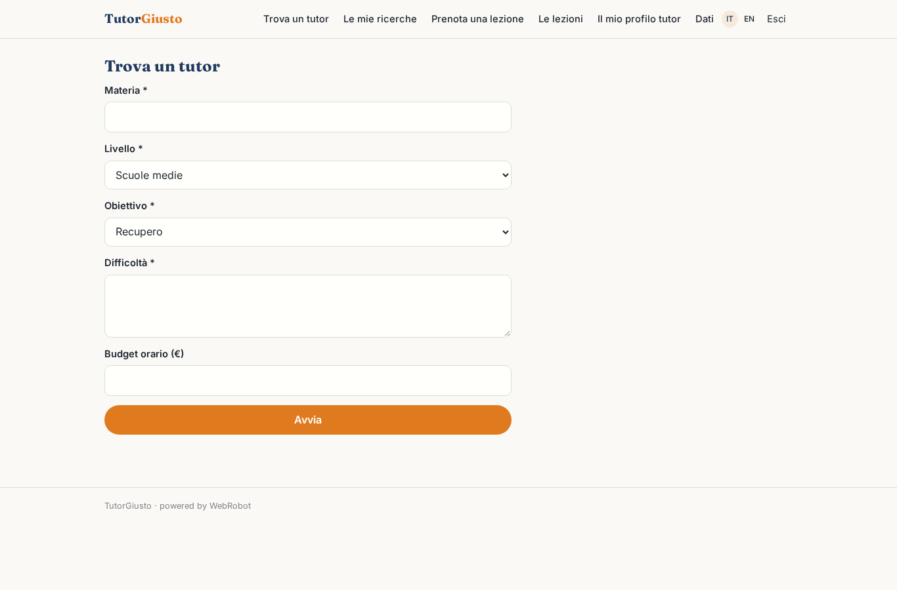
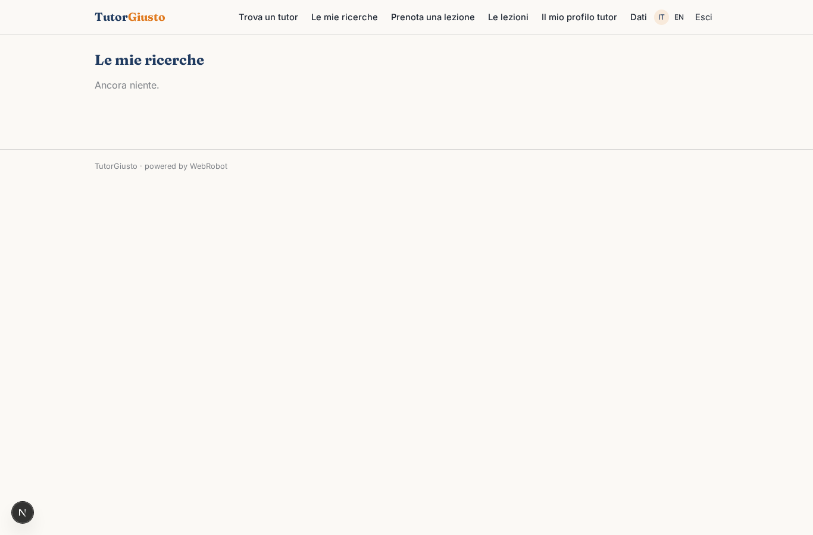
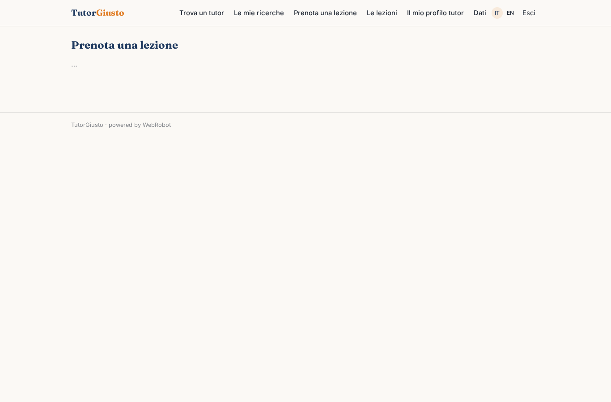
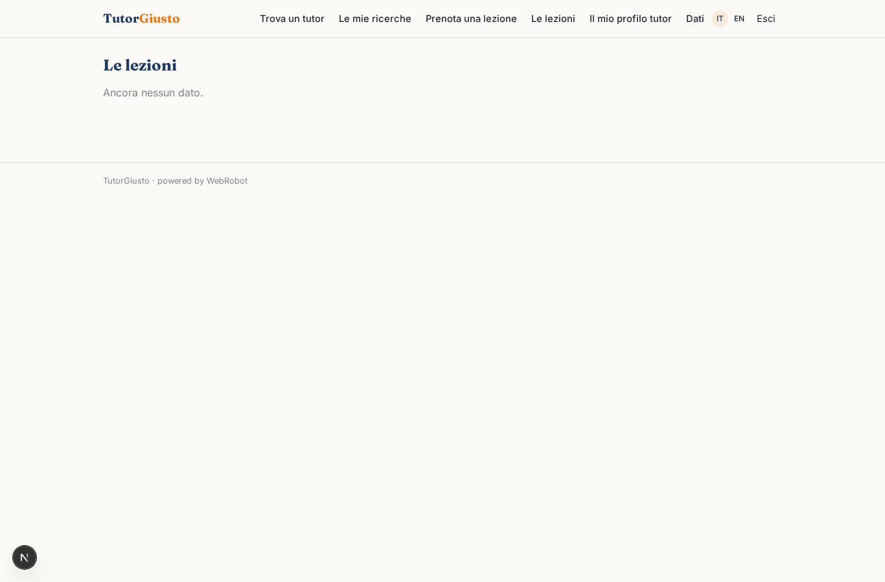
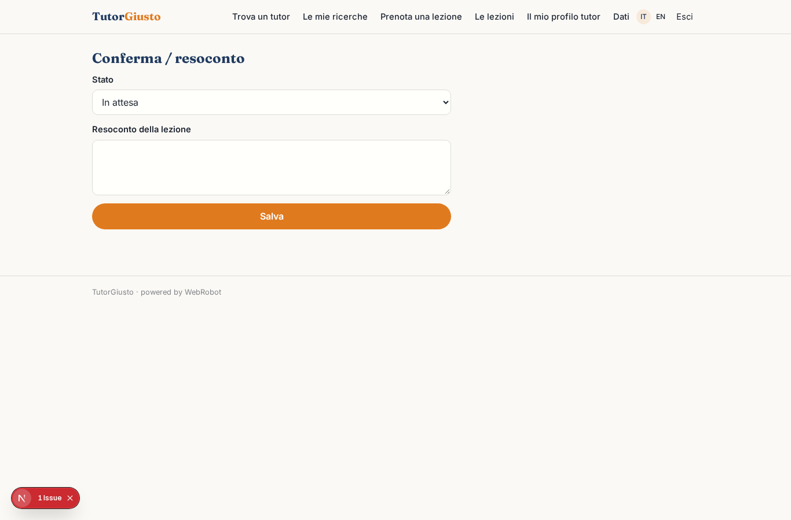
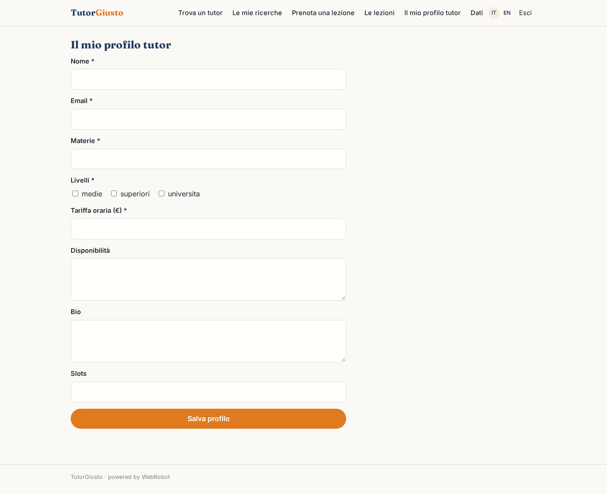

# TutorGiusto

_Il tutor giusto per ripetizioni online, scelto per te._

**Manifest:** valid (schema + runtime contract) · **Functional test:** passed (13 checks passed)

## Description given to the app builder (Italian)

Serve TutorGiusto, una piattaforma per trovare ripetizioni online. Il tutor si registra con materie, livello scolastico, tariffa oraria e disponibilità. Lo studente o il genitore descrive materia, livello, difficoltà e obiettivo (recupero, esame, verifica). Un agente propone i tre tutor più adatti spiegando il perché. Lo studente prenota una lezione e paga con carta; il tutor la conferma. Dopo ogni lezione il tutor scrive un breve resoconto che il genitore riceve via email. Il tutor vede solo i propri studenti, la famiglia solo le proprie lezioni. Commissione su ogni lezione.

## Functional test: what did not pass

- **trigger has its effect** (trigger new_booking): email to record.tutor_email: no such recipient in the test (role nobody holds or empty field) _(warning)_
- **saved record shown where its collection is read** (view lessons_list): a record was saved in lessons (by admin) but the page does not show it (as user) _(warning)_

## Design checks (who fills each collection)

- view tutor_profile: roles tutor cannot add to tutors, a shared collection only the admins fill — keep roles: [admin], or own the records by user

## Features not expressible today (spec.extensions)

- **tutor_link**: Il campo tutor_email/tutor_name della lezione va compilato dalla risorsa scelta in prenotazione, e il pagamento con carta va collegato alla prenotazione; i tutor devono collegare il proprio Stripe Connect.

## Screenshots (interpretive runtime, no data)

### home-anon

### home-mobile

### home

### new_match

### matches

### book

### lessons_list

### lesson_edit

### tutor_profile

