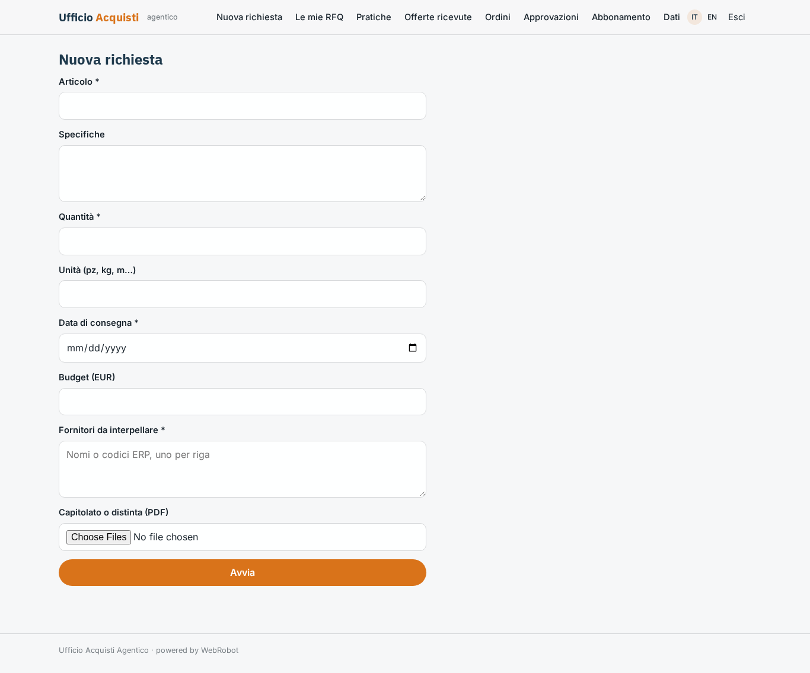
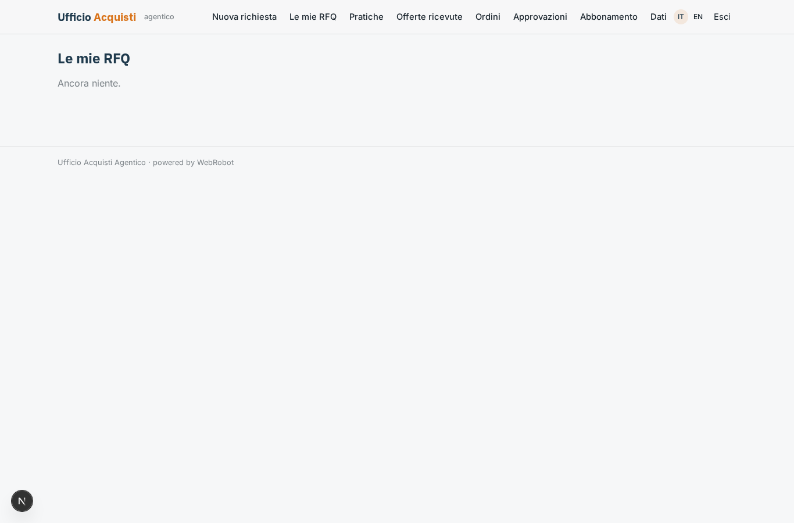
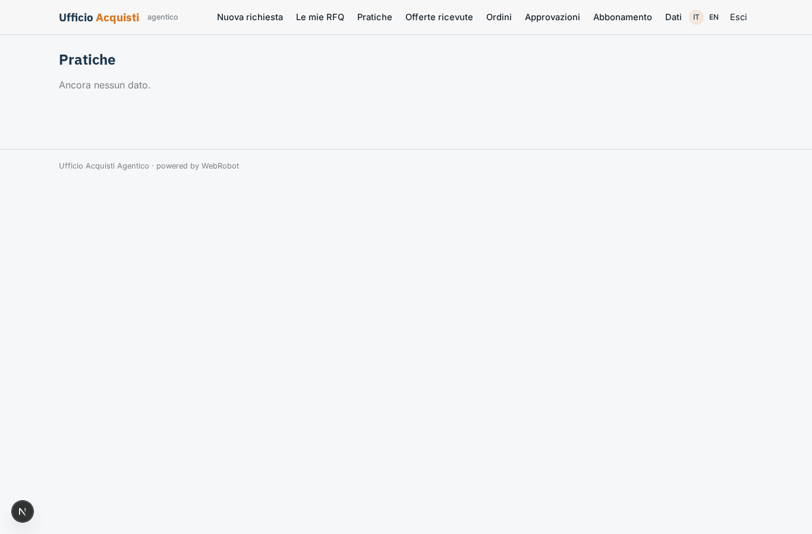
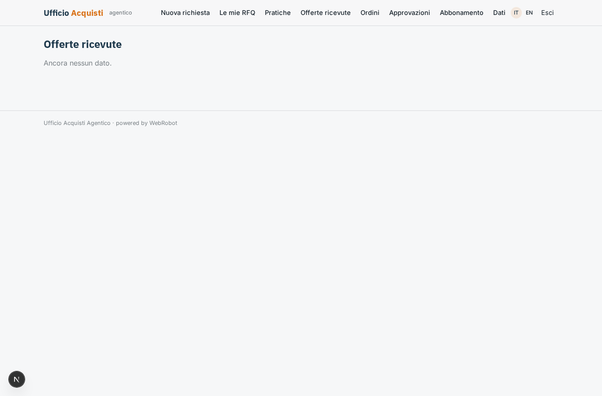
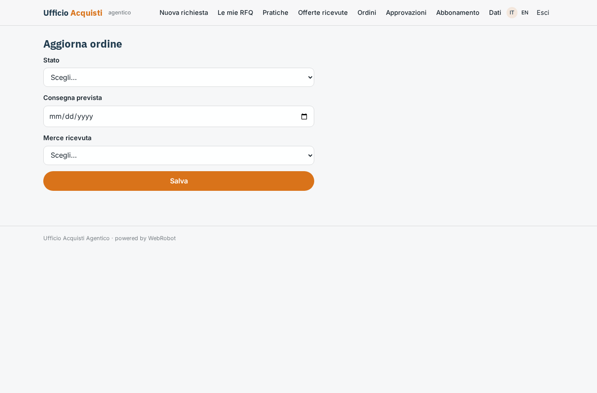
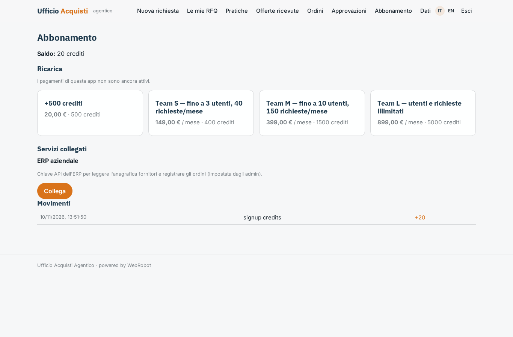

# Ufficio Acquisti Agentico

_Dalla richiesta d'acquisto all'ordine nell'ERP, con agenti AI e approvazioni._

**Manifest:** valid (schema + runtime contract) · **Functional test:** passed (16 checks passed)

## Description given to the app builder (Italian)

Ci serve Ufficio Acquisti Agentico per i buyer di aziende manifatturiere. Il buyer inserisce una richiesta di acquisto con articolo, specifiche, quantità, data di consegna, budget e fornitori da interpellare, oppure carica in PDF il capitolato o la distinta. Un team di agenti lavora così: il primo prepara la richiesta di offerta e la invia per email ai fornitori dalla casella aziendale collegata; il secondo legge le risposte che arrivano nella casella, anche come allegati PDF, ed estrae prezzi, tempi, condizioni di pagamento e minimi d'ordine; il terzo confronta le offerte in una tabella, propone il fornitore migliore motivando la scelta e prepara la bozza di ordine. Il buyer deve approvare prima che l'ordine parta; sopra una soglia di importo serve anche l'approvazione del responsabile acquisti. Dopo l'ordine un agente segue le conferme e i ritardi di consegna scrivendo solleciti. Gli ordini approvati devono essere registrati nell'ERP aziendale e l'anagrafica fornitori va letta da lì. Ogni buyer vede le sue pratiche, il responsabile tutte. Abbonamento mensile per numero di utenti e volume di richieste.

## Functional test: what did not pass

- **saved record shown where its collection is read** (view requests): a record was saved in requests (by admin-data, admin-data) but the page does not show it (as user) _(warning)_
- **saved record shown where its collection is read** (view quotes): a record was saved in quotes (by admin-data, admin-data) but the page does not show it (as user) _(warning)_
- **saved record shown where its collection is read** (view orders): a record was saved in orders (by admin-data, admin-data, user) but the page does not show it (as user) _(warning)_

## Features not expressible today (spec.extensions)

- **mailbox_oauth**: Collegamento diretto alla casella aziendale (Microsoft 365/Google) via OAuth non disponibile: le RFQ partono dalla piattaforma e le risposte dei fornitori arrivano nell'inbox email dell'app (channel offers_inbox), da inoltrare o impostare come risposta.
- **erp_endpoints**: Gli endpoint ERP (/api/suppliers, /api/purchase-orders) e il formato dei campi vanno adattati all'ERP reale del cliente.
- **seat_pricing**: Il prezzo per numero di utenti è espresso con i piani Team S/M/L; il limite di utenti per piano non è imposto dal runtime. La soglia di 5000 EUR per il responsabile è nel prompt degli agenti comparer e orderer.

## Screenshots (interpretive runtime, no data)

### home-anon

### home-mobile

### home

### new

### runs

### requests

### quotes

### orders

### order_update

### approvals

### account

