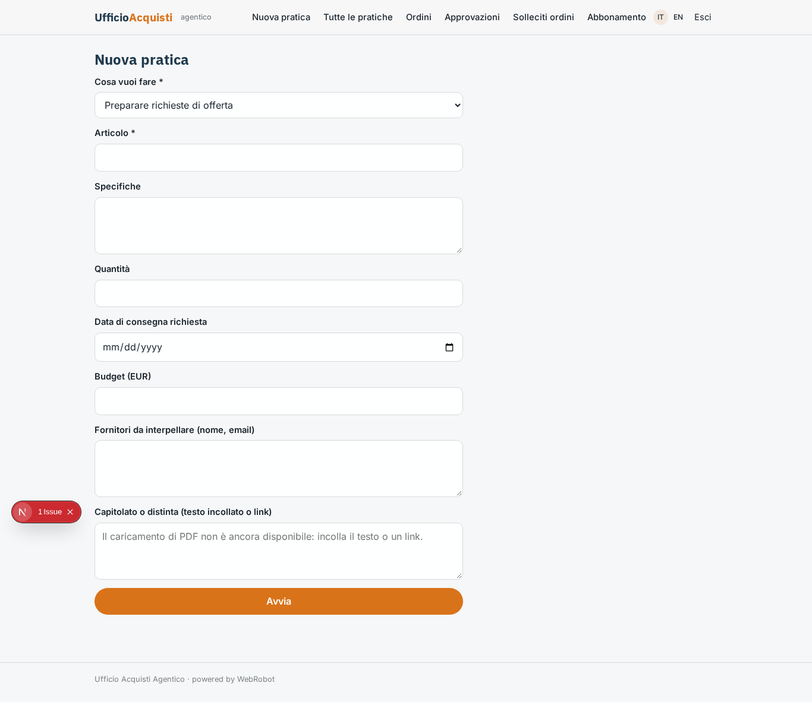
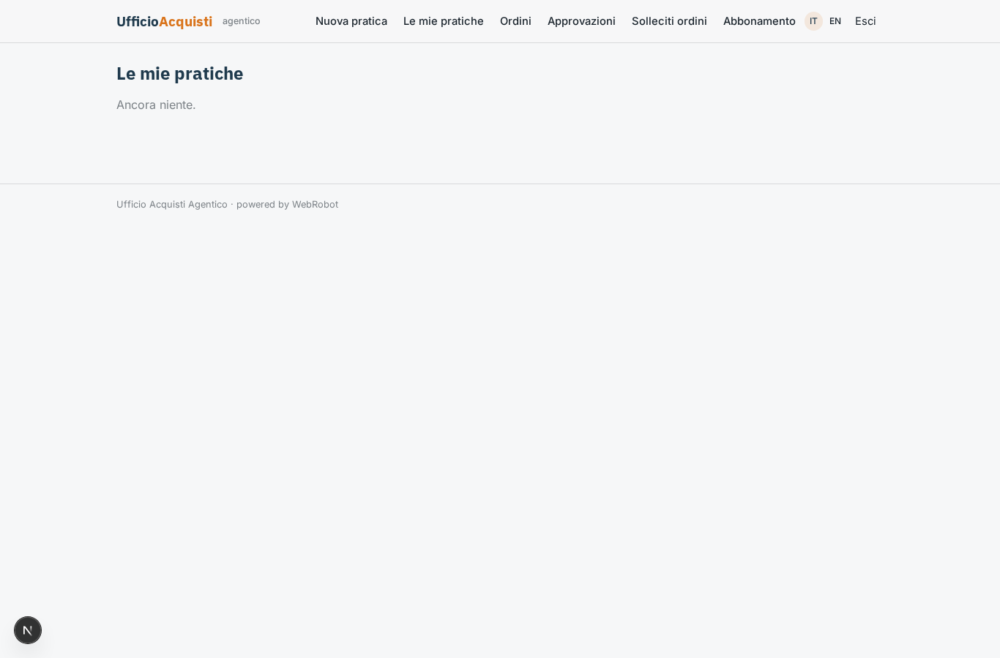
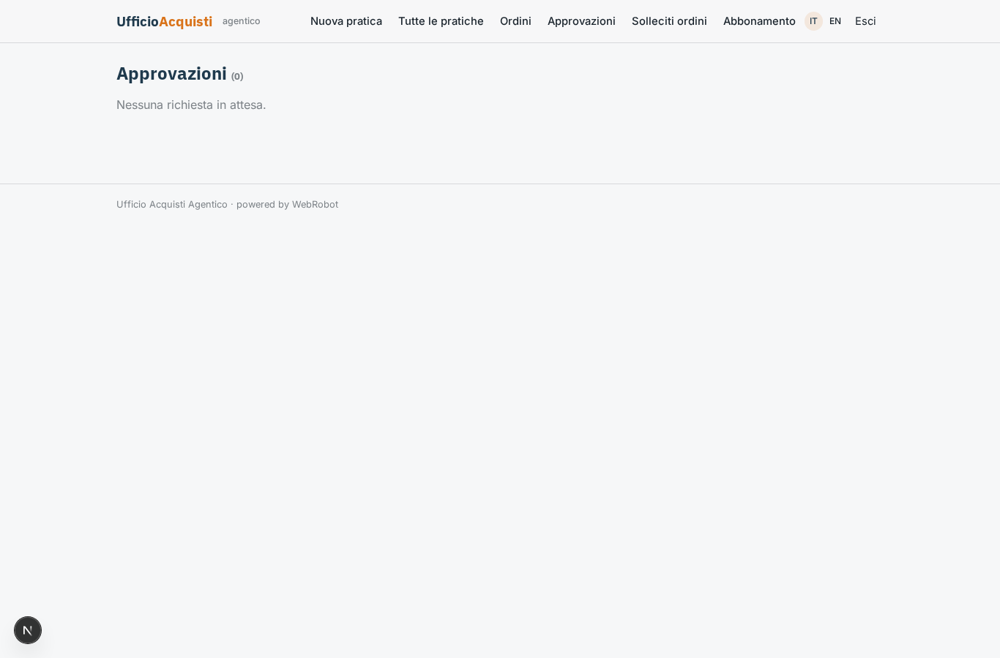
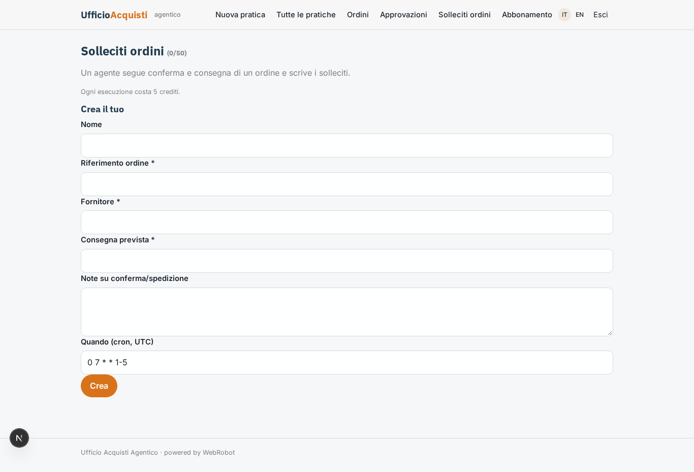
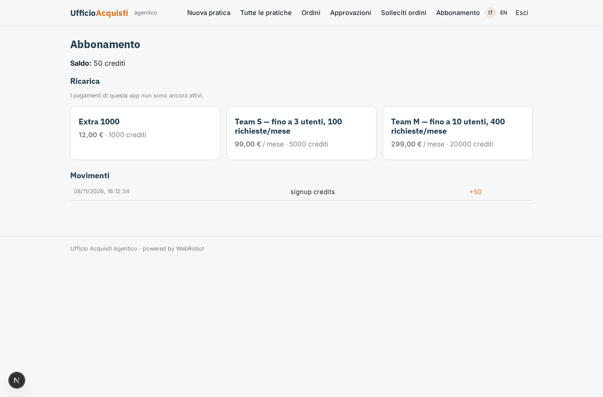

# Ufficio Acquisti Agentico

_Dalla richiesta d'acquisto all'ordine approvato, con un team di agenti._

**Manifest status:** valid (schema validator + runtime contract)

## Description given to the app builder (Italian)

Ci serve Ufficio Acquisti Agentico per i buyer di aziende manifatturiere. Il buyer inserisce una richiesta di acquisto con articolo, specifiche, quantità, data di consegna, budget e fornitori da interpellare, oppure carica in PDF il capitolato o la distinta. Un team di agenti lavora così: il primo prepara la richiesta di offerta e la invia per email ai fornitori dalla casella aziendale collegata; il secondo legge le risposte che arrivano nella casella, anche come allegati PDF, ed estrae prezzi, tempi, condizioni di pagamento e minimi d'ordine; il terzo confronta le offerte in una tabella, propone il fornitore migliore motivando la scelta e prepara la bozza di ordine. Il buyer deve approvare prima che l'ordine parta; sopra una soglia di importo serve anche l'approvazione del responsabile acquisti. Dopo l'ordine un agente segue le conferme e i ritardi di consegna scrivendo solleciti. Gli ordini approvati devono essere registrati nell'ERP aziendale e l'anagrafica fornitori va letta da lì. Ogni buyer vede le sue pratiche, il responsabile tutte. Abbonamento mensile per numero di utenti e volume di richieste.

## Features not expressible today (spec.extensions)

- **company_mailbox**: Sending RFQs from, and reading replies (including PDF attachments) in, the company mailbox needs per-company credentials and email connectors, not available yet. For now agents write the email drafts and the buyer pastes the replies.
- **pdf_upload**: Uploading the PDF specification or bill of materials is not available yet: the buyer pastes text or a link.
- **erp_integration**: Registering approved orders in the company ERP and reading the supplier master data from it need a connector with the company's ERP credentials, not available yet. Approved orders are stored in the orders collection with status 'approved', ready for export; suppliers are kept in the suppliers collection.
- **approval_threshold**: The 5000 EUR threshold for the manager's approval is written in the registrar agent's prompt; make it configurable per company when slots/settings allow.
- **seat_limits**: Plans are described by users and request volume, but the runtime does not enforce a per-plan user count; volume is controlled through plan credits.

## Screenshots (interpretive runtime)

### home-anon

### home-mobile

### home

### new_request

### requests

### all_requests

### orders_list

### approvals_inbox

### follow

### account

