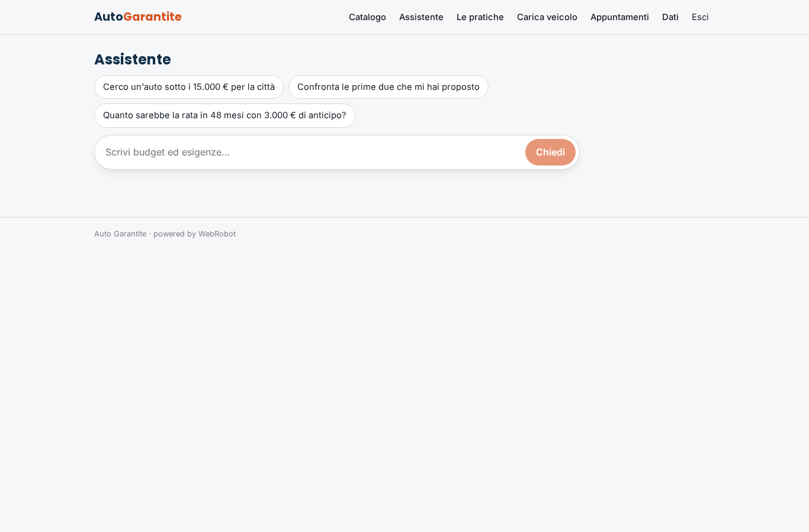
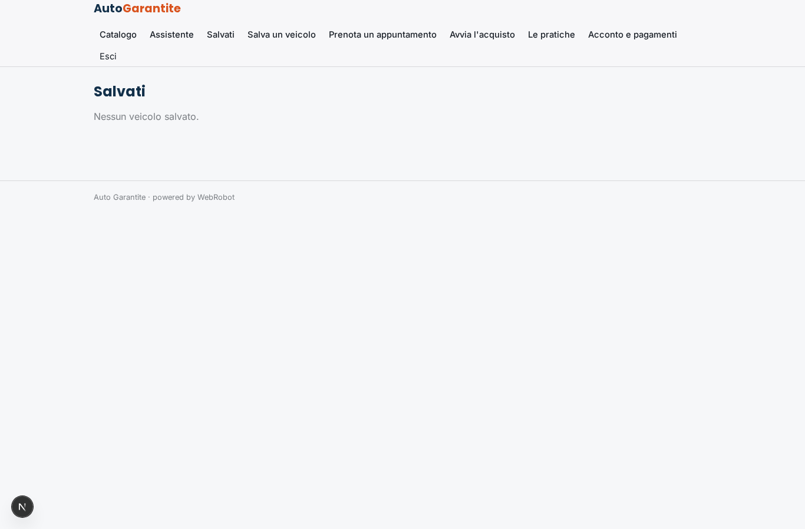
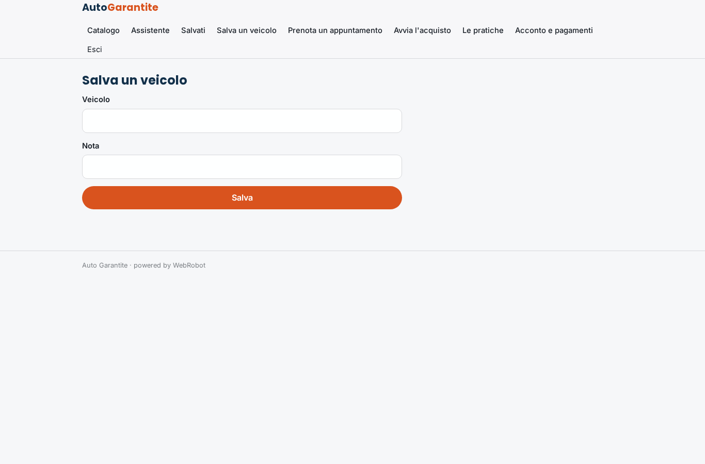
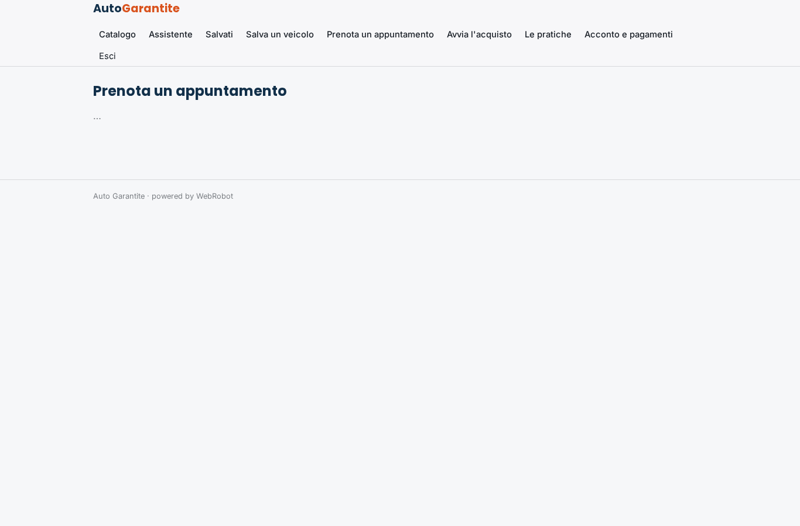
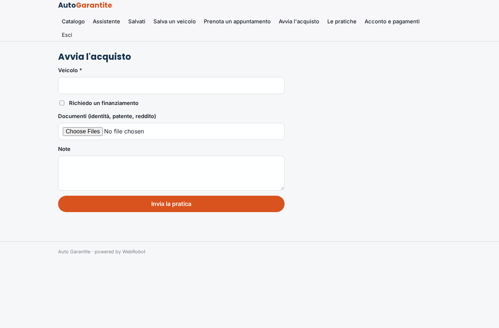
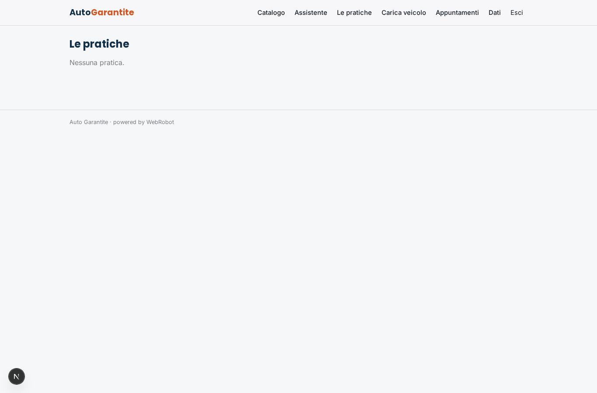
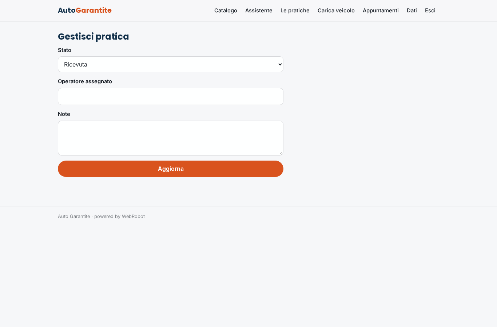
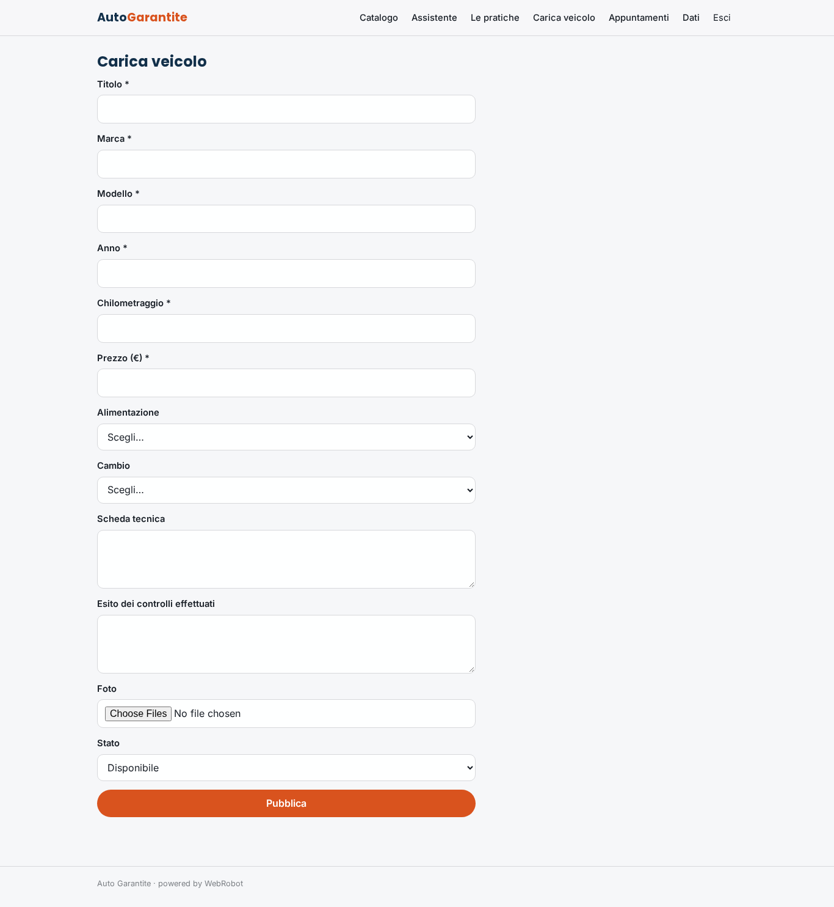
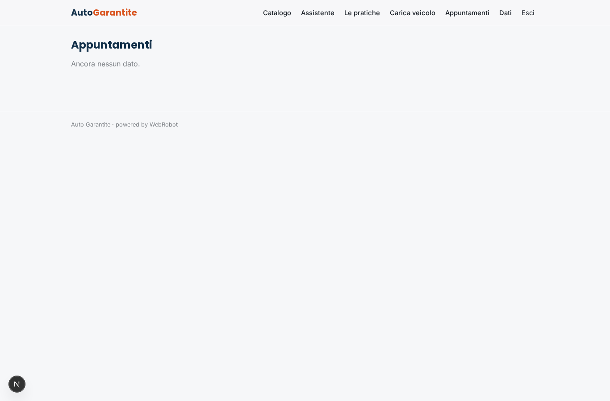
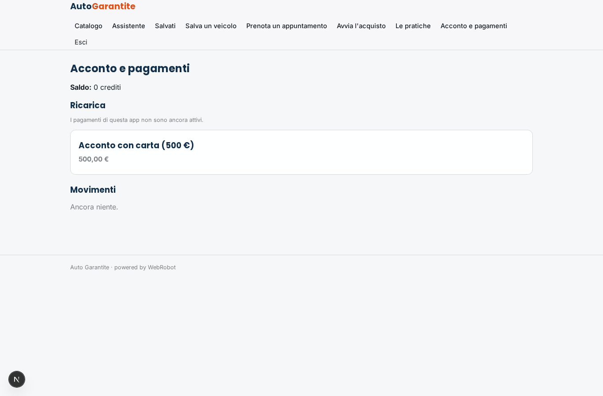

# Auto Garantite

_Auto usate garantite: scegli con l'assistente, prenota o avvia l'acquisto online._

**Manifest:** valid (schema + runtime contract) · **Functional test:** passed (22 checks passed)

## Description given to the app builder (Italian)

Descrivo solo lo strato software di un servizio di auto usate garantite: il portale che presenta i veicoli e gestisce la trattativa, non l'ispezione fisica ne il ritiro e la consegna dell'auto, che sono servizi a parte. Il cliente sfoglia il catalogo dei veicoli caricati dall'azienda, con foto, scheda tecnica, chilometraggio, prezzo e l'esito dei controlli gia effettuati, e usa i filtri per trovare quello giusto. Un agente lo aiuta in chat a scegliere in base a budget ed esigenze, confronta due o tre modelli e calcola la rata di un eventuale finanziamento. Quando e interessato, prenota un appuntamento o avvia l'acquisto caricando i documenti, e un operatore umano prende in carico la pratica per le fasi successive. L'acconto si versa online con carta. Il cliente vede solo le proprie pratiche e i veicoli salvati, l'operatore quelle assegnate, l'admin il catalogo e tutte le trattative. Aggiornamenti via email a ogni passaggio. Monetizzazione: vendita dei veicoli, lo strato software e di supporto. In italiano.

## Features not expressible today (spec.extensions)

- **deposit_amount**: L'acconto è modellato come pagamento Stripe a importo fisso (pack 'acconto', 500 €). Un importo variabile per veicolo e l'imputazione automatica alla pratica non sono ancora disponibili: l'operatore porta la pratica a 'Acconto versato'.
- **vehicle_detail_filters**: Il catalogo mostra le schede in ordine di prezzo; filtri interattivi dell'utente (marca, prezzo, km) e pagina di dettaglio con galleria foto non sono ancora disponibili: l'assistente in chat copre la ricerca per esigenze.

## Screenshots (interpretive runtime, no data)

### home-anon

### home-mobile

### home

### catalog

### assistant

### saved

### save_form

### book

### start_deal

### deals

### deal_edit

### vehicle_form

### appointments_admin

### account

