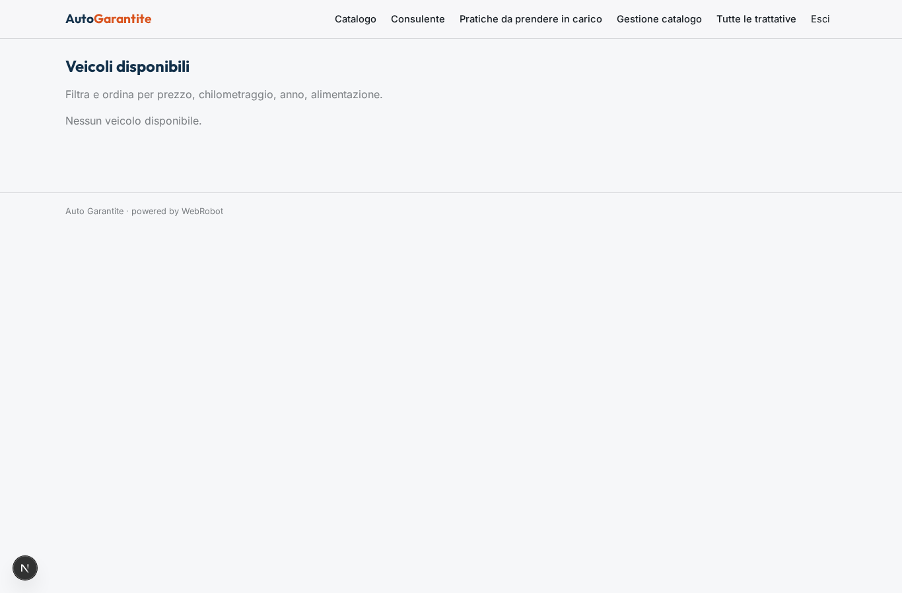
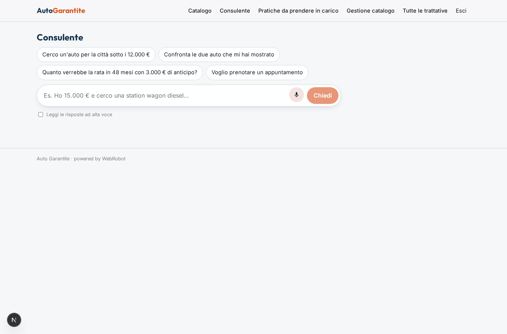
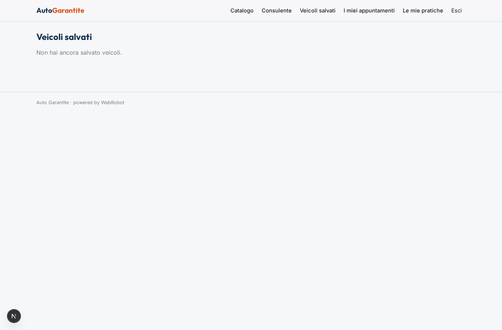
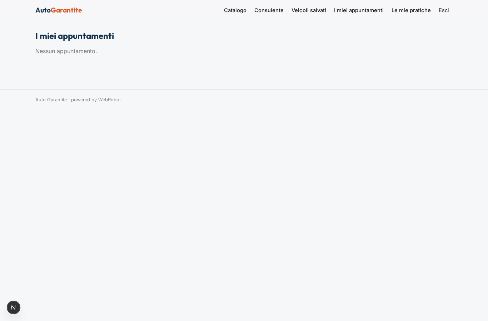
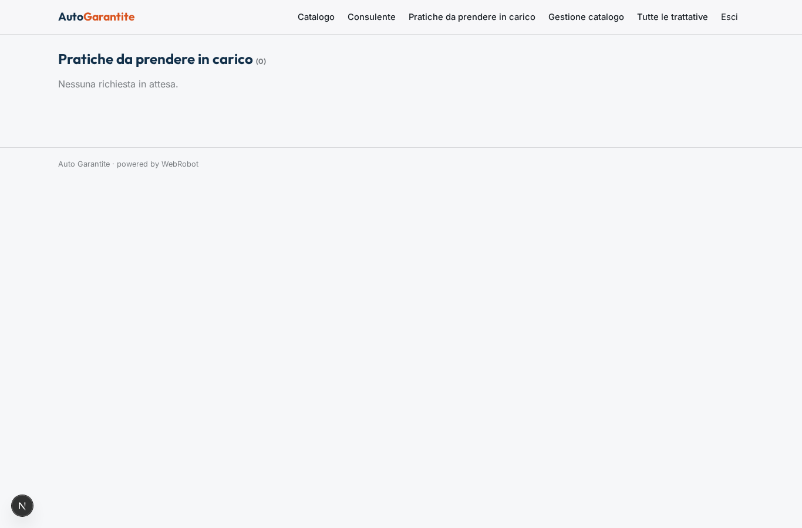
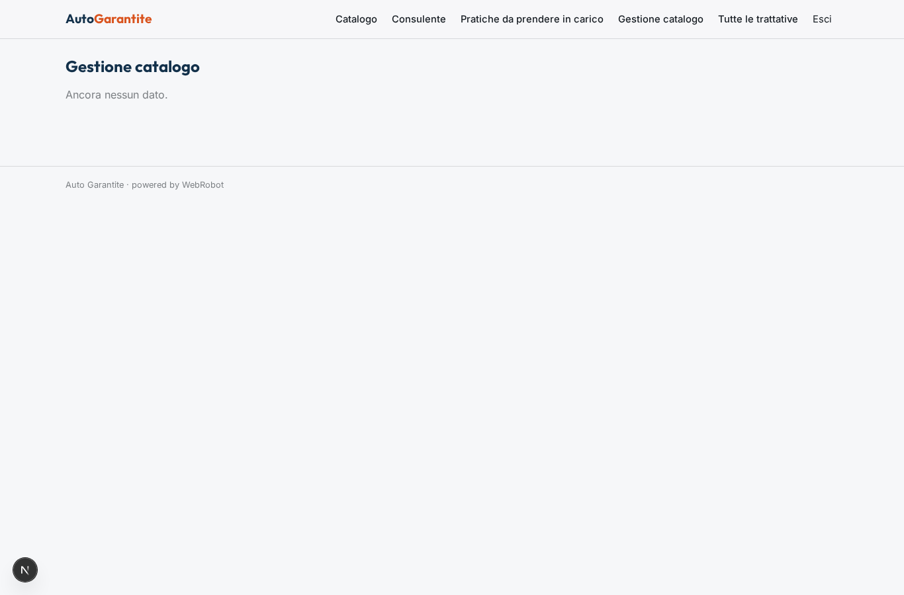
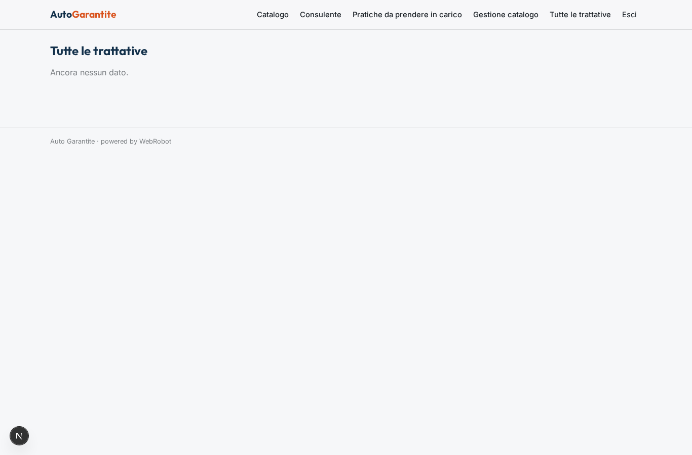

# Auto Garantite

_Auto usate garantite: scegli con un consulente AI, prenota e acquista online._

**Manifest status:** valid (schema validator + runtime contract)

## Description given to the app builder (Italian)

Descrivo solo lo strato software di un servizio di auto usate garantite: il portale che presenta i veicoli e gestisce la trattativa, non l'ispezione fisica ne il ritiro e la consegna dell'auto, che sono servizi a parte. Il cliente sfoglia il catalogo dei veicoli caricati dall'azienda, con foto, scheda tecnica, chilometraggio, prezzo e l'esito dei controlli gia effettuati, e usa i filtri per trovare quello giusto. Un agente lo aiuta in chat a scegliere in base a budget ed esigenze, confronta due o tre modelli e calcola la rata di un eventuale finanziamento. Quando e interessato, prenota un appuntamento o avvia l'acquisto caricando i documenti, e un operatore umano prende in carico la pratica per le fasi successive. L'acconto si versa online con carta. Il cliente vede solo le proprie pratiche e i veicoli salvati, l'operatore quelle assegnate, l'admin il catalogo e tutte le trattative. Aggiornamenti via email a ogni passaggio. Monetizzazione: vendita dei veicoli, lo strato software e di supporto. In italiano.

## Features not expressible today (spec.extensions)

- **acconto_carta**: Versamento dell'acconto online con carta (Stripe Connect verso l'azienda) legato a una singola pratica e al suo importo: il manifest non esprime pagamenti per transazione su una collezione. Da collegare dopo la presa in carico.
- **email_aggiornamenti**: Email al cliente a ogni passaggio della pratica (presa in carico, acconto, chiusura): le notifiche non sono ancora disponibili.
- **upload_documenti**: Caricamento di foto veicolo e documenti del cliente: i file non sono ancora disponibili; si usano link o testo incollato.
- **visibilita_operatore**: L'operatore dovrebbe vedere solo le pratiche assegnate e l'admin tutte: le pratiche sono dei clienti (ownedBy user), serve un filtro per assegnatario e un accesso admin trasversale non esprimibili oggi.

## Screenshots (interpretive runtime)

### home-anon

### home-mobile

### home

### catalogo

### consulente

### salvati

### appuntamenti

### pratiche

### coda_operatore

### admin_catalogo

### admin_trattative

