# VerificaDifese

_Controlla le tue applicazioni web prima che lo faccia qualcun altro._

**Manifest:** valid (schema + runtime contract) · **Functional test:** passed (19 checks passed)

## Description given to the app builder (Italian)

Vorrei VerificaDifese, un servizio di valutazione della sicurezza per aziende che vogliono controllare le proprie applicazioni web prima che lo faccia qualcun altro. Il cliente registra un'applicazione di sua proprietà e dimostra di controllarla pubblicando un codice di verifica sul proprio dominio; senza verifica e senza l'accettazione di un'autorizzazione scritta al test nessuna analisi può partire. Il cliente sceglie l'ambiente (test o produzione) e le finestre orarie consentite. Un agente esegue solo controlli non distruttivi e a basso carico sul dominio verificato: configurazione TLS e intestazioni di sicurezza, versioni di componenti con vulnerabilità note pubblicate, esposizione di pagine amministrative, conformità alle buone pratiche OWASP, e traffico limitato agli host dichiarati. I risultati sono classificati per gravità con spiegazione e indicazioni di correzione per gli sviluppatori. Un consulente di sicurezza della piattaforma rivede e approva il report prima che arrivi al cliente via email. Il cliente può pianificare una verifica mensile e confrontare i risultati nel tempo. Ogni cliente vede solo le proprie applicazioni e i propri report. Abbonamento per numero di applicazioni verificate. Italiano e inglese.

## Functional test: what did not pass

- **trigger has its effect** (trigger report_to_review): email to role:consultant: no such recipient in the test (role nobody holds or empty field) _(warning)_

## Features not expressible today (spec.extensions)

- **field_level_protection**: Form views expose only the intended fields, but record fields such as status are not write-protected at field level: a technically skilled user could try to set their own status. Verification and report approval should be enforced by the platform with field-level write rules.
- **window_enforcement**: Allowed time windows are checked by the agent from the stored text, not by the scheduler; a structured window field and scheduler-level enforcement would be stronger.

## Screenshots (interpretive runtime, no data)

### home-anon
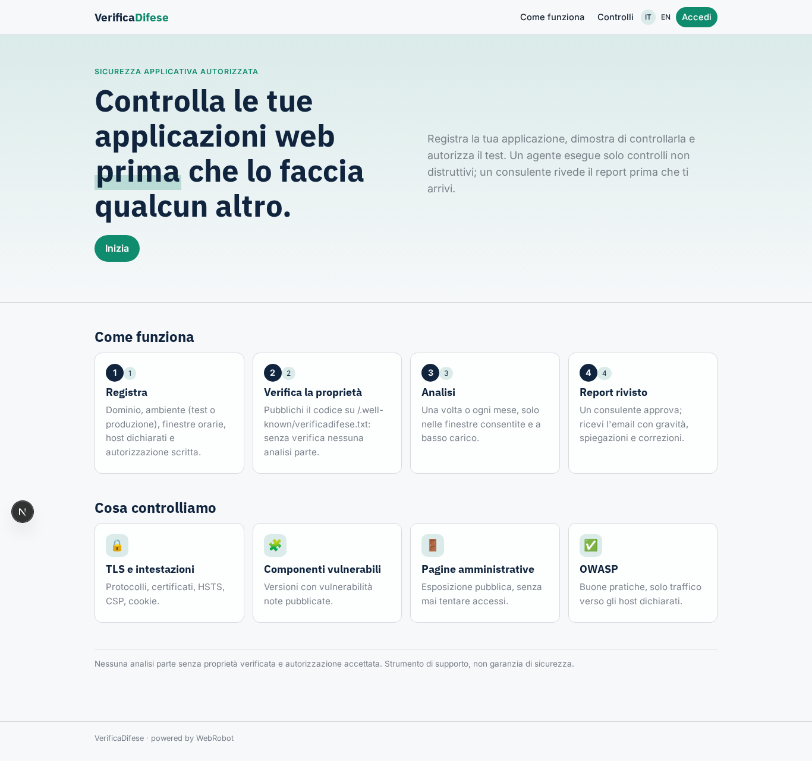

### home-mobile
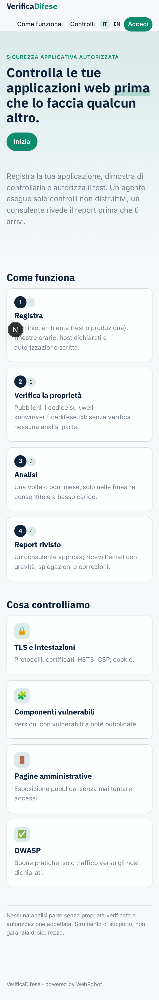

### home
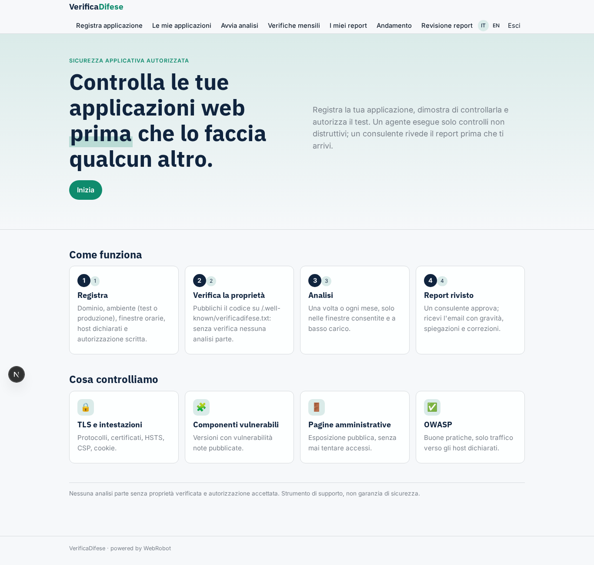

### register
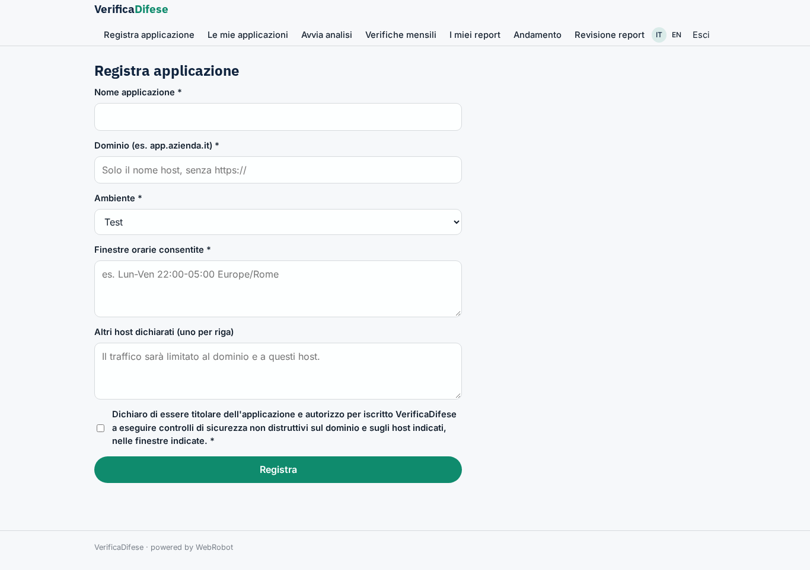

### apps
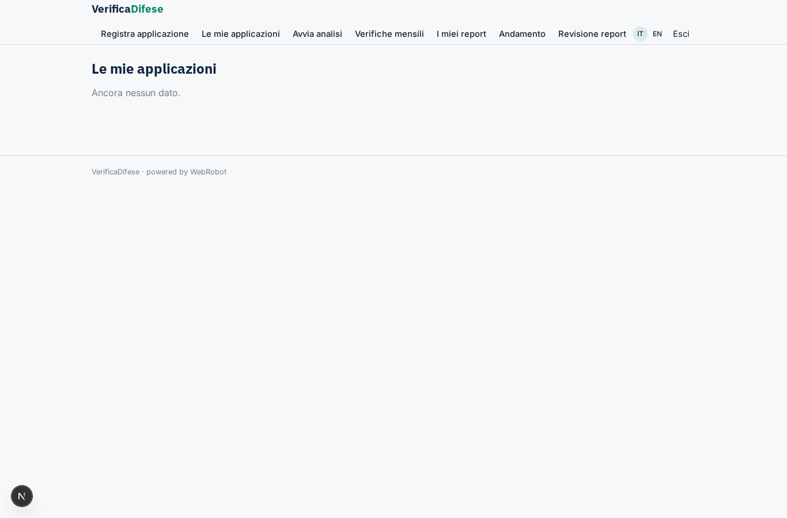

### verify
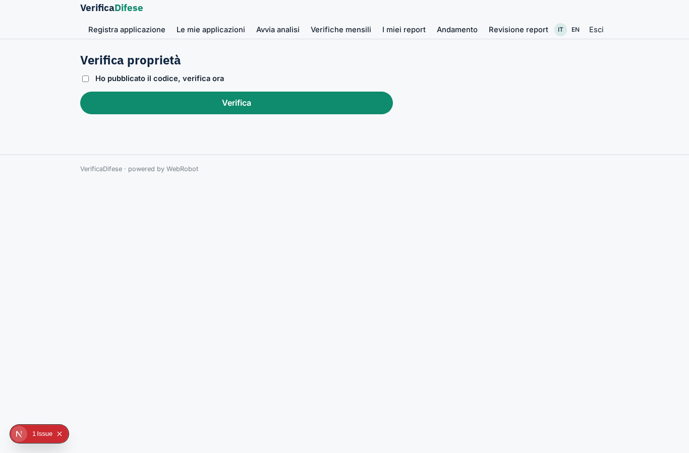

### request_scan
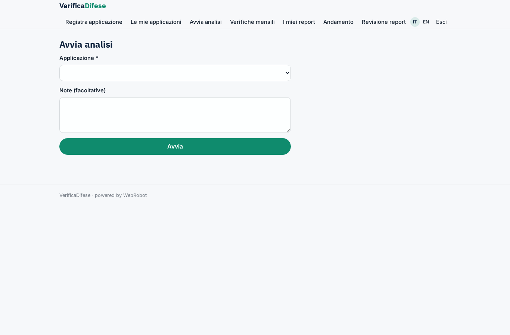

### monthly
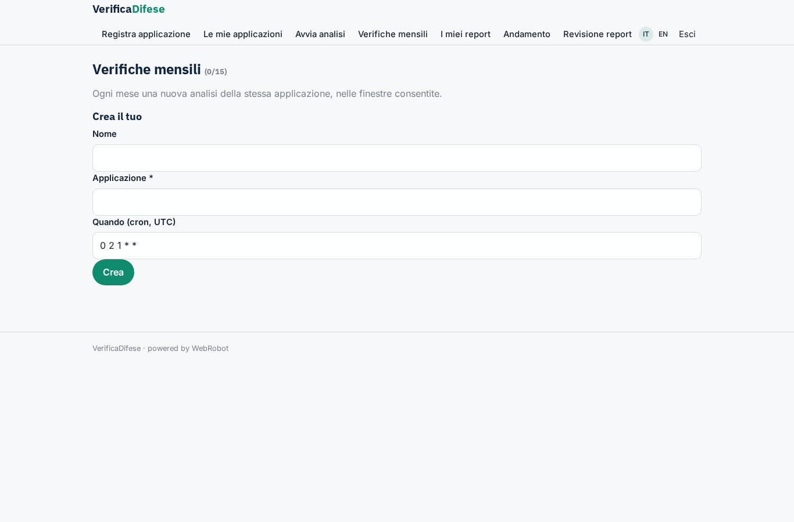

### reports
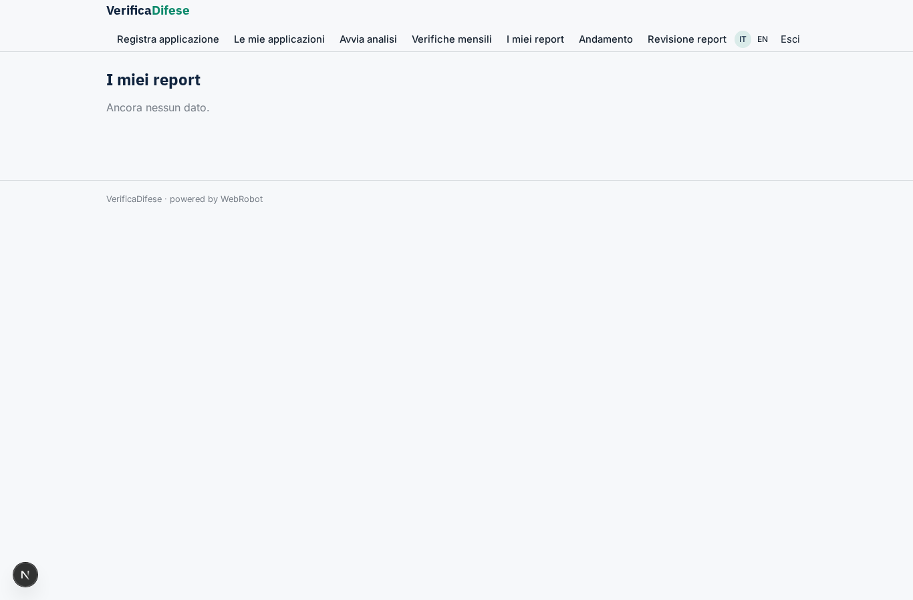

### trend
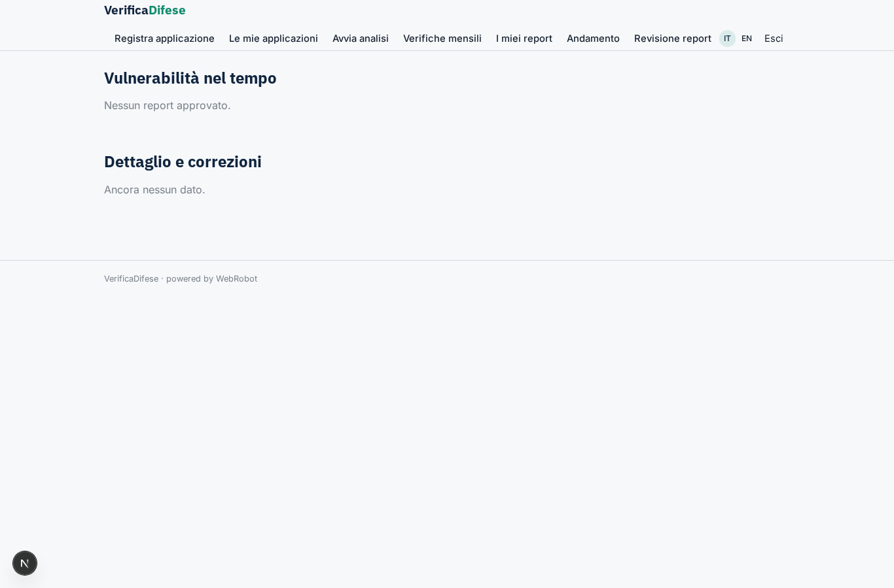

### review
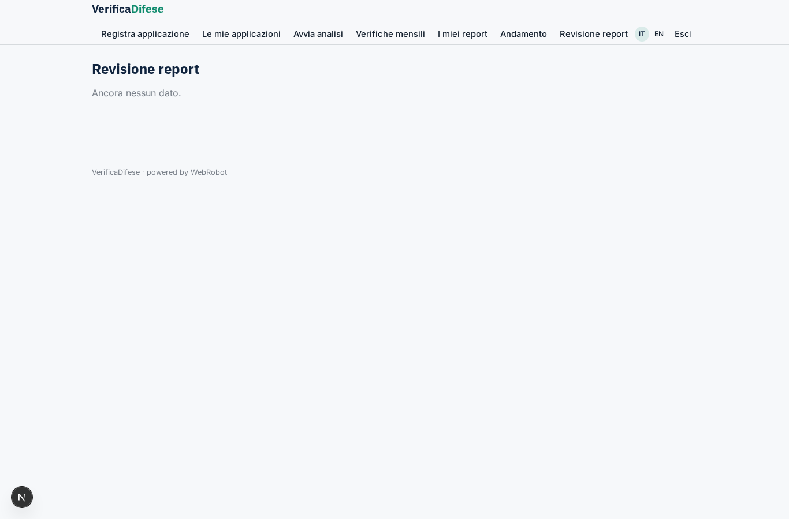

### review_form
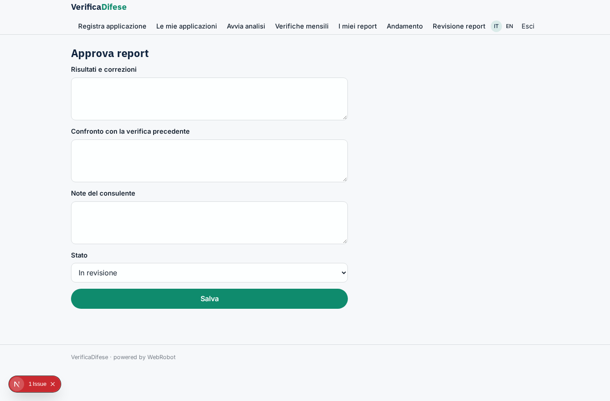

### account
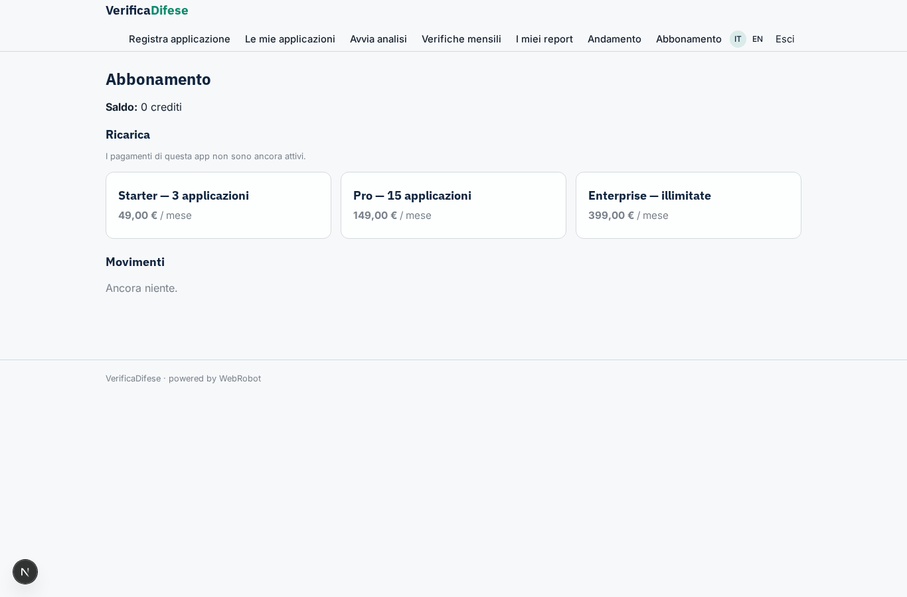
