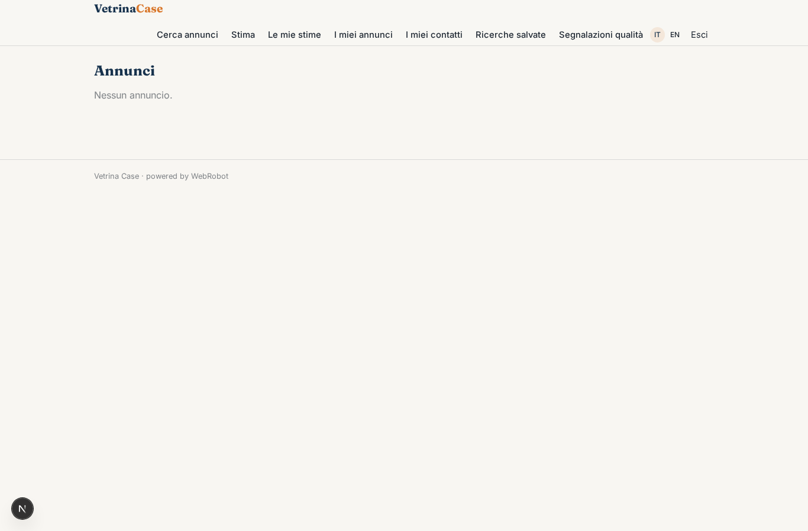
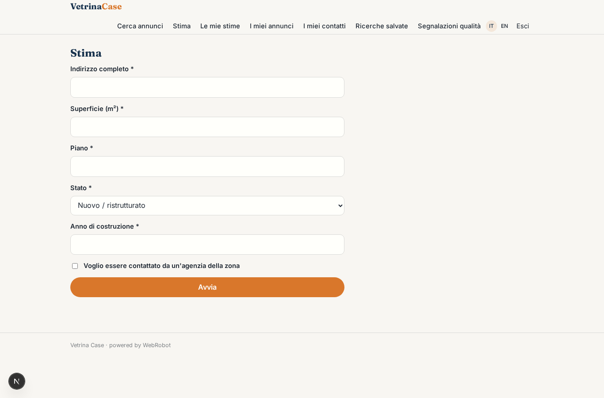
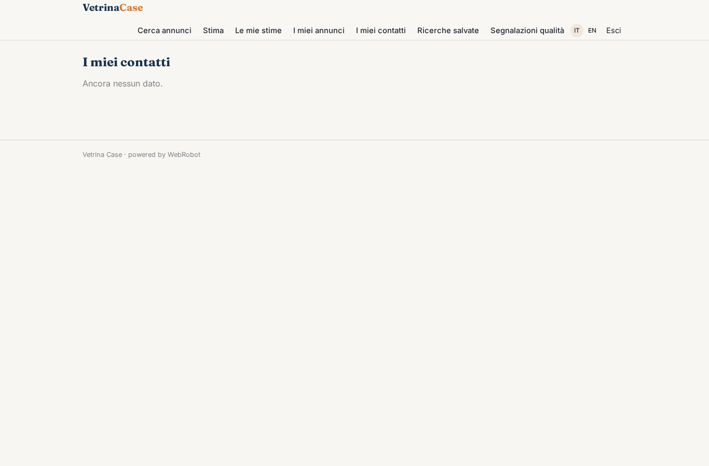
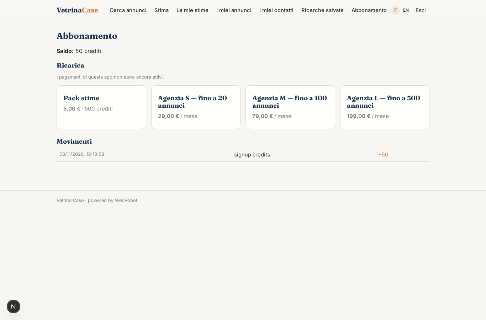

# Vetrina Case

_Annunci immobiliari delle agenzie, con stima automatica del valore._

**Stato manifest:** valido (validatore Python + contratto runtime)

## Descrizione data all'app builder

Voglio Vetrina Case, un portale di annunci immobiliari pubblicati dalle agenzie, con una stima automatica del valore. Descrivo solo lo strato software, non l'attività di mediazione. Le agenzie si registrano, caricano gli annunci con foto, planimetria, prezzo, superficie, classe energetica e posizione, oppure li importano dal loro gestionale con un feed. Il visitatore cerca per zona sulla mappa, prezzo, locali e caratteristiche, salva le ricerche e riceve un'email quando compare un annuncio nuovo compatibile. Può contattare l'agenzia con un modulo, che arriva all'agente. Un servizio di stima chiede indirizzo, metri quadri, piano, stato e anno di costruzione e calcola un intervallo di valore usando le quotazioni dell'Osservatorio del Mercato Immobiliare e i prezzi degli annunci presenti sul portale; il proprietario che chiede la stima può decidere di essere contattato da un'agenzia della zona. Un agente controlla gli annunci duplicati o con dati incoerenti e li segnala all'admin. Ogni agenzia vede i suoi annunci e contatti. Le agenzie pagano un abbonamento mensile per numero di annunci.

## Funzioni non esprimibili oggi (spec.extensions)

- **listing_editor**: Form for agencies to create/edit listings with an agency-scoped write to the shared catalogue, so each agency sees and edits only its own listings and leads.
- **file_upload**: Photo and floorplan upload is not available yet: agencies paste links (photo_urls, floorplan_url).
- **feed_import**: Import from agency management software via feed (XML/CSV) needs a per-agency connector and a scheduled sync.
- **map_search**: Interactive map search with drawn areas is not available; search is by zone text and filters.
- **email_alerts**: Email notifications for saved searches are not available yet; new matches appear in the saved-searches view.
- **contact_form_and_lead_routing**: Public contact form that writes to the agency's contact_requests, and routing of the owner's contact consent from the valuation to a local agency, need cross-user writes not available yet.
- **plan_limits**: Enforcement of the active-listings cap per plan.

## Screenshot (runtime interpretativo)

### home-anon

### home-mobile

### home

### search

### new_valuation

### valuations

### my_listings

### my_contacts

### searches

### flags

### account

