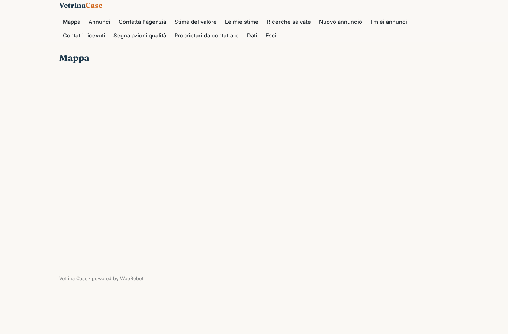
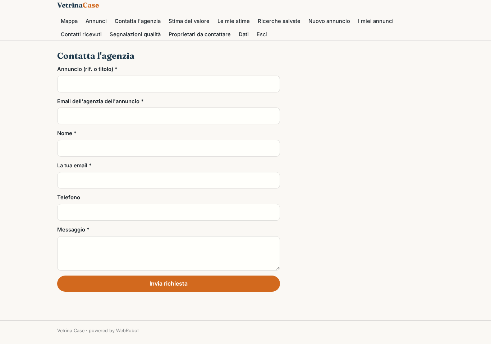
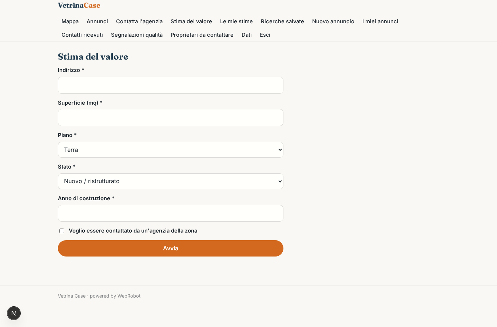
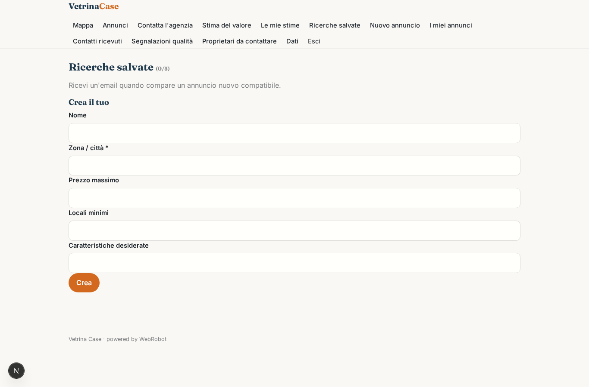
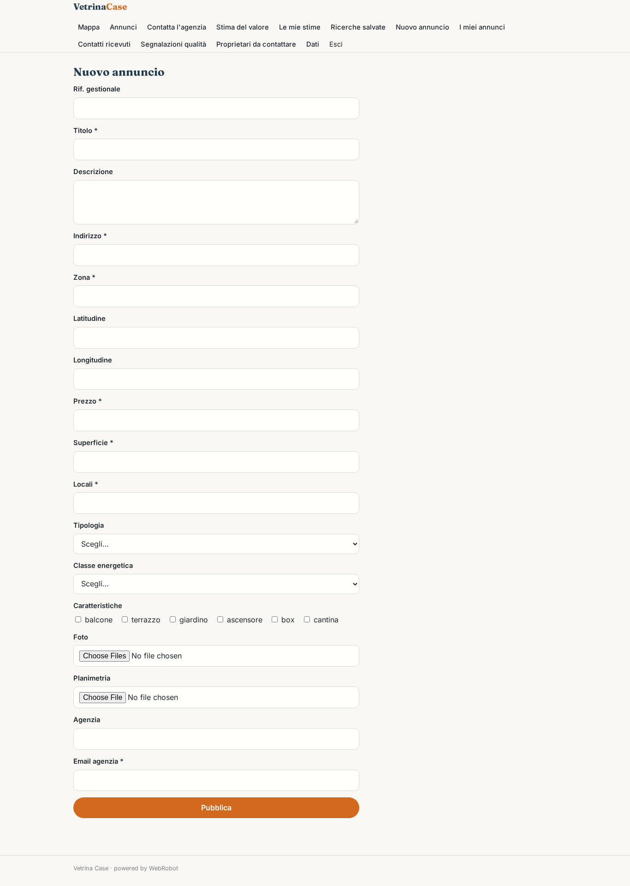
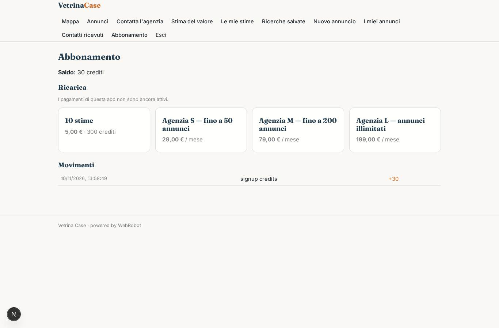

# Vetrina Case

_Annunci immobiliari delle agenzie, con stima automatica del valore._

**Manifest:** valid (schema + runtime contract) · **Functional test:** passed (29 checks passed)

## Description given to the app builder (Italian)

Voglio Vetrina Case, un portale di annunci immobiliari pubblicati dalle agenzie, con una stima automatica del valore. Descrivo solo lo strato software, non l'attività di mediazione. Le agenzie si registrano, caricano gli annunci con foto, planimetria, prezzo, superficie, classe energetica e posizione, oppure li importano dal loro gestionale con un feed. Il visitatore cerca per zona sulla mappa, prezzo, locali e caratteristiche, salva le ricerche e riceve un'email quando compare un annuncio nuovo compatibile. Può contattare l'agenzia con un modulo, che arriva all'agente. Un servizio di stima chiede indirizzo, metri quadri, piano, stato e anno di costruzione e calcola un intervallo di valore usando le quotazioni dell'Osservatorio del Mercato Immobiliare e i prezzi degli annunci presenti sul portale; il proprietario che chiede la stima può decidere di essere contattato da un'agenzia della zona. Un agente controlla gli annunci duplicati o con dati incoerenti e li segnala all'admin. Ogni agenzia vede i suoi annunci e contatti. Le agenzie pagano un abbonamento mensile per numero di annunci.

## Features not expressible today (spec.extensions)

- **listing_sync**: Le modifiche e le cancellazioni di un annuncio dal form non si propagano ancora alla copia pubblica; il feed webhook aggiorna per external_id. Geocodifica automatica dell'indirizzo (lat/lon) e precompilazione dell'agenzia nel modulo contatto dal singolo annuncio non sono ancora disponibili.
- **lead_routing**: I proprietari che chiedono di essere contattati arrivano all'admin, che li inoltra alle agenzie della zona: l'assegnazione automatica per zona non è ancora disponibile. I dati OMI vengono letti dall'agente via WebRobot MCP (nessuna API ufficiale).

## Screenshots (interpretive runtime, no data)

### home-anon

### home-mobile

### home

### map

### listings

### contact

### new_valuation

### valuations

### searches

### new_listing

### my_listings

### my_contacts

### flags

### leads

### account

