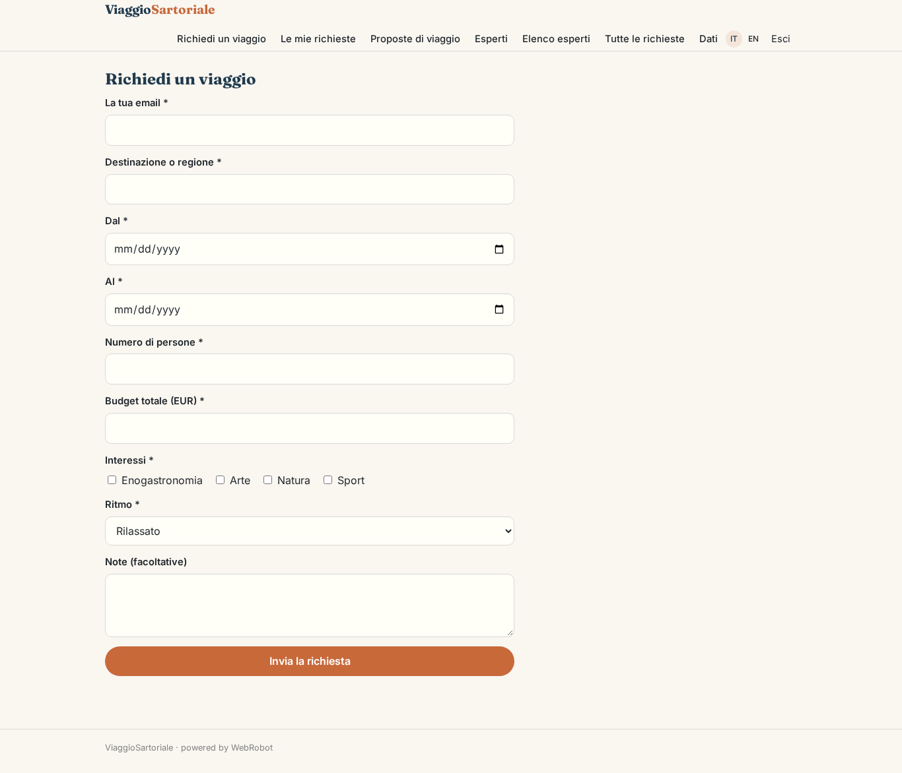
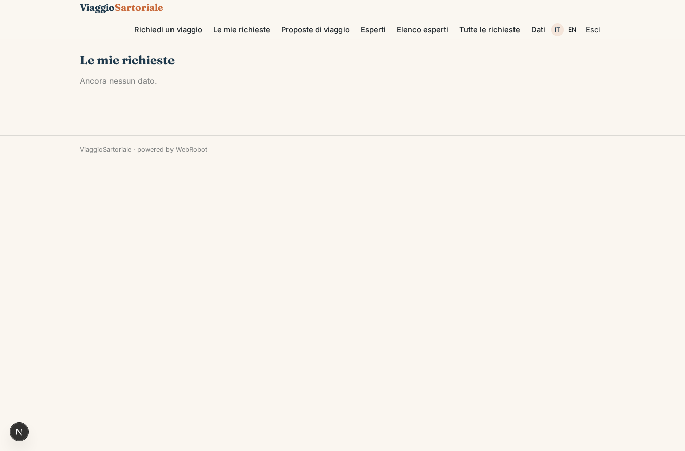
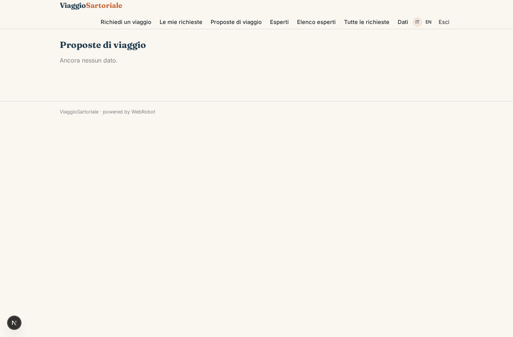
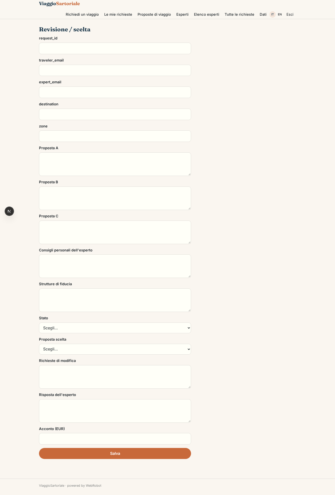
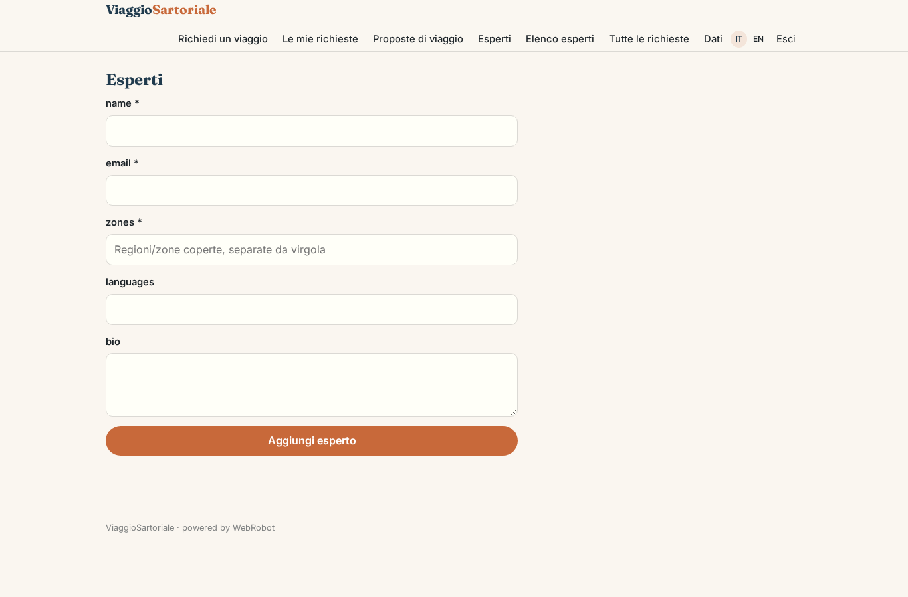
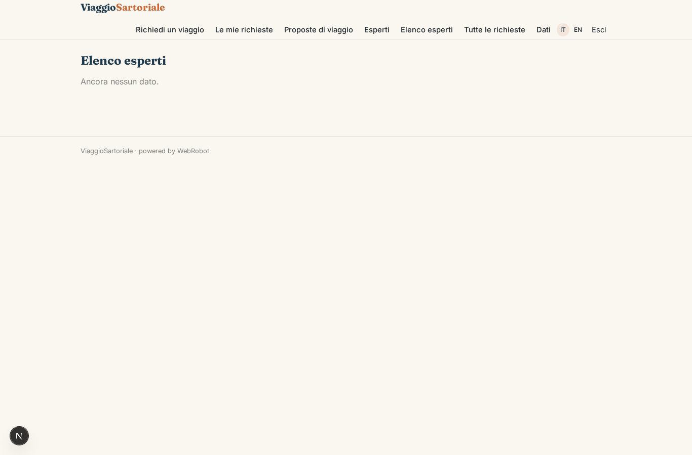
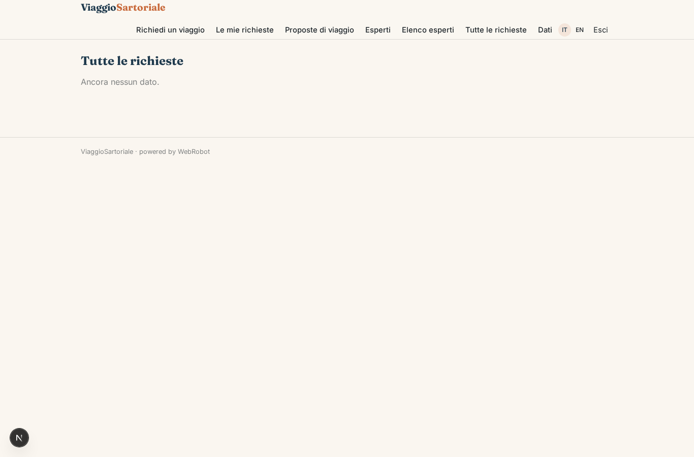

# ViaggioSartoriale

_Viaggi su misura, rifiniti da un esperto locale._

**Manifest:** valid (schema + runtime contract) · **Functional test:** passed (20 checks passed)

## Description given to the app builder (Italian)

ViaggioSartoriale propone viaggi su misura costruiti con un esperto locale. Il viaggiatore, anche senza account, compila un modulo con destinazione o regione, date, numero di persone, budget, interessi (enogastronomia, arte, natura, sport) e ritmo preferito. Una squadra di agenti prepara tre proposte di itinerario diverse usando open data degli enti turistici, OpenStreetMap e Wikidata per luoghi, distanze ed eventi; non uso dati delle agenzie di viaggio online. Le proposte vengono assegnate a un esperto locale registrato sulla piattaforma per quella zona, che le rivede, aggiunge consigli personali e strutture di fiducia, e le approva. Entro 24 ore il viaggiatore riceve un'email con le tre proposte e un link per sceglierne una e chiedere modifiche in chat con l'esperto. Quando conferma, paga un acconto con carta e l'esperto riceve la sua parte. Il viaggiatore vede solo le proprie richieste, l'esperto solo quelle della sua zona, l'admin tutto. Monetizzazione: commissione sul viaggio venduto. Interfaccia in italiano e inglese.

## Functional test: what did not pass

- **saved record shown where its collection is read** (view my_requests): a record was saved in requests (by admin-data, admin-data, user) but the page does not show it (as user) _(warning)_

## Features not expressible today (spec.extensions)

- **expert_chat**: A live chat between traveler and human expert is not available yet: change requests and replies go through the change_request and expert_reply fields of the proposal, with email notifications.
- **deposit_checkout**: The card deposit on confirmation and the payout to the expert (via Stripe Connect on the experts' accounts) must be wired in the studio; the expert must connect their payout account.

## Screenshots (interpretive runtime, no data)

### home-anon

### home-mobile

### home

### request

### my_requests

### trips

### review

### expert_admin

### experts_list

### all_requests

