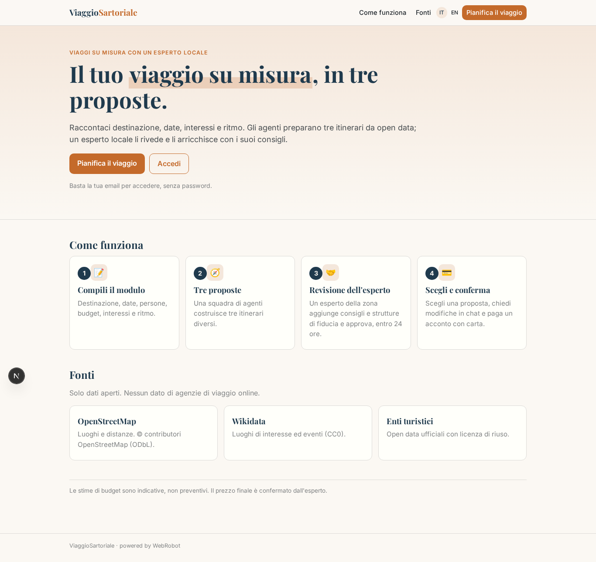
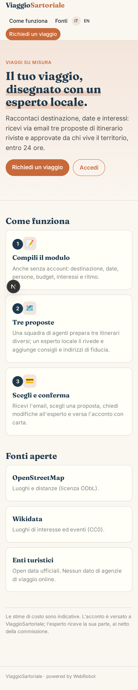
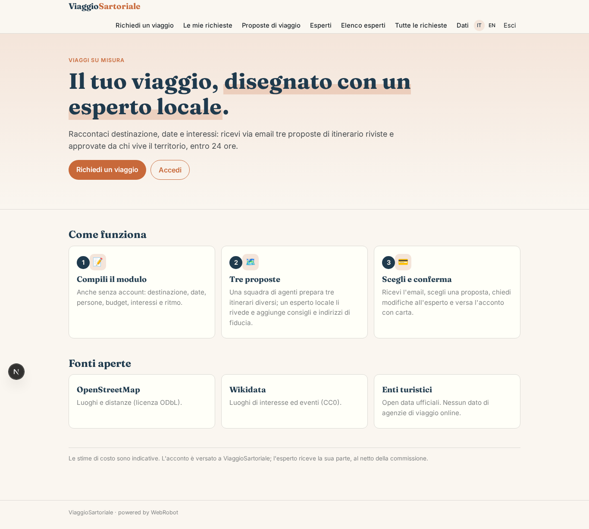
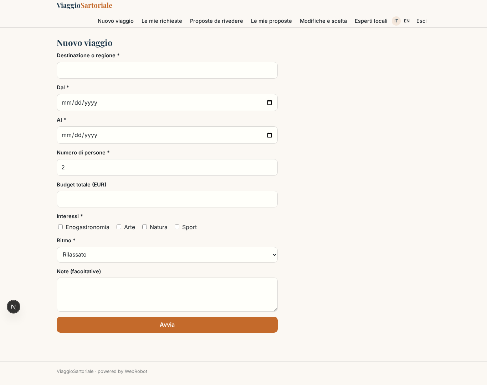
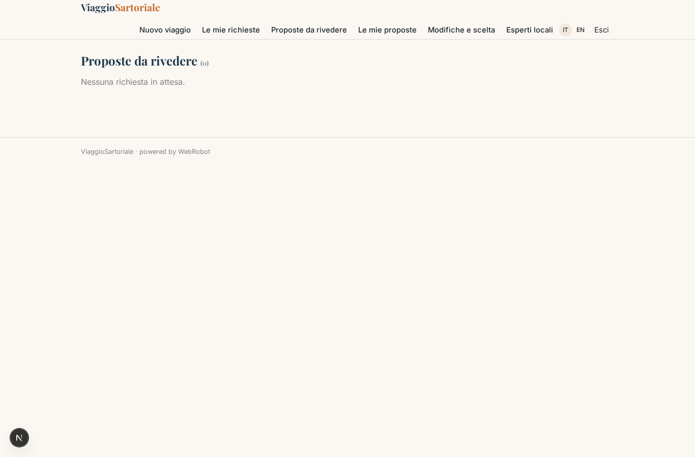
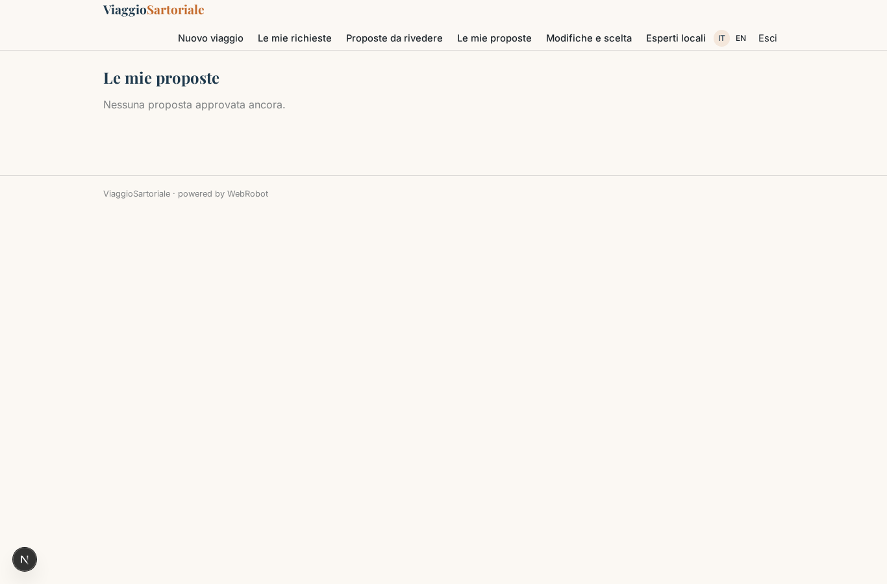
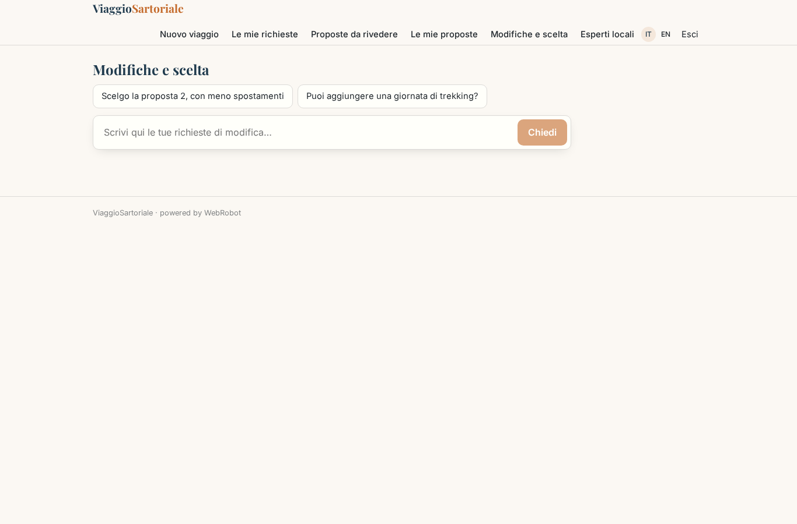
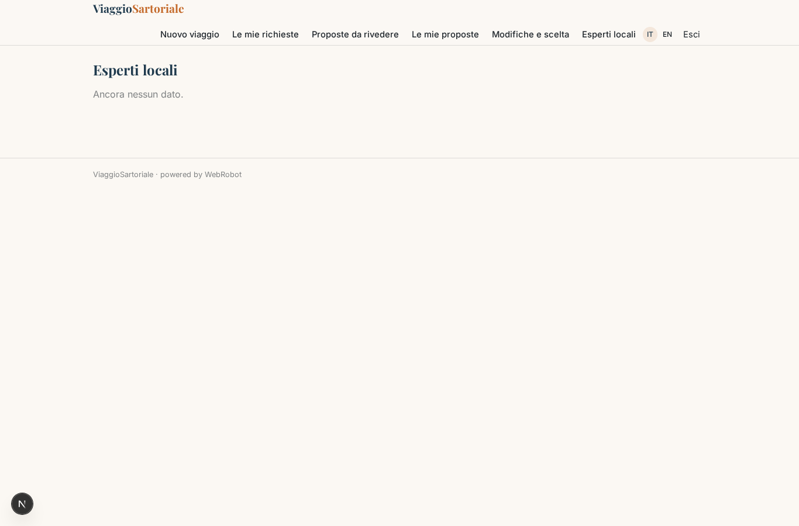
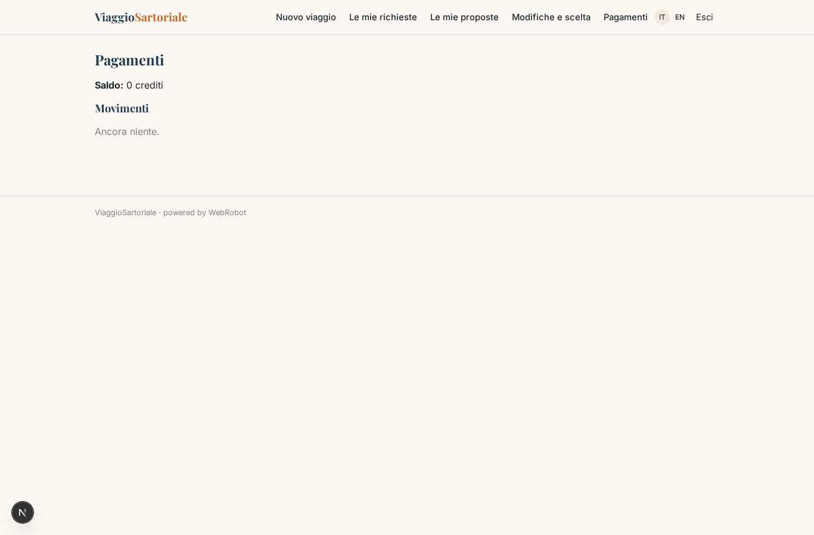

# ViaggioSartoriale

_Viaggi su misura, rifiniti da un esperto locale._

**Manifest status:** valid (schema validator + runtime contract)

## Description given to the app builder (Italian)

ViaggioSartoriale propone viaggi su misura costruiti con un esperto locale. Il viaggiatore, anche senza account, compila un modulo con destinazione o regione, date, numero di persone, budget, interessi (enogastronomia, arte, natura, sport) e ritmo preferito. Una squadra di agenti prepara tre proposte di itinerario diverse usando open data degli enti turistici, OpenStreetMap e Wikidata per luoghi, distanze ed eventi; non uso dati delle agenzie di viaggio online. Le proposte vengono assegnate a un esperto locale registrato sulla piattaforma per quella zona, che le rivede, aggiunge consigli personali e strutture di fiducia, e le approva. Entro 24 ore il viaggiatore riceve un'email con le tre proposte e un link per sceglierne una e chiedere modifiche in chat con l'esperto. Quando conferma, paga un acconto con carta e l'esperto riceve la sua parte. Il viaggiatore vede solo le proprie richieste, l'esperto solo quelle della sua zona, l'admin tutto. Monetizzazione: commissione sul viaggio venduto. Interfaccia in italiano e inglese.

## Features not expressible today (spec.extensions)

- **anonymous_request**: Anonymous travelers cannot submit a request yet (an agent run needs an owner): the traveler signs in with a one-click email link before sending the form.
- **email_delivery**: Email with the three proposals within 24 hours is not available (no notifications yet): the traveler sees the proposals in the app once the expert approves.
- **expert_area_assignment**: Assigning each request to the expert registered for its area, and showing the expert only requests of that area, needs custom logic: for now every expert sees the review queue and the admin should assign it.
- **expert_chat**: Live chat between traveler and expert is not available: the assistant collects change requests and the expert validates them.
- **deposit_payout**: Per-trip deposit checkout and the split to the expert's Stripe Connect account (platform commission 15%) must be wired to the confirmed proposal; experts connect their Stripe account first.

## Screenshots (interpretive runtime)

### home-anon

### home-mobile

### home

### new

### trips

### reviews

### proposals

### refine

### experts_admin

### account

