# VoceDelMercato

_Ascolta cosa dice il mercato di te e dei tuoi concorrenti._

**Stato manifest:** valido (validatore Python + contratto runtime)

## Descrizione data all'app builder

Mi serve VoceDelMercato, una piattaforma di consumer intelligence per marketing manager e agenzie. L'utente crea un progetto di ascolto indicando brand, concorrenti, parole chiave, esclusioni, lingue, paesi e periodo. Ogni notte gli agenti cercano sul web e raccolgono contenuti pubblici da fonti lecite: feed RSS di testate e blog, forum che permettono la raccolta nei termini d'uso, recensioni pubbliche e Reddit tramite API commerciale. I social che vietano lo scraping non vanno toccati; se il cliente ha un abbonamento ufficiale alle API di un social, lo collega con la sua chiave. Ogni contenuto viene deduplicato, classificato per sentiment, emozione, tema e tipo di autore (consumatore, giornalista, brand) e indicizzato in un motore di ricerca full-text. La dashboard mostra volume nel tempo, quota di voce rispetto ai concorrenti, temi emergenti, citazioni rappresentative con link alla fonte e una mappa per paese. Un analista può chiedere in chat 'perché a ottobre è salito il sentiment negativo?' e l'agente risponde con evidenze. Alert email quando il volume negativo supera una soglia. Report PDF mensile approvato dall'analista prima dell'invio al cliente finale. Ruoli: admin agenzia, analista, cliente in sola lettura sul proprio progetto. Abbonamento per numero di progetti e menzioni; interfaccia italiano e inglese.

## Funzioni non esprimibili oggi (spec.extensions)

- **email_alerts**: Email alert when negative volume exceeds a threshold, and sending the approved PDF to the end client: notifications are not available yet. For now negative volume is visible on the dashboard and the approved report is printable to PDF.
- **client_read_only_share**: Client role with read-only access to their own project only: sharing a project instance with a client user is not yet expressible; the client role currently sees what the agency grants.
- **search_engine**: Dedicated full-text search index with relevance ranking: mentions are searchable through the app's collection search; a separate search engine is not configured.
- **social_api_connectors**: Connecting a customer's own official social API key needs per-customer credentials, not available yet; the project only records the intent.
- **country_map**: A true geographic map is not a built-in block; countries are shown as a bar chart.
- **monthly_report_schedule**: The monthly report is started by the analyst from the form; automatic monthly generation per project is a later step.

## Screenshot (runtime interpretativo)

### home-anon
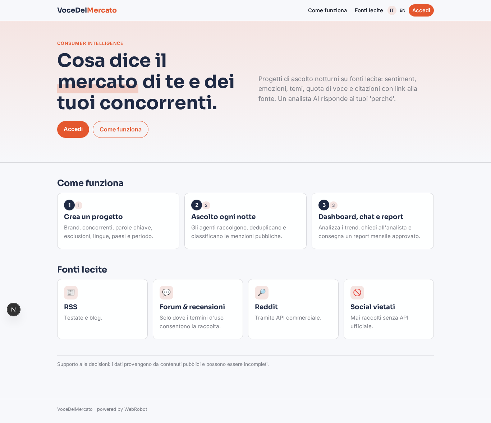

### home-mobile
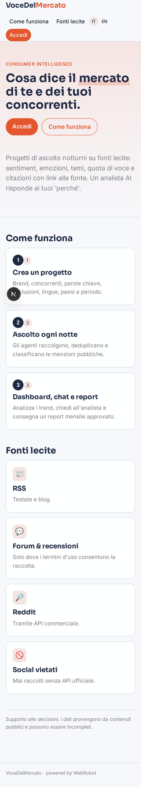

### home
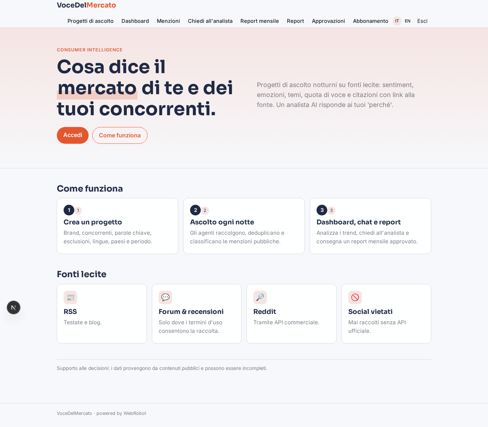

### projects
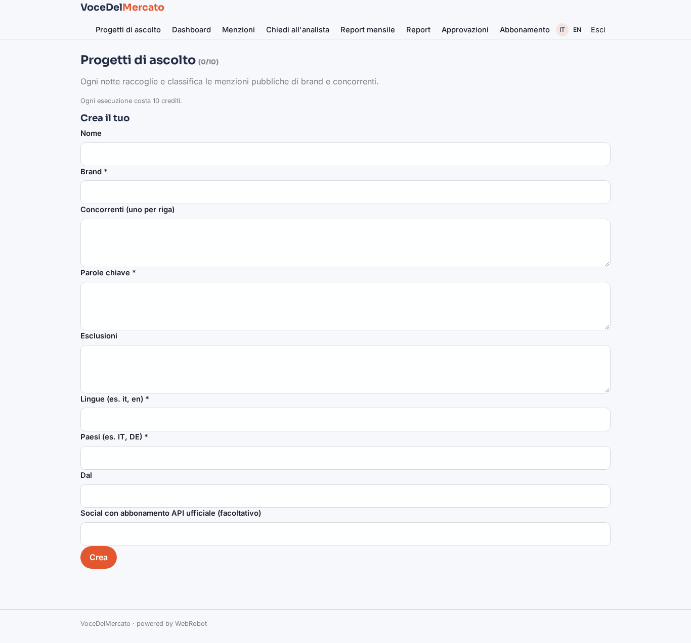

### dashboard
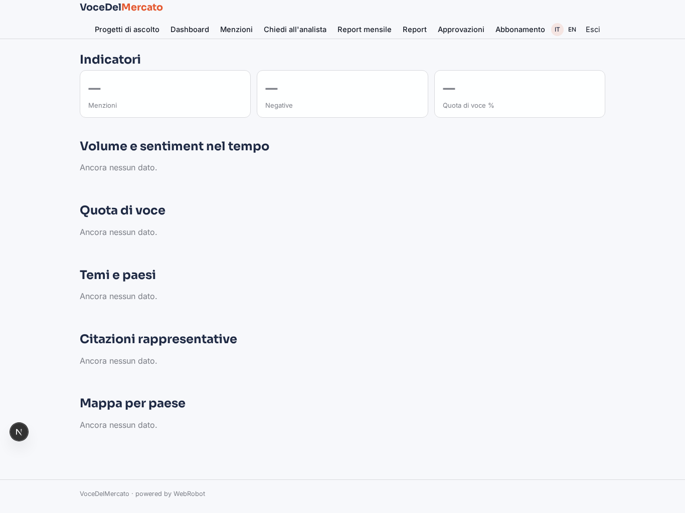

### mentions_view
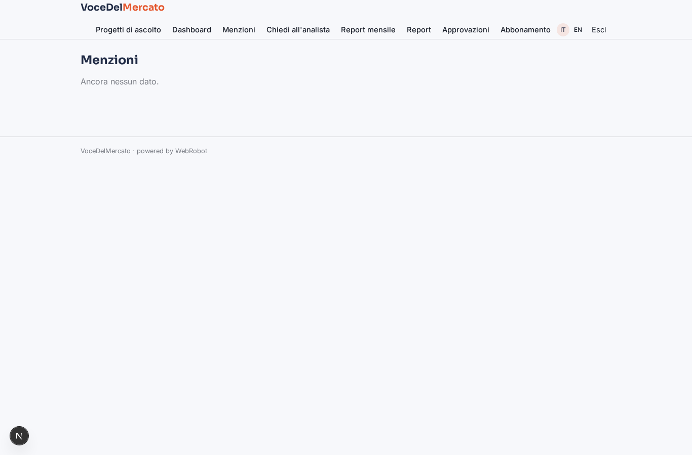

### ask
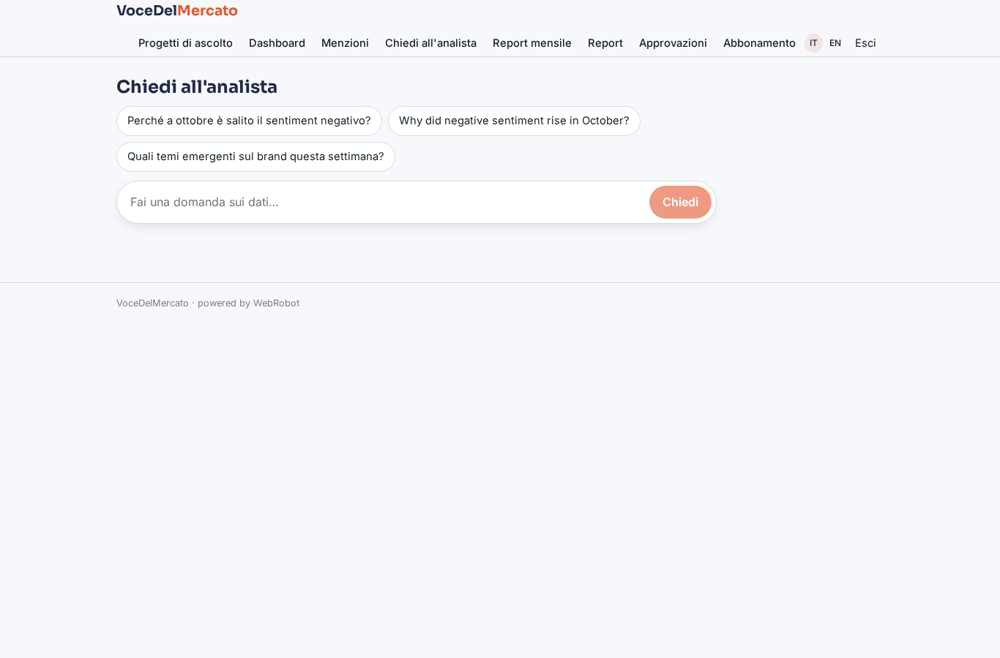

### new_report
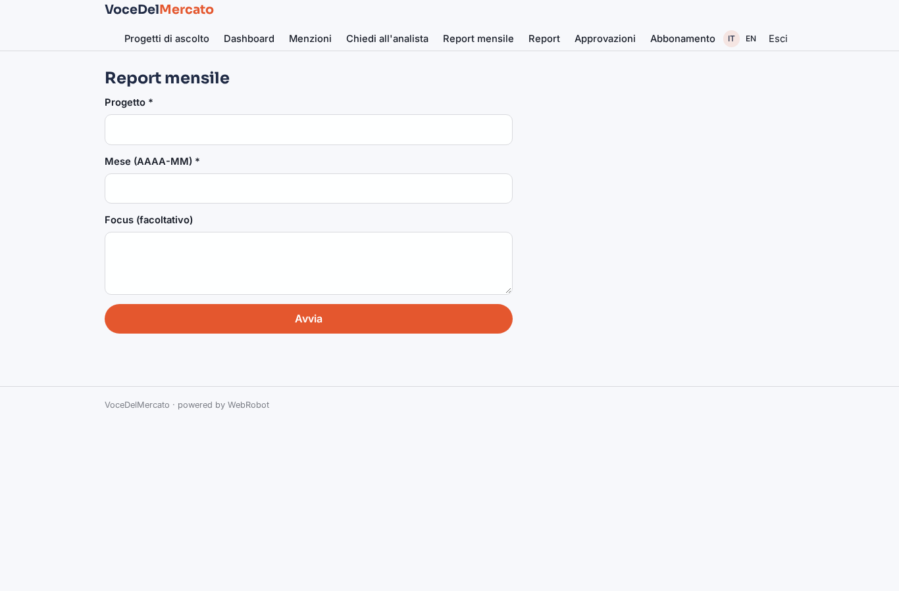

### reports
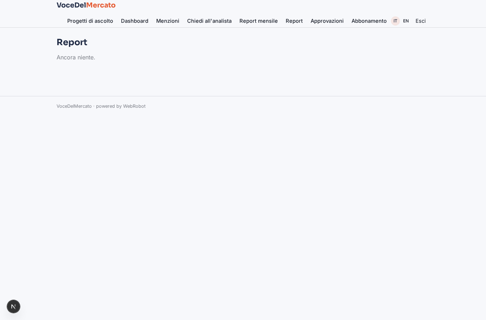

### approve
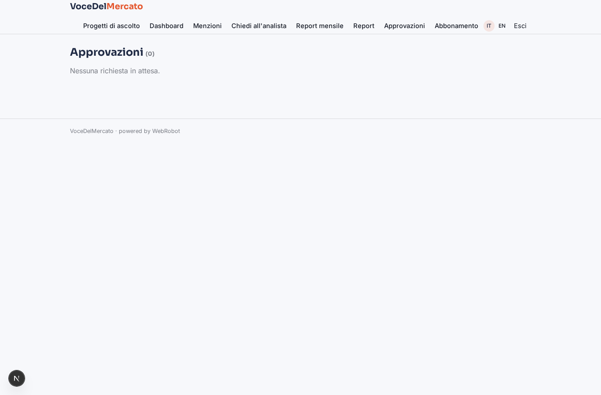

### account
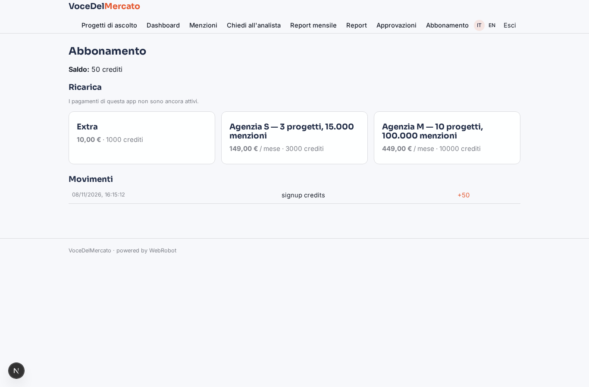

