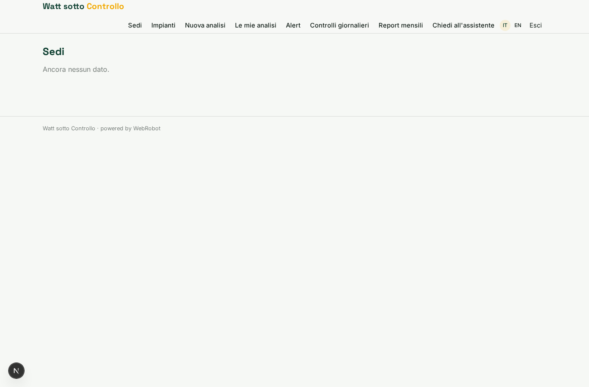
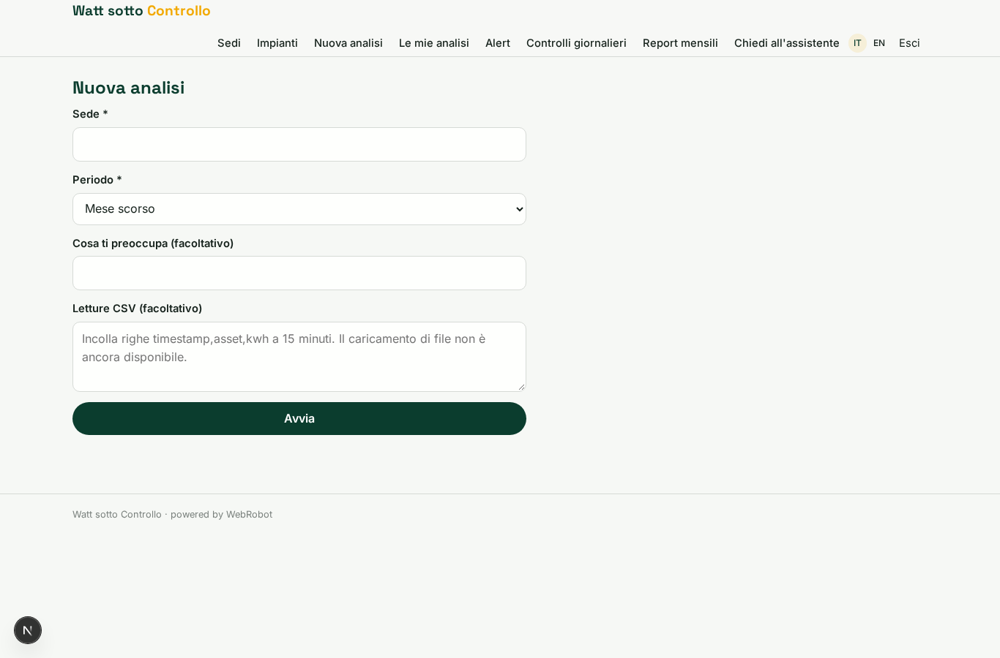
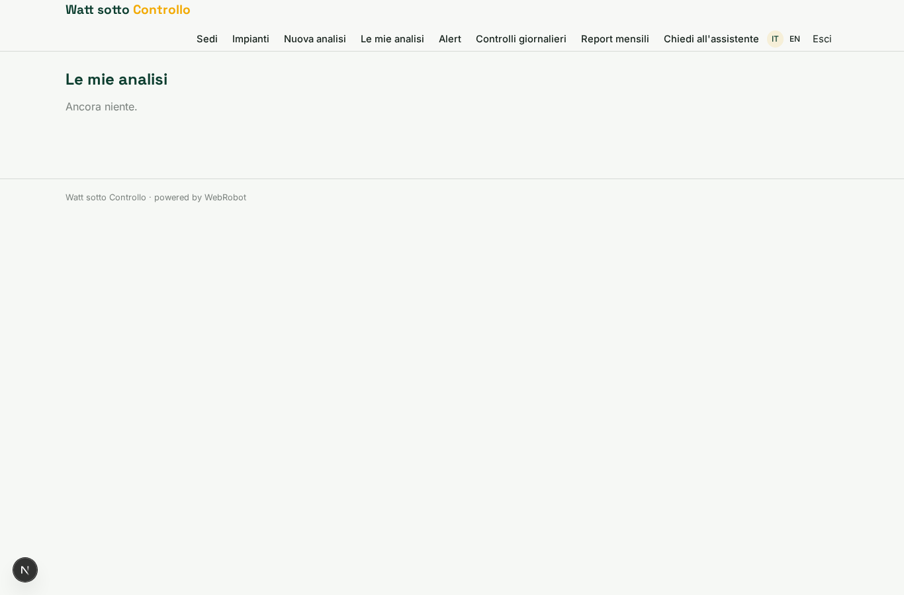
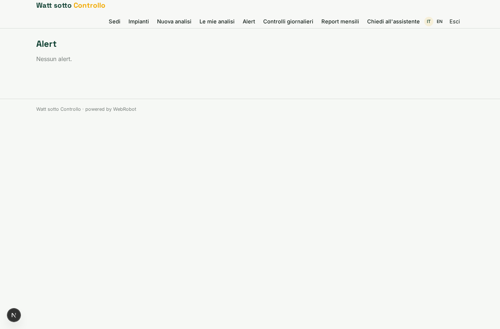
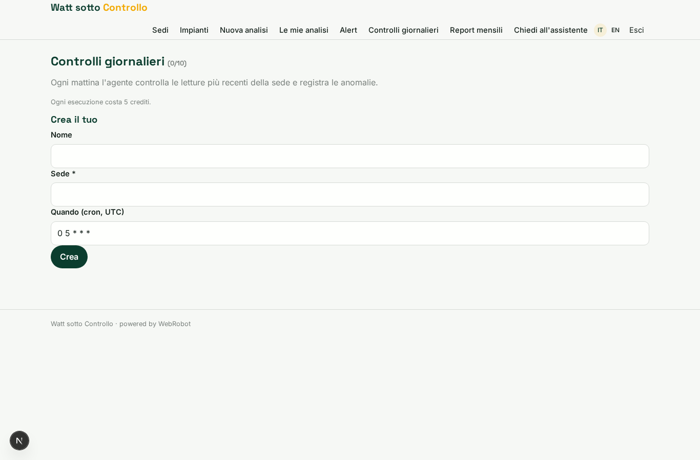
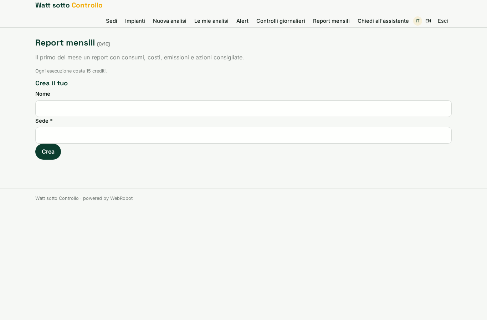
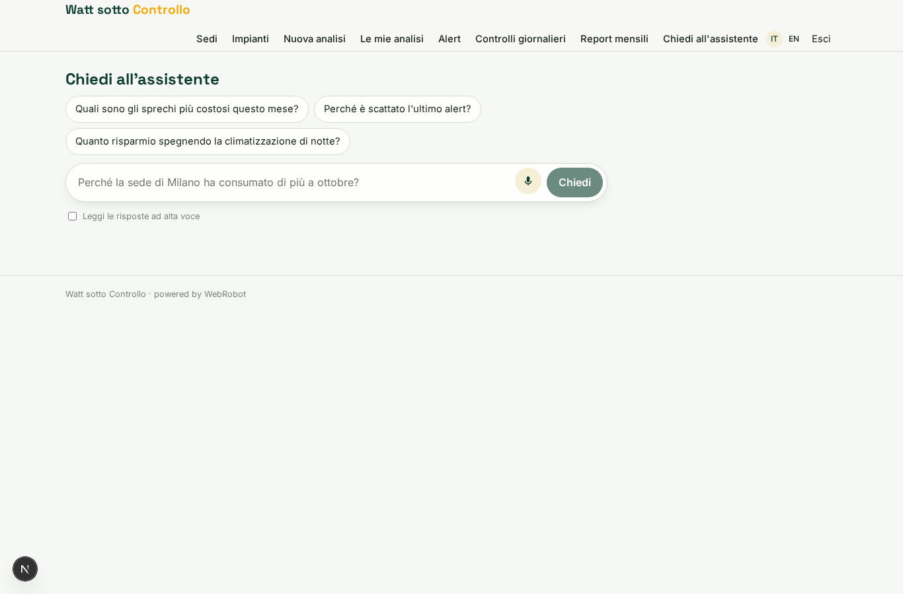
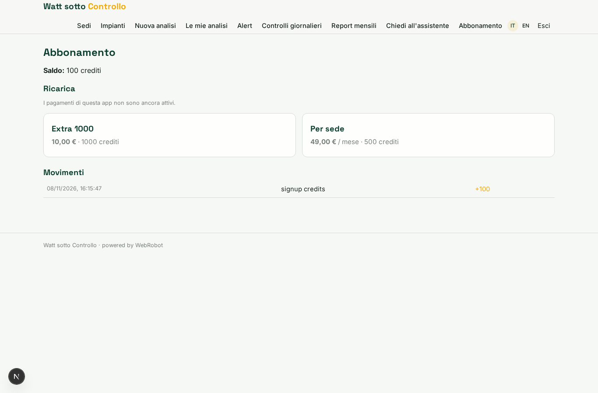

# Watt sotto Controllo

_Trova gli sprechi di energia dei tuoi edifici e sai quanto risparmi._

**Stato manifest:** valido (validatore Python + contratto runtime)

## Descrizione data all'app builder

Voglio Watt sotto Controllo, la piattaforma di analisi per un servizio che monitora i consumi energetici di edifici commerciali e industriali con sensori installati. Descrivo solo lo strato software: l'installazione dei sensori e l'hardware sono a parte. Il gestore dell'edificio si registra, descrive le sedi, gli impianti (climatizzazione, illuminazione, linee di produzione) e gli orari di attività. I dati dei sensori e dei contatori dovrebbero arrivare in automatico ogni quarto d'ora; per ora possono anche essere caricati in CSV. Un agente analizza le curve di consumo, individua sprechi come impianti accesi di notte o nei festivi, picchi anomali e apparecchiature che consumano più del normale, e stima il risparmio di ogni intervento usando i prezzi dell'energia del contratto. Quando rileva un'anomalia in tempo reale manda un alert via email. Ogni mese arriva un report con consumi, costi, emissioni e azioni consigliate, e in chat il gestore può chiedere spiegazioni. Il manutentore vede solo gli alert sugli impianti di sua competenza. Abbonamento mensile per sede.

## Funzioni non esprimibili oggi (spec.extensions)

- **realtime_ingestion**: Automatic ingestion of sensor and meter data every 15 minutes (and real-time anomaly detection) is not available yet: for now readings are pasted as CSV and the monitor runs once a day.
- **email_alerts**: Email alerts on anomalies and the email delivery of the monthly report are not available yet: alerts and reports appear in the app.
- **maintainer_scope**: The maintainer sees only alerts on his equipment through per-record viewer invitations on alerts (inviting the email in assets.maintainer_email); automatic sharing by that email needs custom logic.
- **per_site_billing**: The plan is a single per-site subscription; charging one subscription per site actually created (quantity) needs custom billing logic.
- **csv_file_upload**: File upload of CSV is not available: users paste the text or later use the automatic ingestion.

## Screenshot (runtime interpretativo)

### home-anon

### home-mobile

### home

### sites_list

### assets_list

### new_analysis

### analyses

### alerts_table

### watches

### monthly

### assistant

### account

