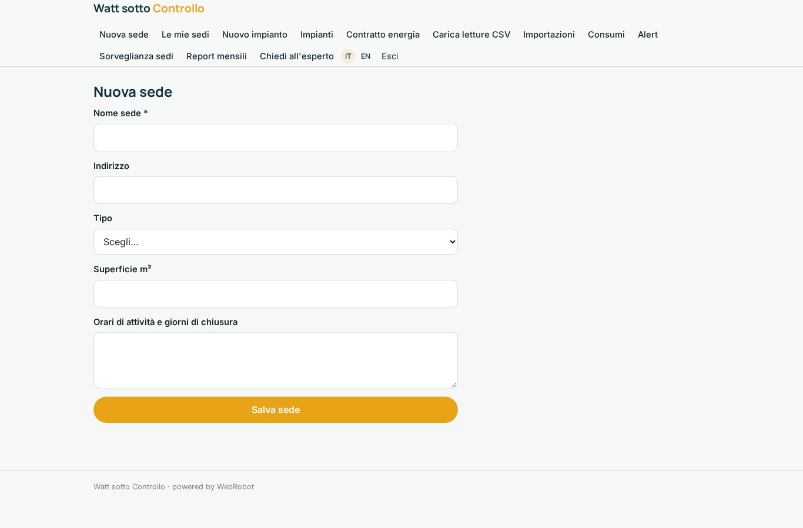
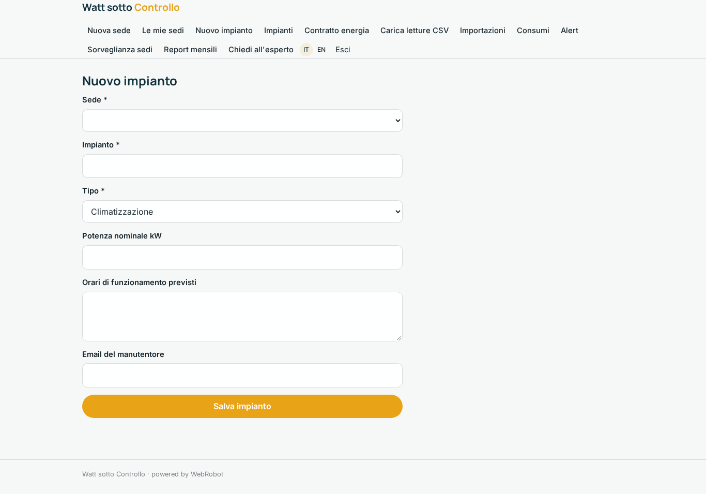
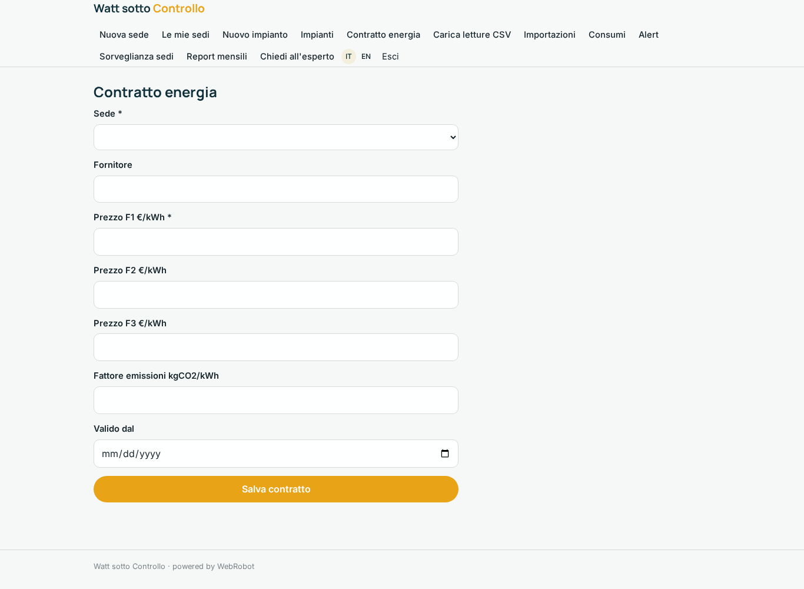
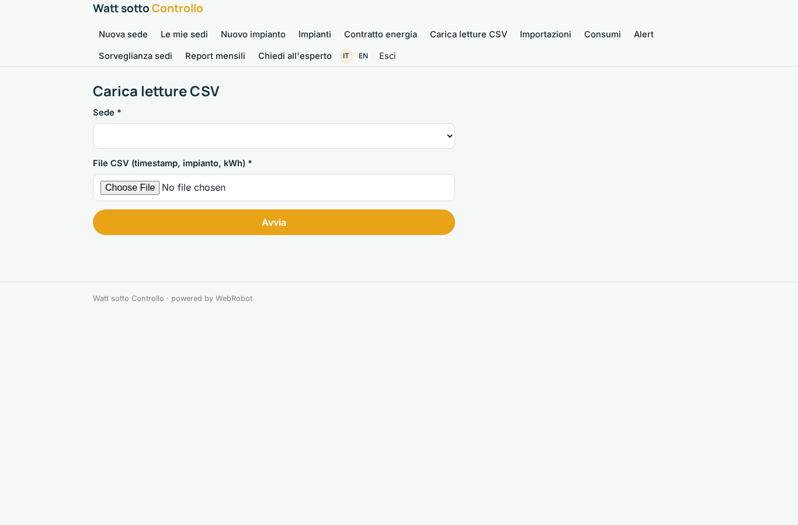
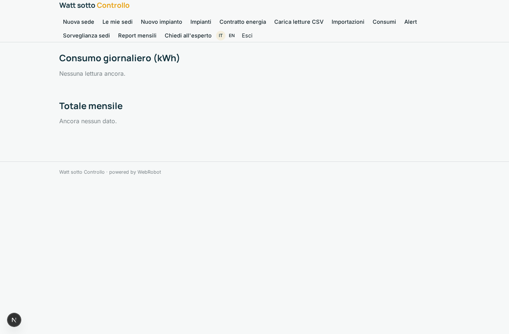
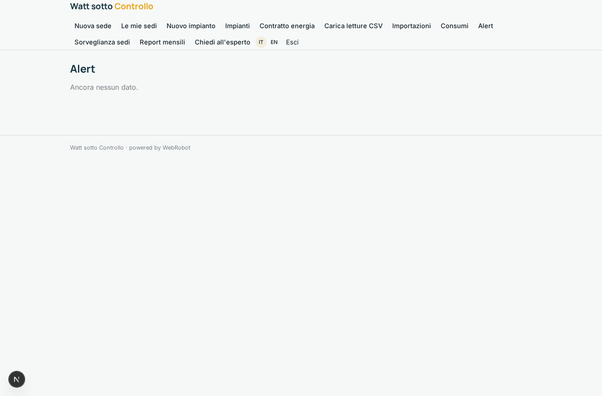
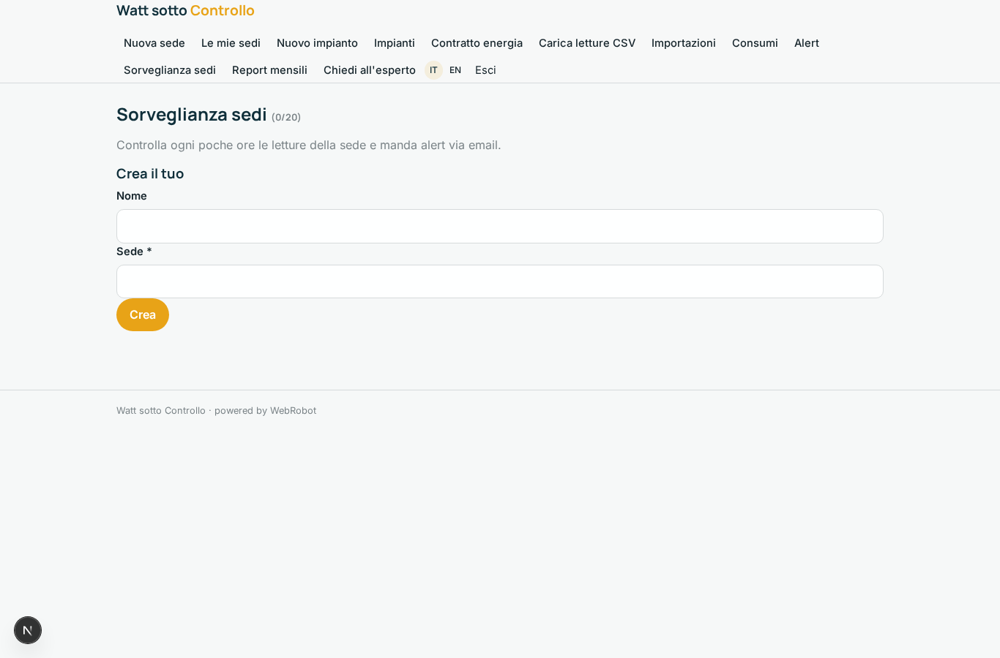
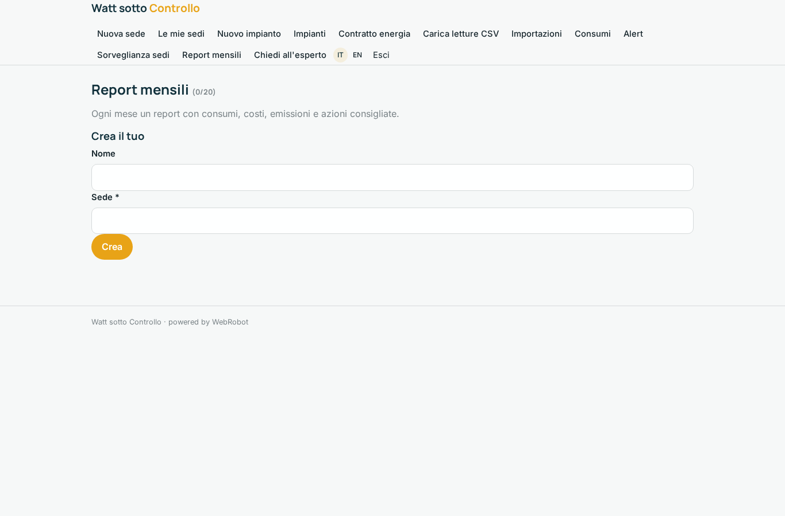
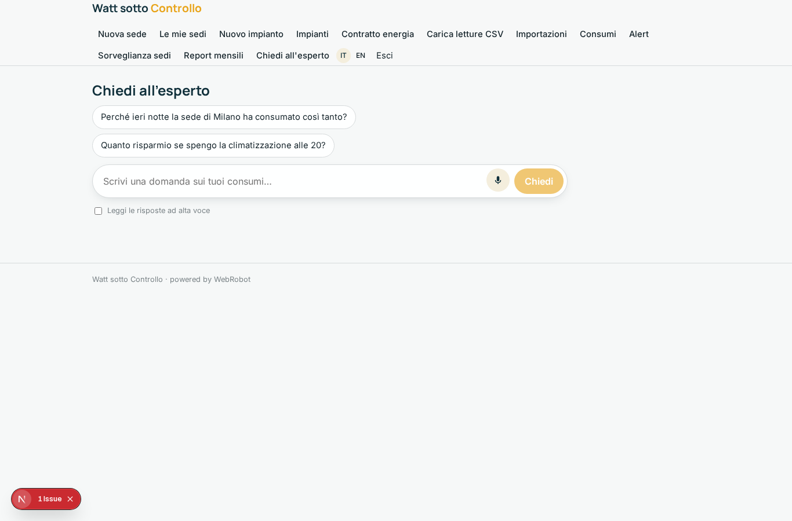
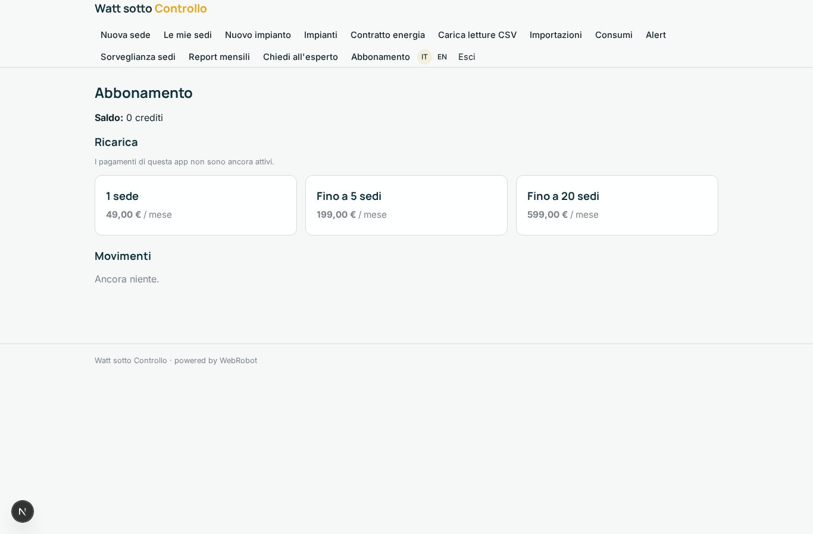

# Watt sotto Controllo

_Trova gli sprechi energetici dei tuoi edifici prima che li paghi in bolletta._

**Manifest:** valid (schema + runtime contract) · **Functional test:** passed (21 checks passed)

## Description given to the app builder (Italian)

Voglio Watt sotto Controllo, la piattaforma di analisi per un servizio che monitora i consumi energetici di edifici commerciali e industriali con sensori installati. Descrivo solo lo strato software: l'installazione dei sensori e l'hardware sono a parte. Il gestore dell'edificio si registra, descrive le sedi, gli impianti (climatizzazione, illuminazione, linee di produzione) e gli orari di attività. I dati dei sensori e dei contatori dovrebbero arrivare in automatico ogni quarto d'ora; per ora possono anche essere caricati in CSV. Un agente analizza le curve di consumo, individua sprechi come impianti accesi di notte o nei festivi, picchi anomali e apparecchiature che consumano più del normale, e stima il risparmio di ogni intervento usando i prezzi dell'energia del contratto. Quando rileva un'anomalia in tempo reale manda un alert via email. Ogni mese arriva un report con consumi, costi, emissioni e azioni consigliate, e in chat il gestore può chiedere spiegazioni. Il manutentore vede solo gli alert sugli impianti di sua competenza. Abbonamento mensile per sede.

## Features not expressible today (spec.extensions)

- **webhook_device_mapping**: I contatori inviano le letture a POST /api/hooks/meter_feed con il segreto dell'app; l'associazione del dispositivo al cliente (proprietario delle letture) va configurata in fase di attivazione.
- **realtime_alerts**: Gli alert sono 'quasi in tempo reale': l'agente controlla le letture ogni due ore (costo AI), non a ogni quarto d'ora. Un rilevamento continuo a soglia richiederebbe codice dedicato.
- **sms_push**: Alert via SMS/WhatsApp/push non disponibili: solo email.

## Screenshots (interpretive runtime, no data)

### home-anon

### home-mobile

### home

### sites_form

### sites

### plant_form

### plants

### contract_form

### import

### imports

### consumption

### alerts

### watches

### monthly

### chat

### account

